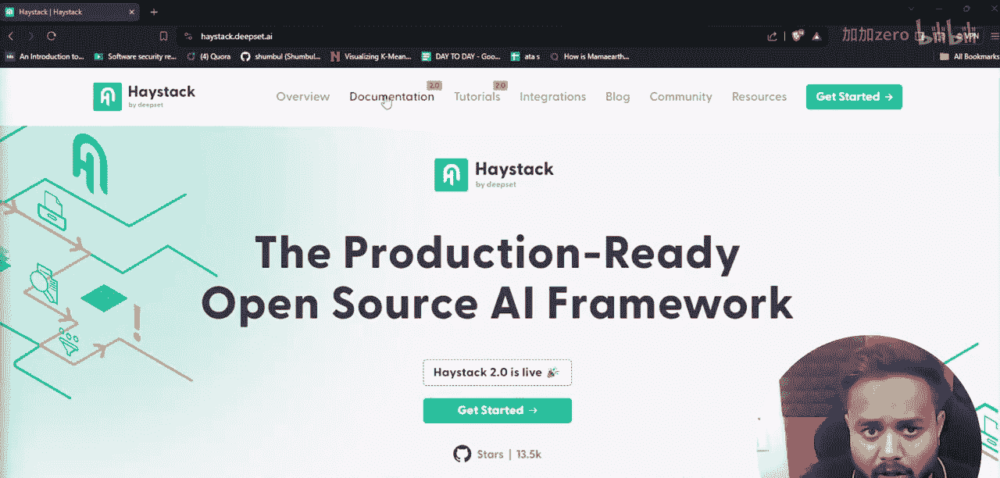
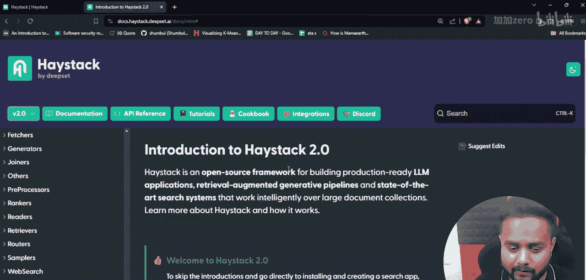
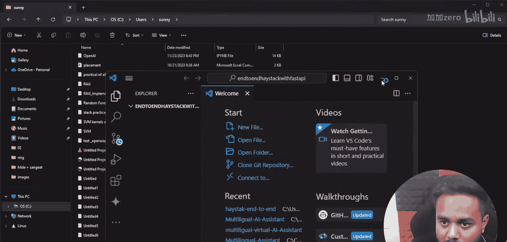
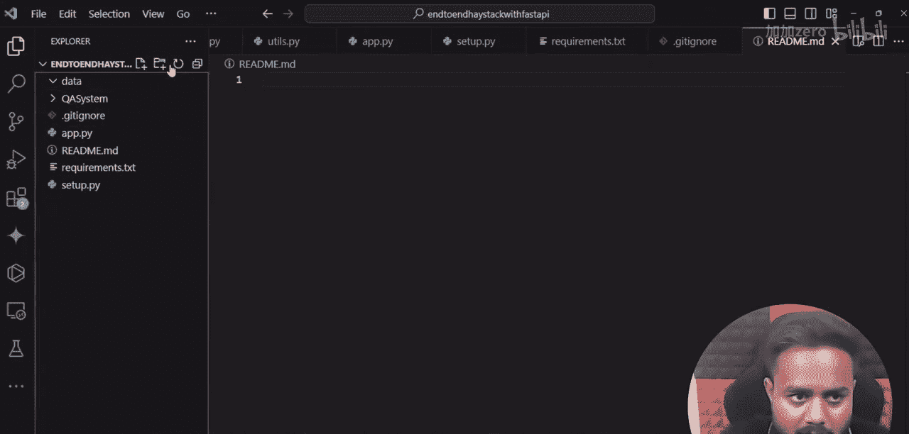

# Sunny Savita【中英⚡生成式AI：从初学者到专家｜Generative AI In-Depth Roadmap from Beginner to E】 p21 P21 End to End RAG Application Using Haystack MistralAI Pinecone & FastAPI #rag [BV1Uht8zDENA_p21]

Hello everyone。 welcomelcome back to my YouTube channel。 My name is Sunisa Vita and in this video。

 we're gonna implement one end to end project by using Hayt Mr AI pine con and fast API Yes guys So I was creating the video on top of the rag So if you will go and check with my YouTube channel So I created around8 to 10 video with respect to the rack where I started from very scratch I discussed the basic agenda of the rag。

 then I came to the how you can create the pipeline and all and then I discussed the red by using the different different framework。

 So first I started with the la， the lamite decks and by using this la decks and la I already created couple of project in the previous video I was talking about the hastag So how you can use this hayst what are the pros and cons we have with respect to the hast and what you have inside this new documentation of the hayst that is to point X So we try to。

😊，Explore that and we find out so many over there So that's why I thought why should not I create one end to end project where you can utilize a pin con be inspectspecor database where you can create the as by using the like this flask or fast API radio or sea or maybe you can use the different different model open source model I'm not focusing on the like the paid ones so here I will be completely focus on the open source itself So yes let's start with the implementation of this project soon you will find out so many video with respect to the rack and definitely I will be coming up with those video but here in this video let's cycle implement this project So first of all guys what I will show you I will show you the documentation of the Hast now here you just need to check with this documentation 2。

0 So this is the latest documentation of the Hast and behalf on this only。

A going to implement this entire project So here without wasting a time I will start with a project so I won't focus too much on theory for that like I will create a separate videos let's say if you want to understand about the Mr A if you want to understand about the hastag which I already covered in the theoretical term if you want to understand about the vector databases and all so definitely I will be creating a dedicated video on top of it。

 but here I will more focus on the project implementation only and I'm taking I'm taking a reference of this particular documentation So guys don't go with one point X because here lots of things depred and you will face a lot of issue So this is the stable documentation and you have to use this particular version of the haystag for creating the project So let's begin it So here guys what I'm going to do I'm going to implement this entire project in the V for itself and don't worry I will give with the clearcut architecture。

And what are text that we are going to use each and everything I'll be talking about here itself。

So what I'm doing， first of all Im going to open my folder right so in any drive in right D drive。

 you can open your folder， you can create the new folder and that particular folder you can open inside the V code Okay。

 so by a command from or by a Ui both is fine Now what I'm doing here So here I'm doing right click here I'm creating a new folder So my folder is going to be and to and。

Good stay。Okay and do enter here stack with fast API。

 So here I'm going to use fast API for creating the API。 okay the endpoint URL。

 Now this is what is my folder guys now here what I will do here I will right click on top of it and this particular folder I'm going to I'm going to open my Vs code so here in my Vs code basically I'm going to open this particular folder now see guys I open this folder inside my V code now I will show you from scratch that how to create the environment and all and how to do the entire setup So each and everything I will show you here itself and then see I'm showing you this thing in my all the videos whatever in whatever videos basically I try to create the project and also I started from scratch already so I will go little fast I will try to skip those thing I means I won try to explain you much if you want to understand in detail definitely you can visit my previous video so I can suggest you one live session which I took on top of the Lama index so。

There I created one Q system from sketch and I explain you the complete infrastructure setup。

 but soon I'll be like updating too much content on my YouTube where I will uploading the video how you can create the end to and development environment Okay for your AI development for your geneative A development now let's start let's a big So this is what this is my empty folder and each and everything we are going to do here itself。

 So the first first folder which we are going to create over here that's going to be a QA system right So here is what this is what this is my main folder and my folder name is going to be Q system Now inside this particular folder I'm going to create one file So manually I'm doing it because this is not a very huge project where where I have to create hundreds of folder No it's not like that So here I just have to create a couple of folder photo5 only so I can do it manually as well otherwise I can use any automated script and that。

I will show you in the later on project where we are going to implement any huge infrastructure okay now what I'm doing so here Im going to create this in file in dot Py。

Now inside this itself inside the Q system itself， I'm going to create two more file so the first file is going to be in just dot p okay so where I will be writing my each and every code for respect to the with respect to the ing data in I think you know about the rag architecture and all everything if you don't know guys just fit I will be like our little bit part so that you will get to know the context of this video if we are watching me first sign then only Now if you are following to mean then I think you will be champion in this particular thing like rag and all everything So what I'm doing so here I'm going to create one more file inside this particular folderer just click on it and then click on this icon and here you can simply write ing dot p So this is my new file now I'm going to create one more file here itself inside this particular code Now my new file name is going to be a retrieval retrieval and generation generation So this new file basically I'm going to create over。

Generation right do P by So here I will be writing the code with respect to the retrieval and the generation。

 Both code I will write inside the single file Okay now here。

The next file basically inside this particular folder which I am going to create the file is going to be u so here I am going to create this u do py so I have this three file inside this folder one is ingsion and second is retrieable and generation okay so first we ing the data and then well retrieve it and then finally will augmented by using the by using the LLM models。

Now， apart from this one guys， I want to create I want to create what I want to do tell me I want to create my past API。

 So for that also Im going to create one more new file that's going to bet p and it will be apart from this folder means outside of this main folder Now let me create few more So here I want to create a setup file so that I can use this particular folder as a local package I can install it。

 I can install it inside my local virtual environment I will create the environment along。

 don't worry everything and even I will give you the all the set in myme file So and I will upload it on my Github and then from there itself you can take this code So Q system in it ingetion retrieval utilize and here one more which is required that is called a requirementq and dox So this new file is required over here that requirement dox now if you want to initial slice。

😊，And also definitely for that a couple of file will be required so here I can create that also so here the new file is going to be let's say here I can write this Gi ignore so that later on I can update my code over the Github right so whatever thing I want to ignore I don't want to be discard I want to be discard from this local repository and the Github repository I can mention is that this Gi ignore couple of other file so here I can mention one more file read me dot so read me dot so this file also I can create and there I can write my all the like all the details and all regarding the project so that everyone can read it and everyone can understand it Q system get ignore at P read me required P a P I think most of the file we have created now let me create one more folder here not file folder the folder name is going to be a data because here we are going to read the data from the local directory itself we are not going to read how any cloud resources。

So those type of project also I will show you where we can read the data from as three from as we have developed or from the different different sources Okay so data Q system category at Py read me tx set Py I think most of the pile we have created over here now let's try to create the application means let's try to write the code and this is going to be a complete modular coding guys and here like you will get to know that how efficiently we are going to write each and every line of code okay so here you can see we have data now here inside this particular folder I'm going to keep my data Q system is here and then one more thing the which is。

