# Sunny Savita【中英⚡生成式AI：从初学者到专家｜Generative AI In-Depth Roadmap from Beginner to E】 p22 P22 Complete Automated Local Setup for AI (ML,DL,GenAI) Development With Vscode, [BV1Uht8zDENA_p22]

Hello， everyone。 Welcome back to my YouTube channel。 My name is Sunni Savita。 and in this video。

 well see that how you can do end to end project setup for your local system by using Vs code an aconda docker and gi。

 guys I was creating lots of video with respect to the end to end project And this was a very common question So Pa。

 can you teach the end to end project setup with respect to all the tool and the extension which you are using for a project building。

 So yes， today I came up with that video So here actually will try to see the end to end project setup。

 We are not going to implement any project we will just see the project setup and I will show you some useful extension as well for your geneative AI data science and AI related development。

 So here what I will do I will create one boilp or you can set template。 So later on， you can use。😊。

that boilerplate or template for any kind of project or for any kind of pOcs or development。

 So let's start。 So first of all guys here you can see here's my YouTube channel So on my YouTube channel I'm uploading a video with respect to the geneative AI so soon you will get the video with respect the python Nlp machine learning deep learning computer vision regarding each and everything So here you will find out so I was talking about the Ra pipeline I start with the rag pipeline how to understand the rag pipeline。

 What is the rag architecture how you can create the rack pipeline form scratch and then you will find out couple of project as well and before that I started with the g then Lama and then history of the Geneative A roadmap and all everything So if you are willing to learn Geneative that definitely you can check over here apart from that you will find out one end project as well by using the Lama index and Google g So you can check out。

else as well now let's begin let's start so first of all what we need to do first of all。

 let me write each and every requirement basically whatever thing is required whatever a software is required for this and end setup up So the first thing you can have Windows system Mac system or。

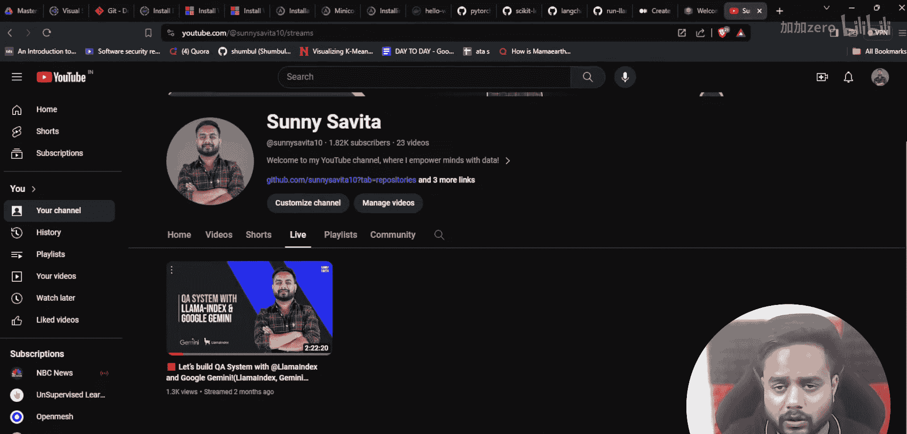

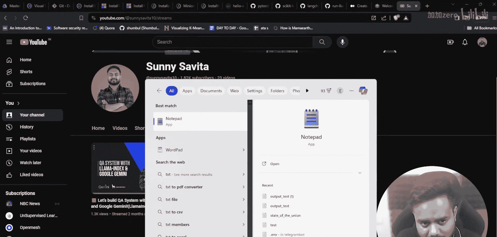

Linux system， not an issue with that。 So any sort of a system anywhere you can perform this end to end project setup。

 So we are talking about the windows。 So Linuxux basically so you can have any sort of a variant of that。

 let's say open to and sent to us you can have red it also there are so many variant of the Linuxux。

 So if you are using any sort of a variant you can do the setup over there。

 I will highlight those points over here Now the next one is what Mac So Mac1213 and 14 any sort of a variant of the Mac you can use for doing this setup or M1 m to chip any1 okay1 processor。

 Now Windows by so most sort of people are using windows and even here I'm using the windows So for the windows what will be the bare minimum requirement。

 So at least you should have 10 to so at least you should have Windows 10 or 11 along with that you should have at least4 to 8 G of。

Okay， at least i3 processor I i3 to i 5 I would suggest you I 5 not i3 because it's going to be very slow。

 So i 5 processor and apart from that you can have 500 GP hard disk okay so this much is the where minimum requirement for the Windows system if you don't have GP and all don't worry about it because we are not going to use the local GPU until we don't have that Rtx3090 or 4020 or any titanium version was version we are not going to use that so let's begin。

 let's start So what I will do first of all， let me write it down that what all software is required here So the very first software which is required that is nothing that is V code the second software which is required over here that is docker the third one is what the third one circuit and the fourth one is Ananaconda So if you don't have annaconda in that case means if your system is not supporting the heavy version okay。

The heavi Ananaconda in that case， you can use this miniconda as well。 So yes。

 miniconda you can use in place of this Ananaconda if your system does not support heavy software apart from that this Docker and code easily you can install inside the windows。

 but the bare minimum requirements Windows 10 and 11 Now why Docker is required because Docker plays very important role for any kind of development。

 whatever development you are doing So in any type of development。

 Docker plays a very important role and in our project also going forward。

 we are going to use the docker for setting up the vector Db or for setting up the other thing or even for the deployment as well。

 So we can run any application by using the docker。

 we can create the images we can run inside a container local project as well we can deploy it。

 So many users we have regarding the Docker that's why Ive included Docker Now one more thing you will find out over here the fifth1 P code extension。

 So here at the end I wish to。The vport extension， or maybe I will create one separate video if it is not going to be too long。

So let's begin first of all， what we need to do here。

 Let me write this extension and then you need to open your drive any drive you can open So here I am going to open this C drive because in my system I just have this C drive So here I will open my C drive and inside this drive I will create one folder so I will just do the right click and here here I will create one folder my folder name is going to be local set up for。

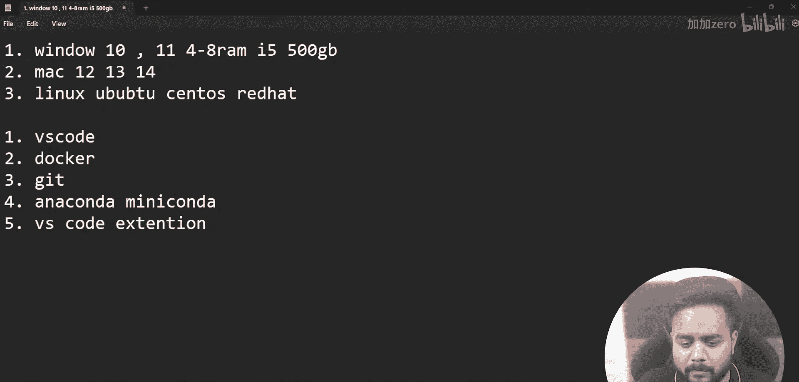

Lo set for AI okay AI development。 So this is what this is my folder name。

 Now I will use this particular folder for my project template creation because every project we create inside the folder itself whatever file inside the other directory you always create in one parent folder。

 So this is going to my parent folder。 Now first of all。

 let me show you all the link from where you will be able to download this V4 docker gate and aconda and other V extension So extension I will show you later on but let me show you the other one other software。

 So here is what here is the visual studio code So directly to search video studio installation So you will get this link and you can install it then heres the gi directly search about Gi install So here you will get this Git download So Git means what source code management Then you can simply search about this Docker installation and Docker installation for Windows Mac or line So you will get this particular page。

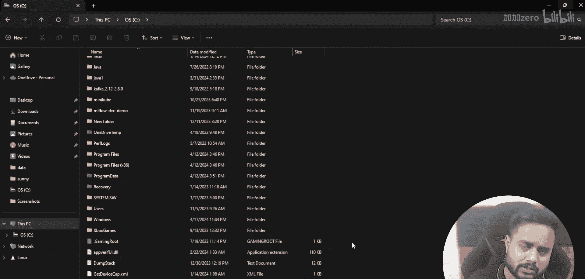

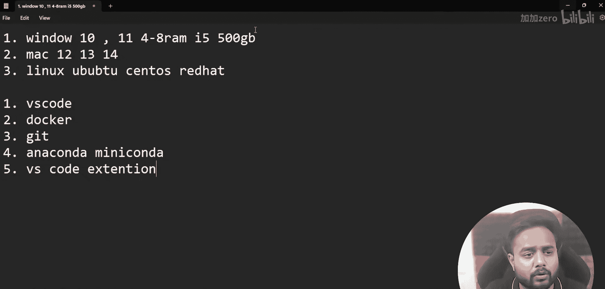

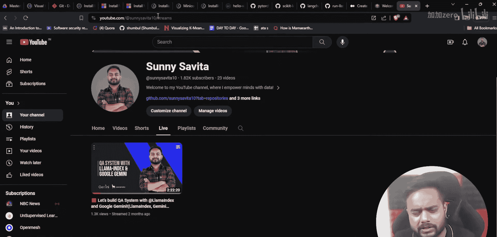

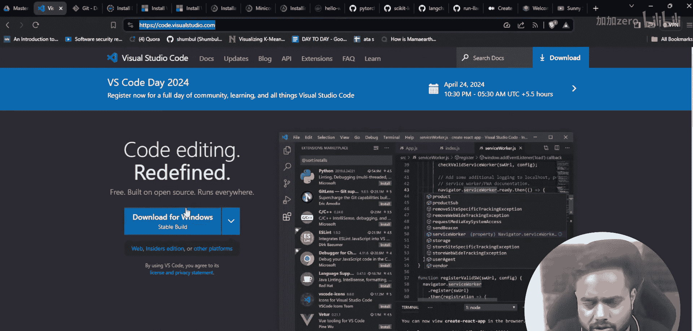

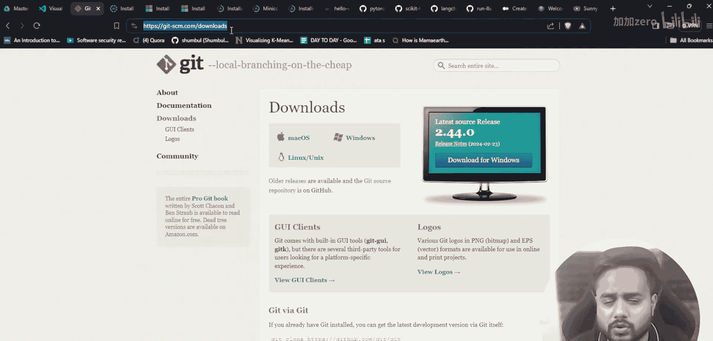

I specified each and everything that bottle thing is required for this docker for installation of this docker。

So the very first thing is what you need to do here。 first of all， you need to check the requirement。

 prerequisite。 So if you are satisfying this requisite prerequisite in that case。

 you need to download this Docker desktoptop and along with this Docker desktoptop。

 either wsl or hyperb back。 So here W SL is my choice you can utilize this you can download this wsl and here is a link for downloading so for installing this Wsl inside your Windows system you can read this particular documentation and just use this particular command Wsl install and then you can set up this Wsl inside your system。

 Windows subsystem Linux because this docker has been built on top of the Linuxux Excel So it required the Linuxux environment。

 So by reading this one you can download the Dockerl it's pretty easy Now apart from that you can see installation of the Ananaconda。

 So here is a link for installing the Ananaconda you can simply click over here install Windows Mac Linuxs and you can do that apart from this one you will find out。

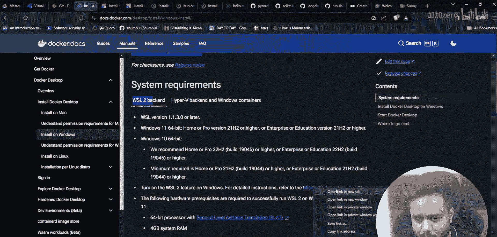

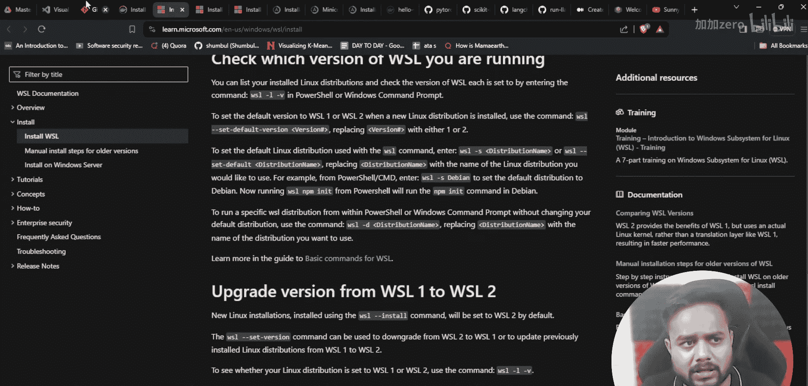

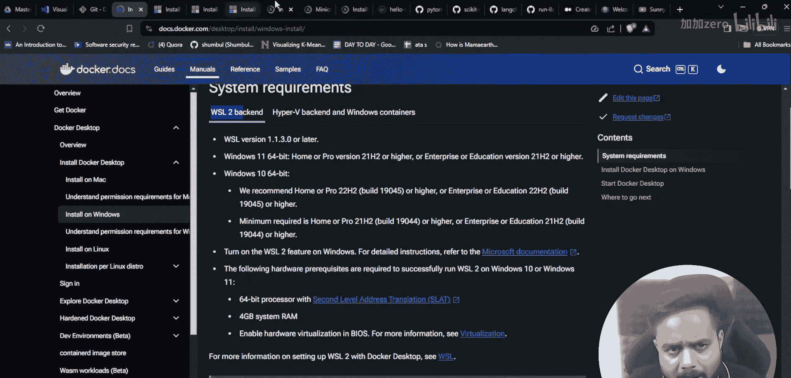

Miniconda。 So here you need to search about the miniconda。

 and you will get the link for downloading the miniconda as well。

 So installing miniconda wherever you want to install Windows or Mac and Linuxux anywhere you can install this miniconda。

 I will give you this entire link inside a description so that you can check it and you can download it Now。

 what will do here so here， guys。Will open my folder So after opening my folder here。

 you can see this is my folder。 Now what I will do see just do the right click on top of this particular folder and after doing the right click here you will find out many shortcut So I'm going to use this V code because each and every development each and every like project directory or the files and all everything I will create over here itself inside my vs code So just do the right click and open this folder inside the Vs code automatically once we will install that。

 you will get this vs code icon over here Okay in your shortcut Now just do the right click and here you can see Im able to this particular folder inside my Vs code Okay。

 so this is my folder now here I will be required my complete project structure。

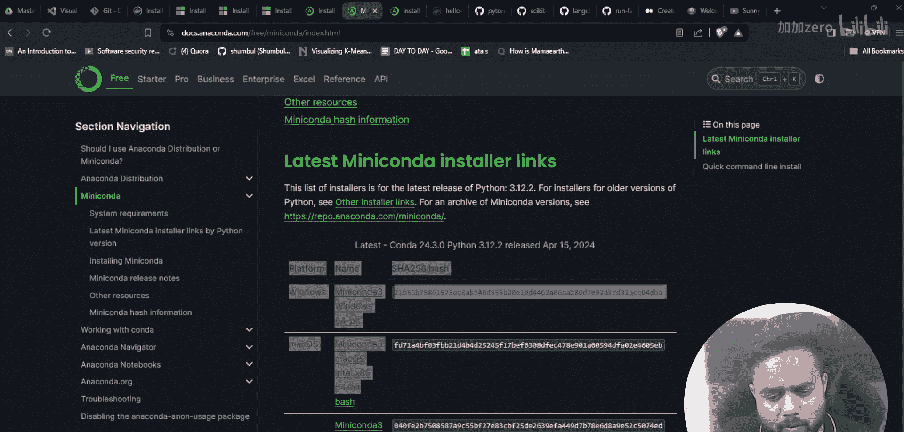

So first of all tell me I hope till here everything is fine everything is perfect if it is fine then you can mention in the comment section also is sir yes its going well and I am feeling happy also like after watching this end to end setup for the for the AI development now I required the project structure so for creating the project I structure。

😊，Each and everything is going to be automate over here。 I'm not going to write any manual command。

 single manual command here。 Okay， now whatever environment creation and all everything is going to be automated。

 Now， the very first thing which is required over here we we required one file。

 So here the file name is what。Project structure， So I see。

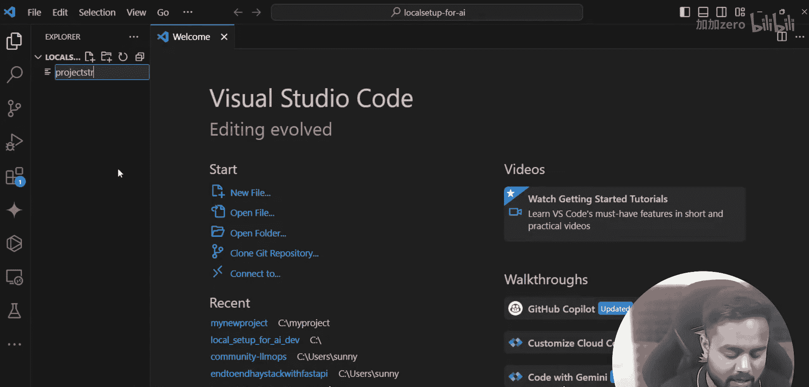