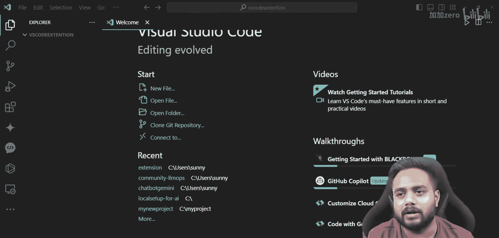
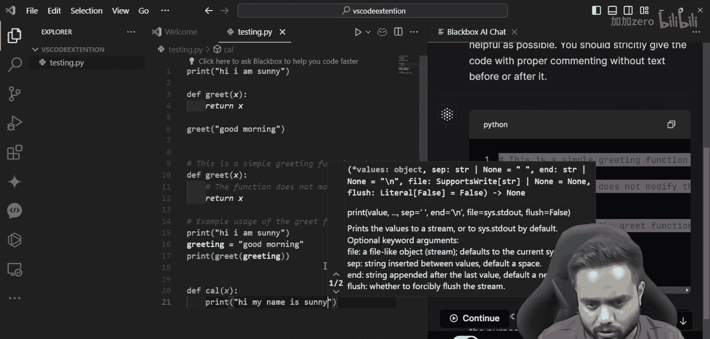

# Sunny Savita【中英⚡生成式AI：从初学者到专家｜Generative AI In-Depth Roadmap from Beginner to E】 p23 P23 25 Best VSCode Extensions for AI (ML,DL,GenAI) Devlopment In 2024 [BV1Uht8zDENA_p23]

Hello everyone， welcomecom back to my YouTubetu channel。 My name is Sunnyavita。

 and I'm packed with another exciting video。😊，So in my previous video I have shown you that how you can do and to a project setup for the AI development if I am saying the meaning is artificial so the meaning is data science generative AI machine learning deep learning anything which is relatively AI now in the previous video I told you that I have a very useful and a powerful extension for your AI development as well。

But I couldn't show you that the video was quite long， actually around 47 minutes。

 So that's why I discarded that part。 Now I recorded one specific video for the VS code extension now here I will show you one by one each and every extension and what extension you should install inside your V code from making your development a more easier or interesting one each and every we are going to discuss in this particular video。

 So let's begin。 first of all， let me show you my YouTube channel。

 So here guys you can see if you will go and check with my YouTube channel you will find out the different different video with respect to the rag and apart from that you will find out the video with chimney lama and history of the and apart from that you will find out the roadmap as well Im uploading I'm creating a video with spectral gene areas of now but soon you will。

Ha so many video on my YouTube channel with respect to the data science code， machine learning。

 deep learning， prison NLP and everything。 So in the previous session I shown you the development setup and I got a very good response from your side so I thought why should not I create one dedicated video on top of the extension as well first of all guys what I will do So here I will show you my VS code and here instead of B code guys where you will find out all the extent。

So here， just over your mouse left and side。 So here actually will find out one option。

 The extension option。 Just click over here。 Now here you will find out so how many extension I have installed inside my B code。

 see Ive seen that people are saying coding is a boring thing development is a boring thing guys it's not a boring。

 if we are doing in a right way。 So it's not a boring thing。

 and this extension this extension actually support us to make a development more easier and interesting one。

 I will show you that Now I can get I can give you very good example。

 I will just thinking that So let's say I am a student and I want to learn about a geneative A So as a classical student what I will do I will purchase a book form that particular I will be just reading and the other way basically what I will do。

 So I know some sort of a thing with a spectral geneative A means basically what is a。

and all and I know like what kind of a question I should ask right to someone or to the chat GpD or what should I search over the Google so that thing is going to be a more interesting compared to this。

Clical one。 So similar to that， if we are simply writing a code in my noteppa or some way So in that case。

 is's going to be pretty painful because we don't know anything about that code。

 we are just like putting the logic and we don't even know whether it's correct or not from where I should ask the help immediately at that place itself。

 So here this I and this extension comes into the picture which is really helpful for the development。

 Now let me show you that what extension I have in my system。 So I have in my system。

 I have around 3 to 40 extension， which I just installed to showcase you I generally use this 50 to 20 extension very frequently。

 but yes I kept many more over here。 So step by step basically I will show you each and every extension it is not possible to show each and every extension。

 but yeah let me highlight something over here and then I will give the list。

 I'm not going to this video I will keep as as small as possible because my other。o basicallyically。

 if you will see that so there you will find out on 40 to 5 minutes because I'm trying to provide you the in depth knowledge with respect to every topic from。

From everywhere。 Okay， so here I won't do that thing。

 I will give you the state for information of the extension。 Now， first of all， what I'm doing。

 So here I'm writing or I'm creating my file。 So testing dot P you guys， I'm a data scientist。

 Im a engineer， I'm a machine learning engineer。 So what I do I always write my code in the python。

 So as a data scientist as aI developer， you should always write the code in the python。

 but it is not mentally it depends on the project， it depends on the program。

 it depends on the like organization as well which language they are using you should make a habit to write in each and every language。

 Okay， means I'm saying you should be familiar with each and every i syntex because syntax is an all everything is same now inside the language Okay。

 so whether it's the Python， Java script， Java Gola and this that， whatever right。😊。

You should have that capability so that you can use any sort of a leg。Now， here， guys see。

 whenever I'm writing any sort of a code。 So let's see if I'm writing here print。

 simply Im printing something。 So now I'm getting a suggestion here。 Okay。

 I'm getting like so much suggestion。 Now here I'm writing this print。 And here。

 if I'm simply saying， I， I am sunny。 So， I am sunny。 So what I'm getting guys。

 So here I am getting too much suggestions too much like a different different description and all how I'm getting that。

 because I'm using some extension over here。 Now what is the meaning of extension if someone is asking you。

 what is the extension in a la extension means。😊，Some tools or some plugins， right。

 which is extending your functionality and。In softwareable。

 you will find out different different product and with respect to that product。

 you will find out the extensions。 you can say extension of plugins both are fine。

 which is enhancing the functionality of that particular software。

 the same thing we have seen with the chat GPT also if you will purchase the like advanced version of the chat GPT with a $20 per there you will find out lots lots of extension which you won't get in the the normal chat GPT。

 which is using 3。5 it Now here is testing。 and I just written one statement and I'm getting so much information Now how it is possible is possible because of the extension Now let me show you some other thing So here。

 let's say if I'm writing I'm writing one method。And here my method name is going to be C。

 It is suggesting to me method name as well like this。 So here。

 let's say I want to write my method is read G R W T。

 Now here is this suggested to me what you you want to use as a variable。

 So here let's say I want to use X。 And here let's say this is what is my method。

 and simply it is saying that whether you would like to like print or not no I don't want to do that。

 I simply I want to write it I'm getting so many things now here is X。 So here what I can do。

 I can simply call this method。 So if I want to call it。

 So if I'm going to call say Im getting this grid and simply I can pass my value so good morning or something。

 Now once I will learn it， I will be getting it。 Now once you will hover the mouse。

 you will be getting a lot of details and all and it is possible this thing is possible because of this extension。

 Now what extension is there that thing I will let you know Now here one more amazing thing。

 which I want to show you。 So here， let's say if Im。😊。

Clicking over here right click here to ask black box to help your code faster。

 Now if I click over here。 So I'm getting something here。 That is nothing that's a black box。

 right it's a black box extension， which is really helpful which is giving the access of the G model just guys which is give you the access of the G model and not that one along with that like so many thing right explain code comment code find box something at all So here lets if I want to explain the code simply I will click over here and here you can see it is explain in the entire code with a single click this black box right now if you want to ask the coding question here you can ask how I can make this code more readable right more readable R8able now here actually you will find here are giving the option So what you can do here simply you can do these type of changes is can add on the。

This variable name and all。 and you can you can then print it。

 So different different ways actually is showing you。 It is using DP model in the backend。

 Now new chat share refresh， continue。 So if Im click on the continue and here you can see if I will continue So again it will provide to me that particular interface new chat once I will click on the new chat。

 again I'm getting that interface now again， if I will right click over here command code。 So yes。

 it showing to me see it is giving me all the command and all So simply I can use this particular code from here and not guys this thing Okay it it is capable to it is capable for the debugging also right by using this one I can do debug let me show you how here let's see if I'm showing。

And here I am writing。K right can now here， let's say if Im passing something and my variable name is x。

 now what I'm doing， So simply Im printing something and in my print is I'm saying here so I。My name。

It is。这你O。

