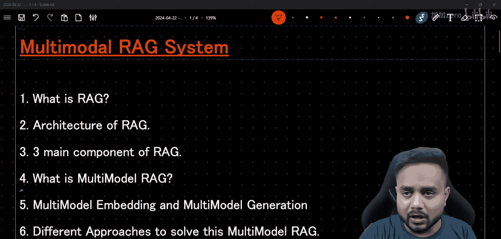
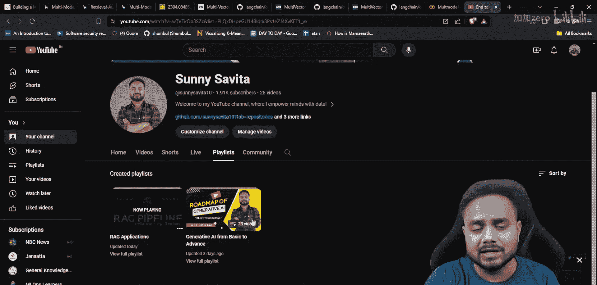
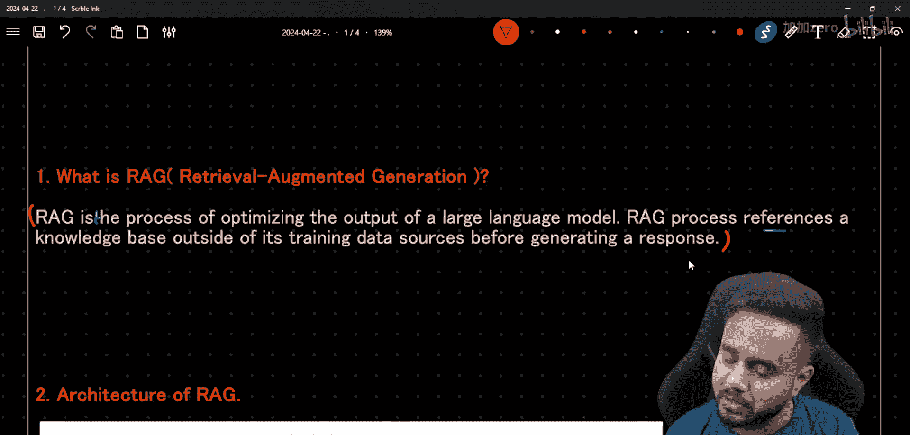
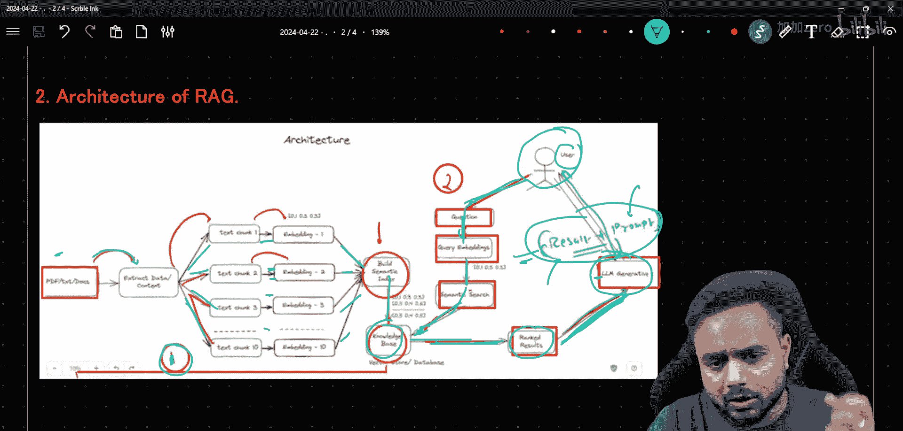
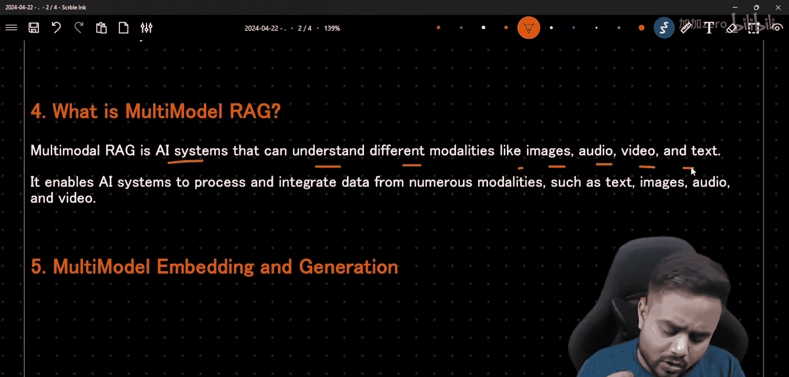
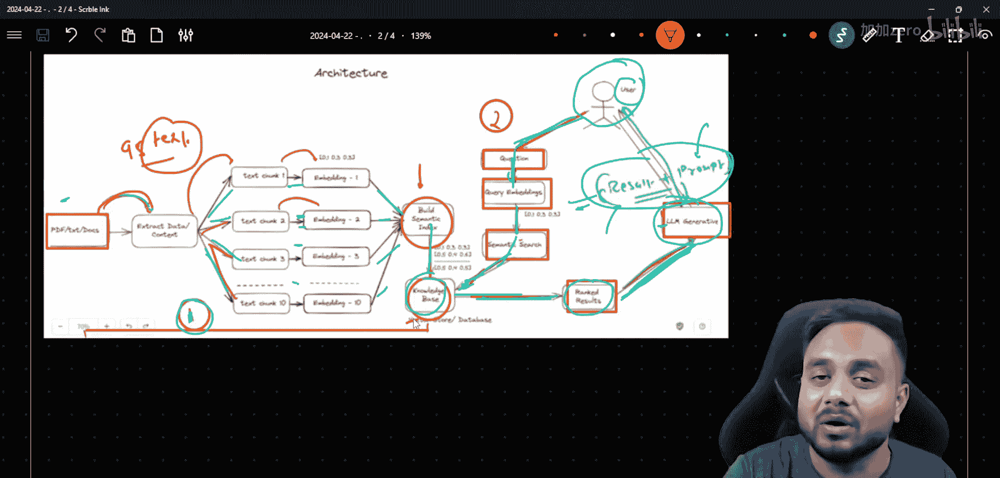
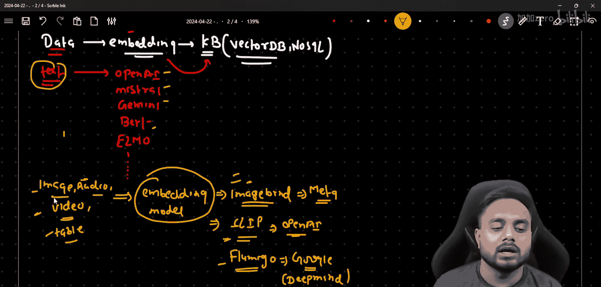

# Sunny Savita【中英⚡生成式AI：从初学者到专家｜Generative AI In-Depth Roadmap from Beginner to E】 p24 P24 Multimodal RAG Systems： Comprehensive Introduction to Next-Gen AI Technology [BV1Uht8zDENA_p24]

Hello everyone。 welcomelcome back to my YouTube channel。 My name is Sunny Savita。

 and in this video we'll discuss about multimodal rag system。 Yes guys。

 so Ive created many video on top of this rag。 So here if you will go and check with my YouTube channel So you will find out one complete playlist on top of this rag So there inside this playlist I discuss so many things so many concept regarding the rack and I try to cover this rag retrieve augment generation by using multiple framework。

 So if you haven't check guys， please go and check with this particular playlist。

 it will solve your many doubt regarding this rag Now in order to that I'm going to create one more video with respect to this rag and it's not going to be a single video So here there will be a multiple video regarding this multimodal rack system So I'm thinking around4 to5 video there I will be discussing different different practical。

😊。

This video will discuss the complete and detailed introduction of this multimodal rag Now here。

 this discussion I have divided into multiple points。

 What is a rag rag architecture component of the rag architecture then from the fourth point itself my main thing is going to be start So from here multimodal rag what is a multimodal multimodal embedding and multimodal generation So this is the heart or cold part of this multimodal guys multimodal rag system So please don miss out this fifth point is going to be very important then different different approaches to solve this multimodal rag and then use cases of this multimodal rag what kind of use case we can solve and in which what kind of use cases actually you will be required this particular concept then framework for building this multimodal rag this is also a very important thing Okay so at time I will show you the framework and all and then we start with the project development So first of all guys let's try to discuss。

The right I think you already know if you have seen my playlist if you have seen my previous video so what is the red case So right is a process of optimizing the output or for augmenting the output from the large language model right we are not directly generating the output from the large language model instead of that what we are doing first we are going to retrieve the like relevant document from the database and then we are passing to the LL model and then based on that L model we are generating the output right so here this definition is saying same you can read it and you can understand about this right system if you want to understand a detailed manner definitely you can check out with my previous video。

Got it now coming to the next point here。 So what is the architecture of the right。

 So here in the architecture Actually you will find out three main section。

 So here is what here is my data sources from there we are going to extract the data then I'm going to create a chunk from the data then here we are creating an em and finally after the em we are going to store inside the knowledge base got it So this is called first part first section which is called in insion of the data Then in the second actually in the second phase user is asking some query it is going from here means if user is asking some query it is going through this emdding model and then what we are doing we are going to find out the similar search and based on that we are going to generate the output relevant output then from here we are passing this relevant output to the LM and this LLM actually it is like taking this prompt and this relevant output that result and is combining both and finally it is generating an answer to the user。

 So let's say if。Model has not been trained on the particular data So what we can do here so like we can connect this model with out with the outsourced basically with this knowledge base and definitely we can generate the response without training on that particular data we can do that and that is like importance of the rag and that's why we use this rag we have two approaches one is fine tuning and the second is called rag。

 So here we are talking about this rag so this thing I already discuss So here I'm not going to waste my time now coming to the next point here。

 So here three main component of the rag I already discuss in retrieval and generation generation of synthesis Anything you can say both are fine here now coming to the main point guys for that I think you clicked on this video So the main point is what is a multimod right So here you can read the definition carefully So multimodal rag is an AI system that can understand different。

PartlessLike images， audio， video text So in the classical direct system。

 we were just working with the text data。 So here if you will look into the architecture guide。

 so we are going to extract the data， different different data actually from the different different resources and 95% time you will get the text data over here means in short。

 I can say I'm just dealing with the text data。 but here instead of the text。

 if I have some other data。

Right， like if we have images， if we have audio or video or let's say we have this table data。

 Okay tablet data now what we will do。What we do So how we are going to tackle that situation and in the real time many more use cases you will find out along with that type of data right where you will be having images。

 tags， videos audio table this that whatever Now how to process those data Yes。

 we are capable to process text data over here and we are able to store as an embetting in my knowledge base knowledge basease means what databases like No SQL SQL database。

 vector database generally we use no SQL or vector database。

 but here guys this data could be anything。How we are going to deal with that And for that only as an engineer as a developer。

 I have to create a system and that is called multimodel rag system。 Now。

 let's try read the definition again and you will get much more detail。

 So here multimodal rag is an AI system that can understand different modists like image audio video text。

 it enable AI system to process and integrate data from numerous mods such as tags images。

 audio and video。😊。

So as a classical system， we are not just going to use the text we are going to dealing with a different different type of data that is images。

 audio video and all but I hope you are getting my point now coming to the next point multimodal embedding and generation so here let me explain you this particular point because I told you it's a core heart okay it's the heart of this particular tutorial now let's say if we are getting a data from the source from anyone's source and this data is coming and this data actually I am doing a embedding of it and then we are going to store inside the knowledge base knowledge base is nothing knowledge base actually it is knowledge base I can say it's a database itself it could be like a vector database it could be like no sQL database any sort of a database you can consider here now here let's say initially we are going to like just dealing with the text data so for the text data we have。

A different different embedding model I think you know about it。

 so we have open air embedding model we have this Mr embedding。

We have gym embedding okay gym embedding now we are talking about the classical model So there you will find out the board embedding okay many transformer based model or you'll find out the Almo right Almo is also a model so regarding theal model you will find out there embedding model also now embedding is nothing actually just a numerical representation of that data numerical representation of the data correct it so there's those embedding I'm going to store inside the knowledge base now guys。

 let's say if install this text I am getting my data So here my data is going to be image。

My data is going to be audio my data is going to be video So from the video itself we can like get this images audio text and all I will show you how to process this video data in my next video So here let's say we have a different different type of data let's say we have tabular data tables which we are extracting from our like documents and all So for those actually will be required the model right embedding model which which model I will be required the embedding model now those model is called those model for multimod em model multimod embedding model So we have different different type of model So I know a couple of name which I have used like in a different different projects and all So here I have used one model that is image mind So it's a Microsofts model or some meta model I forgot that I think it's a meta model this image bind So meta has created this model meta is Facebook and you can use this particular model for creating a embedding which is respect to this image audio video and even the table。

Right。Apart from this one， you will find out the clip right， so clip actually is a open A model。

Open AI model and this is also very famous。 So here I think the full form of the clip concent like this language image between right this is the full form of the clip it's a open AI model now we have one more model which I use in one one of my PC that was a flamingo So Fleming also is is a model actually it's a model I think it's from the Google So it's a research of the deep mind and deep my wall deep deep mind actually it was under the Google itself okay it's a Google department for the AI all So this Fleming is also there clip is also there image mind is also there directly actually see if we have a text data So for that we can use this particular model but let's say。

