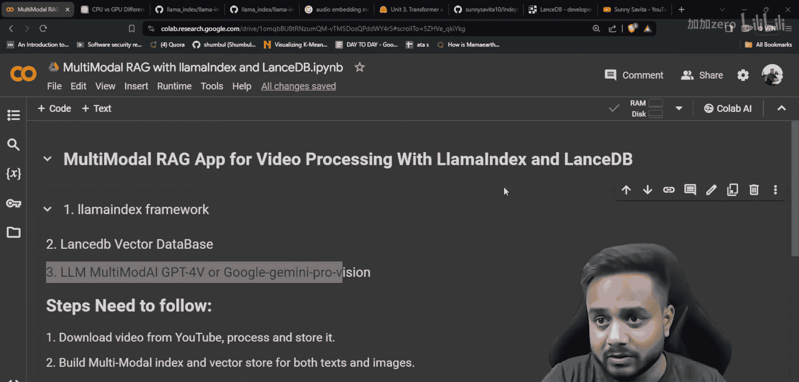
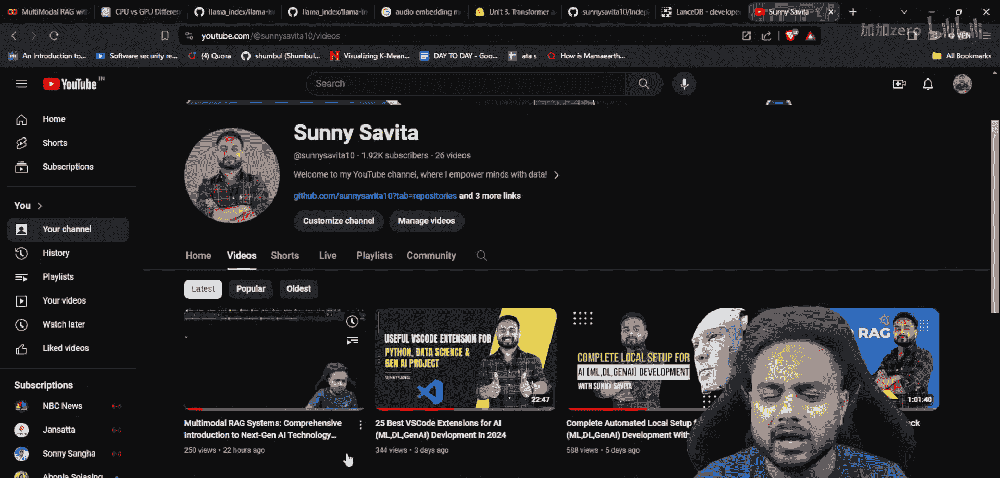
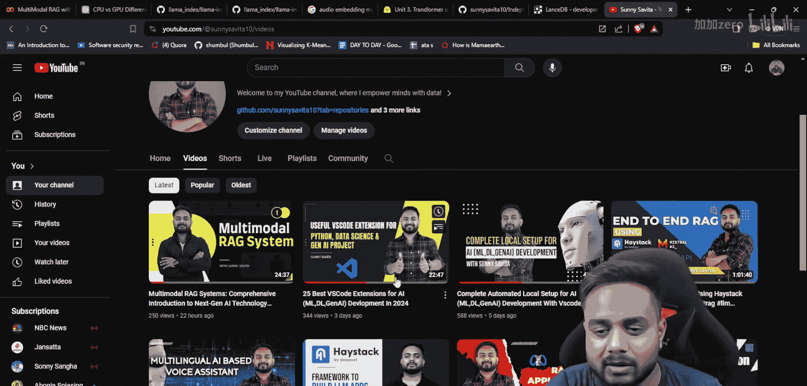
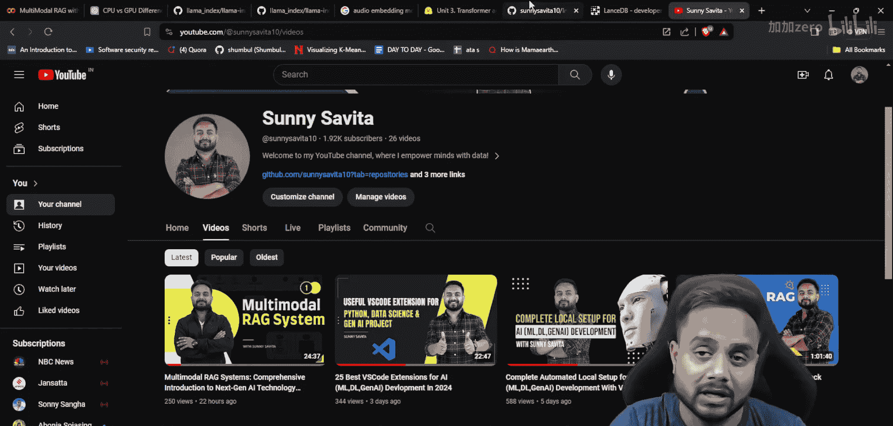
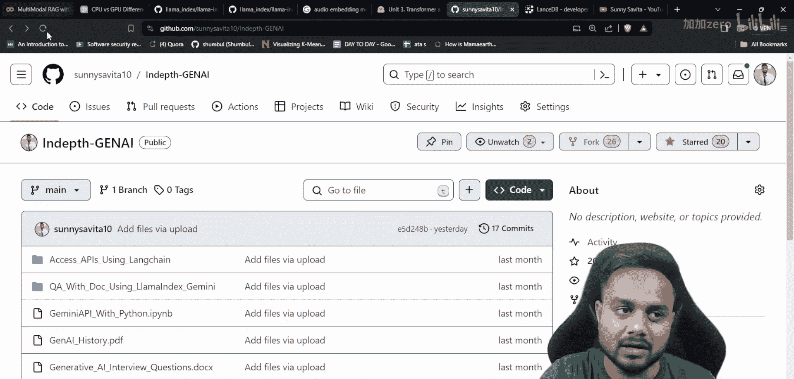
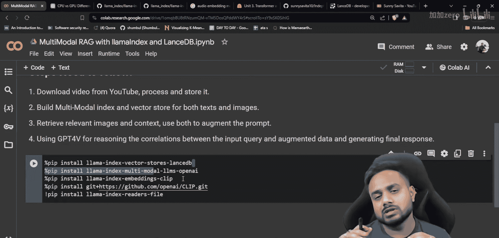
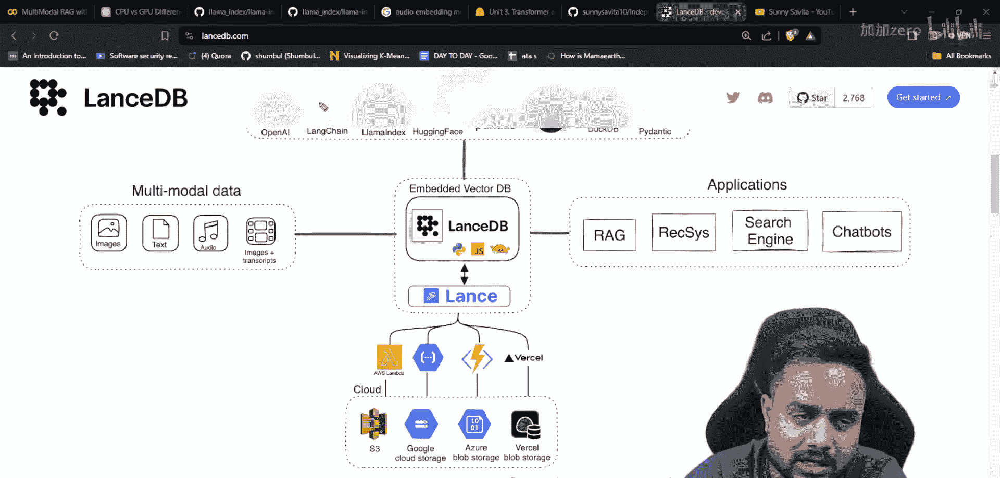
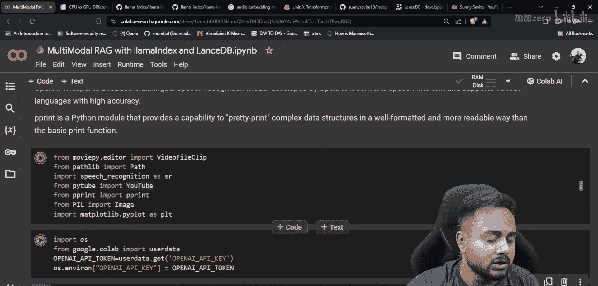

# Sunny Savita【中英⚡生成式AI：从初学者到专家｜Generative AI In-Depth Roadmap from Beginner to E】 p25 P25 MultiModal RAG Application Using LanceDB and LlamaIndex for Video Processing [BV1Uht8zDENA_p25]

Hello， everyone。 Welcome back to my YouTube channel。 My name is Sunny Savita。

 and I hope you all are doing well。 guys， today in this video。

 we're gonna create our first application using this multimod rag system Gu。

 this multimodal rack is very much important。 and there are lots of use cases regarding this multimodal rack And in every domain。

 you can create this multimodel rag system。 So I have designed couple of use cases for all of you so that you can solve any challenge related to any sort of a domain。

 Okay， guys， in my previous video if you will check if you will go and check my YouTube channel。

 So there I discussed a complete theory related to this multimod rag system。

 Now apart from that you'll find out many more video with respect to this rag And here I created couple of more video with respect to the different different topic guys if you haven't checked so far。

 please go and check。😊。

And if you are liking the content guys， then please support to the channel because this type of content takes a lot of effort。

 So guys if you are liking it then please support it please subscribe the channel please hit the like button and share with your friends apart from that I'm maintaining with one Github repository as well regarding this particular tutorials regarding what you do So whenever like you want any sort of a material you can go and check out with this particular repository now here you can see the number of folks and star so yes definitely people are looking into it and yes you can also check if you want any sort of a material regarding this in depth gen Now without wasting time let's start with the video So in this particular video。

Were going to implement our rag application where we are going to solve this video related issues so how we can process the video。

 how we can create the rags， the system multimodal rag system on top of the video so in a similar manner right we are doing the question answering with respect to my document and all right in a similar manner I can do the question answering to this videos as well so how it is possible I will show you so in my previous video I told you that this rack this。

For the multimodal rag， actually， we have different different framework。 So in those framework。

 I guess I selected two main framework。 One was the Lama index and other was the link chain。

 I shown you the different different code implementation from the length and the Lama index。

 So here guys the first use case I'm going to solve by using the Lama index and this Lama index is really good like with respect to the rag and all。

 And here you will find out so many cookbook and all and which is error free asl。 So yes。

 let's start without a waste thing the time now。 So here you can see I written couple of thing couple of points over here。

 So the first point I'm saying So what thing is required。

 So first thing is Lama index and then lens TV how to how do I get the data and all everything I will show you from sketch only Now a Lama index framework lens TV vector and here we are going to use the multimod as well multimodal LM that is G4 or Google G Provis anything I can use So here。

In todays a particular application， I'm going to use G4。

 and then I will show you with the Google pro Vi as well。 then what is a step we need to follow here。

 So here first we have to download the data。 for here for downloading the data Im going to use the YouTube So from the YouTube itself directly I am downloading the video that video actually whatever video I want to process then I will maintain one multimod index。

 I will maintain one vector that will be a multimod indexes multimod index where I will be keeping my text and images this text and images I will be collecting from the video citizen then what I will do I will be creating my retriever on top of that and then I will be creating my prong and finally Im going to my output from the G4 So this is going to be a completeflow of this tutorial let's start step by step the first place guys will be required some library So let me copy and paste the library library is required for this。

application So here I kept couple of library。 Let me copy and paste。

 So here the first library is going to be Lama index vector store lens tb guys lens t if don't know about the lens tb it's a similar database okay it's a database similar to this fine going chrom Db it's a vector database right and generally we use this vector database for the multimodality now here if you will go and check with a website of the lens t So you will find out the description what they have written whatever they have written So here they have written lens t is a developer friendly open source vector database for multimodal AI with zero management overhead。

So here generally we use this database for the multimodal AI Now if you also want to use so for your multimodal system so definitely you can go and check with this lens TV so here is two variant is available first is in memoryory variant and the second is a cloud variant So if you are worried about the privacy in privacy and all in that case you can go and check with the memoryory database or other than this one you can use a cloud variant also now here you will find out so in the multimodal rack it is applicable or it is capable to keep any type of data inside the database right so here image text audio image plus transcriptscript means image captioning and all everything basically it is able to keep inside this particular database right now it is for the Ra application racks is such engine chatboard for any sort of application we can use this lens TV So this lens TV is it's a pretty amazing database and here definitely you should use it if you are going to create your multimodal system。

Now let me install it first。 So here I'm going to install a part that you will find out open AI because I'm going to use Gp4 version。

 then I'm getting clips。 Okay then here you can see I'm going to install this clip this clip actually it's a model for the language image both right It's the language and image pre model from the open AI Now here you can see So Lama index reader files。

 if I want to read if I want to read any sort of a file。

 So for that I'm using this Lama index reader file。 So here guys。

 I'm installing this library other than this one we have many more libraries for this particular project。

 So let me keep all the libraries over here and guys sometimes I will be copying and paste the course for code why because I just want to save my time now here what I'm doing So here I'm going to keep two more library which is very much important for this particular project So here the next library Lama index and then next one is the whisper I think you all know about the whisper whisper is basically be used for generating the transcript from the videos and all So here we。

To install this two library as well apart from this one for processing the videos。

 we have different different other libraries as well。

 let me copy and paste and let me give you the description of all those library。

So here lens to be for keeping the data U P P tube P do speech recognition F M f f m E G sound file torch matpl lipscycller image f f f f F T F5 Raage and Tq。

So these are the library basically which is required for this particular project now let me give you the description also regarding all those library all this library okay so here what I did I kept the description regarding all this library now I'm just going to copy and paste it so that you can at least understand about this particular library。

So here what I'm going to do guys I'm just going to copy and paste the description of it。

 So one by one basically you can read about all the library So in short I can say here that this library is being used just for processing the video data right like this movie by5 you speech organization fm mg now sound file okay now this fp raets actually for for getting a regular exhibition and tqD tqDm for what tell me for the processing bar So you I have written this description of the libraries and all definitely you can check out with it I'm not going to read it otherwise the video is going to be very very long here I just want to showcase the simple rag system so that you can build it for your use case as well and library wise definitely you can read out this particular description now coming to the next point here So the very first thing which is required over here so let me write that code as well until。

Ibri is getting installed。 So here what I'm doing I am giving you the further code for this particular application and don't worry I will provide you this notebook so that you can execute it by yourself。

 So here guys I have to like。I have to import this module So the first one is what video clip from the movie pie then partly okay for the path I think you know right in my previous videos as well I explained this library speech recognition for recognizing the speech like whatever Im saying I can like system can recognize the speech and it can generate the or it can generate the transcript or something and pipe you for the YouTube video P print pretty print and P for the images and my plot links These are the library guys。

 which I'm going to be import over here and other than this one。

 let me set my open API token as well So here guys here what I have I have my open API key which I already kept over here inside my keys now let me give the access to this one and now what I'm doing now I'm just going to be So still here guys I think this is a very。

For money step。And in every project we have performed this particular step now after this one。

 after setting the API key and all what we are going to do。

 we are going to download the video from the YouTube website so first of all guys what Im doing。

