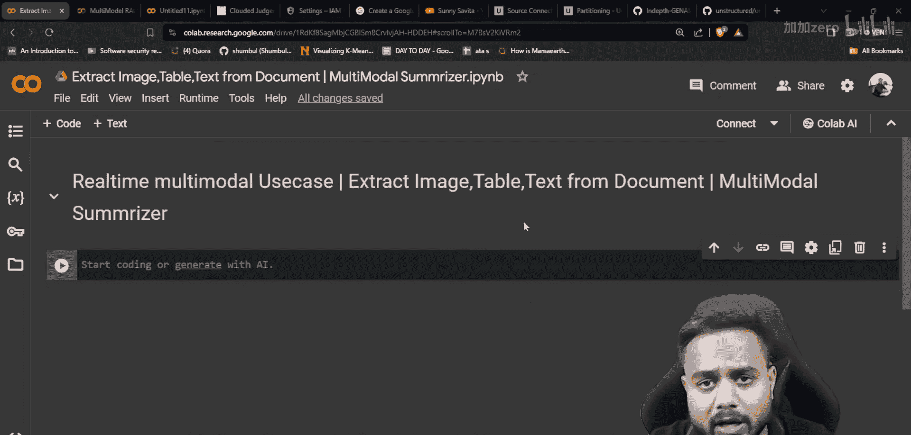
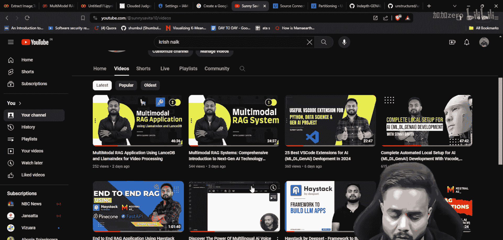
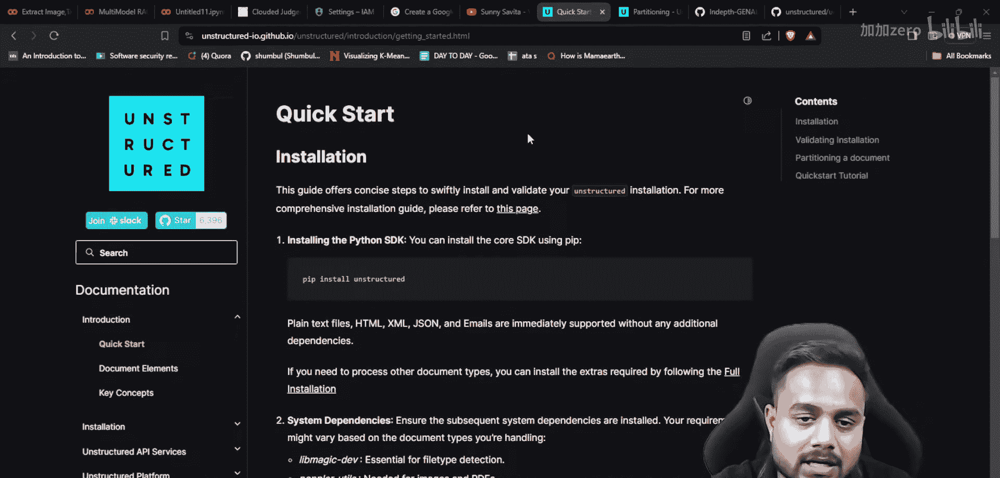
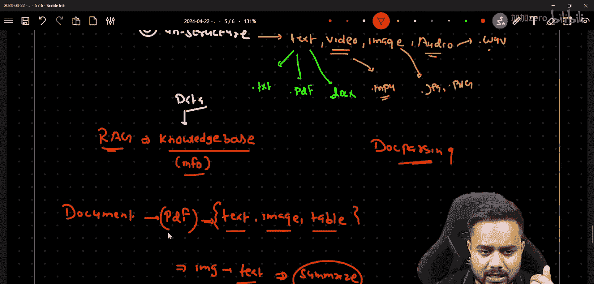

# Sunny Savita【中英⚡生成式AI：从初学者到专家｜Generative AI In-Depth Roadmap from Beginner to E】 p26 P26 Realtime Multimodal RAG Usecase Part 1 ｜ Extract Image,Table,Text from Docum [BV1Uht8zDENA_p26]

hellello everyone， welcome back to my YouTube channel。

 my name is Sunny Savita and in this video well see that how we can pass the document guys。y。

 this topic passing the document is very， very important because here we're gonna see that how we can deal with a different different type of data。

 how we can deal with a different different type of document So whenever we create whenever we create LM based application whether it's the right chatbo portion answering or summarize or any other application。

 any other use case So we always deal with the data right so the first step is the data engine itself right so where we ing the data from the different different sources So data sources might be a different different and from there also we can get the variety of the data So let's say we have a document and in the single document if you have variety of the data let's say in the single document let's say the PDFf itself you have text you have images you have tables you have HTMLml content Xml content So how to deal with those type of situation Now we gonna understand here in a detailed manner because。

This video is going to be very very important and it is directly connected to my other upcoming video as well where we are going to create like many realtime application on top of the rag guys yeah please watch it till the end and here I'm going to share a lot of information with all of you and definitely maybe in the real time in your organization or in your project you are dealing with those situation where you have this type of documentation with a mix mixed data like images table tag hml or any other format of the data like Jason and all so how to deal it let me show you first of all what I can do here I can show you my YouTube channel and here on my YouTube guys Im creating a video on top of the multimodel rag so I uploaded two video with respect to it and before that I created a rag with a variety of the tools and all so definitely you should check if you are willing to learn this rag and I'm try to create。

Plist on top of the rag itself where I'll be coming up with 10 to 15 more video。

 there are five to six video I've decided with spectacular realtime application and five more video regarding the different different topic like evaluation hybrid solution of the rag or different different research of the rag itself So you will get each and everything over here on the single channel if you are applying this rag or if you are creating this rag based application in your organization apart from the soon I will be coming up with the fine tuning and the la series。

 many more things you will find out over here。 So let's begin first of all guys。

 what I will do here first of all I will give you the complete and detailed introduction of the data so what type of data we have and from what type of document document actually we are going to extract the data now like one library we have the library name is for any structure this is very amazing library guys and it is having many more。

So by using this particular library you can extract any type of data right now if I'm parsing so don't be confused here with the bird parsing because this parsing means passingsing means what extract right extract or describe so extract of the data extract of the data describe of the like you can say describe of the document right so the simple meaning is nothing we are just gathering the information from the document itself so if someone is saying parsing is someone is talking about the parsing they are simply saying here we are just going to extract the information nothing else。

So here guys， we are going to use this unstructureural library。 It is a very very good one。

 It's very useful also， And here I will show you the rock code of this unstructureural library because it is completely open source and you find out many more things And in today's class we are going to use this unstructureural library only for parsing or or for describing the document for accepting the information from the document。

 first of all， let me give you the clear understanding of the data。 So here on my blackboard guys。

 I am going to write each and everything with respect data。😊。

So whenever we are talking about data guys。For this data， we can divide into。A box。

The first type or the first part of the data is called structure data。等是。Data。

 the second type of data is called semi structure data。n b。的确。Data now。

 the third type of data is called unstructure data。So honest。对的。Now。

 whenever we are talking about this structure data guys。

 so this data will be always available in the tabular format。

so it will be always available in the tableular format and here actually you will find out two type of variable right two type of column so first type of column is called categorical color and the second type of column is called in numerical form。

RightOkay in what files， actually you will get this type of data。

 So let me write on the name over here。 So here this type of data you will get in。Yes， we。

In yes we file。If you will get an Excel file。So in this particular files。

 you will get this tabular data。Now， if we are talking about the semi structure data。

 so the semi structure data it's a different type of data。

 so generally we get this data a different different format。

 So here let me write a couple of names Jason format。X ml format。HtMl form。Thel format， O。

 you will get thestructureer data in this different different format。Now。

 when you will be talking aboutstructure data so one is such data again like I can divide into the multiple parts。

 So first I our first part is called text data。 the second is called。The third one is called images。

Like even though this video is nothing， it's a collection of the images and the audio itself。 Okay。

 so whenever we are talking about the video， you can you can say it's nothing it's a images or audio itself。

 Okay from the audio we can collect the text if you don't know about this video processing so you can check the i button I will give you the link of this video processing I created application on top of the video processing itself multimod application you can check out with it guys this tag data now were talking about the tag data So you will find out this tag inside the dot tx format you will find out this tags inside the P format now youll find out this tag in the dot docs format right the document itself now video bias so we have a different different format of the video MP3 sorry MP and other format of the video Now images guys So images you will find out in JPg or in P G format。

now audio so generally you will get the web file from the audio web file so guys we have a different different type of data and I think you got to know that what type of data we have okay so guys let's say whenever we are going to create a right system so the first step is what so whenever we are talking about the right system do we always maintain one knowledge base。

Okay， you always maintain one knowledge base。 Now guys。

 knowledge base means what we are going to collect the information from the different different sources from the different different document right So this is nothing this is you can say it's nothing it's my document onlyPP X based an XMl S Yal or you can say PP also right X we have one more format we are going to mention maintain one knowledge base right So directly we can say here we are dealing with a data only we are dealing with a data only Now guys data could be in any format right I think like you know right if you are working in the industry if you are working in a realtime use cases you might get data in any sort of a format。

Now， guys， how to deal with those type of situations。Let will give you one example。

 So let's say you have one document。Let's say you have one document and inside this document。

In this document， you have okay， the document is nothing。 It's subped correct。 right it's aped。

 Now inside this document， you have text。You are based。You have images。Or you have people。OK。

Protectt images and table。 Now， how to deal with this type of situation。Hearing my point。

 or let thing you have image。You have image and from the image。from the image itself。

What you have to do， you have to extract the text。And on top of the on top of this text Excel you want to get a right right you want to summarize this particular image right each and everything I will try to explain you in this two video so in first video we're gonna discuss about the document par we are try to see how we can extract the information from the from the different different documents and all and then we'll be talking about the second one。

 how we can get the information right from those particular document。

 how we can do the summarization when summarizemar once application I will show you right where we try to perform the document summarizemar so I hope you got to know that what I'm trying to say right so data skillia use cases skill here let's say we have one document from where we want to get text images or table or let's say。

