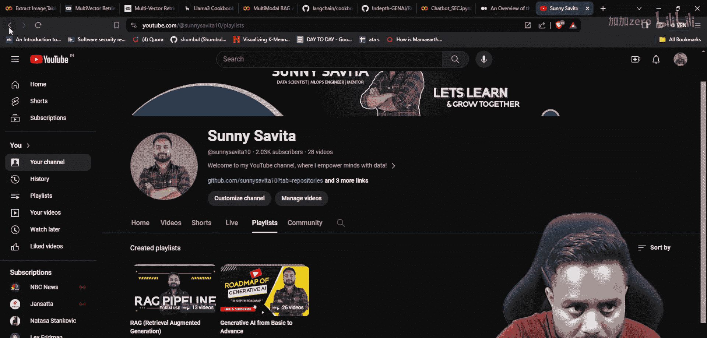
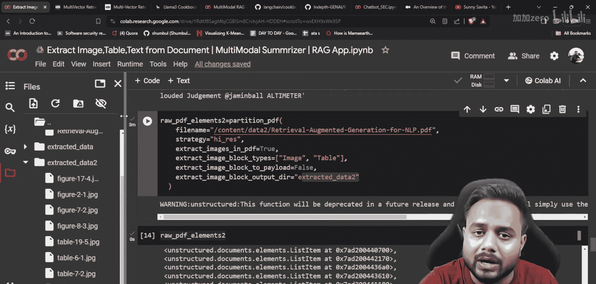
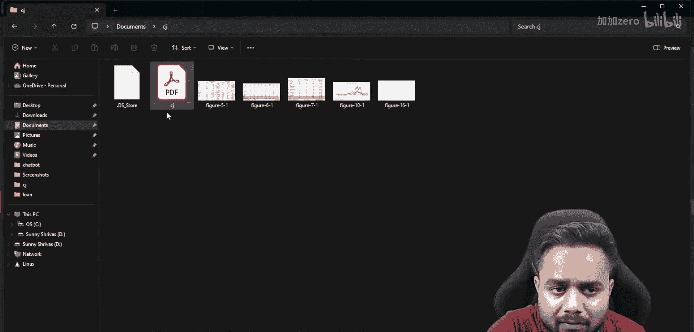
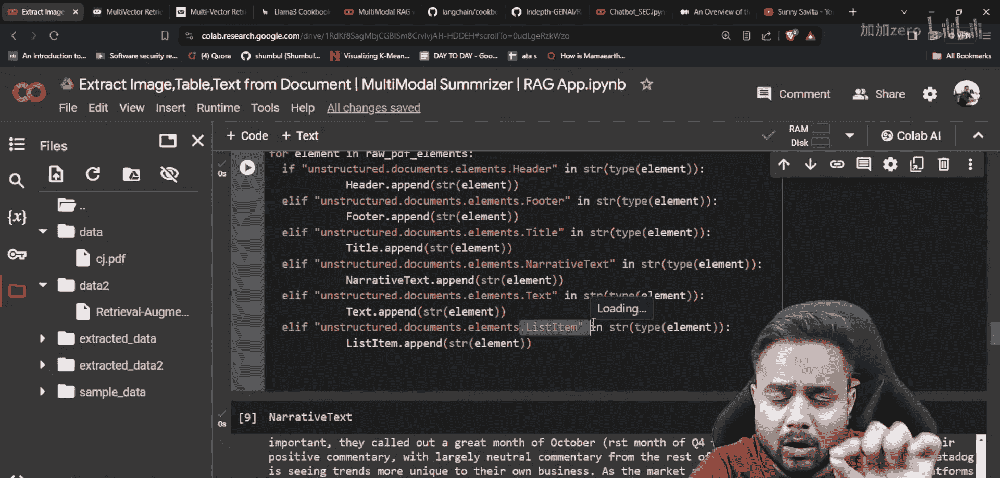
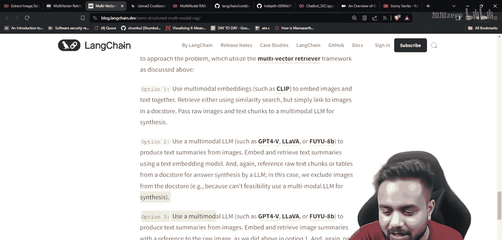
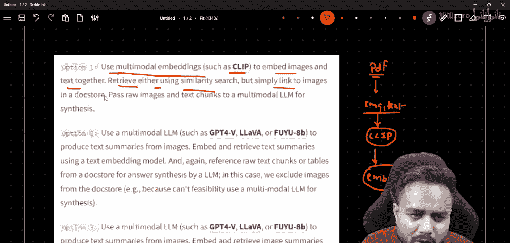
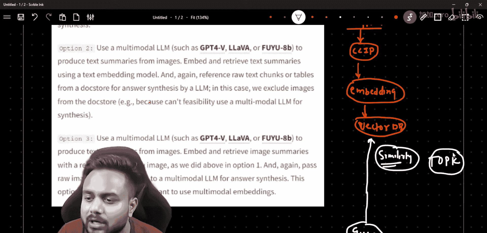
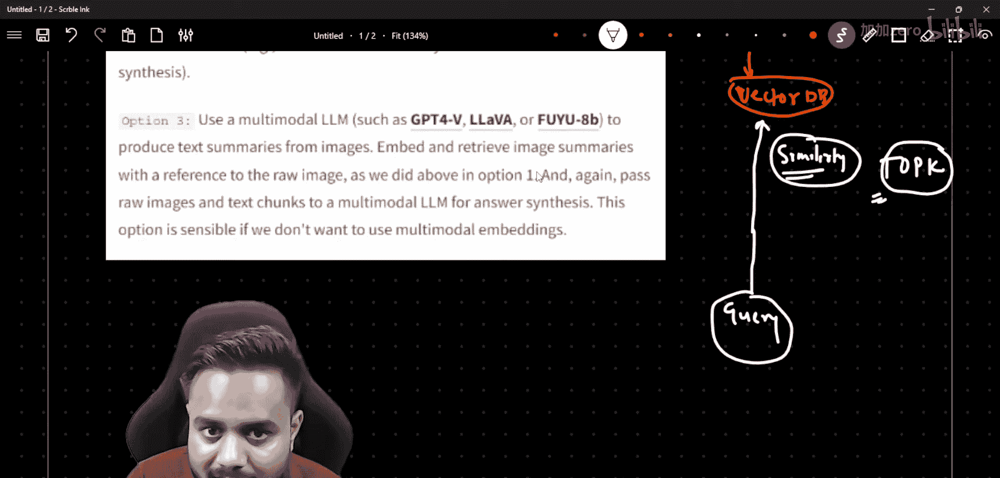
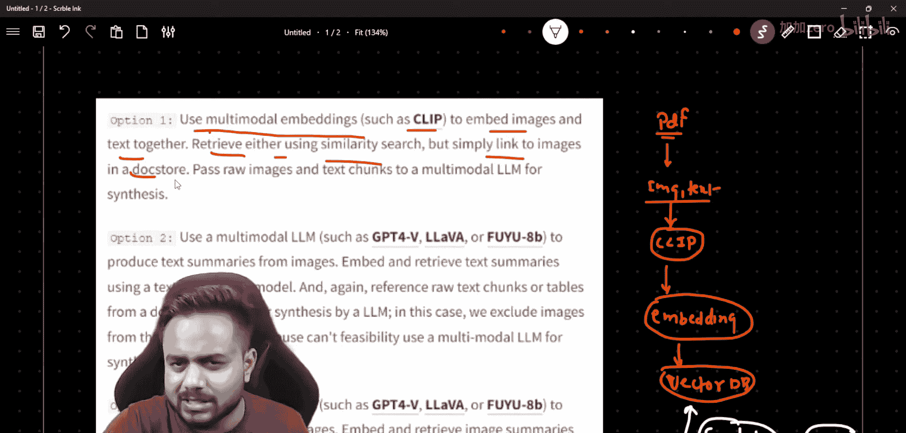
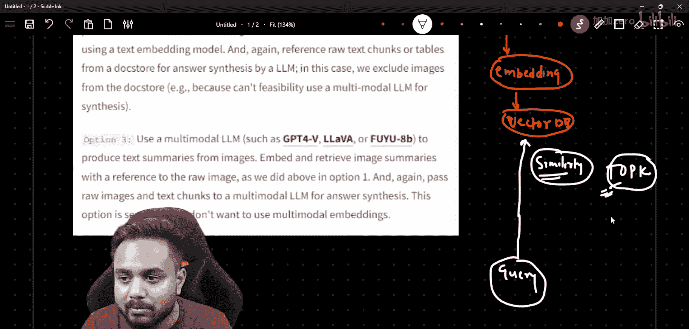

# Sunny Savita【中英⚡生成式AI：从初学者到专家｜Generative AI In-Depth Roadmap from Beginner to E】 p27 P27 Realtime Multimodal RAG Usecase Part 2 ｜ MultiModal Summrizer ｜ RAG Applicat [BV1Uht8zDENA_p27]

He hellello everyone。 welcomelcome back to my YouTube channel。 My name is Sunni Savita。

 and I hope you all are good and doing well。 So guys。

 this is the second part of this real time multimodel use case。 So I was talking about rag system。

 different different type of rag system rag architecture and in order to that。

 I started this multimod rag series。 So already I completed three video on top of it。

 if you will go and check with my YouTube channel there you will find out introduction of the multimodel rag。

 you will find out one application also regarding this multimodal rag。

 And then first part of this realtime use case。 Okay。

 realtime multimodel rag use case where we have seen how we can extract the data。

 different different type of data from the document。 So guys， if you don't know about it。

 if you haven't check， please go and check with my YouTube channel already video are there now。😊。

In the second video we'll see after collecting the data from the document right so we have a document and from that document we are going to collect images。

 tables， adss， different different type of data we are going to extract okay and in the real time guys many more use cases you will find out like this and maybe in your organization in your company in yourpoOC in your project you are encountering with these type of use cases so yes this is a realtime use case which we are implementing end to end so in the first part I show you how you can accept that data now in the second part I will show you how you can make a summary from the data and then the third part will see how we can create the rag system okay guys this rag actually is very extensive topic so prototyping of the rag is creating a rag just for the practice or just for the learning it is very easy but the deployment of the rag right in the real time it little bit difficult。

So guys here I took the initiative to cover this rack from basic to advanced level here I already created 13 video on top of it if you will go and check you will find out inside the police section now20 to 20 more video you will get from my site where you will learn different different retrievals technique you will find out the reraning technique。

 different different search and optimization technique and there actually you will find out different different hybrid solution okay with respect to the databases。

 No SQL databases vector databases okay and then how you can evaluate this rag pipeline so each and everything I gonna cover here inside this rag pipeline or this rag series so guys please check out with series if you haven't checked so far and now let's start with a video first of all guys here inside this file I kept the entire code and I share this file I given you this file in the description of the video you can。

Check it out and from there itself， you can download it Now in the previous video we have seen how we can collect the data from the document guys in a very detailed manner。

 I have explained you that part。 if you haven't seen。

 please go and check its a request to all of you and then if you will continue with this video it will give you a lot of benefit right if you are directly watching it by running this particular notebook。

 you can also understand So here is a library guys。

 couple of library which we have installed for which we are installed for extracting the data from the document if I'm seeing document So the document means p dos Pdf right there are different different type of document So not only the pdf other type of document as well from any document we can collect that data we have the library on such a library I shown you in my previous tutorial you can go and check out Now guys here you can see the entire code So in this particular code you will find out the different library and all now this is the。

Function， which we were calling for extracting the data。

 So here inside this particular folder inside this folder， right， I already have a data。 Now。

 this Pdf actually， it is up like it is having a。Like some sort of knowledge related to the LLM geneative A rags and all。

 so that data actually I'm going to be load over here。

 and here you can see inside this folder inside this extracted data I collected the images So here youll find out the images and all I already shown in my previous session Now similar to that I have one more folder inside that I kept the variety of the data right So inside this folder inside this data too means the table in the raw format itself and here you can see the PDFf name retval argument generation it's a research paper of the rag and from there itself from here itself also we are going to collect the data Now guys whenever we run the code right so see here you can see we are going to collect the data inside this extract data folder Now here I have all the images and table you can go and check with this particular folder if you are executing the code inside your system definitely you will be getting that and don't worry I will give the PDFf and all everything at a single place and from the Gi directly you can download it Now。

you are going to collect the data by using this library So it always provide a data in the form of elements right So here you can see these are the element。

 So what I did， let me show you here I collected all the element from the P and this is all the element I see so here hader title narrative text footer images list item So this element actually it is having a data a different different type of data。

 which is going to be extract from the P If you want to see the p I can show you that also it is there inside my local system from there itself I have uploaded over there this is the PDF now inside this PDF you will find out we have a data we have several type of images now here we are going to collect the data we are going to collect this title points everything right by using that particular library the library name is what on is structure So by using that library we are going to extract the data and guys this thing I already explained in my previous session。

So now guys， we got the data and here my data is available inside this folder。 Okay。

 the image is available inside this particular folder apart from this images and all so yes。

 we have extracted other data as well So if I'm going to be taught I'm going to accept this narrative text so here I will be getting my text means the text if I'm going to be collect this list item I'll be getting my all the points from the data right so whatever points 1。

2，3，4 whatever points has been highlighted over here like this this 1，2 okay3，4。

5 this is the list item now here you can check this is my narrative text which I'm going to be collected from the P now here you'll find out the list item1。

2，34，5，6 these other point which is already there inside the P okay I hope you got it how we are going to accept the data。

Now what we are going to do here， we are going to create a summary from this particular data and then on top of it will try to create a rag Now guys。

 you will ask me Sunny why summary why then rag okay so here guys if you will look into this if you will look into this L article right youll find out this particular article on this blog dot L do dev it's a pretty amazing website and many more thing many more solution you will find out with respect to geneative AI application So guys here they have proposed a different different solution with respect to this multimodal rag right we all know about the rag if you don't know guys you can go and check out with my series there I already discuss about the rag and all So here guys they have proposed three solution related to this multimodal rag So let me explain this solution already I have explain you in my previous session but yeah let me give you a glimpse of that So already I have this particular screenshot inside my blackboard So now let me explain you。

So here in the first solution， so they are saying use multimodal embedding such as clip to em images and text together means we have a Pdf or any sort of a document。

From there， we are going to collect the data， let's say we are going to collect images。Next。

Then what we are doing， we are using this multimodal embetting。Clip model， it's the open air model。

Then we are going to create embes。We are keeping this ems inside the vector database。

 okay vector database。Now， after keeping inside the vector database， you know what will happen。

So here my user is querying so here you can see retrieve isn't using similar t search but simply link to images in talkqueto so here what we are doing you know so whenever user is querying let me show you here first of all let me keep my video over here we hope it is fun with so guys now let me show you so here let's say there is what gets my vector D now user is querying something let's say user is asking any sort of a query I can take a different column。

Okay here is my죠。Now this is what this is one like query okay from the user side now this query is going to the vector database and here I am performing a similar T search。

I will take them。Similar embedding okay， let's take top3 embedding Okay top K I'm writing it might be top3。

 top4 or whatever right now this embedding I will collect this embedding and this embedding I will pass okay this particular embedding I will pass where guys tell me So here it is saying just just look over here inside the solution So simply link to images in talk to is this embedding directly I will take the images like we take the chunks and all based on the best embedding best embedding top embedding right so in the similar way we take the images and here what will do So whatever images So based on this top。

