# Sunny Savita【中英⚡生成式AI：从初学者到专家｜Generative AI In-Depth Roadmap from Beginner to E】 p28 P28 Realtime Multimodal RAG Usecase Part 3 ｜ MultiVectorRetriever with Langchain [BV1Uht8zDENA_p28]

He hellello everyone。 welcomelcome back to my YouTube channel。

 My name is Sunni Savita and I'm back with another exciting video。 So guys in this video。

 we'll see that how we can create a multimodal rag means already I discussed this multimodal rag application。

 I uploaded two parts。 So this is the third part of that a particular use case。

 So I took initiative to complete this rag and with respect to this rag， not even the rag。

 the complete geneative guys。 So in order to that I came to this rag and I uploaded a different different video on top of this rag。

😊，So if you will go and check with my YouTube channel guys。

 so here you will find out I uploaded many more video with respect to the geneative AI and the different different topic about the geneative AI and like since past we okay so I'm uploading the video regarding this drag so far I uploaded around 14 to 15 video and there actually you will find out each and everything from a scratch only I started one series with this multimod rag system when the first video I discussed about the theory in the second one I created one application there I use the Lama index and landt vector database and I created a multimodal drag on top of it then I came up with one more application where I'm going to where I'm going to pass where I am going to be retrieve the data from the different different document if I'm sync data so Im going to extract image P or table any type of data from the different different document and I。

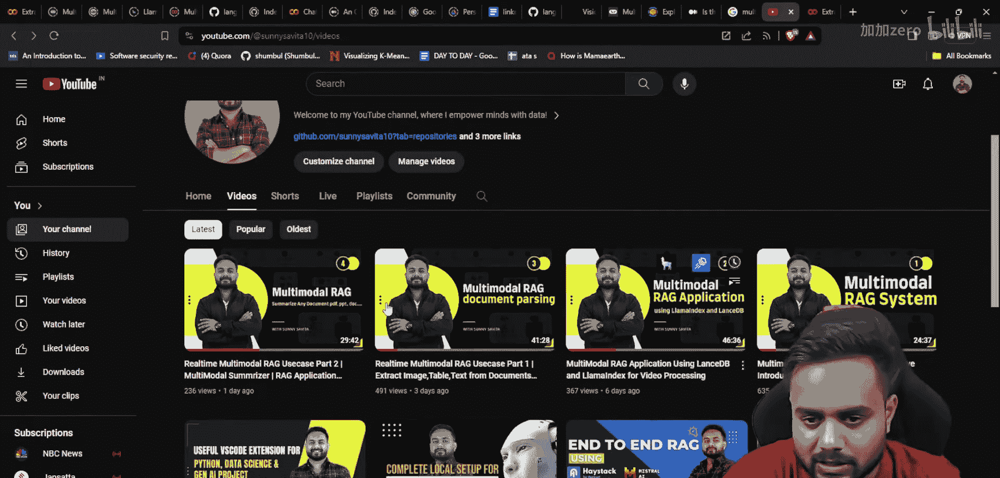

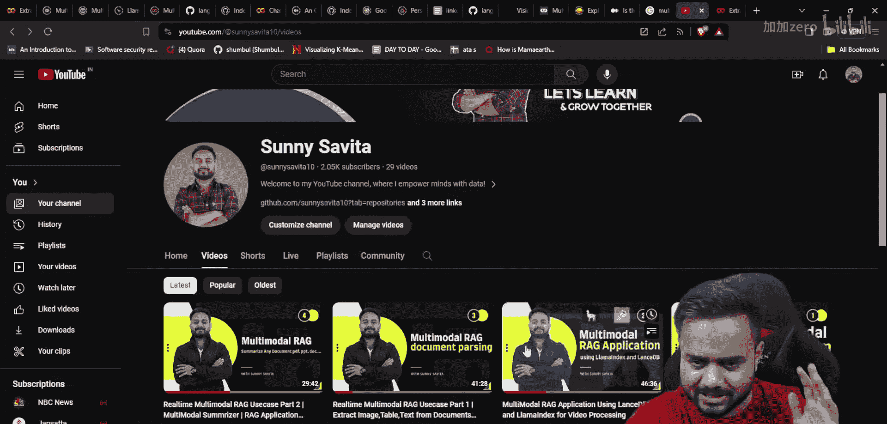

Induce one very important library as well in my this particular session。

 multimodal rag document passing。 If you don't know you can check then I came up with this sumr because it's a part of the architecture and in this video I discuss the complete architecture of the multimodal drag which we are implementing over here so I already created two video in the first one I shown you the document passing and the second one I shown you the summarizer the summarizer and passing its a part of the application itself。

 now in the third one we are going to create a rag first we'll create a multimodal retrieve on top of it and then we'll create the rag Okay so yes let's start network game guys if you haven't check so far please go and check if you are going to learn the gene V in depth So you can follow to my channel guys and if you don't know to follow just look at there if you finding out this content is useful for you then based on that you can take a decision now。

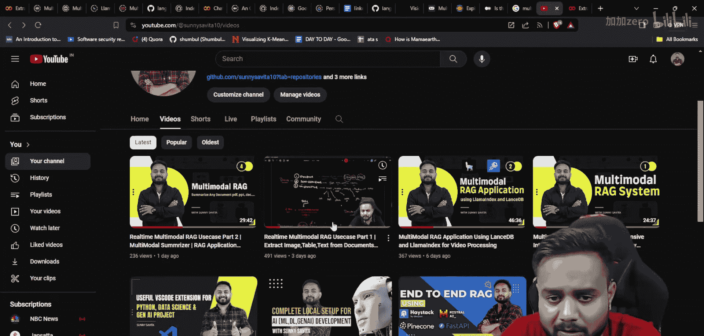

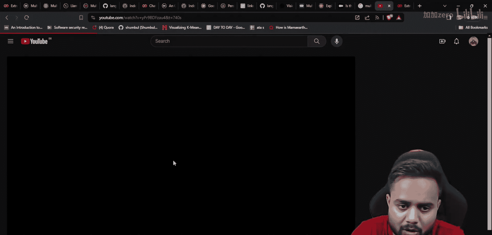

let's start So first of all guys， what I will do I will show you the code So here is my code guys。

 So this is what this is my code。 Now what is the application name。

 The application name is extract image table tags from document then summarize it and then on top of it we have to create a rag So in summary I can say it's nothing is a multimod rag system So already I discussed this part where I have to extend that data from the document So guys here actually I took two document you can see this two p here in my onep I was having the different different images and text Yes definitely I was able to extract if we don't know about it you can do and check with my previous video in the second folderer I kept this particular document So this document name is what document name is re argument generation for NP it's a research paper on top of the rank So in that research paper we are having the multiple tables images and all So here I can show you this one if I'm。

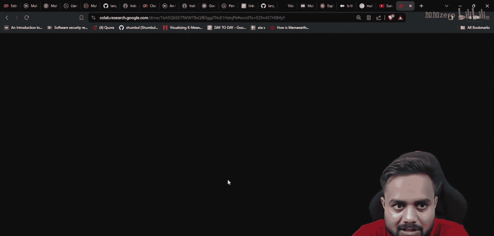

Open it guys so maybe I will be able to open No here I cannot open PDFf so I will have to showcase it in my local system only So this is the P guys。

 Now here you can see inside this P we have a several data several images that will like tables and all and youll find out the text along with that guys on top of this data itself I'm going to create a red system。

 So let's begin let's start how we can do that now I will show you。 So first guys。

 let me give you the quick recap from the previous session So here we are inputing the we are installing the different different libraries。

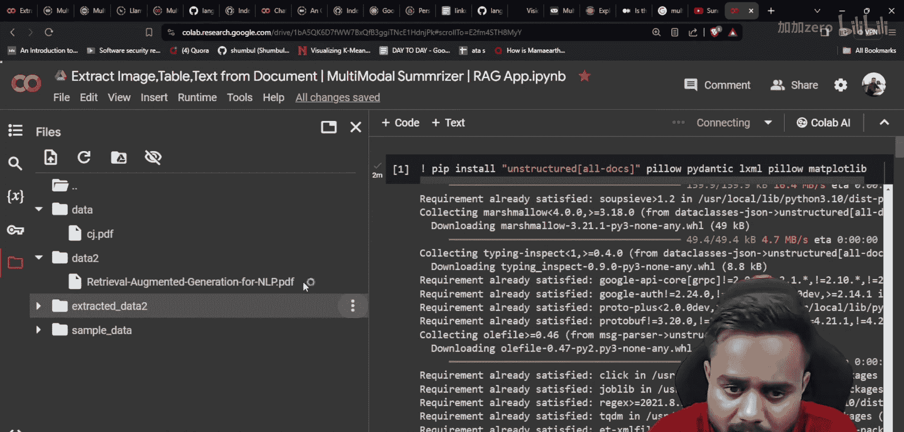

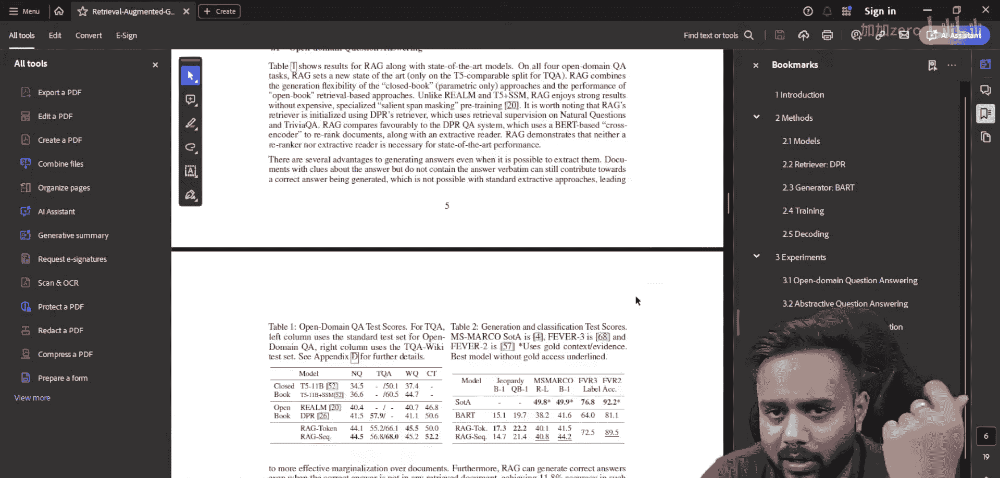

And here I think I already explained in this part Now guys this was the this is a function which is responsible for extracting the data from the Ps here inside the PDF we have images tables and all so this is the this is a function for the first PDF so first PDF I'm not going to use because we don't have too much data two much tables over there so what I did simultaneously I have created one more method over here let me show you that so this method actually I'm using for fetching the data for extracting the data already I have shown you in my previous session you can go and check out with that particular session now after that guys you will find out here after fetching the data so I will be getting these a particular element and inside those element my data will be available so if I want to collect the table so here you can see I have a table if I want to collect this text so here I have this narrative text or this item with both I can correct now here if I want to collect the images so yes by using this one I can collect the images。

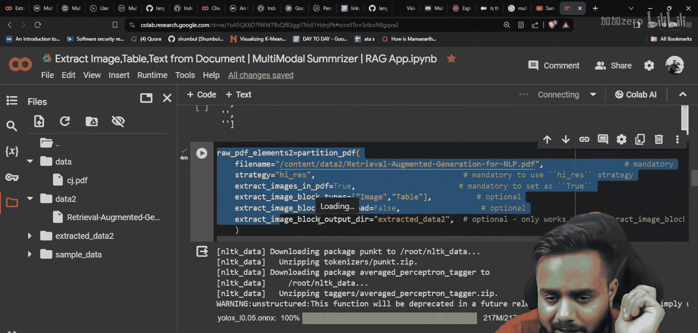

I have my text images and table now here guys inside this particular folder。

 you will find out the GPPG format of the text and the images as well。

 sorry gPG format of the text GPPG format of the images and the table also So here if you will open it guys so you will be able to find out the table inside this table there is a complete detail Okay。

 which we took from the P itself。

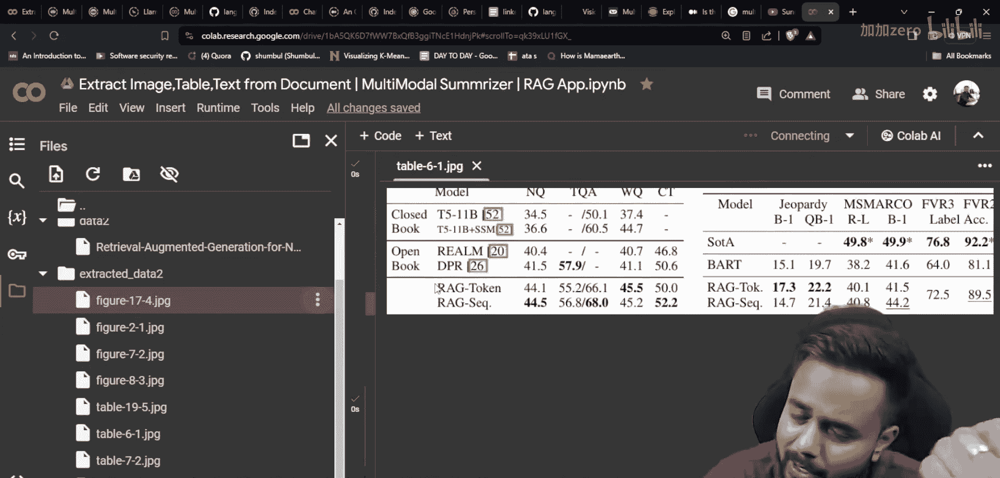

Now I hope this thing is clear to all of you and this code is also visible to all of you Now this thing I already explained。

 then I'm using this selection guys and I'm using this chroma D for a multi for the multi vector storage Now how you have to use it I will let you know that So guys this was the exception part which I already talked about now after this extraction actually you will find out the summarization So here guys。

 you can see here we have a summary of the table So we have a different different table which we have collected I can set the variable I think I shown you that and then we are going to be create a summary of it now this thing also I discussed in my previous video if we will go and check in my previous video this one So I discussed that how you can create a summary from the data。

 okay so please check out if you haven't checked so far and on top of it guys what we are doing So on top of it itself on top of this data only we are going to create application Now here you will find out the table now apart from this table you find out the text So here is what。

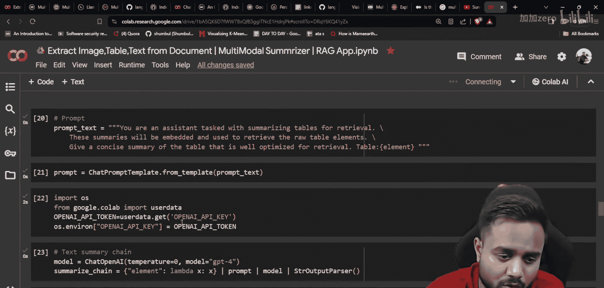

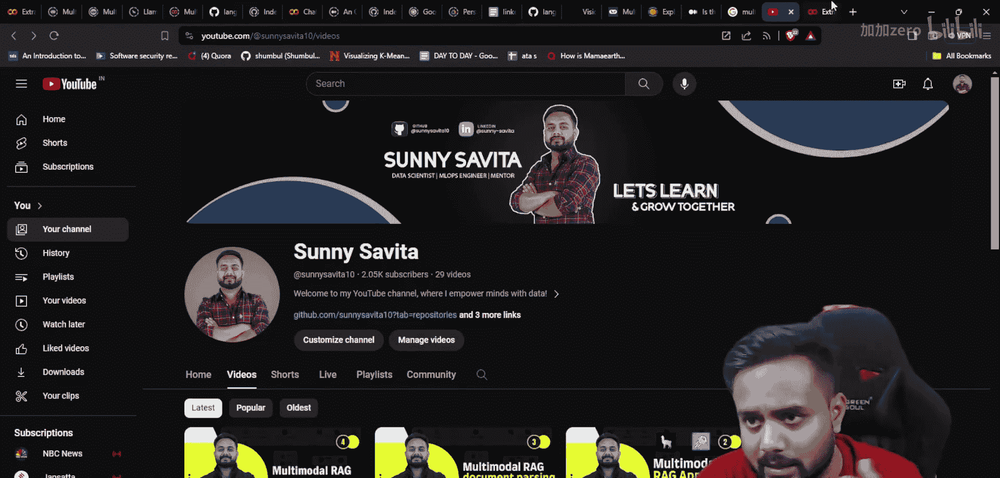

Heres a text and you find out the summary of the text so I am loading the model and on top of it basically you see this is the sub model data and this data actually I am passing to the model and that LM model actually is providing me a summary the same actually is happening with the me it is happening with them。

Table also now see this is the model， guys， this is the open air key， which I' am going to be load。

 And here you will find out the model。 So this is what is my model。

I am using the DbT 4 model for summarizing this document。Now， after this one after this text。

 you'll find out the images also So let me show you the images with that particular image only also I'm going to create a summary So let me show you this image part just a second here I can scroll down and see guys this is what this is the image summary Why Im not not writing a code why Im not executing in front of you because I already discussed in my previous session I don't want to waste my time over here。

 I want to show you the further Im going to show you the further implementation Now here guys you can see I'm going to create an image summary so there is a two way for creating an image summary directly I can pass the images to my G4 or I can pass in the form of vs 64 base 64 so base 64 is nothing it's encode it form of the image and we can encode in the 64 or we can recordcode from there also base 64 is nothing It's an encode it format of the image So we can pass in the encode format or directly also we can pass by images both are fine Now here you can see the image summary So till here。

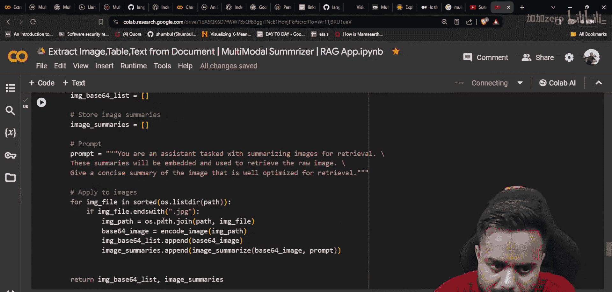

I hope guys everything is clear now coming to the retriable argument generation。

 So here you can see this is what this is nothing。 this is my architecture。 Now first of all， guys。

 let me clarify this particular architecture and then you will be getting the idea right so inside this particular architecture you'll find out we have a document and from this particular document what we are going to do tell me so from this particular document we are going to collect table and the text right but in my case in my document images is also available So here what I'm going to do I'm going to collect the images also so let me explain this part So here what I'm going to do guys study So here table and text and here I will be having images now what I will do from this particular images and this text Ill be creating a summary so I'm passing this to the Lm and I'm creating a summary from here So after creating a summary guys I will be storing okay I will be storing this embedding embedding form of this summary inside the database and along with。

That I'm storing the raw data as well。 same thing I'm going to do with the table。

 same thing I'm going to do with the text and images also。

 So here is what guys tell me here I'm having my LLm which can deal with the images okay and which can summarize this particular images and that somebody basically I can keep it over here Now guys whenever user is asking any query so it will come to this particular database right and after coming to this database means my query will come over here So this is what this is my query I hope is clear then what will happen it will perform the similarity search with somebody okay and then based on that。

 it will provide me raw data now this raw data along with the pro Im going to pass through my Lm this is going to be a complete flow okay I hope you got to know now so now let's discuss about the retriever part over here So where is the retrieve part here you can see this is a retrieve part here。

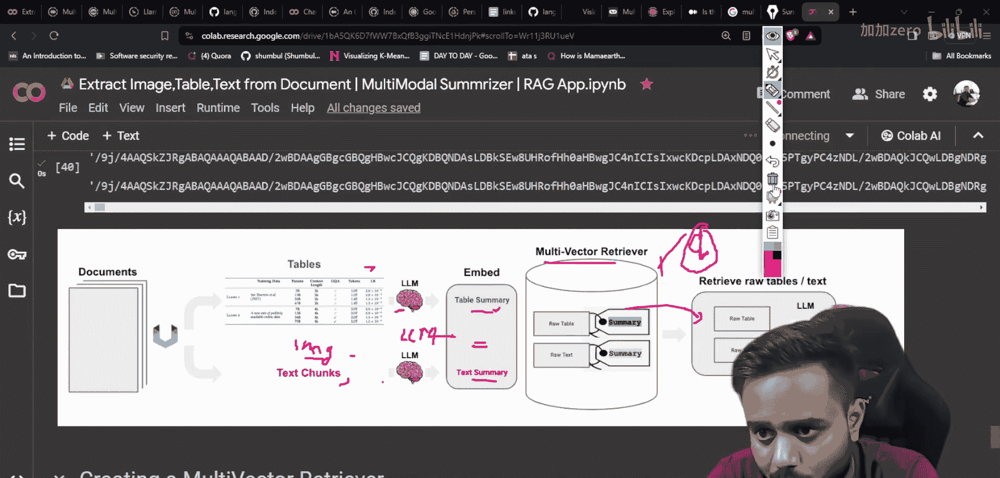

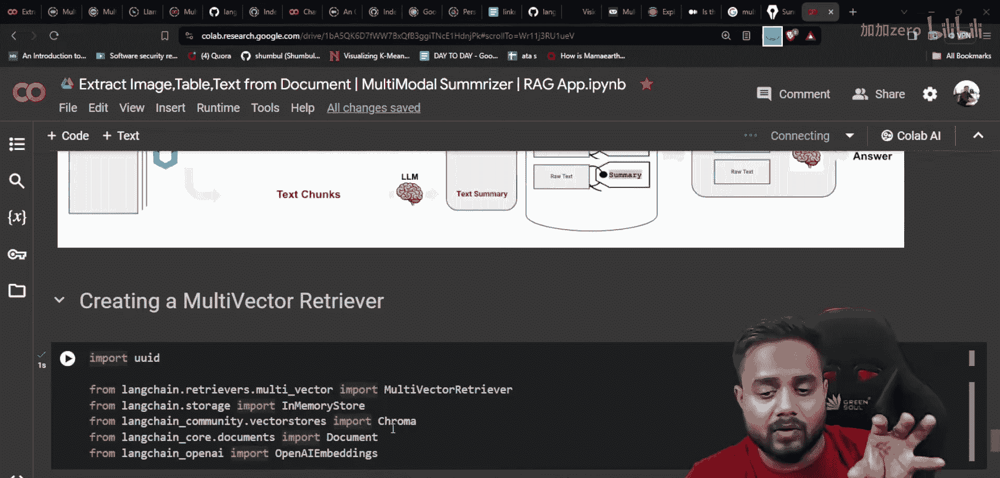