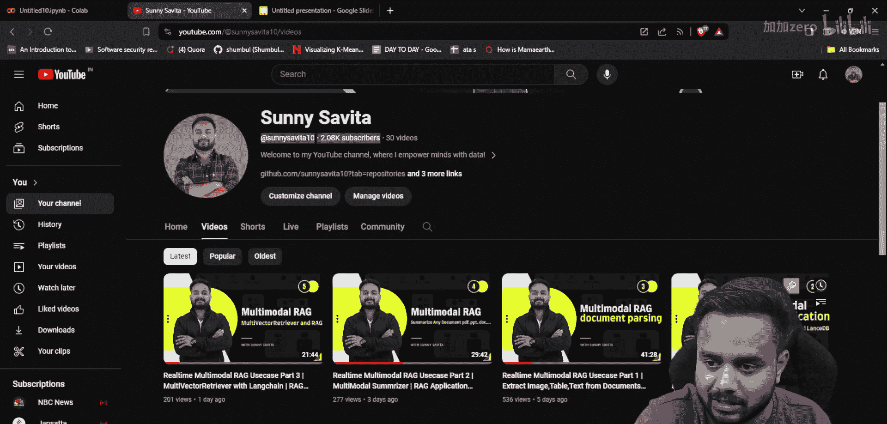
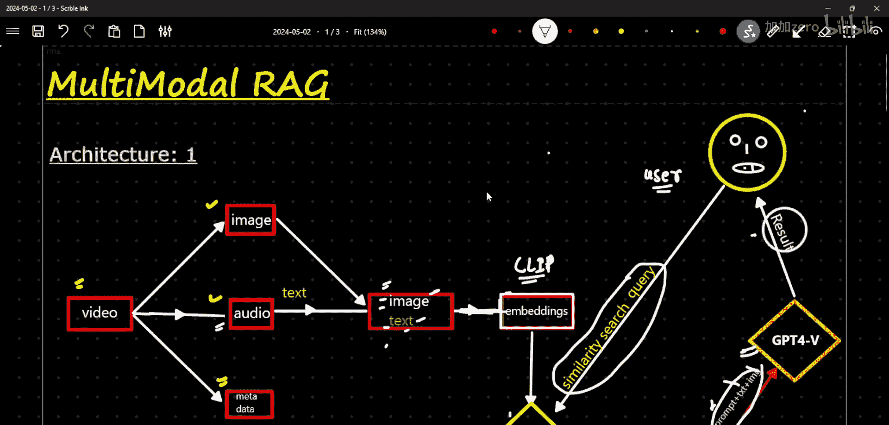
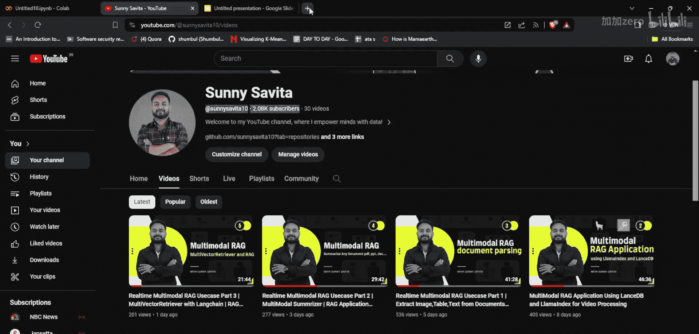
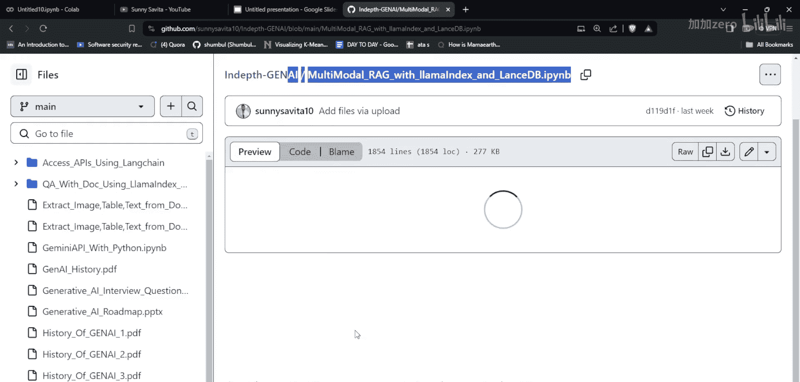
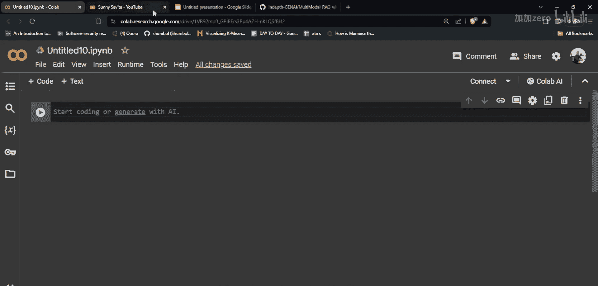
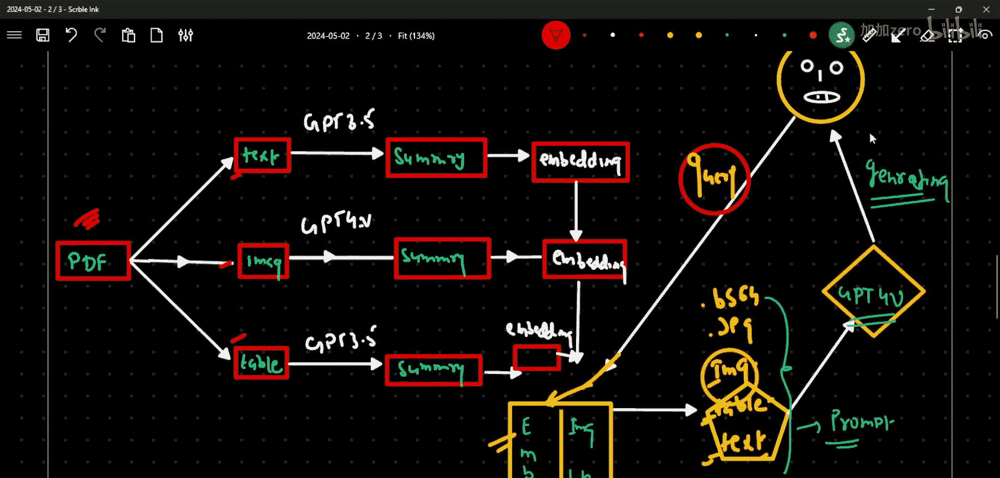
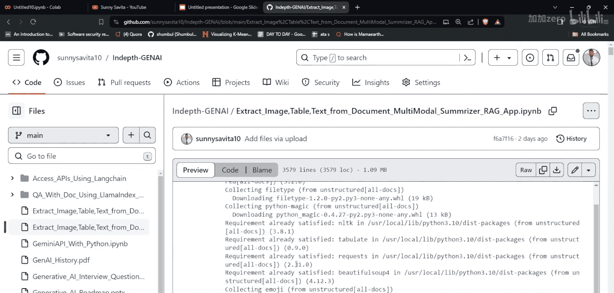
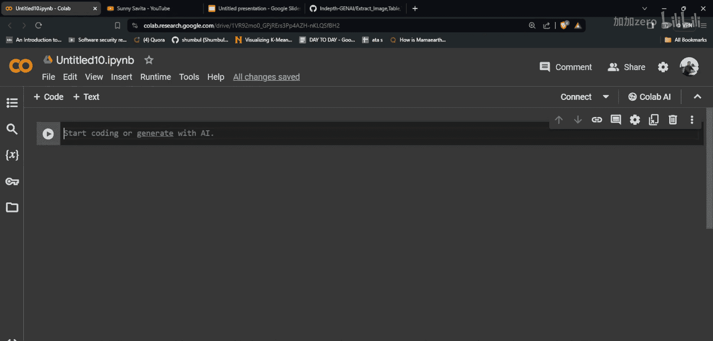
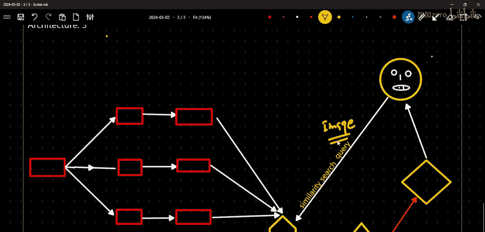

# Sunny Savita【中英⚡生成式AI：从初学者到专家｜Generative AI In-Depth Roadmap from Beginner to E】 p29 P29 Realtime Multimodal RAG Usecase with Google Gemini-Pro-Vision and Langchain [BV1Uht8zDENA_p29]

Hey hi everyone， welcomee back to mytu channel， Myinabianni Samita。

 and in this video were going create one more application by using this multimod array concept。

 So here guys， I will show you the multimod app using this Google J。😊。

I have created one pist on top of this multimodel rack and there actually I have implemented various architecture。

 different different architecture。 I will give you the recap of those all those architecture。

 whatever architecture we have implemented to our car generally for this multimodel rack Now I was getting many requests So can you showcase any one application by using any open source model or by using any three API right so here guys I came up with this Google gym API so here we are going to be create application by using this Google Gmney so that you will be having a flavor of all different different models and here I am going to be implement completely different architecture from my previous video So the previous video I implemented two architecture1 using Lama index and second using this lunch and in both architecture actually I have used the G4b now here the architectures。

😊，To be different and even the model also So first of all guys。

 let me show you my YouTube channel where you will find out all those videos。

 So here once you will search about Selia Vita guys here you will find out 30 videos on my YouTube channel I'm uploading slowly and gradually I'm trying to upload the video I not in hurry I just want to give you the refined content that's why I'm taking some time and I'm giving the precise and the sequence content so that it can add some value in your learning in your life because we know this is the era this is the time of the AI and we have to be learn the AI whether we are software engineer data scientist or machine learning machine learning engineer。

 whatever guys we should be familiar with this generative AI thing because in every industry it is being used this rag and find unit is pretty amazing thing which we can use right for any sort of a project and that's why it is getting too much popularity and you will find out。

Lots of variance， lots of implemented implementation of it。

 So here I have I took the initiative to teach you this a particular thing in a specific way in a specific manner。

 but definitely you can reach out to the channel if you want to learn these thing now guys first of all。

 let me do one thing here let me give you the idea of let me explain the previous architecture this previous application which I already record it so here is guys here is the complete architecture I think you can see so I created around three architecture and this third one basically Im going to be implementing today's session Now first of all let me explain you this very first architecture and then I will come to the second and the third and then finally will go for the code implementing Okay begin first of all let me hide to me because I think I'm。

This architecture is not visible to you now you can hear a voice。

 but not you cannot see it so by guys So here guys in the very first architecture what we did so let me explain you So in the very first architecture。

 we are having the video and here now so we were from the video actually we were extracting the images we are extracting the audio and metadata metadata means what so the title of the video or you can talk about the views number of views number of likes okay who is the owner of the video So that is called the metadata Now what we did So here what we did so we have collected the text okay this text actually we have collected from the audio and here we have collected the image right so image there and text is there then what we did we created the regarding this text and this image right and here we have stored inside this lens TV multi vector is stored what we have stored guys tell me So here we have stored these images right so here you can see this image。

And this tag we have stored after the emttting what we did。

 So we have stored inside this multi vector store， getting my point。 I hope yes。

 so this was the in part。 Now what we have done， we have done right So here let's say this is is what this is my user user is asking some query over here So here what I'm doing。

 So here I am performing this similar now based on this similar I'm getting the rank result what I'm getting guys。

 I'm getting the rank result。 So here I'm getting relevant images and text Yes guys So here I'm getting original images and text and these images and this text relevant images and relevant text Im passing So along with a prompt I'm passing to my Gp4 model prompt plus text plus images and then finally we are generating the result getting my point guys Yes or no So here guys see again I can repeat image text then we are doing a embetting of it by using this clip model and this is a multimod and then what we are going to do here we are going to be stored it and along。

mi we have a data image data and a text data and finally we are getting the raw result。

 this image and text and that we are passing to this Pp model and finally we are generating the answer So this was the first architecture which I have implemented and if you want to check guys so where you will find out the code so simply I have updated the code on my Giub so let me show you that So once you will reach out to me reach out to my repository in depthgen so there itself actually you will find out the code so let me show you that particular code and here you can see this code multimod with lama index and before the video processing one so you can check it and you can implement it now the second one is what so here if you will look into the if we will look into the architecture so in the second architecture what we have done so let me explain you that so here guys I can show you the second one so in the second architecture we are having the P so from this particular P we are extracting the data so you extracting the text here。

Seme the images， okay。And then we were actually tables right then what we were doing guys so we were creating the summary over here right summary of this images or of this text and this table right so here actually for creating a summary now see here simply we are using this GPP model GP 3。

5 GPP 3。5 but here here guys with respect to this images we were using this GPp 4 okay Gp 4 b model now here see what we are doing we are creating a then from the summary actually we are creating the em。

Okay， we are creating the em。 So let me write over here em。

 and after creating the embeing guys what we are doing。

 So here also I have a em now after creating the em summary okay eming of the summary。

 we are restoring inside the database So this is what this is my database now here actually I was using the inmeory chromer database So in memory is stored So here I was using in memory in memory chromma database okay Chma database now is here so what we were restoring so we are restoring two things so I can divide it two past this thing So the first thing which were restoring over here that was the em So let me write over here em em and the second thing the second thing which we were which we areoring over here that was the tell me that was the document so raw document So raw images raw images then raw table raw table and raw text right this one text raw text then what was happening over here see whenever user is。

Asking something whenever user is asking any sort of query。

 So here guys see whenever user asking any sort of query puts are coming over here and then it is performing a similar search based on this m right and then relevant to that relevant to this one it was like it was giving to me this images tables Okay images tables and here guys images tables and this text right now this image table text whatever we want to extract from here guys text and this table is both our file Okay so text and table actually it will be in the text format itself。

 but here the images will be now either Gg format or it will be in the v4 format Okay base 64 base 64 let me write over here base 64 format Now this thing all together this thing I was passing So here this is my data which Im getting from the retrieval and here is what here is my from and this thing Im passing to the model So here also I was using this D4 G4 and then。

Finally， we were generating the answer。 Okay so this was my second architecture。

 which we have implemented。 Now guys， this architecture is very much necessary。

 if we have a data we are actually in the similar document。

 we have a text image table So definitely we can deal with it and we can query with respect to that particular data Now here this architecture is very much important So if you want to process the video or let's say any image file audio file altogether right image or all。

 you can use this particular architecture。 Now if you want to get the if you want to get the code related to this particular architecture。

 So already I have given you inside my inside my Gi。

 So once you will check with this particular file so here actually will be able to find out the code with respect to this particular architecture Now I hope guys this thing is clear to all of you now coming to the next part over here we we are going to be implement our third architecture right So first of all。

 guys， let me open my camera over here and let me tell you something。 So I see。

In the third third architecture， what we are going to do So here instead of passing this image instead of passing the query okay text query。

 we are going to pass the image query， Yes right what we are going to do we are going to pass the image query so so far we are passing the text query。

