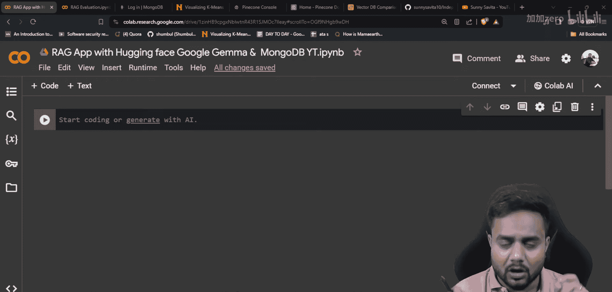
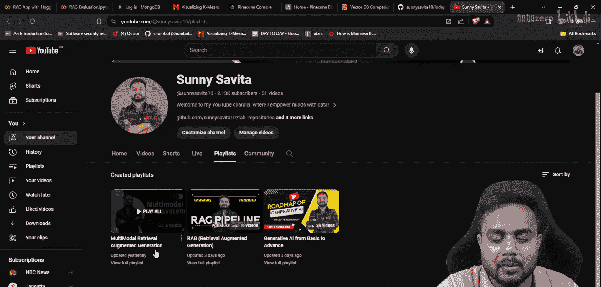
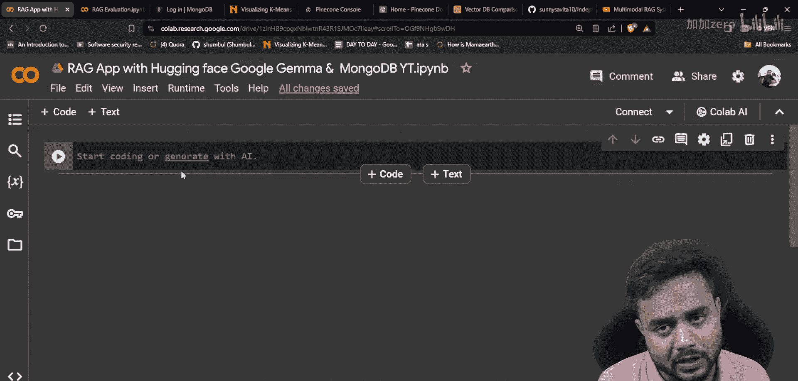
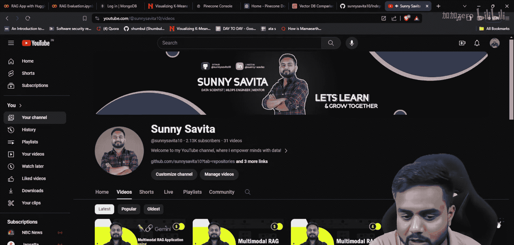
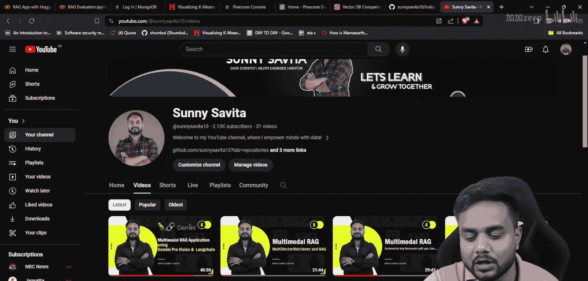
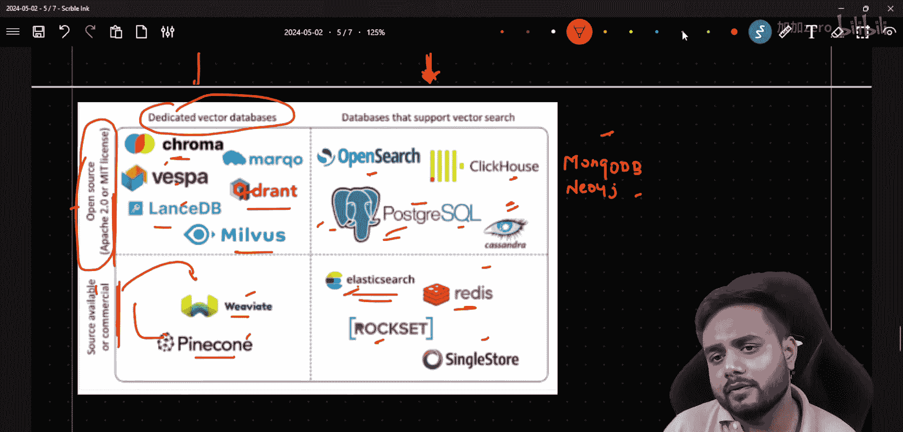
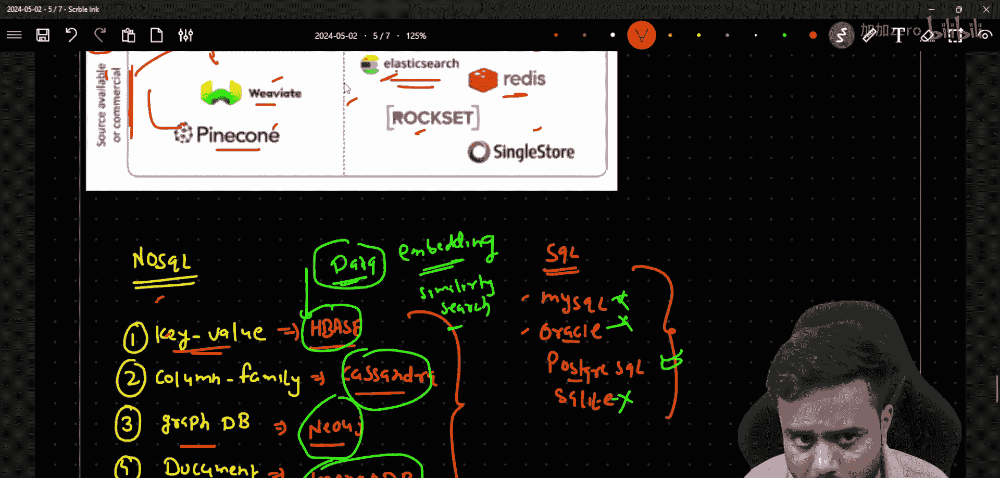
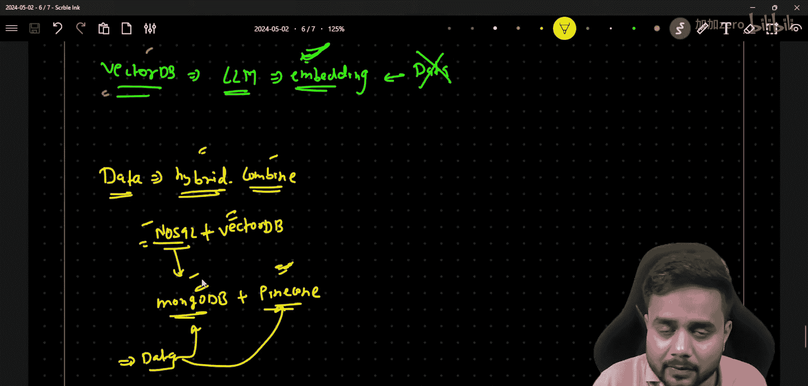

# Sunny Savita【中英⚡生成式AI：从初学者到专家｜Generative AI In-Depth Roadmap from Beginner to E】 p30 P30 End to End RAG App with Hugging face Google Gemma &  MongoDB Vector Search # [BV1Uht8zDENA_p30]

Hey hellello everyone。 welcomelcome back to my YouTube channel。 My name is Sunny Savita。

 and in this video， were gonna discuss rag application with Google Gma and Mongo D Yes guys。

 so recently I was creating a video on top of the multimod rag and I created one playlist on top of that if you haven't checked that guys。

 please go and check with my YouTube channel there you'll find out around6 to7 video inside that playlist In this multimodel retrieval augment generation So each and everything I try to cover with respect to this concept now I came up with one more new series where we are going to discuss no SQL databases as a vector search Yes so we can use this nosQL databases also as a vector search like we have other databases find con the dedicated vector databases Okay in a similar way we can use this nosQL。

😊。

abase also so here guys I decided around five video So in the first video I will discuss about the Mongo Db Mongo Db vector search in the second one I will be talking about the cassandra then elastic search then no sQL and then postcra okay so we will get around five video inside this series and here。

We are going to be start from the Mongo Db itself each and everything I will show you here itself in the in this tutorial I's going to be quite long so because each and every code I'll be writing in front of you So before it's starting with the session let me tell you why we are going to be use this Mongo Db as a vector search and what is a benefit of it not Mongo D I'll be talking about with respect to the entire no SQL databases all the nosQL databases and all Now guys here is my YouTube channel if you want to learn the gene definitely you can check out over here So you will get the different different video with respect to the geneative Lama index and all and I'm uploading like different different video other video as well so soon you will find out so many content or my YouTube channel if you haven't subscribe you can subscribe and yes you can press notification button so that whenever I'm uploading the video you will get the notification Now first of all what I'm doing here So here you can see guys I just。

One image from the Internet itself。 So here you will find out the different different database right so let me highlight all these databases。

 So here we have this chromma chromroma lens tb I think we have used in the previous application then we have this malvius right quadrant is there very popular database now here you will find out the pine code So we know these databases actually it's a dedicated vector database now apart from that you'll find out some other databases which is not a dedicated vector database but yes definitely we can use those database as a vector database So in that youll find out this cassandra I think you have seen this cassandra and now people are using for the as a vector database because here also we can do the similar search postg also postgre it's a sQL based database but here yes here also we can do the similar Now other databases like open search and click house and all now in this one I can write a few more so Mongodb is there I can use。

go Db now I can use this neo 4j okay Ne 4j and here you will find out the other databases like elastic search Okay right is we can use and rocket and this single store in all。

So different different other database。 but this Mo would be new4j cassandra postc these are a quite famous one。

 And here we are going to be used this database for the other perspective also okay not for the embedding are be using this particular databases for the different different other uses as well for storing the entire database Now it here you'll find out So all the databases。

 this one this chromma coordinateine are the open source database they have mentioned over here it is under the Apache license Now here you'll find out this is not a open source this is for the commercial purpose。

 this one P Web similar to this like P web。 So here we have the elastic source So this is also a commercial purpose means this is not a open source Now here apart from that if you will come over here in this particular site So postc casandra this is the open source database which is under this Apache license but just focus over here dedicated to vector database dedicated to the vector and dedicated。

😊，It is not dedicated to the vector we can use for the multipurpose for the other thing as well okay these these databases which I am pointing out over here now whenever we talking about the vector database C let me write something over here so let's say if we going to talk about no sQL database so this no sQL database itself we can divide into four part so the first part is called key value pair。

E value pair， the second is called。Gold family。O。好了 family。Cleman family。

Then the third one is called graph database okay， the third type of database is called。

Graph database。The fourth one， which is called document based database。好嘅。

So these are the different different database， different different type of no SQL database now here if you going to talk about this key value here so here I can write h base。

Okay。Now this one， a column family Cassandra is there。Here graph database， new4s there。Okay。

 this document database mon O Db is there and we have like several databases right we will find out like hundreds of databases inside this particular category so these databases actually see we have other other side other than this one we have the SQL databases sQL base。

So there you'll find out the my sql， which is very famous， you'll find out the oracle。Okay。

 you'll find out the other databases。Alex a post create equal。 Okay， postg equal is there。

There you will find out the mysql oral postque SQL light and we have a long list Okay longer list sorry sQL light a T so we have a longer list related to this particular databases So this database we use for adding the fororing the structured data and this database we use generally use for adding fororing the unstructured data Okay this is no sQL databases I think we know about it now other than this one nowadays one more database which is getting quite popular there is a vector database why because nowadays you will find out in every Lm based application we are using the embedding right embedding this embedding is nothing it's a vector only So for storing this embeddings and all because whenever we store the embedding we require the index and inside the index actually the particular index we are going to be stored that vectors numerical value So here we have the different different database like P going wave wait and all But guys here inside this database inside this databases。

the vector database we cannot restore the data Okay it is not possible we we can only store the embedding over here。

 but if we want to talk about this nosql databases so here hbase cassandra neoo4j mongo Db we can store the data we can restore the data and along with that they have given the option for installoring the embedding also。

Geting my point means on top of the embedding， you can perform the similar T search。オ。

Similar to search now Sql also so in the my sql in the verticalacle in SQl light light。

 you won't find out this thing， but yes， post scale is giving you that。

Po scale is giving you that Now apart from that we have other solution as well like red is okay search and all。

 So we'll be talking about these databases also so I decided around5 to six section for this particular series and definitely I'll be teaching you everything So here what I'm doing So in the previous in the previous like solutions and all we have use the different different vector databases I use the lens TV pine going we p now now basically we are going to use a different different NosQl databases So along with the data we can store the sorry along with the data we can store the embedding as well and here guys one more thing C if you will go in the industry so the data is going to be quite complicated the realtime data actually its going to be quite complicated you will get so many columns and all so here you will be taking the hybrid approach hybrid approach now in that what you do actually in this hybrid approach all the combined approach you take the nosQL data for。

ing the data as well as you take the vector database is specifically specifically fororing the vector okay so that solution also I will tell you the combined solution so you can implement this particular solution the real time here is my point so that you can implement this particular solution in the real time hybrid solution also I will be talking about the NosqL database plus vector database so here what I will do so right after this Mongodb so as a NosqL database I will take this Mongo Db and as a vector database I will take the pine code。

This fine cone okay and what I will do I will be taking the data and this data I will be storing inside the Mongo Db and corresponding to the data I will be storing embedding inside the fine con。

Because see， this is also storing embedding inside the Bomo Db so we can store embedding。

 but there can be some advantage on inside this fine cord means it it it might give you the faster search it might give you the。

Like it might give you the faster search or maybe you can store as much as em madding compared to this Mgo Db okay。

 you can do the scale。

