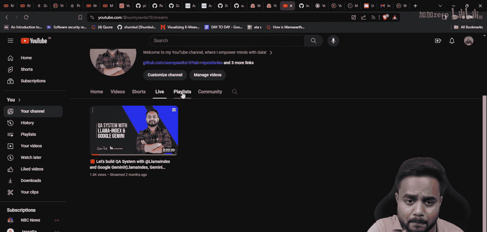
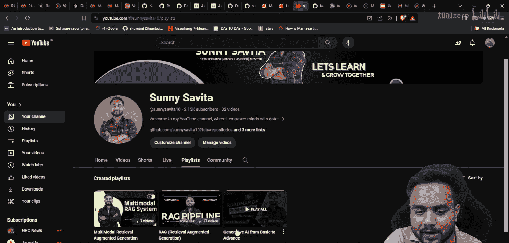
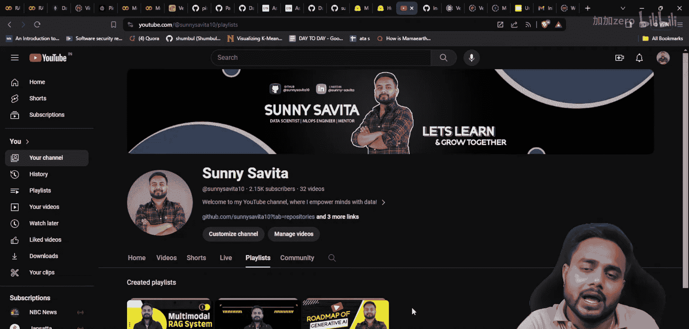
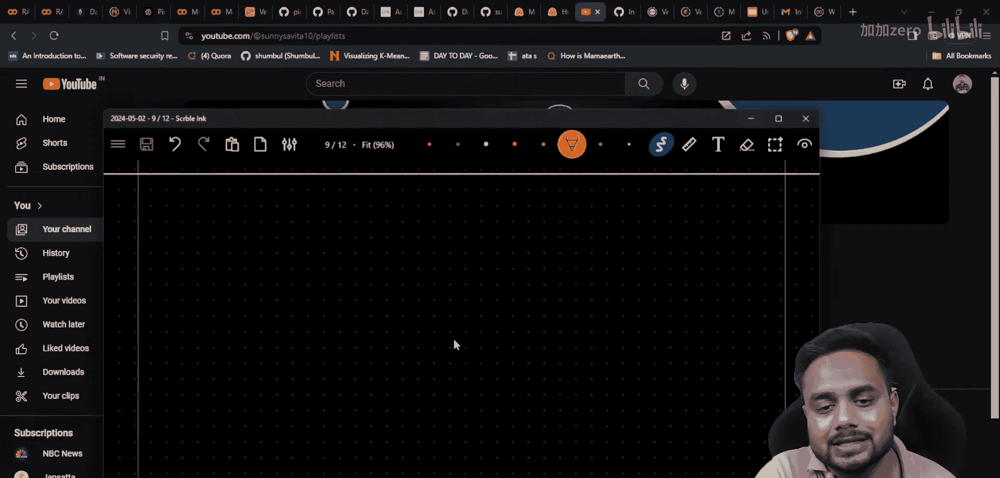
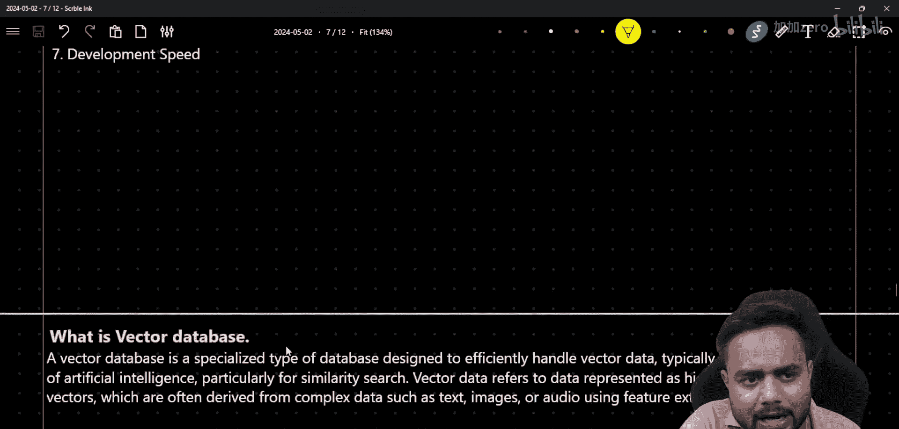
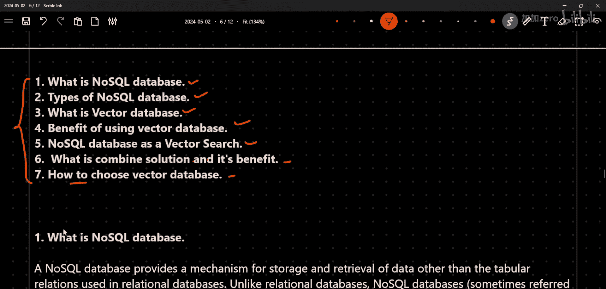
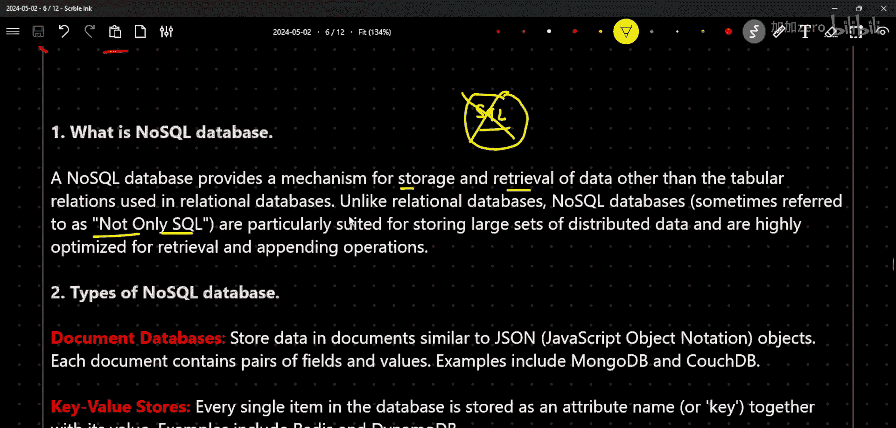

# Sunny Savita【中英⚡生成式AI：从初学者到专家｜Generative AI In-Depth Roadmap from Beginner to E】 p31 P31 Building Real-Time RAG Pipeline With Mongodb and Pinecone Part-1 #rag #llm # [BV1Uht8zDENA_p31]

Hello everyone。 welcomelcome back to my YouTube channel。 My name is Sunni savita。 and in this video。

 we gonna build one real time solution with Mongo Db and pine code。 So guys。

 I was creating the video on top of the rag retrieval augment I created many more video on top of it。

 and I try to explain you each and everything with respect to the rag。

 whether it's a multimodal rag or the other part of the rag。

 Okay I try to explain each and everything from scratch。

 Now guys I told you that Ill be coming up with a different different solution。

 not like the random one， So Ill be creating each and every video in the sequence。

 So in order to that I came up with this Mongo D with pine code。

 So in the previous video we have seen that how we can utilize no SQL database that is Mongo Db as a vector search So in that video I shown you if you have no SQL database like Mongo Db or other one。

😊，the like data tag sorry this cassandra or red is okay how we can utilize it as a vector search I just created one video on top of the Mongodb rest of the video will be uploaded now guys Ive seen Ive seen at many places that people are using the combined solution in the real time they are using the combined solution so they are taking one nosesql database and the other one is the vector database why guys they are doing like this because in the real time actually we have a lots of data right whether we are talking about the tableular structure data and a structured data or semistructure data So whenever we get the realtime data in that actually we have lots of column lots of other different different type of met data and all so just by using the vector database we cannot build the solution it's very tough So along with that actually we need to use some other database which can hold the met data so we can hold the embedding by using the vector database and we can hold the meta data。

By using the other No SQL based database SQL or No SQL but generally we use the No SQL database only so here guys that' is why I came with came with this particular solution where we are going to be create one rag pipeline and to drag pipeline by using this Mongo Db and this fine code and apart from this one I will clarify each and every with respect to the rag okay with respect to the other database is also。

Now apart from that what is the nosQL databases So each and everything each and every landscape I I will be clarifying over here itself。

 Now let's begin from starting So first of all， guys let me show you my YouTube channel if you haven't visit that so please go and check because there I uploaded many more video with respect to the rank and I try to complete one playlist as well so here inside those inside that playlist you will find out around30 videos here you can check now I have three one So with respect to the multimodal rank the second one with respect to the rank as the third one for the gene in that actually youll find out every video like gene introduction Lama index and all everything so you can check out if you are willing to learn the gene V and will help you a lot now guys here first of all。

 let me clarify all the basics and the theoretical stuff so you won't feel like you are learning this type of thing Okay no sQL。

or vector databases。 I would like to clarify few theoretical stuff and then I will come to the practicals and how you can solve this type of problem。

 So here guys inside the theory， I kept a couple of theoretical point with all of you so that most of the thing will be clarify over here itself。

 Now guys here see I added seven point So one by one step by step we are going to be discussed is a particular point。

 So the first point， what is a nosQl database If you don't know guys。

 this thing is going to be clear。 let me hide my camera so that you will get the access of the entire blackboard。

 Now here guys， the second one type of the nosQl databases。

 So the third one what is a vector vector database。 the fourth one benefit of using vector database。

 the fifth one， NosQl database as a vector database consists what is a combined solution in its benefit and how to choose vector database So these seven points I have written so that each every theoretical stuff will be clear to all of you。

Now， the first one， the first point is what。What is a NosQL database。 So nosQL data means what。

 So here guys， we can store and retrieve the data。 Okay。

 without the SQL language means here I'm saying I no need to required SQqL。

 and I know need to store the data in the tabular format without that actually I can store the data and I can retrieve。

 And here don't use this SQL language。 Okay for any kind of storage or for any kind of retrieval。

 and that is a meaning of the NosqL， it is called not only SQL。 here I mention it not only SQL。

 So now whenever we are talking about this NosQL database guys。

 So it is having some sort of advantage right on top of the SQL database。

 So those advantage also will try to discuss over here。 Now， first of all， guys。

 let me show you the type of the NosQL databases which is very， very important。 Now again。

 I'm saying this video is not dedicated to the databases。

 this video is dedicated to the combined solution。 but here I want to clarify some basis。

 That's why I can。😊，With this theoretical stuff Okay now the second point is what the second point is type of those equal databases inside that you will find out different different type like document ways。

K value is stored white column is stored or columnar family stored or graph databases。

 Now in the document， basically how we are going to be store the data。

 we are going to be store the data in the form of Json right I think you know about the json So like this we can create the json object in that we are going to keep the data inside the key and value right So this is what this is called my document and this particular format we are going to be stored the data Now Mongo TV and couch D is one of the example of this document database Now apart from that we have this key value is stored So in the key value is stored you can see red and dyna D comes Now whenever we are talking about the key and value。

 So this is different from this document database in document database。

 we keep the data in the form of json。 But here in the key and value pair in the key and value storage。

 we don't create the Json object we simply create the key and value pair over there so every single item in the database is stored in the attribute name that is key and together it's a value So whenever I will be doing a practical with respect to the nosQL databases。

Defin I'll be showing you that Now here in this particular video， we are going to use the no Mogo Db。

 so definitely will get to know about it。 how we can create the document from the data is how we can create the key and value from the data。

 Okay now here the second one is third one is called wide column is storage or it is called column family So here also we create the column here also we create the table and the data which we access not the row wise actually we access the data based on the columns so here cassandra or Google big table these are the pretty common example of like import S now the next one is called the graph database So here actually we are going to design a data we are going to store the data in this graph format where actually will find out the node and edges So graph how the graph looks like tell me So the graph actually will find out So let's say this is what a point now here is what point Now this is what this my C point right。

actually I have to make a graph。 So let's say this is what this is my graph。

 Okay so here this is called the node。 So this is what this is the node and here this is what this is the ages。

 So likewise actually we are going to be we are going to be we are going to store the database and here we are going to showcase the relationship in the form of this node and ages right I hope this thing is clear Now whenever we're talking about the this graph based database。

 So there actually youll find out this newpo and this Amazon naptune So this do database actually it's called the node sqL graph based database So I hope this thing is clear to all of you now see guys whenever we are talking about no SQL database we can divide into the multiple category as some of the database nowadays we can use as a vector such also we have a dedicated vector database but in these database we can use some database as a vector So those database the name of those database definitely I will be showing you in this session itself Now apart from this one I have written some sort of。

age of this No SQL database to at least someone is asking you so definitely you can explain。

So let me tell you that so first is is scalability its a very scalable horizontal vertical generally we use the vertical generally we scale on a vertical sorry generally we scale it on a vertical sorry horizontal level not a vertical no sL data sorry sqL based database actually we is scale on a vertical level but here is no sqL horizontally what is a vertical scale what is the horizontal scale。

I will be talking about in the upcoming session when I will be discussing about the databases。

 Okay dedicated databases。 Now here is distributed architecture。 So yes。

 it's a horizontal we can do the horizontal spread。

 So definitely its a it provide the distributed architecture Now here manage large volume of the data definitely it means it can manage a huge amount of the data and there's no SQL databases it is being used in the real time also Now flexible schema。

 Yes， it is having a flexible schema compared to the SQL means on the runtime itself we can change the schema Okay now high performance high availability development So these all are the advantage of the no SQL database and it is true guys So whenever we are going to implement it in a real time in the project definitely you can feel these a particular thing right scability distribute。

distributedistbuted architecture manage a larger volume of the data flexibility and all。

