# Sunny Savita【中英⚡生成式AI：从初学者到专家｜Generative AI In-Depth Roadmap from Beginner to E】 p32 P32 Building Real-Time RAG Pipeline With Mongodb and Pinecone Part-2 #rag #llm # [BV1Uht8zDENA_p32]

Hey hi everyone。 welcomelcome back to my YouTube channel。 My name is Sunni Savita。

 and in this video we'll see how we can build a realtime rag application by using Mongo Db with pine cone So in the previous video I shown you that how you can connect this both database So Ive shown you how you can sync this both database on the first side。

 we have shown you how we can install the data inside the Mongo Db and corresponding to the column right with respect to the particular column we were isoring the embedding inside the pine con。

 So one side we will be having the we were having the entire data which we are isoring inside the Mongo Db and then on the other hand。

 we respect to particular column right so we are isoring the embedding inside the pine cone So there is going to be a combined solution and now we can see how we can create a rag on top of it。

 So guys I have talked with many people I talk with my colleagues or with my friends and whoever working in the industry and they have suggested to meet this solution。

😊，And they told， please create a video on top of it so that everyone can understand about it and they can integrate inside their project as well because this is the near time implementation where we are going to be connect this nosQL database with the vector database and many time at many places actually will find out this type of solution with respect to the rag So this video is going to be very important please to watch and here I'll be sharing some in depth insight Okay with respect to this Ra and all。

 so don't miss out anything and yes， let's start with the solution。 So first of all， guys。

 let me show you my YouTube channel。 they are actually will find out many more video with respect to the geneative A now here one more good news so I have added my foundational geneative AI series geneative A foundation series definitely you can check out here we have around 10 video and definitely you will be learning many more thing over here Now apart from this one you will find out all the video in the。

😊。

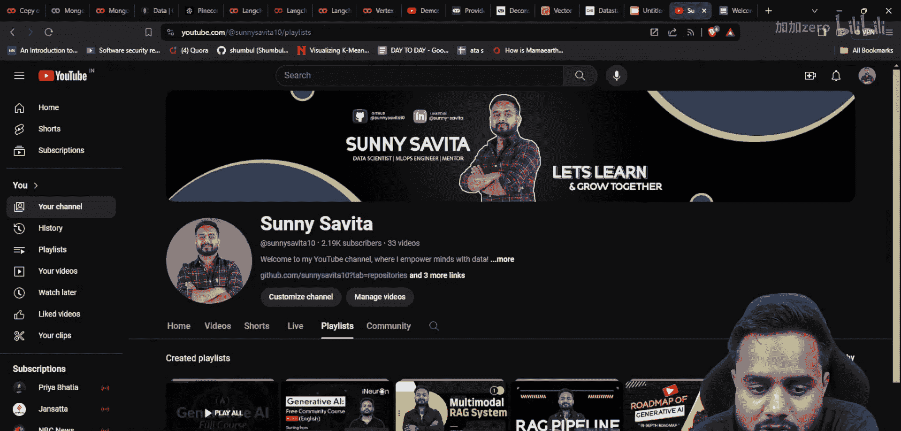

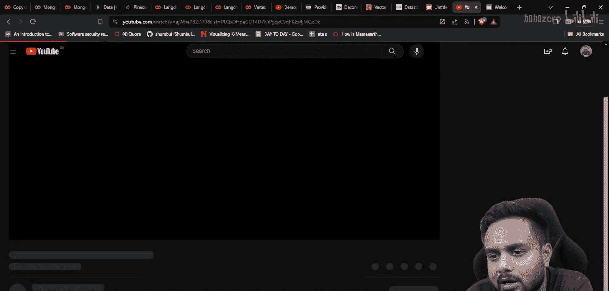

Single video itself as a full course。 So this video has been published to the freecode cam here you can see。

 So this my course actually it has published to the freecode cam and just see the number of views and the number of comment。

 So people liked it a lot and they got a lot of benefit from this particular course。

 So definitely you should check out it and if you want to learn the genetic please follow to my channel。

 Now apart from this one guys one more thing I I want to say here So in in a video guys in the description I I have attached one feedback form as well。

 So once you will click over there， you will find out this particular form， this one feedback form。

 So here inside the feedback form you need to write your name whatever content。

 whatever topic you want from my end you can mention that over here or whatever suggestion of feedback you have related to this particular channel you can mention that also So based on your feedback based on your topic whatever topic you want majority of the topic I'll be creating the content。

😊。

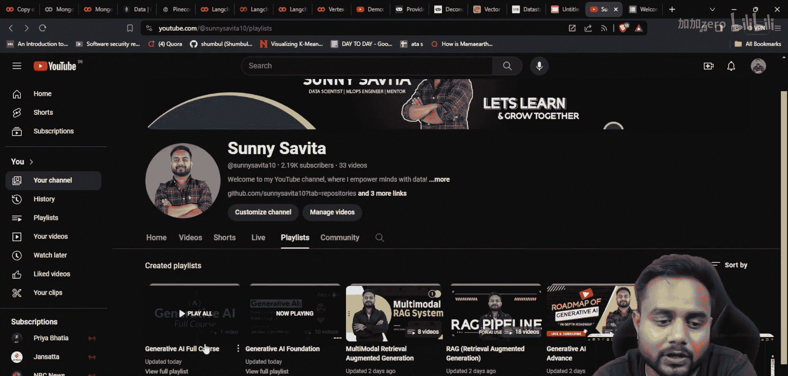

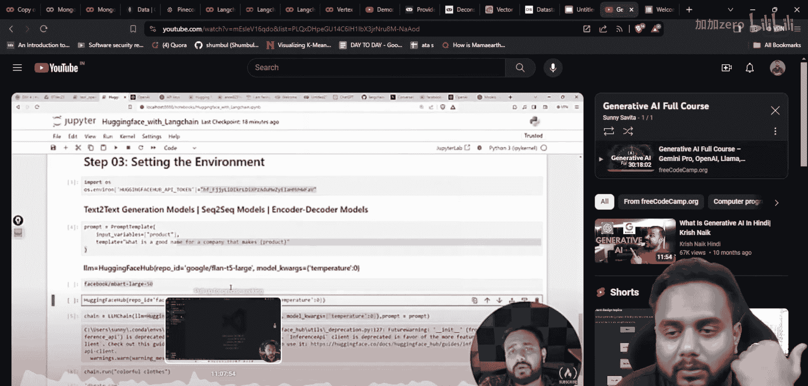

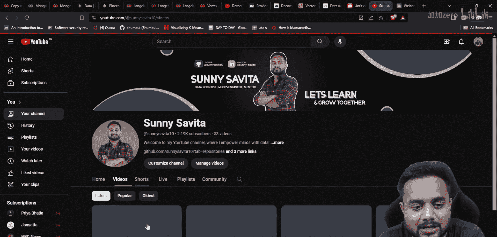

Channel actually it is for all of you。 It is for my community。 It is for my learner。

 If you are getting any benefit from this channel， then only it is having some importance。

 okay it's a worth otherwise it is completely based So guys if you are liking the content then please support the channel please subscribe it。

 please share with your friends whoever required this type of content or whatever you want from my side any kind of improvement any type of topic you can let me know because nowadays in a market youll find out many more creator So how I can stand out from all those creator how I can be a different So this is my moto。

 this is my idea and definitely like you will have to support for that and whatever content Im uploading it's industry great guys you won't be able to find out this type of content freely Yes you will be getting some sort of a video。

 but not in the sequence， not in the tab So this type of thing。😊。

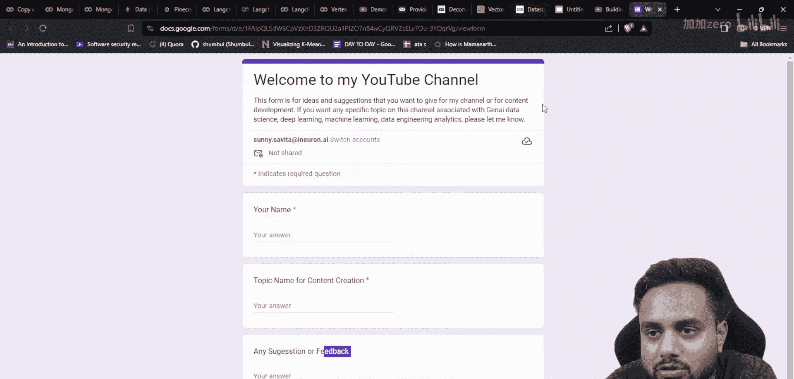

Able to get from some paid course and all， but here Im providing you that completely free。 And yes。

 this is my motto to empower the community to please the community this complete AI geneative AI and all so that we can become。

😊，Like we can we can learn and become become the job ready right so we can crack any sort of interview with respect to this AI and the geneative AI Now let's begin with the video。

 So first of all， guys， let me show you my previous implementation。

 So here what I did actually I connected this Mongo Db with the P code So this is the entire code Now let me give me the complete overview of overview of it and then I'll be showing you the rack part how I have created the retrieval and how basically we are going to be generated the response。

 So first of all， what I can do here So here let me explain you this particular thing where what I have So here actually we have a different different library Pine codee is required Pgo is required transformer is required then。

Here you will find out just the code for the connectivity with the connectivity with the Mongo Db I already showed you how you can connect the how you can connect with the Mongo Db。

 right。In my previous session， I show you the complete configurationgregation of the Mongo。

 if you haven't checked， please go and check over there。 you'll find out inside this video。 Okay。

 the complete detail in this one right in the part one only now what I will do so after connecting with it So here I'm going to be connect with my pine go as well。

 So this is all this is my pine go I created already I create a database let me do one thing here let me create the new new database because I already create it over here let's do one thing so let's delete this one and I'm going to write I'm going to create with another name So first of all what I can do here I can delete this index and let me create the new index and that particular index I'm going to be connect so my name is going to be Mongo movie So this is what is my name because my data is belong to the movie data So here this is the name now let me write the dimension also 102 for the dimension。

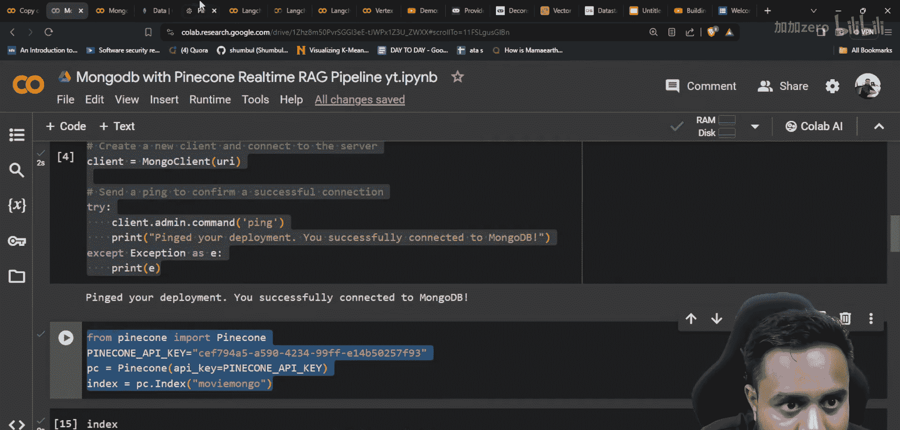

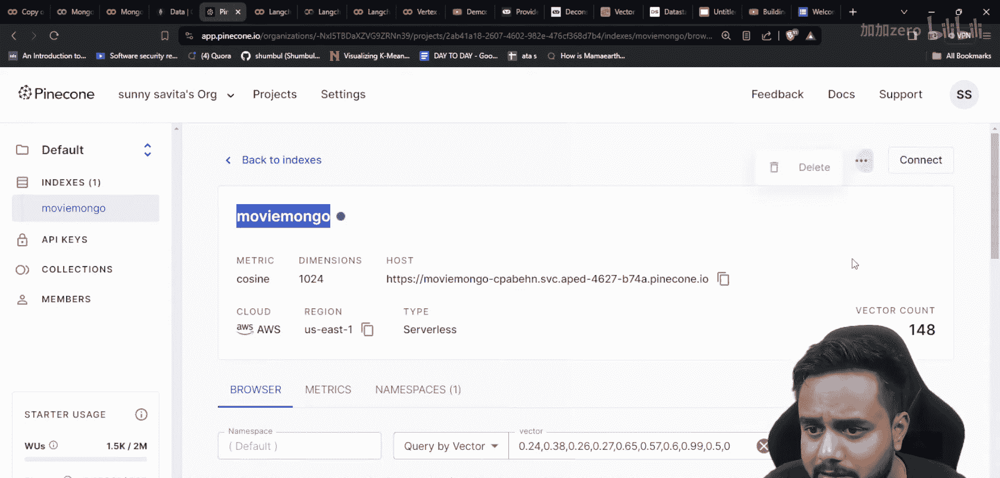

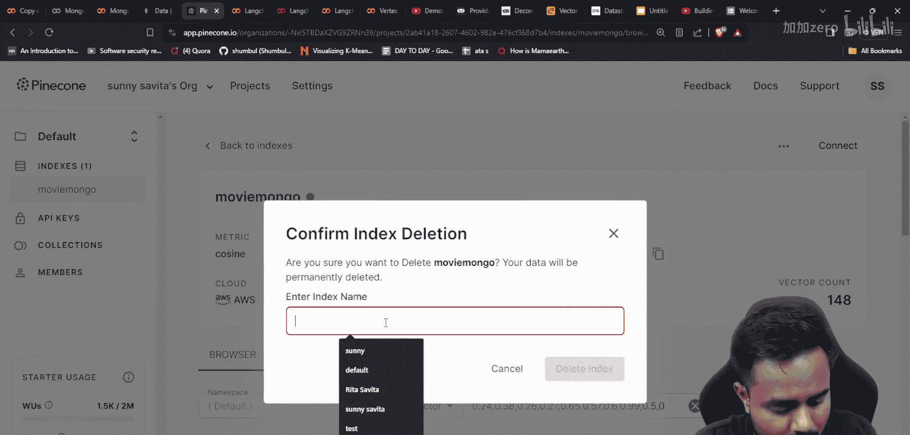

Now everything is a by default now let me create the index So movie Mongo Mongo movie this is going to be a name so let me change a name over here and let me connect with my data Pone database So whenever I will be uploading any sort of data inside my Mongo Db automatically the data will be reflected inside the tell me。

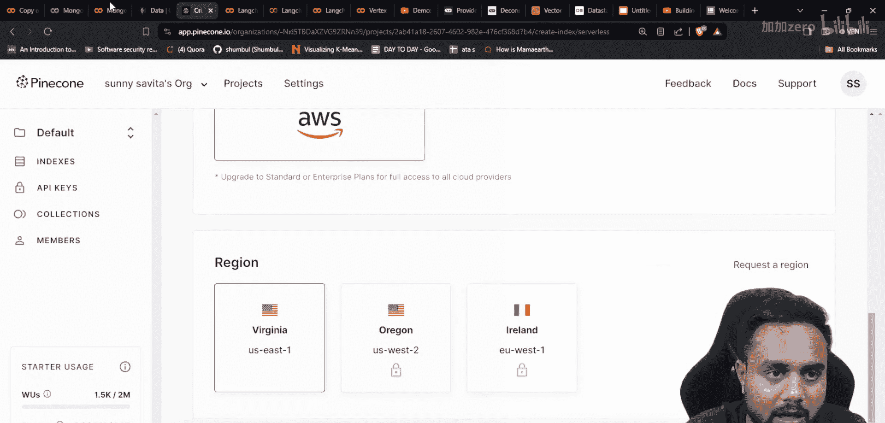

Inside the pine con。 Okay， the corresponding embedding。 So here I'm going to be connected。

 first of all， let me check whether something is running or not， I think it it was running。 Now。

 let me do one thing here。 first of all， let me connect with my index。 if it is ready。

 then definitely I can connect。 Yes， it is ready。 So this is a connection。

 which I am able to make if you want to know how we can generate the API all definitely you can check out with my previous session already I have shown you that。

 So this my index guys， and this is my database name。

 I can change this also because this I have used in my previous video。

 So here I can keep the different name， movie my movie my D。 movie my D and movie my collection。

 This is what is the name you can write any sort of a name， not an issue with that。

 So this is going to my database and here is going my client collection sorry and here I already install this transformer I did it because I want to create embedding。

 So here I am going to import the embedding model So inside this particular variable。

 you will find out the embedding model。 Now I'm going to be executed。 So that guys。😊。

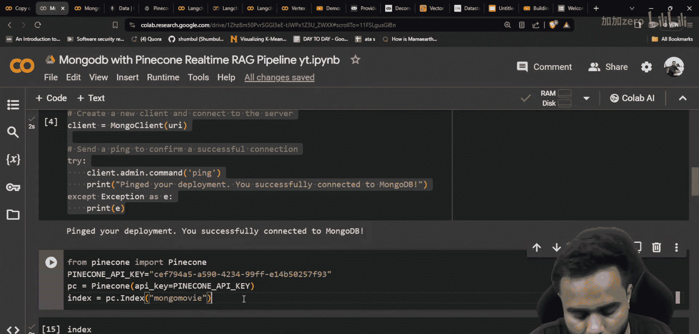

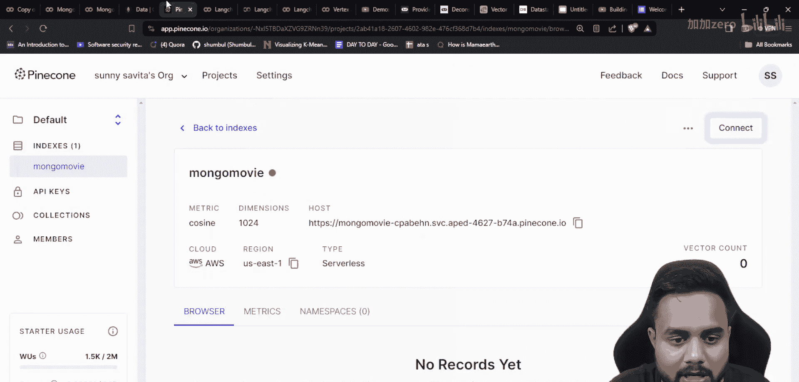

Whatever I'm getting a data inside my database so that I can upload the embedding inside the pine now I'm continuouslyly watching to my collection and then whatever operation is happening according to that basically Ive written a code So let's say if I'm going to insert the data here I'm detecting the changes then I'm going to be create embedding with respect to this full plot and then I'm going to be store this thing inside where inside my pine this is the complete code guide which I return so here Ive returned with respect to the update also if I'm doing any sort of a changes update inside the full plot okay so that is going to be detect and the embedding is going to be update relative if Im going to delete anything so this is the deletion operation right it is a sync this Mo db and the pine now what I can do here So here I can show you the further code related to the right So here I'm not going to be execute from a scratch I return the code inside this file is step by step I can explain you because it is very very easy no need to copy and paste。

 no need to write it down from a scratch。

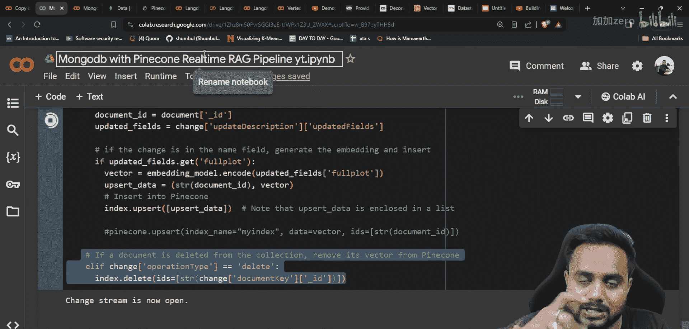

By reading this one by understanding this one definitely you can understand。

 but what I can do I can explain the architectural part here on my blackboard so that you will get some sort of idea Okay so see guys what we are doing we have a data。

Or let me switch on my camera so that we will get access of the entire screen。

We have a data let me show you the data here in the data actually what I have， I have 18 columns。

Again，18 column in the tableau format Now in this column actually we have one column that is a full plot so this full plot actually is keeping the entire description of the movie Okay。

 now what I will do I am taking this particular plot full plot I am creating a ambidding okay with respect to this full plot。

W blood。Okay， now I am creating an embedding so here is what here is my embedding let me keep it over here。

Then I am storing where guys tell me I am storing this particular em inside the pine go so here is what here I have my pine go database now inside this pineone database I am going to be stored entire em now the rest of the data okay so whatever columns we have 18 column where we don't have any em okay we don't have any em only the data okay only the data only the all the 18 column I am going to be stored where tell me inside the Mongo Db。

Got it yes or no， So here we have this Mongo Db Mongo Db and this is what this is my pine cone this one pine con pine cone naturally is steeping the emdding only with respect to this particular column whole plot。

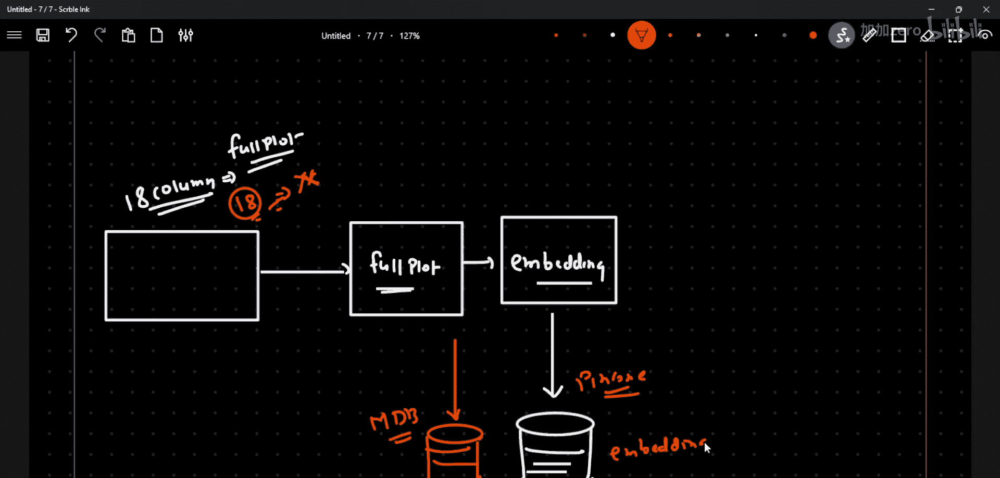