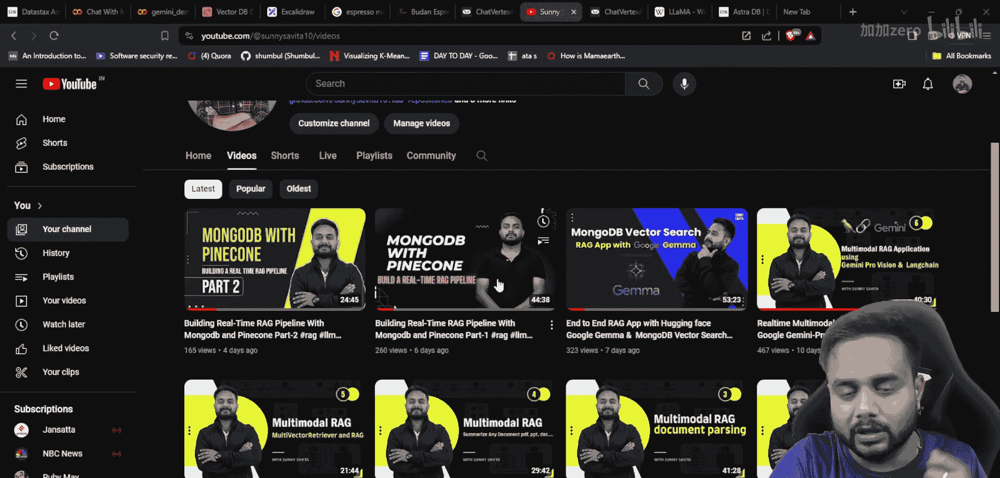
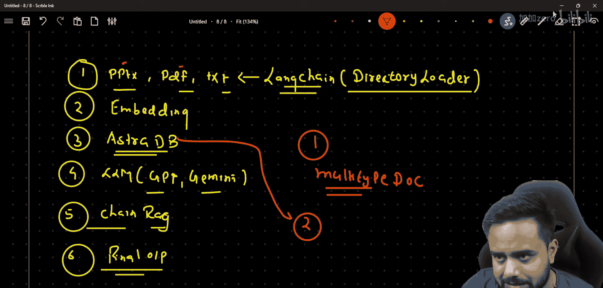
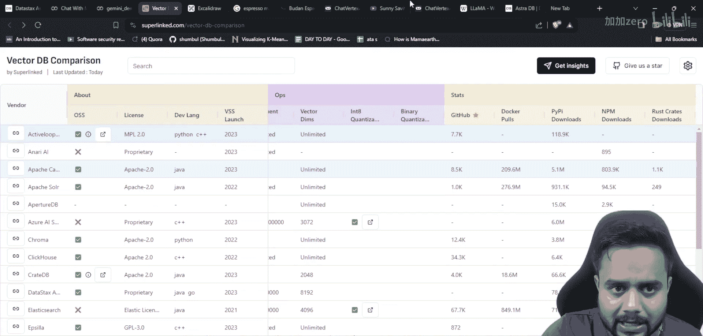
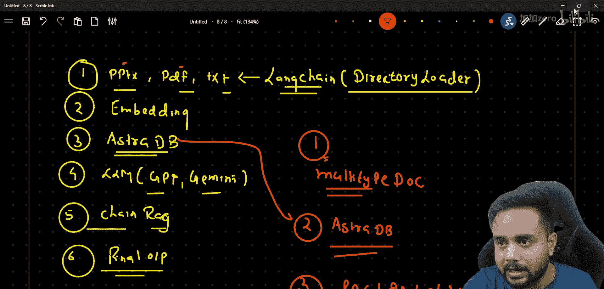

# Sunny Savita【中英⚡生成式AI：从初学者到专家｜Generative AI In-Depth Roadmap from Beginner to E】 p33 P33 Chat With Multiple Documents(pdfs, docs, txt, pptx etc.) using AstraDB and L [BV1Uht8zDENA_p33]

Hey hi everyone。 welcomelcome back to my YouTube channel。 My name is Sunni Savita。 and in this video。

 we'll see how you can chat with the multiple documents like PT Pdf tags or many mode。

 So this solution we are been to by using the la and the Sradb guys a data actually they provide this Sdb which they have created on top of the Cassandra itself。

 Cassandra is a type of the NosqL database。 It's a columnar family database and here this data actually sorry this eradb they have created on top of the Cassandra。

 So you can say this Etradb is nothing it's a cloud version of the cassandra。

 Now this Eradb we can use as a vector database also yes。

 So previously in the previous video I was using Mongodb as a vector database for performing the vector search Now here in this video。

 we're gonna use this Eradb that is cassandra as a vector database。😊。

So step by step one by one obviously I will show you the complete solution。

 but before that guys let me show you my YouTube channel where let me highlight some point so if you will go if you will go and check with my YouTube channel guys so here you will find out I was creating the video with respect to this rag and all so I created a multiple video where at the first place I clarify that what is a rag and how you can create a rag by using the different different framework then。

I have shown you that how you can create the multimodal right。

 And then after this one I came to this different different NosqL database。 So Mo Db。

 I already shown you how you can use the Mongo Db vector search and then I show you one more solution where Mongo Db with Pcon So if you have a huge amount of data where you want to be stored the met data inside the Mongo Db and the vector inside the P code。

 Yes， so that solution I have shown you here definitely you can check out and it will help you along Now coming to the next point over here。

 which is going to be next database which is going to be Atra Db So here in this particular series I will be covering five database first is nosqL sorry first is this Mo Db。

 second is this cassandra and the third one is going to be Ne4ge then red is and then elastic search So you will be having all the database and all and with respect to that you will be。

The applications also so whenever you are building any sort of application you will get the flavor of all the databases。

 So first of all let me do one thing， let me show you the agenda okay the complete agenda of today's session so what you want to learn here and what all thing basically you can build after learning this astra Db or this multiple chat system and all so first of all guys see first what I will do here basically Ill be loading the different different document so different different document from where from my direct itself so I am taking three type of document in this particular solution so the first document I'll be taking that is a p then I'll be talking the PDFf。

And then I'll be taking this on TX document I can take other document as well like HTMLml or Xml file or Json file or any file。

 but here I'm just taking three because it takes time whenever I'm going to be load it now inside the variable So definitely takes time because the passing thing is it a time taking thing then the second thing what I'm going to do here So after loading it see here are basically for loading this particular document I'm using a L So L actually is having a very good method that is called the directly loader。

Okay so definitely you can check out and I'll be showing you through the documentation also so it is having a very good method。

 so very good class actually not a method that is called directly rot So I be using this particular method for loading the data before that guys if you will go and check with my YouTube channel So you will find out one more solution that was related to the unstructured data So if you have anstructured data in any sort of a document so you can you can get all the all those data from the single document also so let's say in one document you have images。

Table tag tag， right So all the data you can you can get okay from the single document itself by using that onual library So somewhere here I have shown you that let me point out that session as well see this one。

Model passing。 So extract image table tags from the document itself。 I hope you are getting my point。

 What I'm trying to say here now。Coming to the point here So P Pdf tag and here what I will do。

 So I will be creating an embedding from this particular data。 So whatever data I'll be collecting。

 Ill be doing a embedding Now before see before embedding actually what I'm going to do here Im going to be convert into the chunks right So PT Pdf tag。

 whatever data I'm going to be collect， I definitely I will be convert into the chunks only then after the embedding。

 I will be storing this particular embedding inside the astra Db So this process I will show you this particular process how you can configure it then finally Ill be creating I will loading my LLM So as a LLM you can utilize anything So here I'm going to be use the G model or gymni also I will be showing the Gp and gni both So GP and gymni Now many more solution I have shown you in my previous session guys if you will go and check there you will find out whether a g GPel or Lama right any sort of a model you can use any sort of a model you can load many more solution。

I have explained you in my previous session then after that after this LLm then I'll be creating the chain okay that is nothing theres my rack chain then this rack chain actually I'll be creating by using board by using the length chain itself so this is going to be a very important process so and after this one only i'll be getting the final output so guys here that solution name is board so here we are going to be solve this multi multi。

type okay I'm going to be collect the multi type document。

 So different different type of document we have like PPPdf text and all。

 So this is the first thing basically which you can take from here。

 So if you have any sort of a data right a multitype is a different different type of file different different type of document So you can like load that particular data for what for creating your system the second thing here which you will learn So the second thing is nothing。

 you will learn how we can use this astra Db right So we have so many databases if you will go and check see here in the previous session also I have shown you that how you can make a comparison between the different different database So this was a website basically this superlink dot com and definitely I'll be giving to you by using this one you can you can like compare the different different database based on the different different factor and inside this one you will find out this astra Db also So where is astra Db this one Aache cassandra it's nothing it's a astra D only。

just see over here。 So they have given you each and every information related to that。

 So about search， okay， for what our model actually is going to be support that APIpi is for what our API is going to be support and then states So different different parameter you will find out。

 And based on that， definitely you get evaluated。 So after discussing all the all the Nosql databases like this reds last search Neo4j all this cassandra I have plan three use cases with respect to this cassandra。

 So I will be creating one dedicated video where。This parameter will like to understand this particular parameter in detail until what you can do。

 you can go through with this particular parameter and you can read about it。

 You can read about this as Apache casandra to what all thing actually is going to be support getting my point。

 I will be mentioning this link inside the description。

 definitely you can check out Now apart from this one guys here let me open my blackboard。

 So multiple document， definitely you gonna learn about the extratradb。

 how we can utilize it Now related to this extratradb basically， Ive created three solution。

 So this is a first solution where actually you are going to be chat with a multi document， right。

 the second one is going to be a multimod where you can use the images also you can create a embedding of those images and you can stored inside the astradb。

 The third solution is going to be a chatboard。 So here I will be coming up with ecommercecommerce chatboard。

 I collected a data from the Internet， I scrap completely from there And then what I'm going to do。

 I am going to create a chat board on top of it。 So this is a first solution。 Those。

Like upcoming you will get in upcoming days。 So I recorded the video So after this one those video will be uploaded on my YouTube channel Now after this one guys。

 Sb， you will learn that how we can create a rack answering system on top of it or how you can create a chatboard because now in the question answering also you can add the history and yes in the rack pipeline also you can add the history and you can as a chat board you can utilize or you can consume it as a chatboard got it getting my point So this particular thing basically we are going to be throughout this session So first of all what I can do So first of all。

 let me do one thing let me show you the solution where I have created the solution So this is the entire solution few of the few library actually Ive already installed because it takes too much time and I don't want to be based on necessary time because here Ive created a solution and the next video I will be giving the chatboard also so definitely this notebook you can convert into the end。

Soution and already many more video you will find out on my YouTube channel where I have show you the end to end project that definitely you can convert this particular notebook into the end to end notebook end to end project got it so here inside this document。

