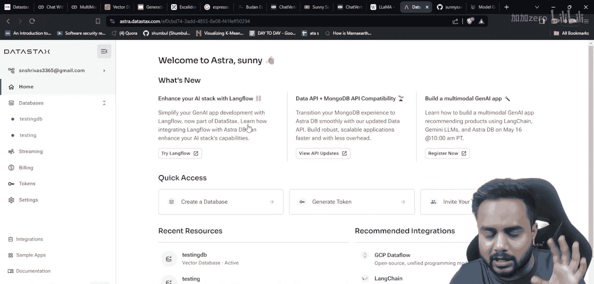
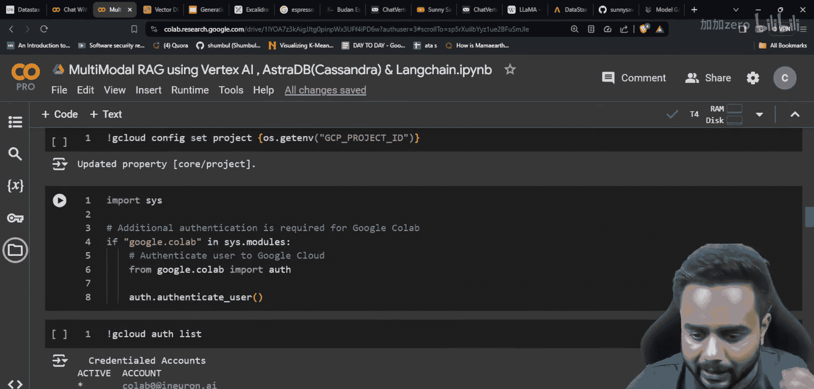
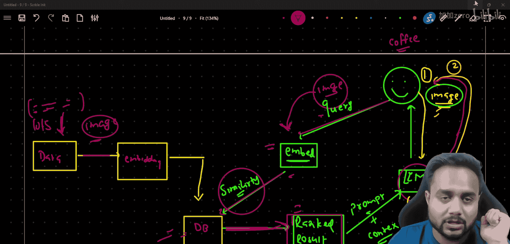

# Sunny Savita【中英⚡生成式AI：从初学者到专家｜Generative AI In-Depth Roadmap from Beginner to E】 p34 P34 Built Powerful Multimodal RAG using Vertex AI(GCP), AstraDb and Langchain #r [BV1Uht8zDENA_p34]

Hey hellello everyone welcomecome back to mytu channel。

 My name is Sunny Savita and I'm back with another exciting video right in this video we are going to build a very amazing solution。

 there actually will see how we can create a multimodal rag system using vertex AI。😊。

Astra Db and the la。 Yes guys。 So we are going to use this three platform by using our multimod rack system。

 and this video is going to be quite amazing。 So so far we have so far I have used this Google AI studio If you have checked with my previous video there I have access the gym model using the Google AI studio now I'll be using the different different model like gym or the different different embedding model。

 multimod embedding model by using this vertex AI Yes guys So vertex AI actually it's a platform of the Google and which you which provide you so many solution with respect to the AI and all and it provide you so many thing for the AI development like the sagemaker。

 So AWS is having Sagemaker Azure is having Azure open AI likewise we are having this vertex AI and here actually we can do lots many So this is the home page of the Google cloud guys。

 definitely you can log in with your regular Gmail。😊。

And you will be able to find out this a particular console Now guys。

 it is give the option to avail the $300 free300 free credited。

 definitely you need to use that and by using that by like enabling that particular thing you can access the different different services from here from the Google cloud itself now I already did it guys So after doing all sort of a thing So you'll be able to find out this type of page。

 Okay so this is the homep page now here simply what I'm doing I'm searching about the overtex AI Now once I will do once will the vertex A I will find out many option Now guys see just click over here on this model garden and there are so many model there are so many option which you will image G different embedding model and all everything basically they are providing you over here not the simple model I'm talking about the multi model embedding means you can convert image also into the。

by using this Google multimodal embedding and that is what we are going to use for building this solution。

 So first of all， what I can do here。 So let me show you the Astra D。

 So in the previous video I showed you how to configure this Astra D for your application for your chatboard。

 if you haven't check with that particular tutorial。

 please go and check you will find out check with a multiple document。

 So there I have used the different different type of document like P dog tags Okay or many other document。

 So definitely you can check with that video and then you can come over here and don't worry I will be showing you how you can configure this Astra one more time Now this is a solution which I have built。

 So here I kept it in my notebook in my coab notebook。

 you can utilize your local notebook or co or you can create the notebook inside your V。

 everything is fine。

What it Now here Im why I'm using collab so that I can utilize my GPU I can utilize the GPU service。

 the free GPp services which they are providing。 Now first of all。

 see there are lots many libraries and all which we need to import and here first of all。

 let me tell you the complete flow of this solution that what we are going to do over here for creating this multimod rank So for that I'm going to be open my blackboard and let me talk about the complete flow flow of this particular project。

 So whenever we are talking about rag guys So in the rag actually we have。

Data okay now with respect to this particular data。

 we are going to be convert embedding okay and this a particular embedding。

 we are going to be stored。 We tell me inside the vector database。

 Now what will what is happening then So let's say my user is coming。 let me switch on my camera。

 So here let's say my user is coming and user is asking something to my LM。

 So we are not directly passing the question to my LM instead of that what I'm doing So here first I am going to be like fire the query from the user site and then this query actually I am going to be convert into the em。

And then this embedding actually， this emdding query embedding， I'm passing toward， I am passing to。

A vector database。 And then here I am performing the similar t right similar t。

 Then after finding out the similar， similar search， what I will do。

 Ill be getting the relevant result over here。 So this is what this is my relevant result or I can say rank result。

 anything you can say here ranked result。 And then this particular result whatever we have from here。

 we are passing to our LLM。 So this is my LLM。 and here the LLM actually。

 we are passing along with a promptm。 So let me write my prompt over here pro。

 So whatever information I'm getting。 So that is also called context。

 this rank result is also called context。 Im combining with a prompt and we are passing to the LM and this is what this is my output。

 So this is what this is my complete flow of the rank。

 So let me tell you that what we are doing over here inside this particular solution。

 So let's say here what we have。 We have a data。😊，Okay， and here what I have。 So here is my emy。

Now this is what this my vector stored and this is what this my database and here we are using as a database we are using astra Db。

It is a cassandra database okay it is a cloud version of the cassandra which is provided by the data stack data stack is what data stack is a company for it now cas Etrat is what it is a service right now what we are doing see wherever my user is asking query to my LLM so it is asking something okay before right I am telling the first solution before rank so is passing the image to to my model。

All it Now here we are passing the image to what to my model and this model name is what gymni model let me write over here the model name is going to be a chi pro vision got it so here we are passing what we are passing to this g pro vision we are passing image and here whatever we have in inside the image based on that it is giving me a response。

 Okay， it is giving a response to my user now seagus here actually we want something as。

Whatever images we are passing， I want some extra information with respect to that particular image。

Okay， I will be showing you along with the example， but here。

 let's say we are passing a image of this。😊，Coffee machine。 So inside my image， what I have。

 I have my coffee machine， okay。This is what this is my coffee machine。 Now， see。

 I'm passing this image to my model。And what I am getting。

 I am getting a detail about this particular image。Got it。

 but here I want something which here I want that， let's say if I want to replace some part of my coffee machine。

 let's say if I want to replace this。Particular is。

Or if I want to replace this switch or if I want alternative of this panel， Okay。

 let's say this is the explosion machine， I want to replace this panel。

 let's say I want to replace this entire machine with the other this with the other like product and all So how we can do that。

We want some additional information so my LLM， my model actually can augment the response。

 So here what we are doing see。 Now we are not directly passing image to my Lm。

 So first what we are doing we are going to be is store a lots of data。

 let's say here what we have we have a coffee machine。So what we are doing。

 we are storing a lots of data around to that particular machine， coffee machine， Okay， coffee jar。

 coffee， coffee mug， coffee cupbs， okay or a different different like switches and all or disk whatever is required with respect to this image So those particular thing we are going to be stored Okay means those particular data we are going to be collect and then we are going to be convert into the emitdding means here Im going to be perform the image amting。

And after performing the image I'm meeting， I am going to be stored inside my data database。

 which database tell me I am going to be stored inside my astra Db。😊，Inside my AstraDb， yes。

 inside the Astra Db， I can hold text embedding as well as the image emdding true guys。

This is it is possible Now what I will do whenever I am asking the query So here I will be passing the image now this image is going to be convert into the em we are going to be used Google Germanyi amdding model multimod okay multimod multimod emdding and here we are going to be convert this image into the em and then we are going to be perform the similar to such between image to image。

Okay， image to image to image。 this is the image I'm meic。 And here also we have an image I'm me。

 And now what we are doing here， we are going to perform the similar dessert。

 Then we are finding out the rank result means let's say if we are passing a coffee machine here。

 So with respect to those coffee machine， whatever requirement， information is there。

 whatever required images is there and getting those particular images and all that data I am passing to my LM and with that。

 actually， I am going to be generated That is getting my point here， tell me yes or no。

 So whatever thing we are doing with respect to the。

Text right so let's say we have a text and if you want to augment that text if you want to generate a response based on my LLM now the same thing Im going to do based on my image Im passing my image and I'm gathering the information around to that image and that particular information passing to my LLM and finally we are generating the response guide So that is my entire motto I hope you got it Now what we can do here we can implement this particular。

😊。

