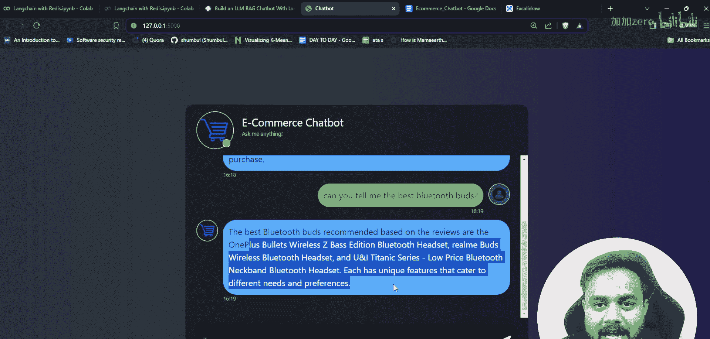
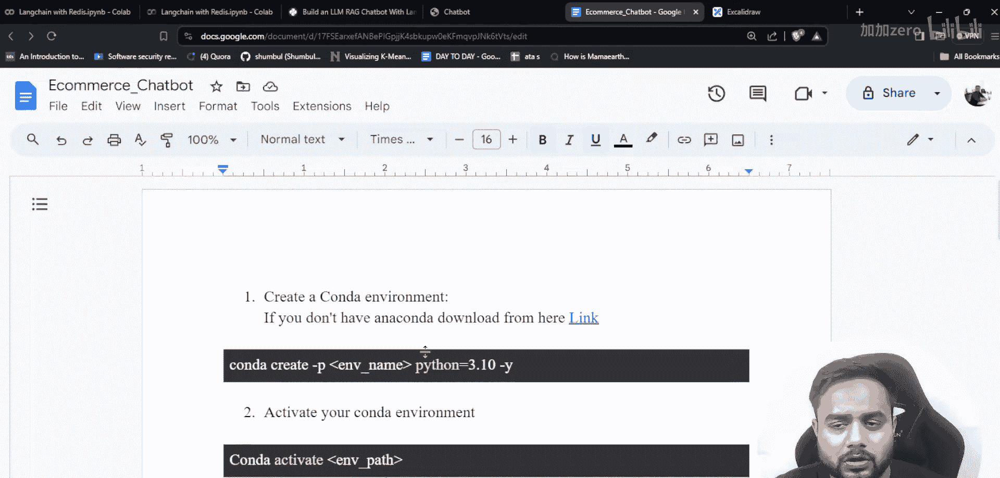
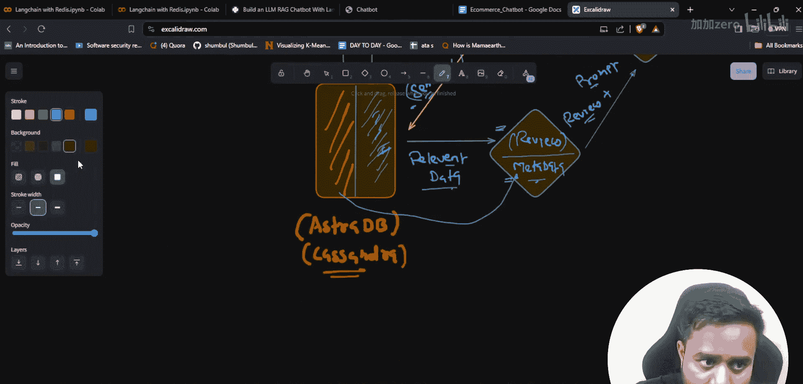

# Sunny Savita【中英⚡生成式AI：从初学者到专家｜Generative AI In-Depth Roadmap from Beginner to E】 p35 P35 End to end E-Commerce Chatbot With AWS Deployment using Astra dB(Cassandra), [BV1Uht8zDENA_p35]

He hellello， everyone。 Welcome back to my YouTube channel。 My name is Theresa Vita。

 and I'm packed with another exciting project。 Thanks in this video。

 we're gonna implement one custom chatbo。 Yes， guys。

 one real time custom chatbo And here you can see the complete UI of this chatbo。

 and were gonna learn that how we can create this type of chatbo from is scratch。 Yes。

 so let me test my chatbo。 let me check whether it is working correct or not。

 So here I'm giving few question to my chatbo。 And again， I'm saying it's going to my custom chatbo。

 So yes， definitely I can customize the answer according to my requirement。

 So guys here is my question to my chat。 I'm asking to my chatbo。

 Can you tell me the low budget sound based handset。

 So let me hit the enter and here you will find out Yes， it is going to generate the answer。

 So this is the like low budget sound based handsset here you can see the complete detail。😊。

From the ecommerce website itself， I escape the data and I have created this custom chatboard。

 which we are going to deploy also yes， right So here guys。

 we are going to be deploy this particular chatbo and we are going to do a deployment of the chatboard on Aws。

 So please watch this video till end and here you will get a lots of insight and you can take the reference of this particular project for many other project。

 and this is going to be very much important for all of you。

 let me ask you more question to my chatboard and let's see whether it's going to be answer or not now here if I'm going to be asked my question。

 Can you tell me the best Bluetooth handset best Bluetooth board。

 So let's see what it is going to be answer to me Now you can ask any sort of a question related to your electronic gazet related to your project on whatever data actually you have trained it or whatever data actually you have used your knowledge phase。

Or you have created your database right So I see it is giving the answer that Bluetooth hands the review that right it is able to generate the answer in a specific manner。

 So let's see let's learn how we can create this type of chatbot from scratch。 So first of all guys。

 I will show you the documentation which Ive created for all of you related to this ecoma chatbot and here I kept each and every command。

 which is required for developing this particular project because everything I am not going to show you from very scratch I did it already in my previous video。

 So here I kept the reference。 Now here I kept the command with respect to the deployment as well。

 So later on basically we are going to deploy this particular project and with respect to that you will be able to find out each and every command over here。

 So one by one in front of in front of you only Im going to show you this particular command Now one more thing guys what I can do here so I can like explain to the architecture also So here。

😊。

I've created one raw architecture and that definitely I am going to be explained。

 So first let's begin with the architecture。 Let's begin with the requirement and then finally we are going to code our project So here guys you can see this is my complete environment which I have created for my project and I will give you the step by step guide with respect to this particular environment if you are new to B code if you are new to this development and all that definitely you can check out my many videos which I am going to refer you and you will be pro in this development so first of all what I can do here I can give you the like I can give you the brief overview of this particular architecture and then later on will try to implement our project So again So first of all let me search of my video so that you can you will be able to get the access of the entire system。

So guys here what I have。 I have my data。 Okay， now let me write over here what I have。

 I have a data。 Now this data， actually， which I am going to be scrap from where。

 tell me so this data actually， which I'm going to be scrap from the tell me from the ecommercecommerce website that is flip card or Amazon。

 So yes， I won't show you that how to scrap the data from flip card or Amazon later on。

 I can create a dedicated video on top of it。 So by using the B4 or by using the selenium and all we can easily scrap the data from the flip card and the Amazon or from any other ecommercecommerce website。

 So that is not a big deal here， I already kept the data inside my system。

 So definitely I going to show you that particular data。

 Now the data actually it is available in the form of table Yes guys。

 So this data actually it is available in the form of table or this data actually it's in a tableular format。

 which I kept in my Excel file。 So let me show you this particular file。 So here guys if I will show。

This file。 you will get the complete detail of the data。 So inside this particular data。

 I have several color right So inside this particular data， you will find out this product I。

 you will find out the product title rating summary and review So guys here just look into the product title and here guys inside the product title you will find out we have different different Bluetooth headset and all。

 So here you will find out the bo ros and here you find out the realme words and then you will scroll down。

 you will find out the one plus and once you will scroll down。

 you will find out real realme words2 or one plus blood real me words Q a different different handsset U Titanic series and all and with respect to that you will get the ratings ratings and here you will get what tell me you will get the summary of the product and here is a complete review guys so here is what here is a complete review Now guys。

 this is what this is my data。 Now this is what this is my review and apart from this。

Whatever thing you can see right this product I product title rating summary So this is what this is my met datata。

 Okay metadata means what which is representing to my product。 I hope you are getting my point。

 and I hope you are familiar with the data also now let let me explain the architecture again by data it is available in that tableular format So from this data actually Im going to be segregate two things So first I'm going to segregate the review and here the second what I'm going to do tell me so here basically the second thing which I am going to be segregate the met datata now inside the metadata actually you will find out each and every thing product I you will find out the product summary you will find out the product name and each and every now what I'm doing here guys so here with respect to this review what I'm going to do So with respect to this review I'm going to be create embedding what I'm going to do I'm going to create embedding with respect to this particular review now for creating this embedding either I can use the open air embedding or gym em。

Anything I can use any sort of embedding model I can use over here。

 And then this particular embedding。 I'm going to be stored where inside my vector database。

 Now let me introduce this vector database that which vector database we are going to use over here。

 So guys for this particular solution we are going to use asb Yes guys you hear right So what we are going to use So here we are going to use as and this is nothing this is a cassandra itself。

 So let me write over here Cassandra and this cassandra actually this is a nosQL database。

 but this nosQL database we can use as a vector database。 And then on the other hand。

 inside the same database inside the astra itself， we are going to be store our met data。

 So one side we have embedding and another side we have a met data inside the same database。

 So I think this data ingestion process is clear to all of you Now it's time to query right now。

Time to do the QA or it's time to create the chatboard。

 So here let's say if my user is going to ask any sort of a question。

 This is what this is my happy user which wants to ask some sort of a question okay related to some technical gadgets So here let's say this is what this is my query which is coming from here Now this query actually it is being converted into the embedding yes you have right now this embedding actually so based on this particular embedding。

 I'm going to perform this semantic search semantic search and semantic search ority search anything you can see over here so this semantic search and what I'm going to do I am going to find out the relevant embedding I'm going to be find out the relevant relevant data from here based on this setic search So this is what this is my embedding and here also I have my embedding this one I'm going to perform the similarity search coine similarity dot product and whatever and here Im going to find out the relevant data relevant data and along with this relevant data。

Inside this relevant data， what I have guys tell me。

 So from here actually Im going to find out the review。 Okay， review。

 And based on this particular relevant review， I'm going to be capture the met data over here。

 let me write over here data data means what product I or a product name or let's say product summary So here is what here is my review based on the similar which we are able to get and here is my met data。

 Now this is going to my to my basically what I'm going to pass tell me So here I'm going to pass my review means my context plus prompt Okay plus prompt prompt prompt prompt means what tell me what is the meaning of the prompt So prompt is nothing actually it's instruction to to my So here let me draw the prompt let me talk about the prompt and here I am going to be mentioned about the prompt。

 So I' am passing review and this prompt to my。 And then based on that we are going to generate the final response。

 So this is。Complete architecture guys with respect to our implement。 Now。

 let me discuss about the tech stack that which tech stack I am going to be use。

