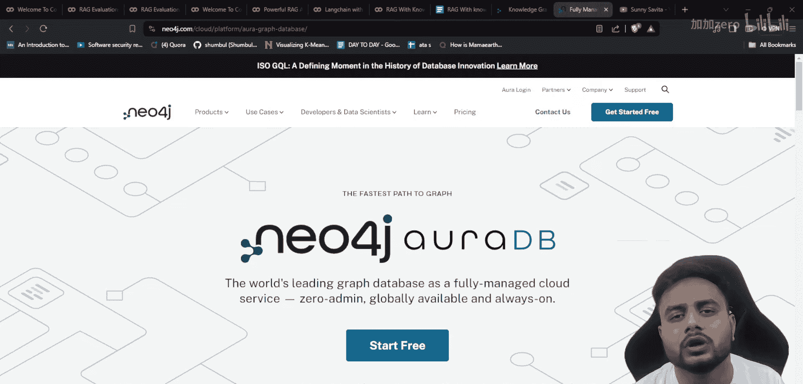
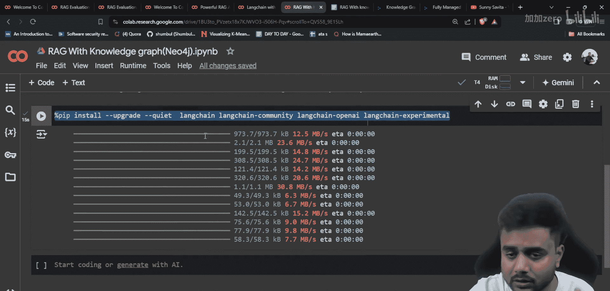
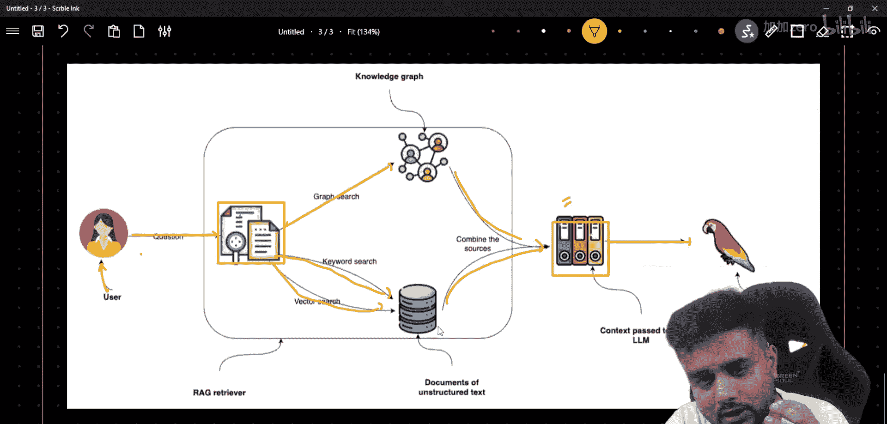
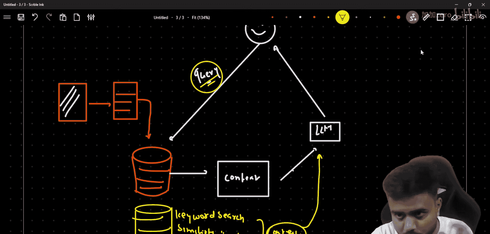
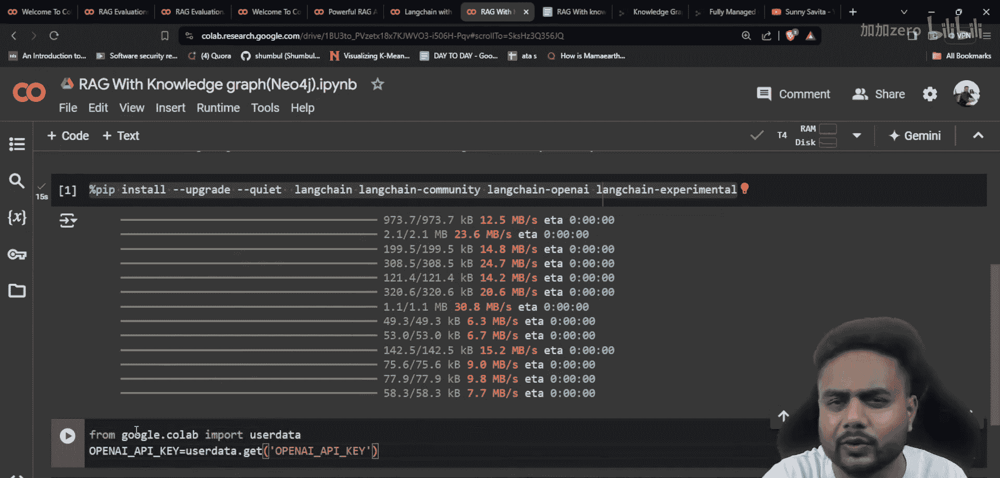

# Sunny Savita【中英⚡生成式AI：从初学者到专家｜Generative AI In-Depth Roadmap from Beginner to E】 p36 P36 Realtime Powerful RAG Pipeline using Neo4j(Knowledge Graph Db) and Langchain [BV1Uht8zDENA_p36]

Hey hi everyone。 welcomele back to my YouTube channel。

 My name is Sunny Savitan In this video we're gonna implement Ra pipeline using Ne4j。 Yes guys。

 so in this video we'll see how we can create a rag application using knowledge graph and for that I'm going to use this Ne4 or D It's a neo4 only it's a cloud instance of the Ne4 So we have Mongo So Mongo we can install in the local system and we have a cloud instance of the Mongo Db like Mongo plus similar for the cassandra also so we can install the cassandra in the local system and if we want to access the cassandra So yes we have a cloud variant of the cassandra that is a Astra Now similar to that if we want to access the neo4 So definitely we can install inside the local system as well as we have a cloud instance that is Ne4 or a D I'm on the mission to like each and everything。

😊，Regarding this rag system。 So here， whatever thing I can include in the in in the retriever or in the generation。

 I'm trying to include those things here you can see you can check with my YouTube channel So if you will go through with my YouTube channel just go inside the video and see last three solution I created around to this etra Db before that I created a solution with respect to the Mongo Db and before that I was talking about the multimodel rag and the complete rag pipeline and all everything I cover over here on my YouTube channel with respect to the rag So soon basically I will be to the like fine tuning as well in a similar way I will try to explore the fine tuning and here I will give you each and every flavor of the fine tuning also Now guys here。

I will show you that how you can implement the rack using the Ne4j。 So first of all。

 what I have to do。 So here guys， let me open my collab and each and every thing I'm going to be right inside the collab itself because it is a best for the notebook instance and here I can connect with the GPU also it's a pre GPU So if you don't have GPU inside your system。

 that definitely you can use this collab now I'm connecting with the GPU guys each and everything Ill be showing you over here from scratch only so no need to go anywhere and yes be here just for 2030 minute your each and every doubt is going to be clear。

 and one more thing you will find out inside the title Power right system。 Yes。

 this is a very powerful right system and this is going to be a very。

 very accurate also why I will let you know why it is powerful and accurate so here what I did here like connected with a GPU now I am going to be installed couple of library which is required for this project。

The first library is L， the LIn community， the open AI and L experimental Now you will find out the different different variants of the L。

 So first of all， let me clarify this thing because many people are asking to me the doubt in the comment section and all So why you are installing the different different type of the So once you will go and check with the documentation itself you will find out there are different different variant of the for the different different work Okay so here I can write it down it and let me give you the complete detail so see guys L community and so they have divided the into this three main variant So in the code actually you will find out this the latest package you will find out all the latest thing with this expression expression language and the other thing as well you can go and check you can read in a detailed way also then we have a community So in the。

it will find out they are providing you all the third party integration and all。

 So whatever third party integration you can explore here inside the Lin community。

 Then the main is L。 So this is the old package right this is the old package Now whatever change agent re algorithm and all you have you will get over here itself inside the So the latest one is the community and code Now apart from this one you will find out this open AI experimental in all。

 So guys the L is going to be a very very popular and many people are contributing over here。

 So that's why you will find out the different different variance of the different。

Like module inside the single package got it。 Now let me install this thing。

 And until then what I can do， I can explain you the architecture of this project。 Now here guys。

 you will find out couple of parameter which Ive written So first is update means the latest library now latest version and here quite means what quite means silently I want to install it。

 I don't want much detail about the installation over here That's a meaning of what that's a meaning of which I mention over here got it Now see you guys here what I did I have install the library now come to the next point here I am like explain you the architecture So which architecture we are going to be implement over here and what is the importance of this neo4j each and everything Ill be clarify if you are watching my video guys I'm covering everything from a scratch So if I'm uploading video little late So it doesn't mean that I'm not going to upload Im going to be more research on top of it and I want to give you the refined country that's why some I takes time。

Now here guys， you will find out So let's say my user is asking any sort of a question。 Now。

 first of all， you should have understanding of the rag architecture so that rag architecture I I like explain you many times if you will go and check with my previous videos you will find out the complete and detailed introduction of the rag architecture。

 So here I'm not going to be repeated you can go and check with my previous video So let's say guys what I have I have my data so guys let's say。

Like this is what this is my data which I stored where So here guys。

 what I did this data actually which I stored inside my or as of now this is what is my data let's say this is what is my user and user is asking a question right so this question actually like in a three way actually we are going to be perform the retrieve operation over here from the single database okay from the single database in three ways we are going to perform the retrievettri operation first is based on the keyword the second based on the vector search and the third is what based on the graph search Yes so in a three ways we are going to be perform the retrievetrieval operation and then we are going to combine each and every context each and every retrieve information in a single document and that particular information we are passing to we are passing to the LLM So this is my complete information and this complete information I am going to be I'm passing to my LLM for generating the response Okay so I hope this thing is。

Cl what is a use of the neopo over here， I think you got to know about it Now let me clarify more over here let's say what is the meaning of the rag architecture。

 So here this is what is my data Now this data generally I convert into the embedding。

 so let's say this is what is my embedding。

And this embeing I am going to be stored inside the database。 So let's say this is embedding。

 I have stored where I have stored inside the database。 Okay， now。

 whenever user is asking any questions， So what user will do。

 let's say user is asking the question from here。This is what this is my user。

Okay now based on this particular query， we are going to perform the similarity search and here we are passing a we are getting a context right So here what we are getting we are getting a context and this context I'm passing to what I'm passing to my LM along with what along with a prompt panel and then finally I'm generating a response So this is my raw right architecture okay this is representing to my data got it now here here guys you will find out So this data we we are going to be in just tell me inside this architecture so just look over here So this data we are going to be is store inside the neo4j Okay this is what this is my neo4j whenever user is asking something whenever user asking any sort of a query right So in the three way in a three manner we are going to be retrieve the answer right So here what we are going to do we are going to perform the keyword search let me write over here keyword search okay we are going to fetch the information based on the similarity search。

And here in a third way， right， we are going to be fetch the information based on this knowledge graph。

So guys just think over here how powerful this context will be the context which we are retrieving from the from the database and this context this this context now where we have each and every information we are passing to my LLM and then LLM is generating a response and that is going to be quite accurate。

other than so after this one， Ill be starting with the evaluation part evaluation of this rank pipeline and all I will give you the complete and detailed introduction of the like L and the rag evaluation。

 then yes the thing will be more clear to all of you so how we can evaluate this rag pipeline so this architecture is clear now come to the next point so I have installed all the libraries and all now let me get the data over here。

 So for the data guys， what I'm going to do I'm going to be import from the the data I'm going to be import from the Wikipedia I'm going to be patchd from the Wikipedia now how I can do it。

 So first of all let me give you a few things over here。

 So here guys these menu parameter is required if I want to connect with a new4 I will let you know how I will be getting each and every parameter over here just in this entire solution everything I will be clarify over here then one more thing is required So here guys as a model Im going to be use this open air。

