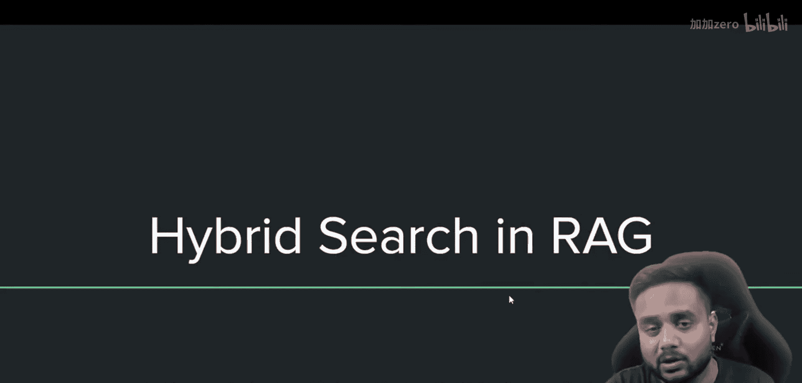
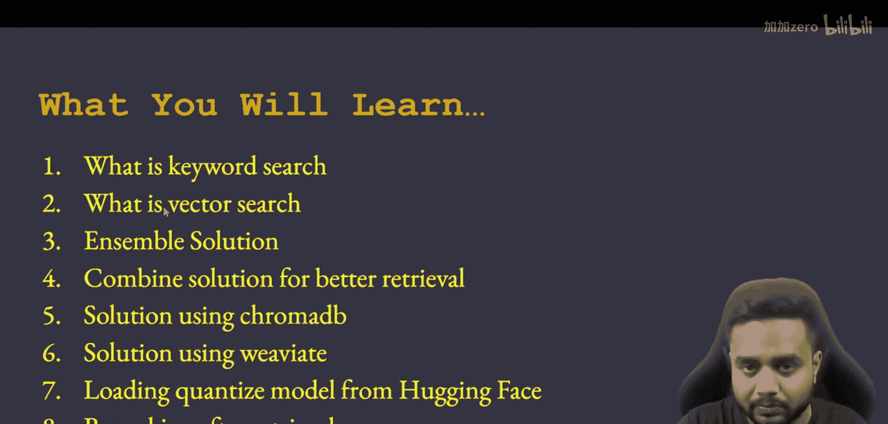
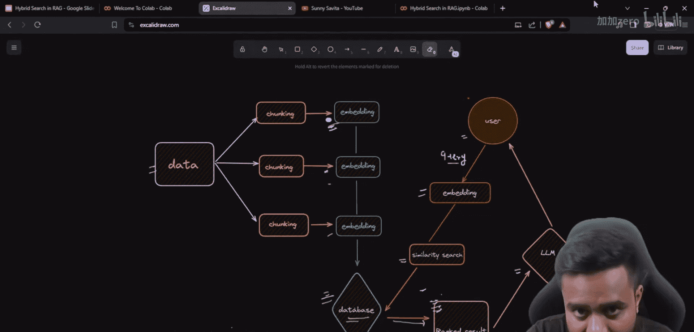
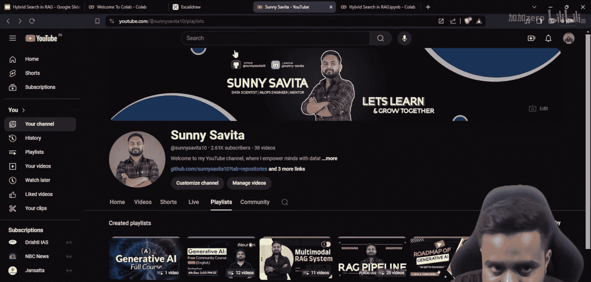
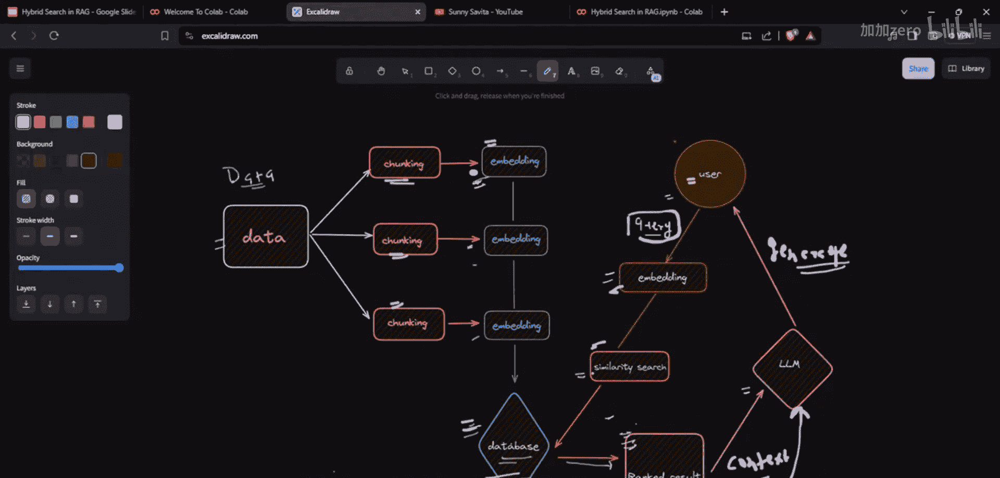
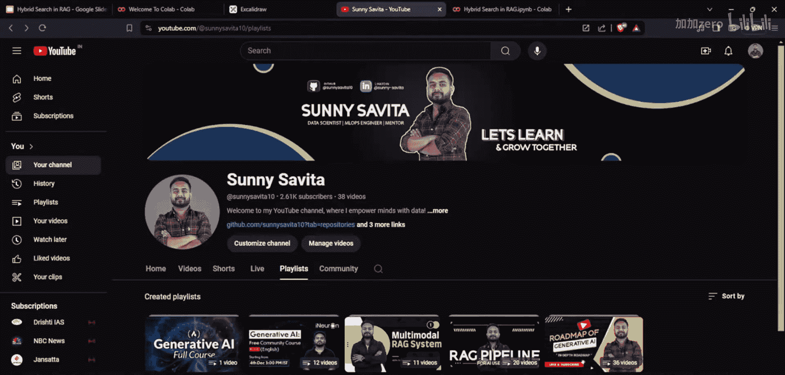
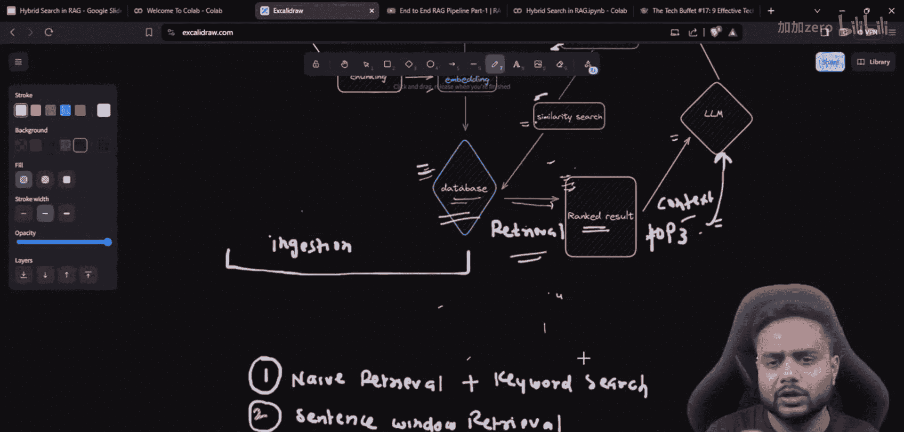
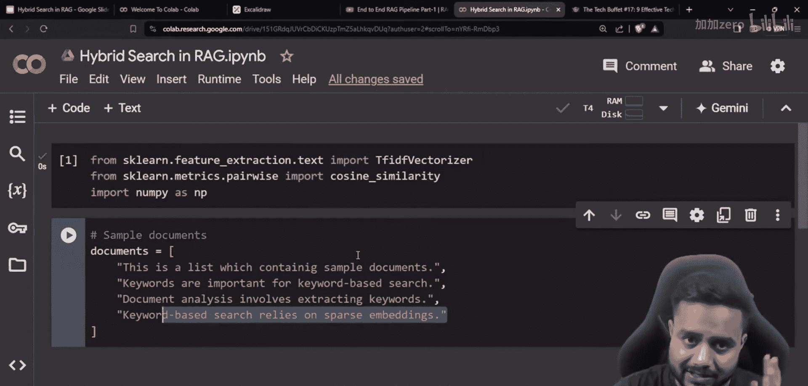

# Sunny Savita【中英⚡生成式AI：从初学者到专家｜Generative AI In-Depth Roadmap from Beginner to E】 p37 P37 Advance RAG 01 - Powerful RAG Using Hybrid Search(Keyword+vVector search) ｜ [BV1Uht8zDENA_p37]

He hi everyone。 welcomelcome back to my YouTube channel。 My name is Tersa Vithan In this video。

 were gonna discuss about this hybrid search in rag。 Yes guys。

 So guys I was on break I didn't upload any video since five days because I was busy with some of commitment and work and all。

 So that's why I couldn't upload， but don't worry now again I am back with this video。 So here guys。

 I'm going to be start with a new topic the topic basically it is related to the retrieval right So if you will look into the rag architecture So the rag architecture。

 I think we have completed till data in。 I will be showing you the rag architecture and the video like whatever video I have created to that now it's time to understand the retrieval process retrieval process for what for getting the context from getting the context from the database and that context we are passing to the model we have a different different retrieval technique and in that this hybrid。

😊，Search okay this is the basic technique and it's the first technique as well and after this hybrid search I'll be talking about the different retrieval technique like na approach or this Windows retrieval and all and we have many more technique definitely we want to discuss those particular technique now apart from that we have reranking and all so first we collect the data then we we rank it okay we given give the ranks and all to that particular sentences and after that we can rerank also so we have those algorithm inbuilt algorithm and all definitely we can learn about the reranking and that comes inside the retrieval only now guys so what all thing you will learn inside this particular session so let let me tell you first of all so here guys you will learn about the keyword search what is a keyword search you will learn about the vector search you will learn about the ensemble solution if we are going to combine this both solution so this is called the ensemble solution now。

Coming why we are combining， we are combining it for the better retrieval。

 for the better context so that we can provide the meaningful information to the LLM model。

The next thing will try to do this thing using the chromroma TV will perform this same thing using the Web8 because Web8 is also having the hybrid search I will be showing you that here we are going to load the quantized model from the hanging phase so no need to worry about any APIs and all and here after the retrieval we're gonna learn about the reran also so this is my main moto for this entire session I hope this thing is created all of you now coming to the next point So guys here if you will look into the rag architecture so first of all let me give you the quick recap from this architecture and from my previous videos and all whatever I have created and then I will come to the solution that what you can do inside the hybrid solution So first of all guys see just look at the architecture this particular architecture let me show my video so that you can get the access of the entire inside this architecture you can see what we are going to do we are going to create a rag so let's say Im going to create a rag and I have a data。

This is what this is my data guys right now this data what I am doing so I am going to be converting to the embedding I already shown you this particular process with a different different framework with a different different database and all from the different different model and all everything then this like chunking we are going to be convert into the embedding and this embedding we are going to be stored inside the database so this particular process is called in guys。

Okay now here you can see。 So let's say here is my user who's asking the query from the chat interface。

 So this query actually is going to be converted into what into the em right and then based on this particular em we are going to perform the similarity search from the database So this process is called the retrieval process retrieval process now here what we are doing So we are going to be perform one more process that is called ranking So we are going to provide the rank each and everything I will show you the Python itself so no need to worry about it I will be showing you the Python implementation So we are doing a ranking and based on that。

 let's say we are doing ranking now top three result we are passing to where we are passing to my LLm okay now based on this particular context So this is also called context my LM is deciding my generation So whatever output is going to be generated。

It is going to be decide that particular that particular output based on what based on this context。

 Okay， I hope this thing is clear now， if you will look into my playlist guys So let let me show you my playlist over the YouTube itself So this is my YouTube channel guys if you haven't follow so far please do it because I am uploading a video on a daily basis yes I was busy in in the previous days and all。

 so I couldn't but yeah most of the time I'm trying to upload within a days or within two days and all so if you will go and check playlist。

 So here I created one playlist on this rag itself now inside the right just look into this particular playlist I try to cover each and each and every framework whether it's a line channel lama index here tag whatever framework guys and I try to create a different different application using the different different model and the different different databases and here guys not this one I try to cover this multimodality also multimodality in terms of。

In terms of embedding in terms of storage okay so here if you will look into this particular pillar so I recorded 20 session and those session basically it was around to this in only here I was not focusing much on the retrieval part so whatever na approaches there of the retrieval I will just trying to I will just trying to perform that and here now from this particular video I will be focusing on the retrieval part as well different different type of retrieving technique so let me tell you guys what type of retrieval technique could be so here I can write those technique and then later on I will try to show you the implementation the Python so the very first technique which is called the nave technique okay。

Ne technique or the technique， which we have performed so far。Nve retrieval。

The second R1 which is called window search， okay， so here I can write a sentence window retrieval or this is also called window search。

Retrieval now， the third type of technique， which is called。 So here are， let me write the third one。

 is called self query retrieval。So。不的。Retrieval， okay， now the four type of technique。

 which is called parent document retrieval， Okay， parent。Document。A rerieval。

Or this technique is also called a small to big reval now the fifth type of technique which is called tell me which is called H D Okay。

 if you will search over the k， you will be getting this H D that is called hypothetical document embeing。

 So we will talk about this also hypothetical document eming and here see as of now were going to talk about the。

Hybrid technique， which is a combination of work， which is a combination of this nave retrieval plus key search。

I hope that idea is clear now。O。So let's look into the practical how we can do it。

 how we can perform it。 So here guys here I opened my collab and inside the collab itself we are going to perform each and every practical and in between whatever theoretical thing will come and definitely I will try to explain you over my blackboard itself let me change my runtime and I'm keeping the GP itself so here guys I'll be showing you the chromma in the next video I'll be talking about we it as well we it with reranking go here reranking we have other reran technique and all and every reranking technique I will talk about inside inside this like inside the upcoming tutorial and all and yes a few I have recorded few I' going to record I'll be uploading on my YouTube channel soon So the first thing guys what we are going to do here we are going to understand about the keyword search how we can perform it now regarding this keyword search I will give you more detail how basically we gonna do it and what is the use of it。

😊。

It's it's not a new technique it's a old technique which we were using Okays it's been a decade right so this Google itself has introduced this like this one key keyword search technique with respect to their web pages and all and they have introduced two things first C idea the second is page rank okay by using this both technique they were trying to perform the search okay so whenever I am going to be search anything over the Google engine they were trying to like pass they were trying to like give the results and all the web pages in the form of webage and all so first of all let's do one thing let's try to。

Let's implement this thing in a Python itself。 So what I have I have few libraries。

 let me keep this libraries over here and along with this library I have a couple of document as well So these are the sample of document which I have written by myself So this is a list which is containing the sample document keyword are important for the keyword based search document analysis involve extracting keyword and here keyword based search relies on the fast embedding okay is fast embedding dense embedding everything will try to discuss just a bit every idea I will try to give you this video is going to be around 25 to 30 minute and within that will try to understand each and every。

