# Sunny Savita【中英⚡生成式AI：从初学者到专家｜Generative AI In-Depth Roadmap from Beginner to E】 p38 P38 Advacne RAG 02 -  Hybrid Search (Keyword + Vector ) & Reranking With Cohere [BV1Uht8zDENA_p38]

hellello everyone。 welcomele back to my YouTube channel。 My name is Sunny Savita。

 and in this video we're gonna discuss about hybrid search using WebP8 guys in this rag playlist I have started with a various retrieval process and in the previous class itself I show you the hybrid search So one hybrid search I have implemented from scratch keyword search in the vector vector search and then I shown you the same process using the Chroma D Now in this video willll see how you can perform this hybrid search using Webbe because WebP actually will give you the inbu classes and la also support the hybrid search through the WebP8 we'll see that how we can perform it on top of our data and how we can make our rag process like best to best and apart from this one guys。

After the retrieval after this hybrid search I'm going to perform the reranking also by using Co here API okay so let's start let's begin with the video。

 so I hope guys you have seen my YouTube channel now here in the previous video I was talking about this hybrid search if you will go and check like definitely will get you know each and every detail about it now see you guys yesterday only I upload it and the comments and the likes and all okay so I got a very good response on top of this video so let's begin let's start with the new implementation so first of all guys what I can do I can open my co because each and every implementation I'm going to do over here itself because here I am having access of the GPU T4 GPU and I can purchase a Google colate then I will get the I will get some advanced GPU also like 100 V00 and all so let's begin first of all let me write the name the name is going to be hybrid search。

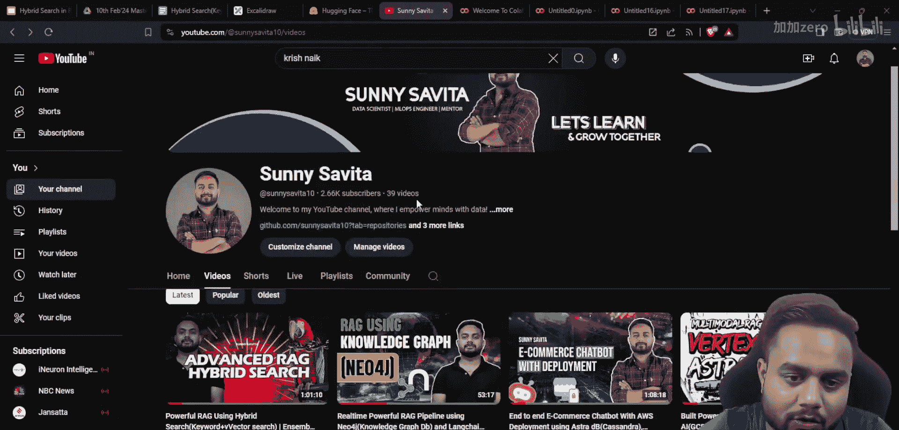

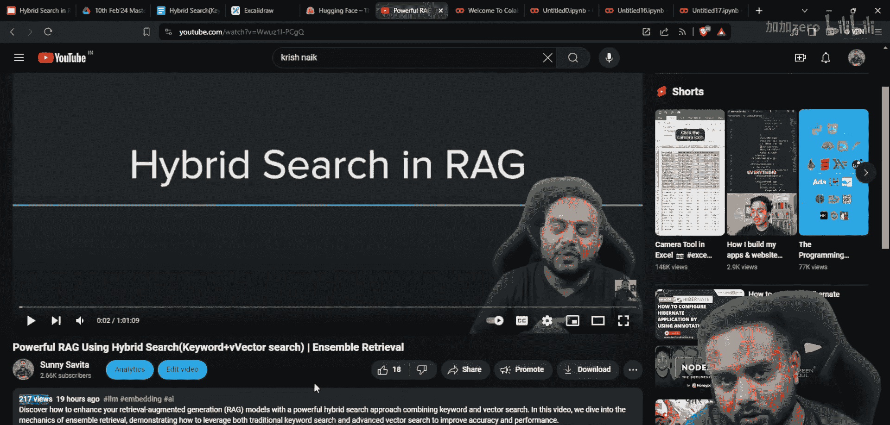

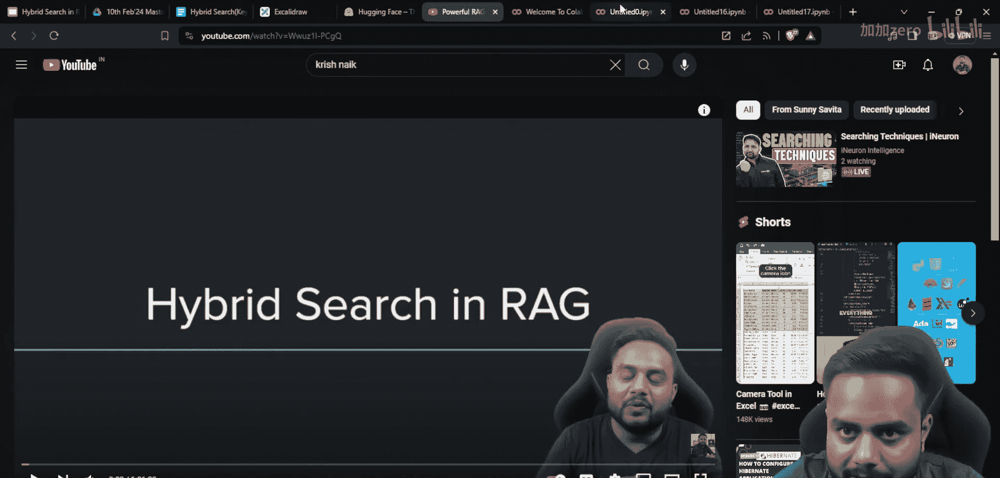

系。Reraning。In the rag Okay， now first of all see I required couple of library。

 So the very first library which is required over here， that is called beard K。

 so let me install the babyard client way be8 okay we be。He， are you fun。

P now the second library guys， which is required over here。 that is L。 So here。

 let me write tip install L。 Okay， now I required one more library So here I require the L committee So let me install this L committee also this three library is required guys for implementing this particular solution right now the next thing what we are going to do here So first Im going to be import V8 so let me write here we if we don't know about Web8 guys。

 don't worry I will explain you it actually it's a database vector database and we can use it for what for the hybrid search Okay it is having some inbuil property。

 it provide you one class hybrid8 hybrid search class and you can use that particular class they already they have they find Vm 25 retrieval Vm 25 like am okay spa am apart from this one like we can configure any sort of em like open AI hugging。

Everything I will show you here don't worry now I am going to be import this Web。

 Now the next thing guys I required a couple of things。

So the very first thing which is required that is plus okay。Now。

 the next thing which is required over here that is API PI key。

So here guys from where you will be getting this particular thing。

 let me show you Now apart from this one guys， first of all， I have to create a client。

 So here is what here is my code for the client So for creating this client guys I will be required this a token also a chapter code means what hugging face token Now let me copy it and let me keep it over here and here I'm going to be collect the hugging face token So this three thing is required So first two thing to connect with my baby database and the next thing hugging face token to connect with my hugging face because here I'm going to be use the open source here I'm going to use the open source model and all Now what I can do So after collecting this plus。

And this API key。 So here are baby8 URL。 Now， let me do one thing。 Let me create one more。

Let me create one more variable。 That is what Web8 URL and I can assign my value over here。

 Okay to this one and here my Web API key is fine so I think I no need to change anything with with respect to this one and this thing the value is same Okay so now I think this is perfect how to assign the variable and all over here so let's do one thing let's try to generate this cluster URL and this API key So first of all you need to search about the V8 let me search in front of you only So I am writing here V8 okay。

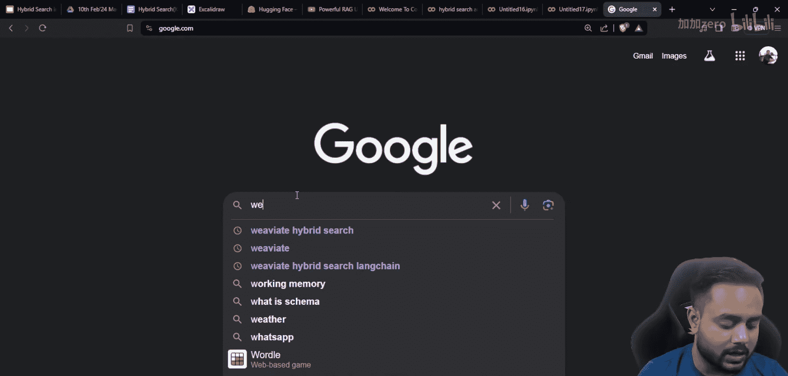

So guys see this is the official website of the Webate Webate is a kind of database okay vector database Now you'll find out this Webate actually support for the hybrid search rag okay generative feedback loops and all you can read each and every detail regarding this Webate they have given given you over the website itself and yes it is having some paid version as well so you can utilize it if you are working in a real time so let's do one thing let's click on this try now and it will ask to me a sign in so here I can do the sign in if I don't have an account then first I can sign up and then I can perform the sign in so I'm going to create my account my account basically I'm going to be create with this particular I now here Im writing my password。

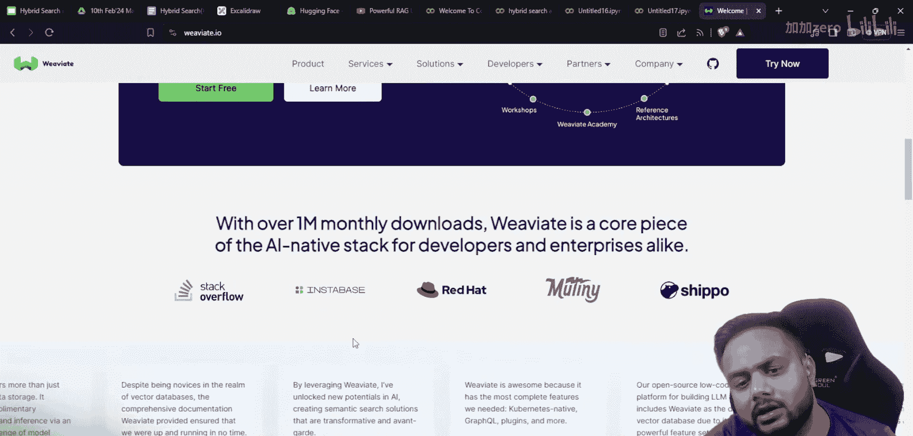

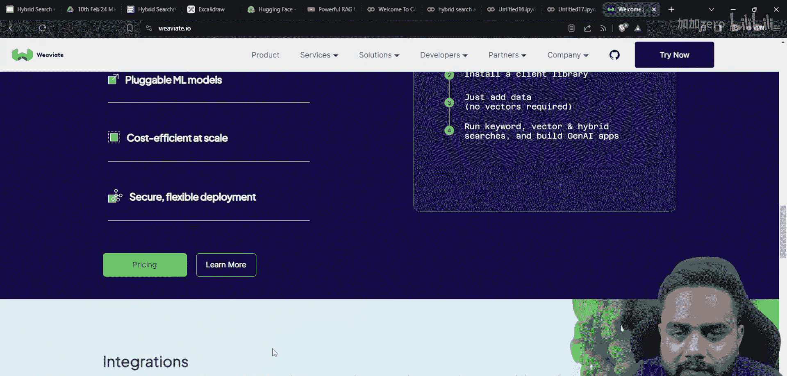

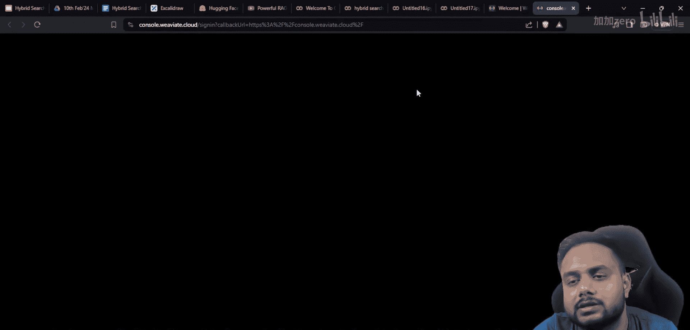

So my password is going to be something。 Now， I'm going to be confirm my password S N3 was。

 and finally done。 So， yes， you can also try with the same password， but you won't be able to log in。

Now sign up and after the sign up guys definitely I can log in over here。

 I can save it and I can check with my mail ID， whether I got the verification mail or not。

So let me verify it， first of all， so here is the verification mail。And yes， Im able to。Verify right。

 fine。 just a second。 let me show you。 Yes。 So I am able to verify。 So after the verification。

 I'll be getting this kind of interface。 Let me close it because I verify it from my mail URL。

 So now what you have to do， you have to create a cluster。 Okay。

 so just click on this cluster After clicking on this cluster here。

 you need to write the sandbox name。 It is completely free。

 No need to write no need to pay anything for this one。Yeah you see single L zone， public slack。

 lifetime access and all， not lifetime，4 life 40 days lifetime and all。 Okay。

 and monitoring communication。 Now， if you want， if you are working in a real time。

 you can use this particular cluster manage cluster。 So here is a pricing of it。 Okay。

 now see this are like facility they are providing to you。 Now what I can do。

 I can write the sandbox name。 So my sandbox name let there' is going to be hybrid search。

 So just a second。 let me write a name over here。Here I can write a name。 just the second。

 why did not allow to me。I am going to refresher。Okay， all the stock。嗯嗯嗯嗯。Just a second guys。

 Let me fix this issue。 Okay， fine guys。 So now I am able to write it down。

 I just did that hard refresh。 and yes， it is along to me now。 So first of all。

 let me write the name so the name is going to be a hybrid search you can write any name it's a custom name Now after this one you just need to click on this create I think it is visible to all of you let me show you see this create option once you will click on this create it is creating your cluster Okay and then after creating this cluster it will provide you two things first as URL and the second is what second is。

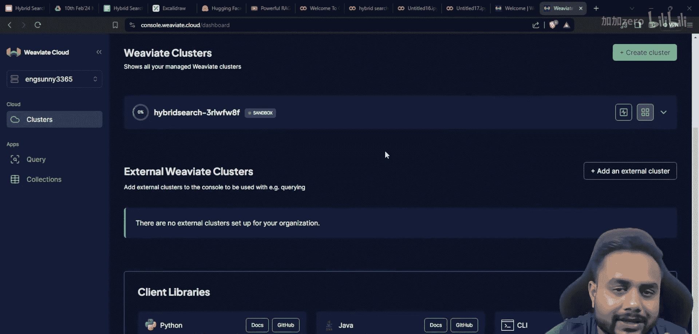

This one plus API P key now until what I can do I can log into my hugging phase and from there actually I can generate my token so let me open the hugging phase and here I am going to be generate。

My token， guys， just a second。 Let me generate the token。

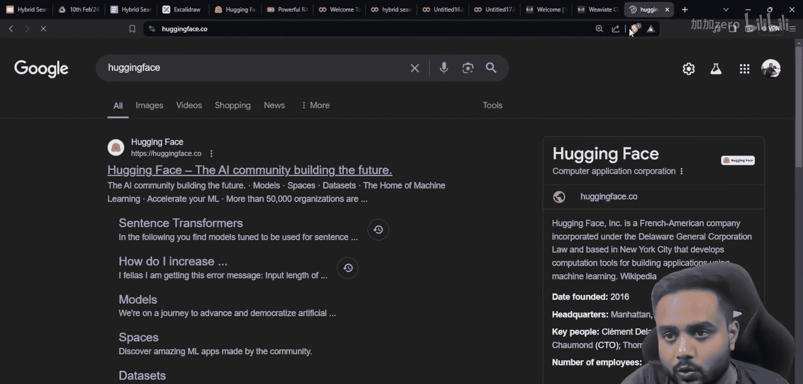

Just click on the setting and here is access token and then。Just copy this particular token。 Okay。

 make sure never was a token publicly。 Yes， I haven't。 Then I can read it。Make sure don't know what。

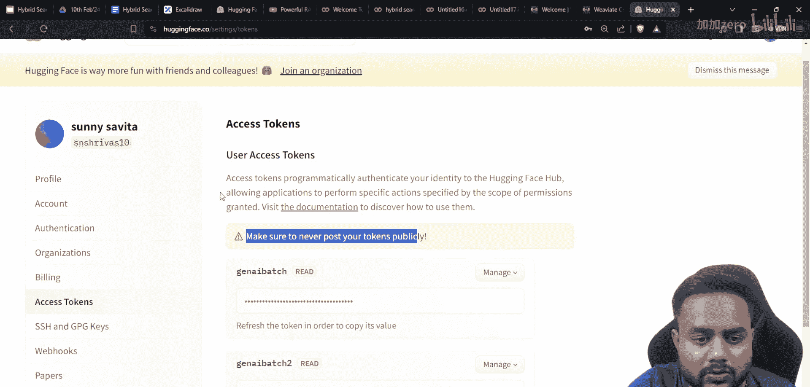

我爱你嘟豆。要多跟哦 i can睇阵了。While it is soccerer。

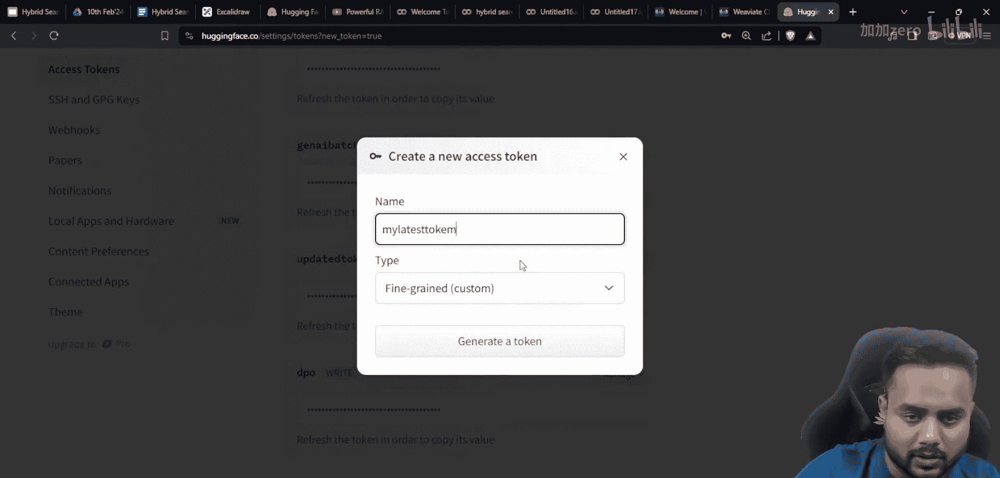

Then now what I can do， I can type re token， then it。Great， I am able to copy it。 So guys。

 these are token。 actually is not active。 It is saying make sure to never post your token publicly。

 I think I posted somewhere maybe with Github all maybe I I have expose it and because of that it is not able to giving me a access。

 So yeah this is this is one more tutorial for you So you have expose token somewhere automatically they will cut the access。

 So here I created a new one Now let me copy it and let me keep it over here itself So here I am going to be my token in the double code itself and I required this cluster API key and this cluster。

 let me check whether it is ready or not So yes， it is ready Now once I will click on this drop down guys here I'll be getting this two thing first is first this URL cluster URL the second is what second is the API key。

 let me copy this cluster URL from here。 let me keep it inside my notebook。

 So this is my cluster URL and let me。

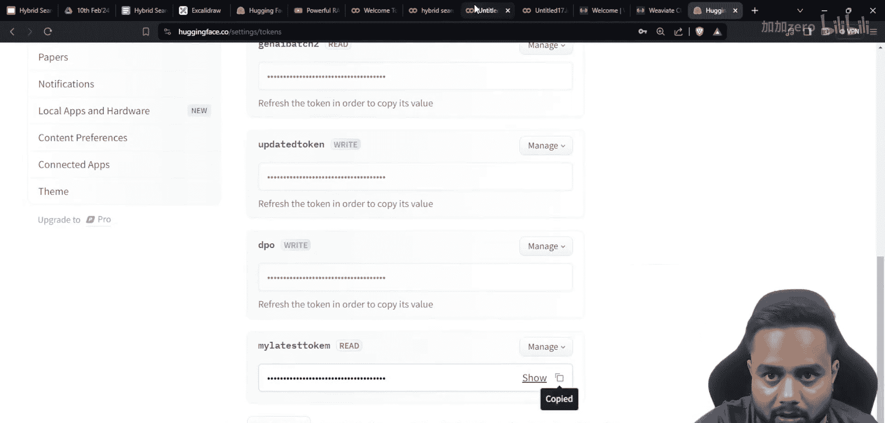

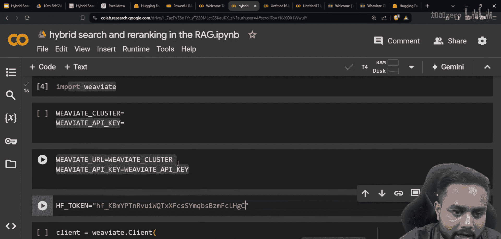

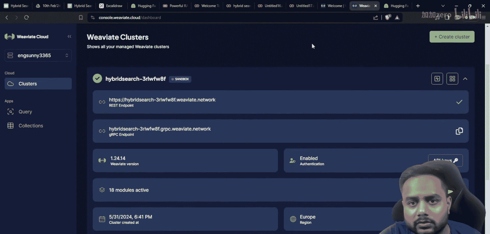

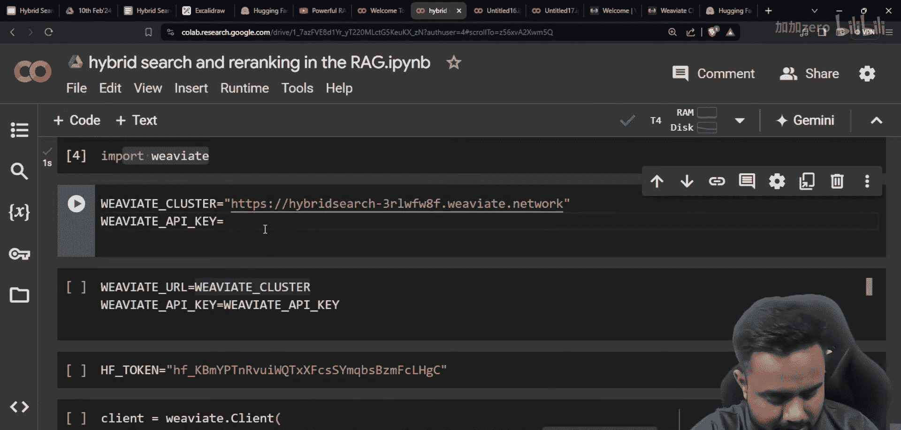

Keep my API key also。 So here is my API key。 I'm going to be copy from here and let me paste inside my notebook book。

 perfect guys， everything is fine now Im running it and here Im assigning to my variable。 Okay。

 my all the variable is ready。 Now simply I can create my client。 Okay。

 now see why I am mentioning this hugging face API key。

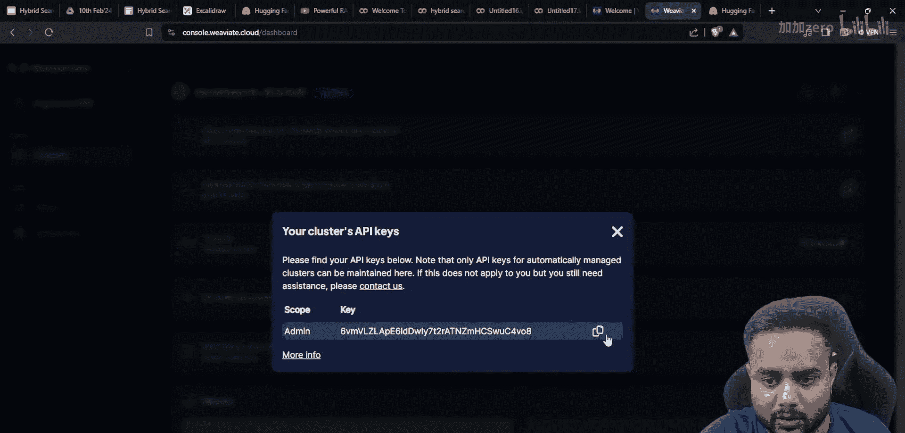

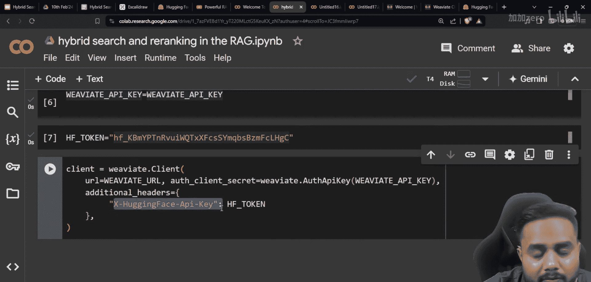