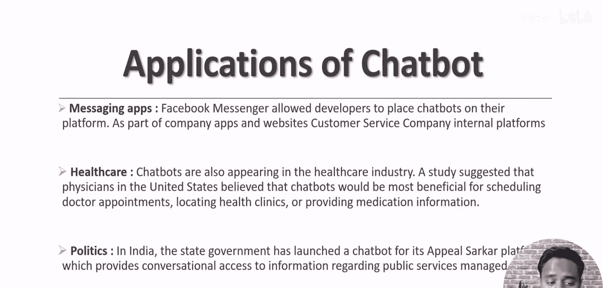

# Sunny Savita【中英⚡生成式AI：从初学者到专家｜Generative AI In-Depth Roadmap from Beginner to E】 p39 P39 End-to-End Weather Chatbot with Google DialogFlow and AWS CI⧸CD Deployment [BV1Uht8zDENA_p39]

He hi everyone welcome back to mytu channel my name is Sunny Saviita and this video will see how we can create a chatbot using Google dialflow with complete and to end CD deployment Yes guys so a few months back I recorded one series on top of the Google dialflow where I have created the weather chatbo and had shown that how we can deploy it using the。

CID pipeline and here for deployment guys I'm going to use the AWS platform and this series is going to be very。

 very amazing because here I have clified each and every fundamental of the chatboard and how you can create chatbo from scratch using this Google dialoflow if you don't know about the Google dialflow Google dialoflow is a managed service which is being provided by the Google itself for creating the chatboard so here I'll be showing you how you can create a chatbot using Google dialoflow how you can connect it with a flask and then how you can call the thirdpart API and then after combining each and everything how you can deploy to the AWs with complete CicD guys don't miss out the series is going to be a very very important for all of you here your each and every fundamental will be clarify with respect to the chatboard So yes I hope you will enjoy it so let's start。

Hello， So welcome back to this checkboard series。 My name is Sunny。

 I in this video will try to see a complete course overview。 So first。

 we are going to start from the checkboard introduction。

 then we'll try to understand a complete business problem。

 and then I will show you the Google Teleflow console and I will give you the complete overview of the Google Teleflow console。

 then we'll try to implement our checkboard。 The checkboard with weather checkboard will connect check with the web application and finally we will try to application over the。

 I will show you like each every connectivity class itself from Sc。

 and then finally we try to integrate our checkboard with telegram of Facebook and finally will see conclusion and futureboard。

 So guys， stating with me in this particular video series So well meet you in the next session。

 Thank you。 take care。 Have a get。😊，Hello guys。 So welcome back to this checkboard series and now in this video we'll be talking about a complete introduction of the checkboard。

 So here I have written like like today's agenda。 So what all thing we are going to discuss the first thing we'll be talking about what is a checkboard。

 The second type of the checkboard then we'll be talking about history of the checkboard then we'll be like seeing that how checkboard works and then I will tell you while checkboard is required application of the checkboard and what all of frameworkboard is there for building a checkboard So a step by step we'll be seeing each and everything。

 So yes， first we gonna to start with what is the checkboard So guys a checkboard is a software application which used to conduct an online check conversation by a voice or text right So what is the checkboard is checkboard is a computer software。

 which replicate。Human conversation， right， or which we make my human conversation。 Okay。

 now in the next line， you can see。 So type of the checkboard。

So here like I have written two type so first is rule based chatboard and the second is an Np based chatboard So what is a rule based checkboard So with this with this type of checkboard communication is through communication has is happening to the preset rules okay so we are writing some sort of a rule and based on that being are getting out right and in the second approach in this NLP or N based actually it's an AI based approach okay its a AI based approach and in that we are providing a data to our model it is able to read the pattern from that particular data and it is generating our replies right so first is rule-based boards and the second is AI based in rule based board there is no AI there is like a simple statement there is like a simple conditional or there is like a preset rules based on that we are getting a replies but here in anLP based checkboard my model is able to read the pattern。

On the given dataset set and it is able to generate a replies。 Okay now guys。

 I have mentioned one more slide here where you can find out this checkboard So the first thing is a website based chatboard the second is messenger port the third one is voice base checkboard So what is a website based chatboard so it may be open in your browser or you can see you can see sometimes in your like screen itself okay in a right hand side corner left hand side or upper right hand side left hand side upper left hand side in a small widget or they can also be used at the this string landing page okay whenever you are clicking now on that particular chatboard icon So it can be appear in a another page also okay so usually this kind of a chatboard you can find out inside the you can find out over the website right so second type of chatboard is messenger check。

Messenger checkboard we are using for messaging purpose。 Okay。

 Facebook messsenger is the best example of the messaging chat。

The third type of chatboard is voice based checkboard okay so millions of people are using electricityory but they don't know that it's a checkboard actually right so they have created thisboard actually on lots and lots of data So that's why it is able to read the pattern whatever we are saying when that like they are able to read the pattern and is able to generate the replies okay so it's an AI based AI based like a voice checkboard okay so I hope you got our idea where you can find out chatboard and what a kind of checkboard is there right the third point is checkboard I guess so guys checkboard is not a new thing here you can see so the first checkboard has been built in 1965 like before that okay so the first checkboard like officially which I have written over there which like officially has been built and I have written over there which has been built in 1965 and the 197219881992 and then 1995 and after。

That internet era key as you know like during the internet era we were generating lots and lots of data and that data we were giving to our algorithm and it was able to do the better so with that we have created a checkboard and in that we have included a little essence of the AI right so little component of the AI the checkboard was smart child and then smart phone aK and from here so the chatboard definition was something else so in 2010 like the silly was there series Apple product in 2012 like a Google assistance was there in 2015 quarter number was there so it a product of the microof and like you can see this quarter in your Windows system so near to search bar right so here you can see so whenever you are clicking here on the search bar near to that you can see this Q okay。

Yeah now coming to this like next word So AI as you know。

 like nowadays like AI is booming everywhere people are talking about data science machine learning Np or a team learning computer whatever right So guys each and every or they have released their own framework with respect to the chatboard okay so we can use that framework as a checkboard and even we can bring our own checkboard with the headboard that framework right so we try to see one framework okay so Google we are going to discuss in got this particular video series So step by step how we can create our own checkboard right so this like bit do A A Louis doI bit do of the face APIpi do AI it's a product of the Google and this Louis do AI is a product of the Microsoft actually this APIpi doI it's called。

Google dial it was some other company but Google acquired it and like they changed the name of this API do right And here is a very。

 very important point guys while chatboard is required so guys chatboard give you the 247 into availability consistency in the awareness it will give the instant response and it will enhance the customer engagement lower cost save time or So there are many benefit for using this chatboard and guys believe me if you are running an organization So this might be a game change in there right so let's suppose you have organization and for that you have open call So guys if you are placing hundred500 or thousand people over there instead of that if you will like place one a software that that will be equivalent to that right so it will be working 24 to7 that people cannot not do。

They will be changing the set it will be giving the instance response maybe like we human we are not able to throw it sometime it will be lower in cost it might be right it will be saving your time as well as it will be a multileer means in a multiple languages like like you can use this chatbo and definitely it will give you like lots and lots of benefit right so that is what chatbo is required now coming to this application of the chatboard so。

I told you as a messaging app， we can use this chatboard in healthcare， we can use the chatboard。

