# Sunny Savita【中英⚡生成式AI：从初学者到专家｜Generative AI In-Depth Roadmap from Beginner to E】 p40 P40 Advanced RAG 03 - Reranking with Sentence Transformers and BM25 API [BV1Uht8zDENA_p40]

Hey hi everyone。 welcomelcome back to my YouTube channel。

 My name is Aa Vian in this video we're gonna discuss about this reranking guys。

 yes this reranking actually it's a very important topic of the rack pipeline although in my previous video I already discuss this reranking along with a hybrid search I've shown you this reranking using the cohe API if you haven't checked that video please go and check you will get to know that how to implement the hybrid search hybrid search means what vector search plus keyword search and there I've shown you this reranking also but we have a different different algorithm we have a different different models and all with respect to this reranking so I thought why should should not I create one dedicated video on top of this reranking itself not one basically I am thinking about two video because we have so many topics so many I'll be showing you a topic that what topic actually we have with respect to this reranking and then step by step one by one will try to implement it。

It will help you for creating a robust rag application Yes so let me show you the topic so here guys you can see the list of the topic the very first thing which we're gonna to discuss here inside this particular video that what is a reranking then we'll discuss why reranking is important then we'll create our reranking Okay will implement the reranking in Python from a scratch using this sentence transformer and this Vm 25 API it's a Tf ideaF algorithm itself。

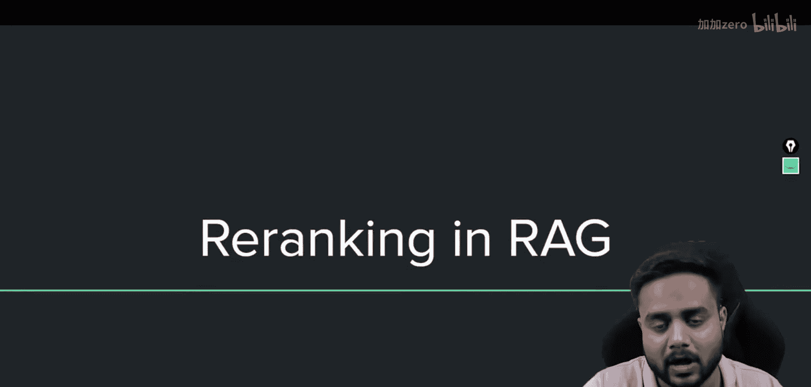

It's updated version of the TF ID we understand this reranking using the cross encoder okay so cross encoder actually it's a model so which take the pair of the sentences I will let you know how it works so definitely using this cross encoder I'll be showing you this reranking and all then will discuss about the cohe API will try to compare all this method from scratch cross encoder and then cohe API and apart from this one。

 we have some other solution of the reranking like this research paper lost in middle research paper which is a very important research paper and very useful as well if we are going to be implement the reranking so I will show you the solution of this lost in middle research paper already we have like implementation using la and and all I will be showing you now rank fusion paper this is also one of the important paper rank fusion so definitely we are going to implement this rank fusion also then finally flash rank Yes this is also very important one and you will find out the solution of the flesh。

Inside the link also okay so in this video Ill be discussing till the cohe API and rest of the thing means 6。

7 and8 right well be discussing in the next video I hope the agenda skill to all of you now let's begin with a video so first of all guys let me show you my YouTube channel here on my YouTube channel you can see recently I have uploaded the video related to the chatboard also so I have implemented the Google I have implemented the chatboard using the Google dialoflow it's an end to end chatbo and here I did the deployment also using the complete Cd pipeline before that I have uploaded the video relate to this hybrid search and here in this particular video only I've shown you this reranking approach using the cohe API okay if you want to know if you if you want to like implement it so definitely you can go and check out with this particular video right。

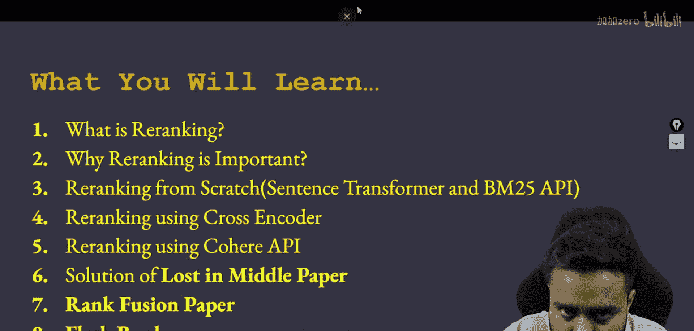

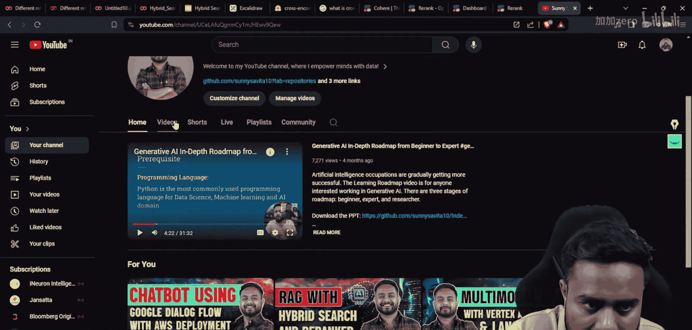

So lets start with the video so first of all what I am doing so I'm going to be explain you the ragg architecture I'm just giving you a quick overview of the ragg architecture now inside the ragg architecture guys what happens see here is my data。

Whi I divide into the multiple chunks so here we have multiple chunks okay now why we are why we divide the data into the multiple chunks so that easily I can feed this data into the model because we have a model is having certain limitations with respect to this context length。

Okay， context land。Now after the chunking what we perform we perform the embedding embedding is nothing actually embedding is a numerical representation of the data and then we store this particular embedding inside the database So this stage right so this is my first stage which is called the data ings Now in the second stage guys what we do we perform the retrieval right so let's say my user is asking my user is asking any query so I convert that query into the embedding and then I perform the semantic search or similarity search so as of now we are working on this retrieval stage right we have already seen the data ingsion and all with respect to the different different databases and all now here in the in this retrieval stage I already talked about this I already talked about this hybrid search。

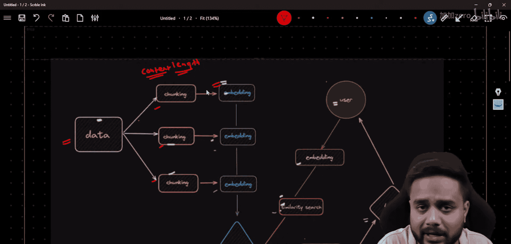

So let me all right over here。I br。Search。No。😡，My motortto to discuss about this reran。ok。

And then after the re rankingking， Im going to be discuss a different different retrieval technique also。

We have various interval technique， so we have this sentence window search technique。

 we have the small to big documented table okay apart from this one you will find out a various different film technique。

 right？So definitely I'm going to be implemented not in this video Okay after two to three video definitely I'll be like coming up with this interval technique I already created some material and soon you will find out the video on my channel so guys if you haven't subscribed so far please subscribe it so now reranking Okay so first of all guys we need to understand about the reranking what is this reran let me like right over here so see let's say we have a database this is my database now inside this database we have。

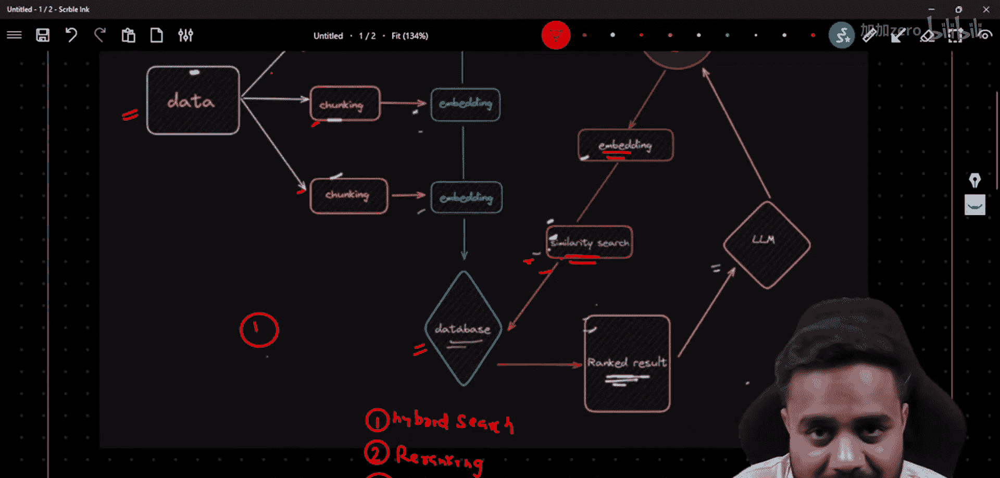

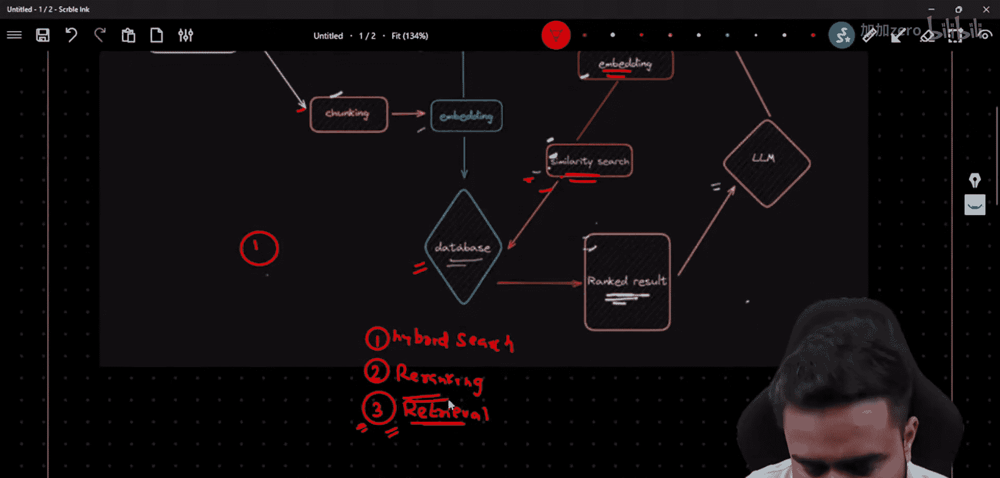

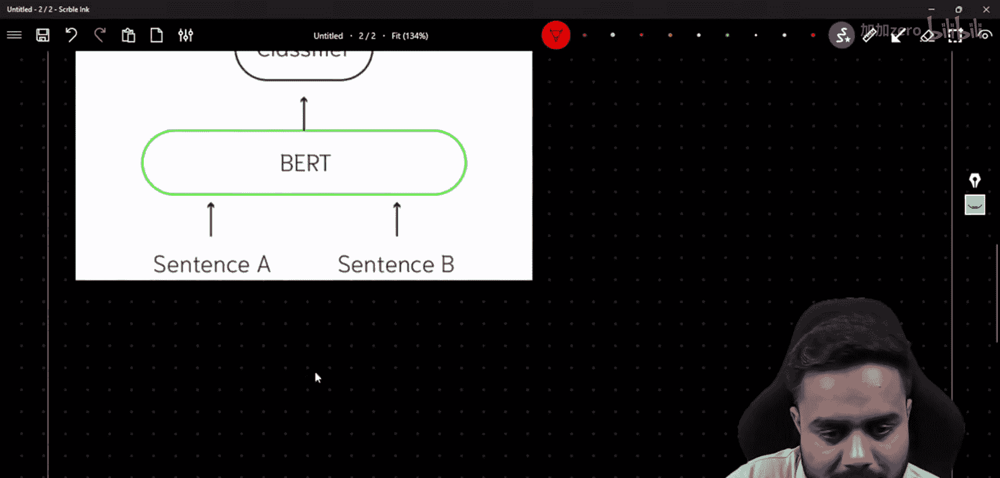

Vectctors， okay， I like kept a several vectors inside my database。 Now。

 let's say user is asking the query。user is asking the query now this query is going through the database and here we are going to be perform the similarity search。

Similarity search now， once once what I do， I perform a similarity search， right， So what we do。

 we retrieve the。Stop gay document。Okay， top K document means what the top match document。

 top similar document。 So here let's say we are going to be retrieve top K， it could be anything 3，4。

5102025 and all right so let's say here we are going to be retrieve top 10 document okay which is going to be similar to this particular query So here is what here I'm having now top  10 document from where from the database itself hearing my point So this particular document now what I'm doing So here see just look into the rag architecture So this particular document we are passing this is a rank result okay rank result I'm saying rank not re rank right so this rank result this document which I retrieve I'm passing to my Lm along with a question and then this is going through the like again basically after generating the response and all we are passing the output to the user okay this is a complete rag architecture and this is also called the rank pipeline where we have three stages first in。

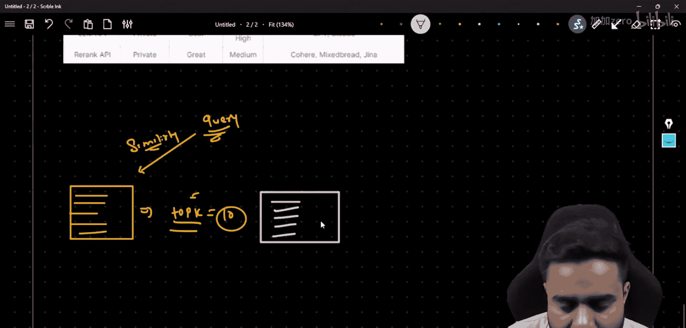

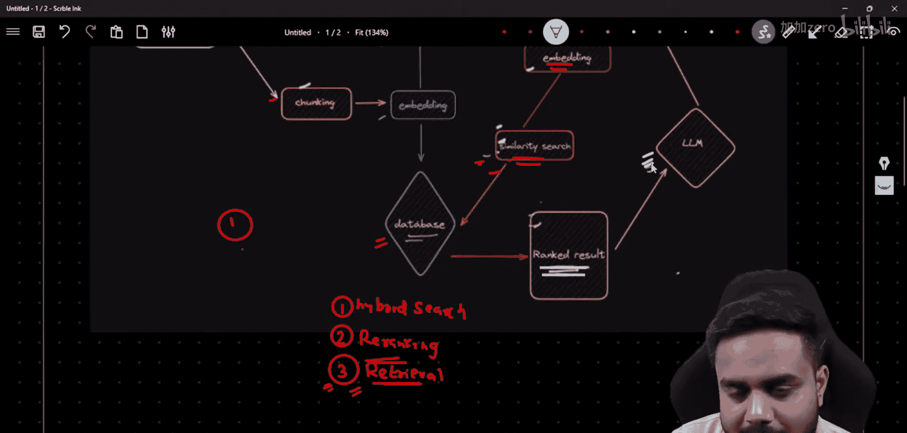

Second is this retrieval， and the third one is what third one is a generation。

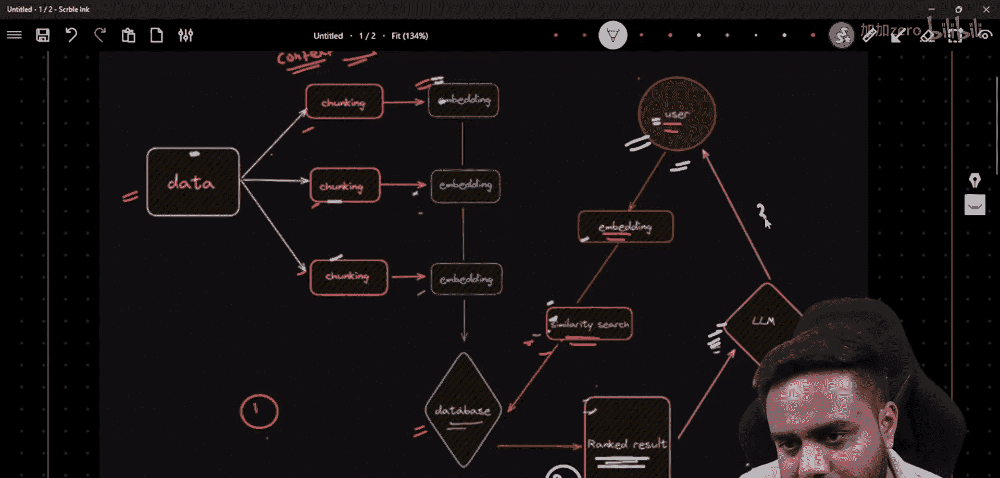

I hope this is clear now where have this reranking come and what is the use of it。

 So here let me explain you。 So let's say if we are passing this particular data。

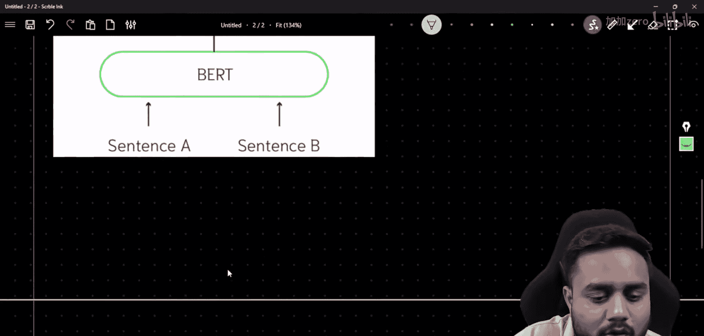

To the model。Okay， now this data actually this data rank data could be a noisy right means let's say based on this particular query。

 we are not able to filter out the sentences， there might be a chances。

I I think you are getting my point， what I'm saying， right， so I can give you a very good example。

 maybe with that， you can understand。 let's say there is a company。 So here is one company。

It is coming to the。College， right， So here is what here is my college， this one。

So this company actually is coming to the college and he wants to this company wants to hire some candidate right now this company wants to hire some candidate and here this college is having some sort of a list let's say there is100 candidate。

Who is going to be up here in the interview now this company actually is having a different different filter criteria So the first stage right what it is doing tell me is taking a apt test。

Okay， now in the second stage what they are doing。They are they are doing a group pre so they are saying okay just do the group discussion and all and we'll see your communication in all how effective you are with your communication and what all thing right So the first stage is what apt。

 the second stage is what group discussion and then whoever is going to be pass this two stages So those person is going to be appear for the main interview right for the main technical interview So this is what this is my first filter criteria here is my second filtered criteria。

 this one and then only whoever is going to be pass okay this particular criteria So those student is going for the interview right this is the main motto So the same thing actually we can do over here So why should I perform only so why should I only take this top kid document Okay after this similar to search and all So after collecting this top kid document Okay let's say I collected this 10 document1 more similar document So why should should not I perform the reranking over here。

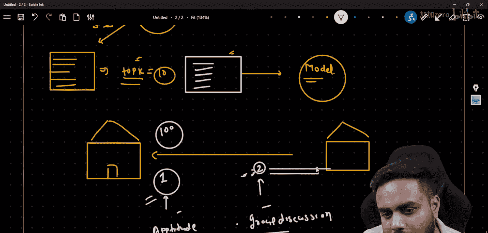

So that I can filter out okay， I can more filter I can filter out one more time my sentences and I can provide the I can provide the refine input to my model I hope the thing is getting clear to all of you if not just rewind the video and rewatch it it will。

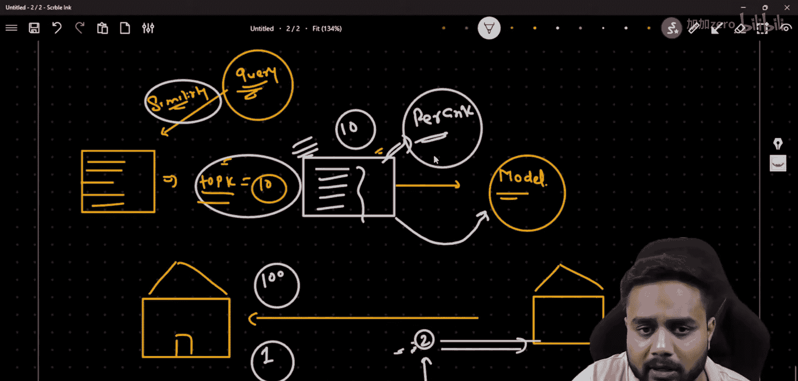