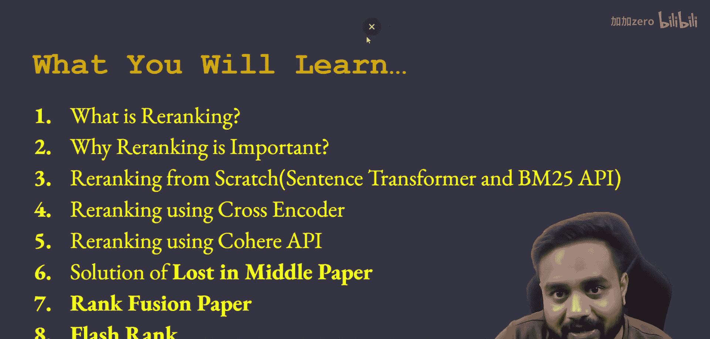
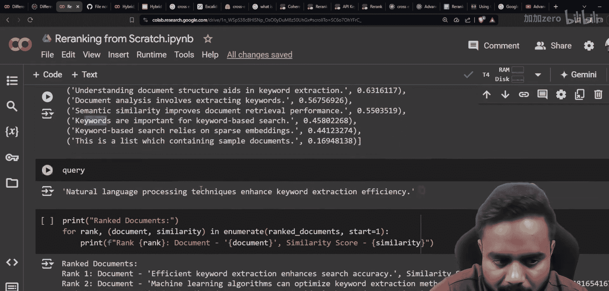
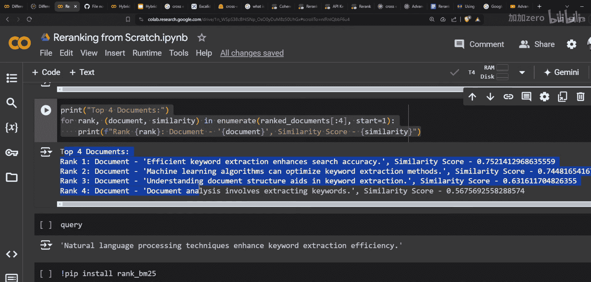
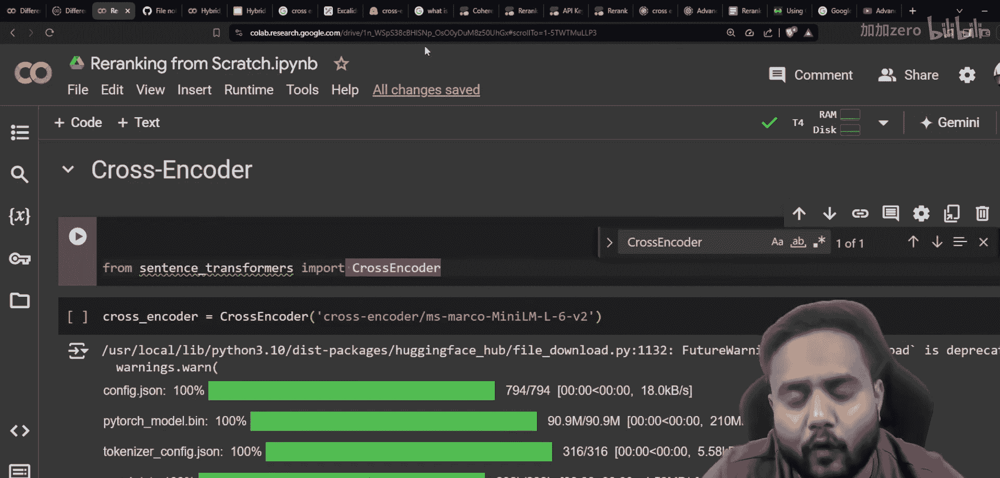
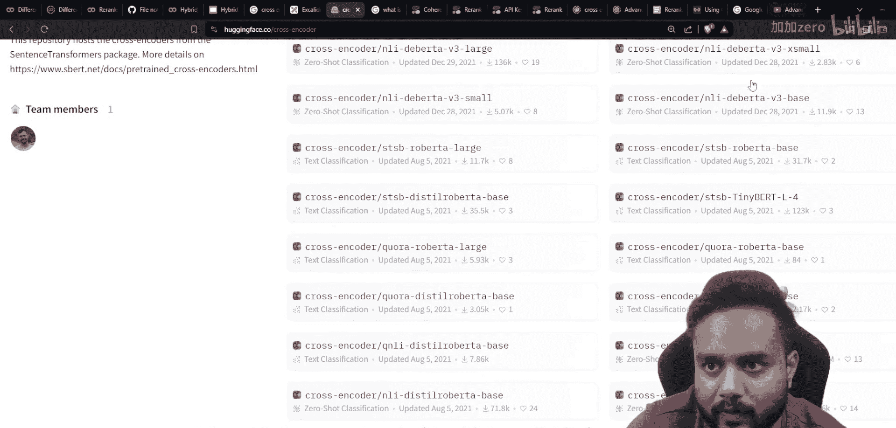
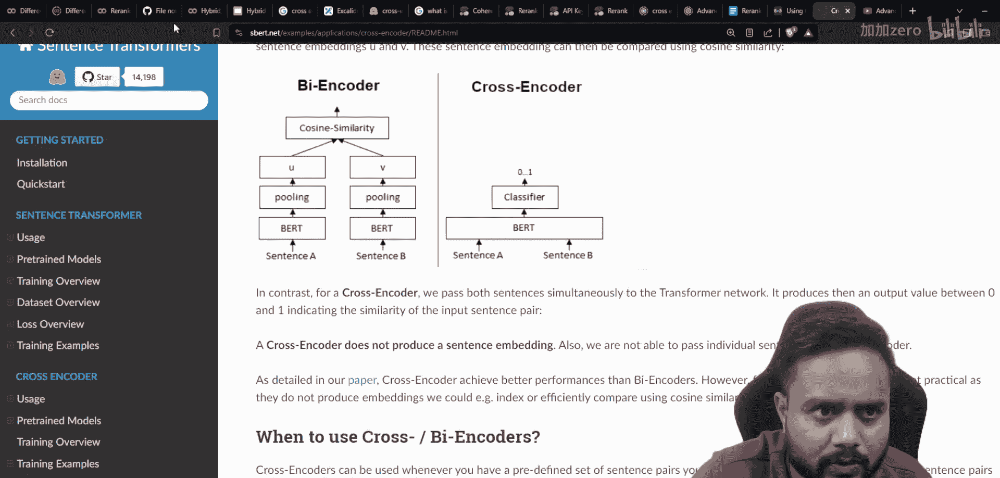

# Sunny Savita【中英⚡生成式AI：从初学者到专家｜Generative AI In-Depth Roadmap from Beginner to E】 p41 P41 Advanced RAG 04 - Reranking with Cross Encoders, and Cohere API [BV1Uht8zDENA_p41]

He hi， everyone。 Welcome back to my YouTube channel。 My name is Sunavita and in this video。

 guys well see how we can implement this reranking using cross encoder and cohe API。

 guys in my previous video I already started with the reranking and there I discussed what is a reranking why it is important and even I have implemented this reranking using sentence transformer and this Bm 25 API。

 Yes， guys， So even though in my previous video only I announced that I am going to be discuss this reranking uses using this cross encoder and this cohe API。

 But even I record also， but when I checked the video now in the video actually this part is missing I don't know what was the mistake when I was uploading or or I didn't check the video。

 maybe it passed in between and I was recording So here in this particular video I just shown you tilda。

😊。

BM 25 that how you can implement the reranking using the Bm 25 the later on I thought that okay I should delete this video and then I can rerecord it the entire one but there are so many people they have already watch this video see like the views is 401 and people are like appreciating it all so I thought okay now what I will do I will create the second part of it there specifically Ill be discussing about this cross encoder and this cohe API so this video actually today's video it's an extended part of the previous video only for the better understanding you can check with the previous video because I'm not going to discuss all those theoretical stuff but yeah again I will give you a glimpse of that again I will try to revise it but not going to be discuss in detail so first of all guys。

 let me show you the solution which I have prepared for all of you so here is a solution guys a reranking from scratch let me give you a quick overview of。

So already I run it and here you can see the entire output of the cell and this thing I have shown you in my previous video as well。

 so I will just give you a glimpse from here and then finally we'll go with the cross encoder and the cohe API and then finally we'll try to compare the result also compare the result of the reranking if you don't know about the rag reranking and all。

Okay， so you can check out with my previous video。 you will get a best to best understanding of this particular concept。

 So let's start。 So let's say guys we have a couple of documents So here in total I have a document inside this list I'm installing this sentence transformer after installing it what I'm doing see here is my model which I am going to be load using this sentence transformer So I'm giving my model name and what I'm doing here I'm going to be load my model this is my document Now what I want to do guys I want to rank this document rank rank basically where it comes it comes inside the retrieval So whenever we retrieve the data from the vector database at that time we rank the result okay based on the similar search so that's's a thing basically which I am going to be similar over here which I am going to be explain you from scratch and I hope you have this much of understanding if you don't have then yes my YouTube channel for you there you will find out each and every content of the genative from scratch So please check out and try to learn it from there。

Now here you can see guys this is my data Okay I'm converting my data into the embedding So this model basically which I am going to be import from the sentence transformer。

 it's a embedding model right now after taking after converting the embedding embedding of my document here what I'm doing I'm converting my query so here is my query C this is my query natural language processing technique each keyword section efficiency I'm going to be convert into the embedding okay now after converting into the embedding I see here this is the dimension of the embedding 768 after this one I' am going to be find out the cosine similarity so see this is the cosine similarity。

Once I will check it now once I will pass my query and this document emm adding to this particular method here is my cosine similarity right now what I can do I can check with a most similar document。

 which one is the most similar document if I will pass my cosine similarity this all the value inside this method I will be getting the index index of the maximum value so 0。

1，2，3，4，5 this is a maximum value means this particular document is a highest yes similar document okay if I'm going to be compared with a query this is my query。

 this one now after doing it so what I was doing guys see I want to perform the so here after this let me show you so this is what is my most similar document which I already like which I already get over here by writing the code and this each and everything I already discuss if you will go and check now with my previous video you will get in detail now here is what here is my query so it's a more similar document now after this one guys what I'm doing I am going to be short this index based on the similarity such。

So here you can see this is my document， all the document and here is a similarity search this is this is the more similar document than this one。

 this one， this one and this one and here is what here is my query Now if I'm going to be rank it means if I'm going to be like put this particular one like description rank one okay so this is my document here is my rank two okay here is my rank3 and along with that you can check the similarity score also I hope it is visible to all of you if not I think you can see now right so this is what this is my similarity score now what I want to do I want to rerank it so Im going to be use the next model the different model so what I'm doing I'm going to be select top four document okay after the ranking and then。

I want to reran it Okay I want to reran this particular document right so for that see I'm using this rank a Bm 25 model it's a updated version of the TF idea already I discussed many times then here what I'm doing See here is what here I'm importing this Bm 25 Que is working based on the tokens okay so this Bm 25 actually it is working based on the tokens it is finding out the token similarity based on this query and this sentences Now here is my top word document now after splitting it C here Im splitting here I'm creating a tokens of each and every sentence and here is what here is my query tokens also now I'm passing each and everything to where I'm passing each and everything to my。

BM 25 model Okay， this is my like Bm25 model which Im creating after passing the document and here is what here is my query。

 Now this is my score which I' am getting。 it's a rerank one Okay reranking I' given you a very good example of the reranking let's say you know two step verification so let's say if I if I'm going to be log into my Google So first it is taking a password Now again is going to be verified whether the person is correct or not So it is like redirecting to me to my mobile number So here you can like you can pick the code。

 okay， whatever code is giving you over the screen and based on that is going to be verified you So its a two step verification step with respect to this document and all now this is what this is my score okay Vm25 score and here if you will see so this is my reran。

And here this is my top four document。 And after the reranking guys， this is my document。

 So this is the first one。 Okay， when I perform the ranking， this was my first result。

 efficient keyword extraction rank one machine learning rank to understanding document rank three then document analysis is rank four Now here if you see so efficient document it is keeping the same position Now see at the second one。

 we are getting this understanding document is structure。

 it is in a keyword instruction So this one is coming at the second point means it is a more similar compared to this one Now after this one machine learning algorithm can optimize so machine learning algorithm。

 it is coming at the third place and this is the fourth one I hope you are able to understand my logic what I'm trying to do over here So till here already we have discuss in my previous class Now coming to the cross andr over here Now let's try to discuss this cross andr and this cohe API P and will try to compare the result also okay。

 which one is giving me a good result should I use the individual one。

Individual reraer or can I combine it also， right， it is up to me at the end So cross encoder is nothing guys cross encoder。

 let me talk about first related to this cross encoder guys。

So guys what this cross encoder does let me show you the diagram of it so see first of all I am showing you this cross encoder using this sentence transformer now this cross encoder is class and there are actually it is a repository and there actually you can use a different different model。

Okay it's a board based model now there is almost 28 model you can see these all are the model and you can use any sort of a model over here。

 but what is a mechanism of it how it is working we need to understand that part so here let me show you one more official website of the cross encoder and there actually you will understand about it so this is from the Web it and let me search about this cross encoder。

This is the sentence transformer documentation。

Just look to the cross encoder so in the cross encoder， we are passing sentence a sentence B。

 I hope it is visible C sentence a， sentence B， and is going through the model B and C here。

I am getting the classification score okay between 0 to 1 actually I will be getting the score so here actually what we are doing we are passing both sentence to the same model now if we are talking about this by encoder by encoded means we are passing the both sentences to the different different model and at the end we are going to be calculate the to sine similarity right but clause encoder is different there we are just passing like we are passing the both sentences to the same model I kept the code as well just to shown。

