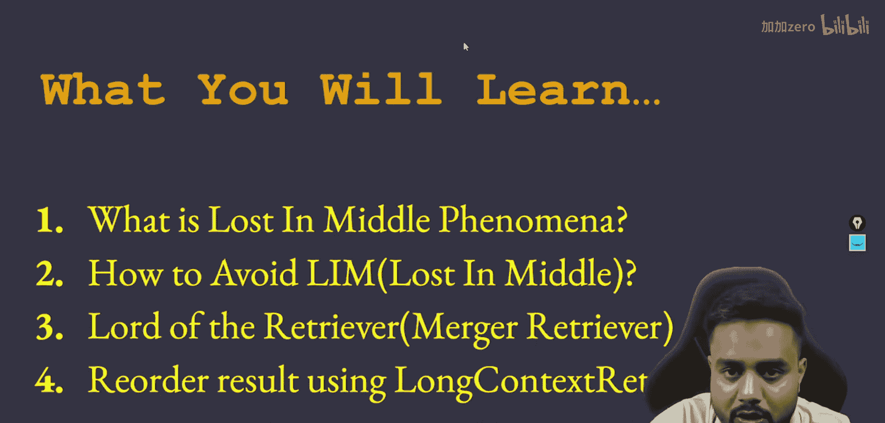
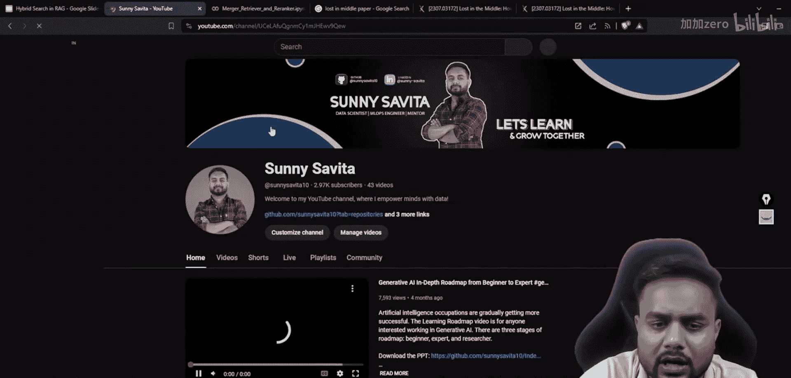
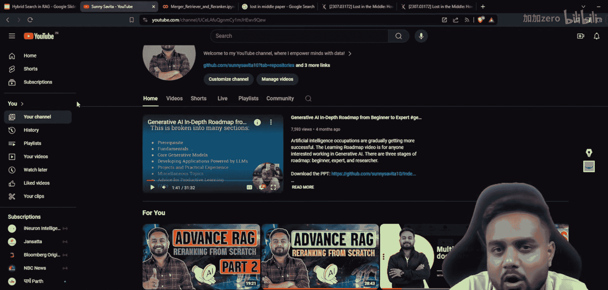
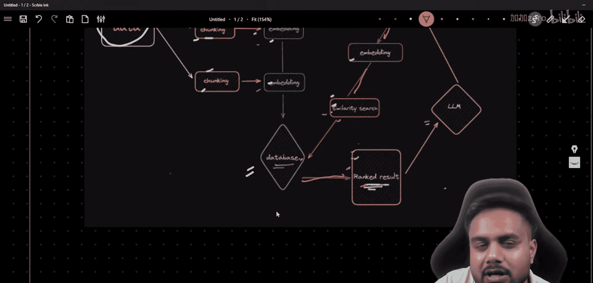
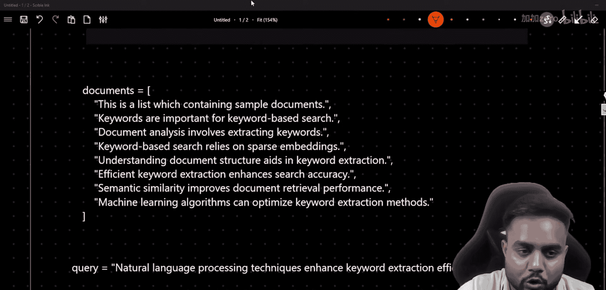
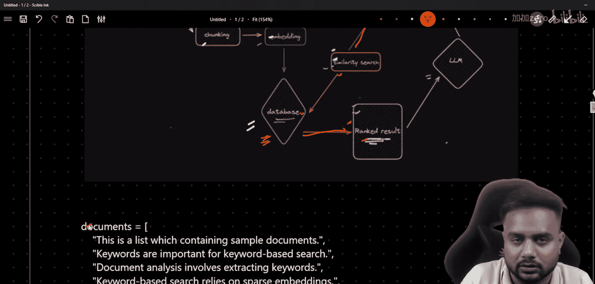
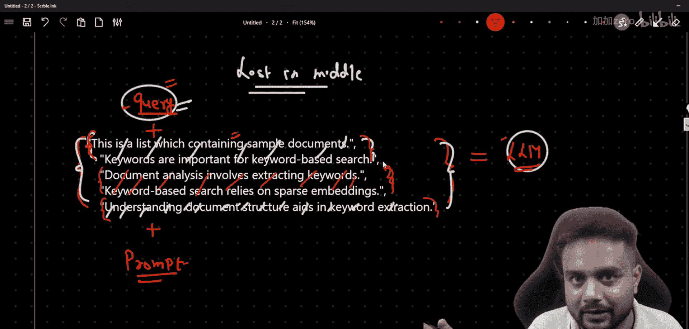
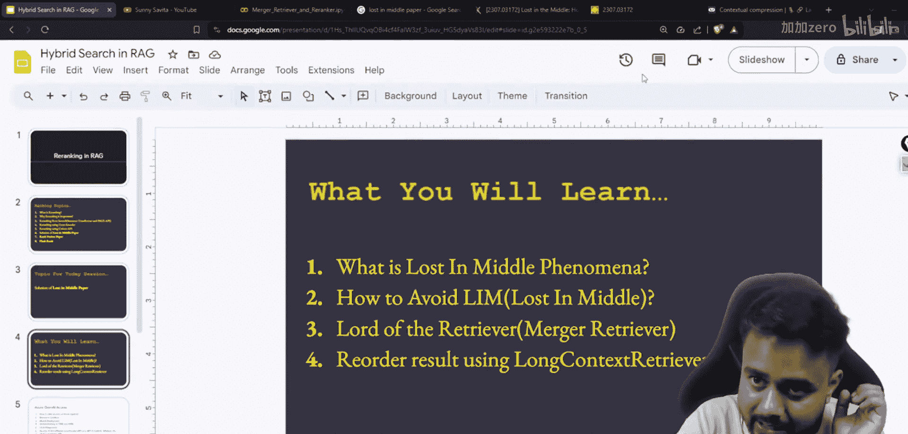
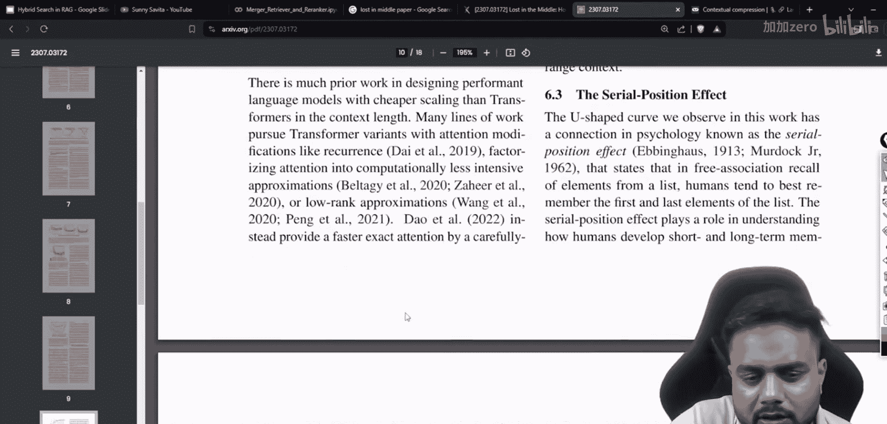

# Sunny Savita【中英⚡生成式AI：从初学者到专家｜Generative AI In-Depth Roadmap from Beginner to E】 p42 P42 Advance RAG 05 - Merger Retriever and LongContextReorder ｜ Lost in Middle Ph [BV1Uht8zDENA_p42]

Hey hi everyone。 Welcome back to my YouTube channel。 My name is Sunni Savita。

 and I'm back with another exciting and useful video。 Yes， guys， guys， in this particular video。

 we're gonna discuss one more topic related to this reranking。

 I already started with this reranking reranking chapter and I already recorded four video on top of this particular topic。

 Now， first of all， let me show you the syllabus and then we'll start with today's agenda。

 So here in this in the previous video， I already discuss about this reranking importance of the reranking。

 I discuss reranking from a scratch using this sentence transformer and Vm 25 and in the previous video I discuss about this reranking using cross encoder and cohe API Now in today's video guys。

 we're gonna make a solution of this loss in middle paper。 So what is this loss in middle phenomena。

 why does it。😊。

okay how we can solve it each and everything we gonna see over here inside this particular video。

 So yes， I hope the agenda is already clear to all of you now coming to the topic that what topic actually you are going to learn So first we' try to understand the problem as I told you then I will show you how you can avoid it and in order to like solve this particular problem I will show you this merger retrieval how it is useful for creating your rack pipeline。

 your robust rack pipeline and then how you can reorder how you can rerannk your retrieval the retrieval component using this long context retrieval So this many thing we gonna discuss right not this one this is just a glimpse we have lots of inside this particular video and at the end of the video I will show you that how you can load the L large language model from the hugging face Q model inside your Google collab and I'm going to use the Lama。

So don't miss out this video guys it's going to be a very。

 very important and each and everything is going to be clear with respect to this merger retriever and this long contracts retriever apart from this one I have some other topic as well like how to remove the redundancy inside the retrieve topic how to compress it so each and everything I'm going to cover over here now first of all guys what I'm going to do I'm going to be show my YouTube channel so here if you will look my YouTube channel you'll find out all the videos and all so yes if you haven't subscribe please subscribe if you want to gene in depth so please do subscribe to support the channel and yes Ill be coming up with many more topic in in the future related to this gene AI data science machine learningm opsl ops with everything so now guys first of all let me open my blackboard and here let's discuss from starting So this is my。

Architecture I think in many videos Ive shown you this architecture so let's try to take a recap and then we'll try to understand this lost in middle problem and don't worry I will show you the research paper as well and we'll try discuss couple of graphs and all based on the research paper so let's say what we have we have a data right this data actually you are going to be divide into the chunks as you know right so always we divide into the chunks if you want to feed to the LLM then we are going to be convert into the embedding using the embedding model and we gonna store inside the data right now after this one guys let's say。

My user is asking any query so that query is going to be converted into the embedding and then we are going to perform the similar T search right where we are going to perform the semantic search or similar t search here inside the data right and then finally we are getting my document Finally we are getting my similar document that is called that is called the rank result okay and now on top of it one more time actually I can perform the retrieval I can rer this result and that is already going on and I already created couple of video so here guys first of all let me explain you what is this loss in middle problem right so let's say so here guys I have this document and this is what this is my query so you can assume this document is available inside my database。

Okay， I perform the chunking and all then after the chunking。

 I convert into the embidding and this is available where inside my database。 Okay。

 the embedding along with the document， it is available like this only be stored now always so this is my query。

 which is being asked by the user Now based on this particular query。

 let's say this is my five document Okay， so I rank this five document which I want to pass to mine tell me which I want to pass to my LM。

 So what I will pass to my LM I will pass query。

Along with a query， I will pass this document。Plus， what I will do is I will pass my。Wrong。😡。

So whatever prompt is there。And then this each and every detail each and every information is going through this L level Now lets try to understand this lost in middle phenomena okay。

 lost。In murder。Verying my point。 So here， let's say this is my query。 Okay， now this LLM， okay。

 this LLM， what he is doing， you know， So whenever I am going to be asked the query。

 it is taking a reference of this particular information。

So whatever information is coming at the beginning。

 lets say this is the information which is coming at the beginning this one。

Or whatever information is coming at the end， Okay。

 lets say this this one which is coming at the end， okay。based on this one。

 it is giving the answer okay， and the accuracy is also perfect means means here is my query。

If the query is related to this particular sentence or。This sentence， right。Definitely。

 it is performing well， it is giving me a good answer。😊，Okay， but guys， if my context， okay。

 if my query is related to this particular data。This particular context， in that case。

 my LLM is going to be fell。I hope you are getting my point what Im trying to say。 See again。

 I can repeat it。 Lets say here is my query。 Here is my data context， and this is my prong now。😊。

I am passing everything to my LLM for generating the final output if my query is related to this one。

 which is coming at the top or which is coming at the end。😊，Then my LLM is performing well。

 but whatever information is time to pick up from the middle at that time its going to fail Im not saying it they perform the research okay so stand in the Stanford University itself they like conduct a research and they figure it out you can you can check this particular research paper let me show you the research paper the name is what lost in middle and here based on this particular research you can see they have published several graphs let's try to understand this graph see first just look into this graph here I hope it is visible let me search of my camera that you can clearly access it see here。

What I have， I have my 20 retrieval document Okay here is a position。

 so first position then  fifth position then 10 position then 15 position and then 20 position So position of document with the answer okay。

20 total retrieval documents。 I hope you are getting my point and here is what here is my accuracy Now see you guys。

😊，If if I'm asking any sort of a query。Okay， now this query it is going to the first position and miss this query actually it is time to pick up the context from the first position okay。

Then， the accuracy is perfectly fine。And here you can see if my query， okay。

 this this particular query， if it is time to pick up the context， okay， we are passing prompt。😡。

This context context in the form of this 20 retrieval document。Okay。

 if this query actually is trying to pick up the context from this 20th position。

 the accuracy is also fine。😡，The ground if I'm going to be matched now with a ground truth。

 it is fine， but in middle， but with the middle position。

 if it is time to pick up the context from the middle position at at that time。

 it' is going to fail means the accuracy is going to be decrease and that is what that's a lost in middle phenomena I hope guys you got it but this is not with the like the ara model right so if you will look into the instead of art model like G cloud a okay if you will look at the G4 as well Yes those model as well they are suffering with this a particular problem and they have proved it they publish this research paper right now in the conclusion see here this other graph here you will find out related to the cloud a cloud a 1。

300 k G3。5 g3。5 turbomppt long chat and all and here you can see the result and all everything they have published Now if you will go。

😊，The conclusion， if you will go and check over there inside the conclusion they have mentioned many more thing that they are telling so we check okay on the architect level we try to rectify the architecture of the model then we find unit as well Okay we perform the context via contextual contextualization and all so many more proposal they have proposed over here now guys one。

