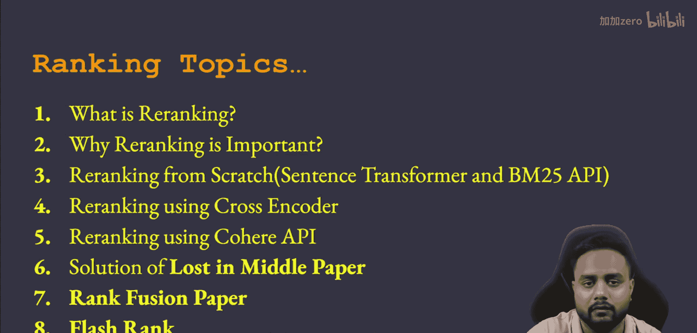
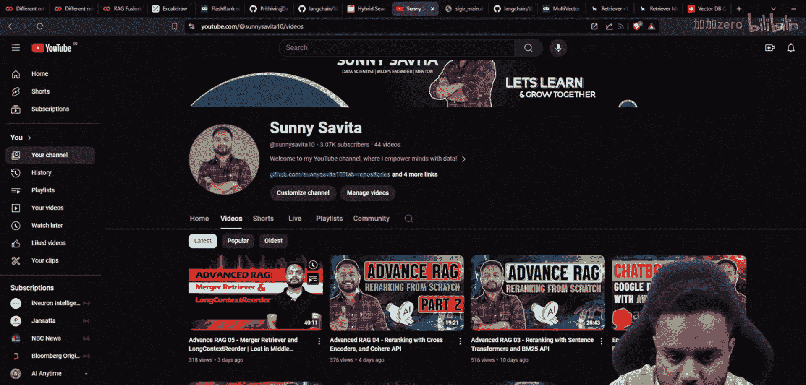
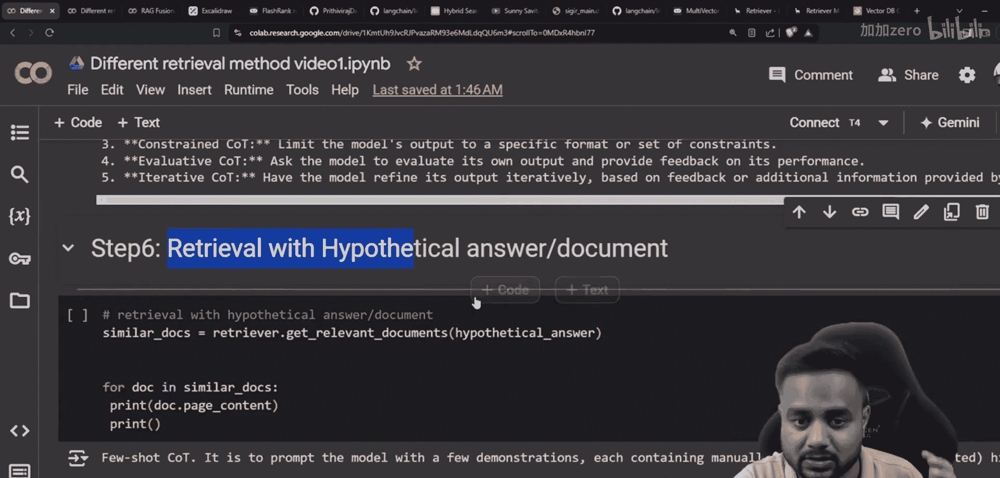
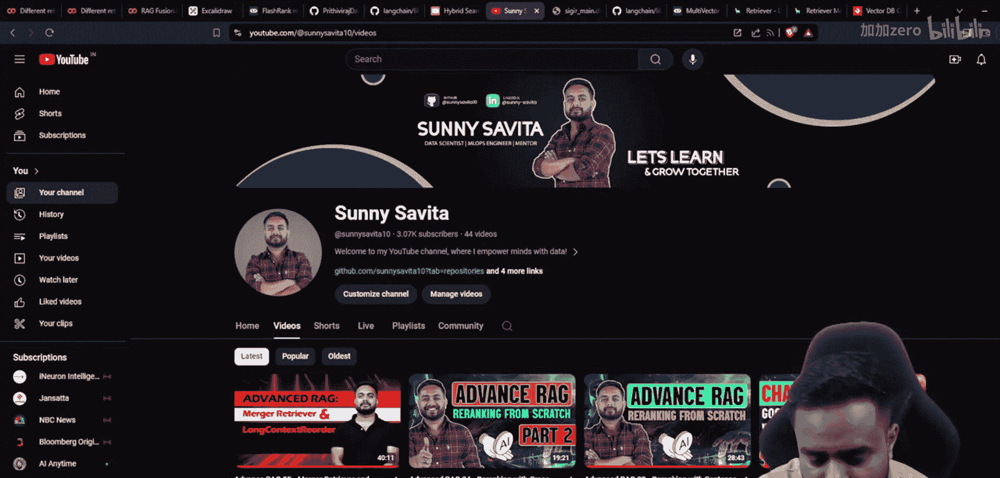
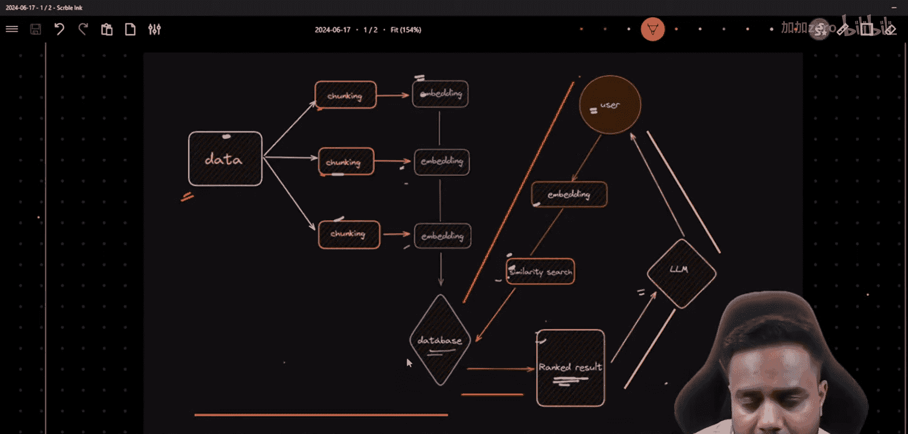
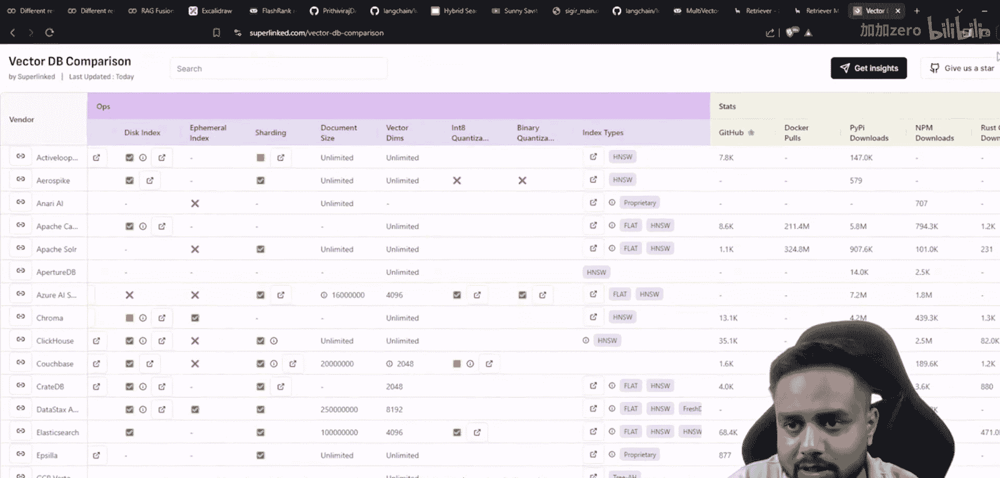
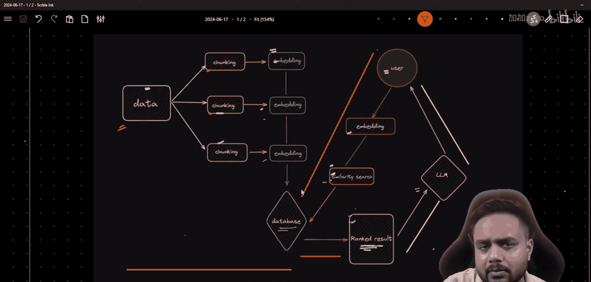
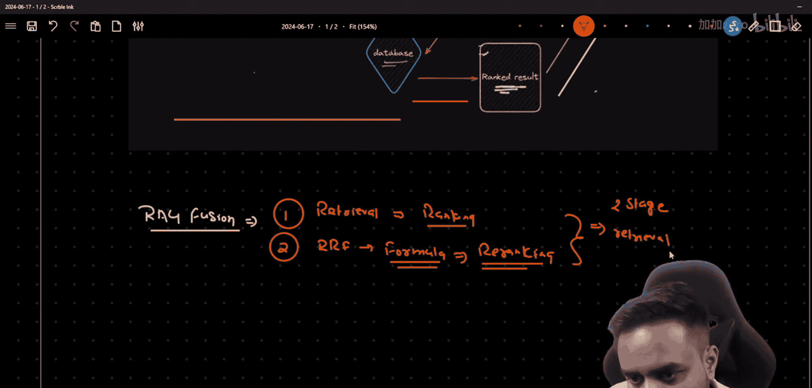
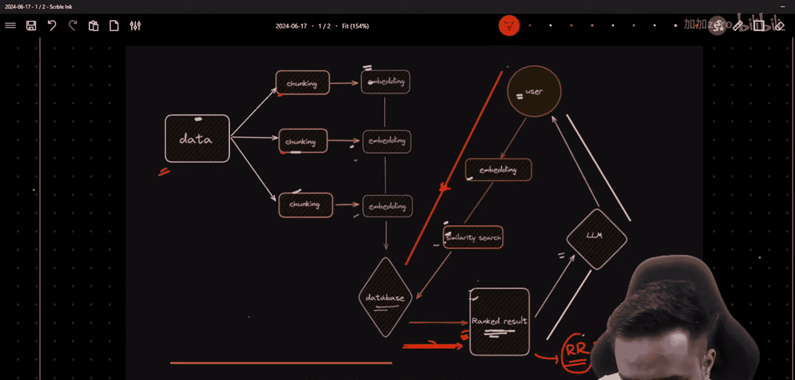
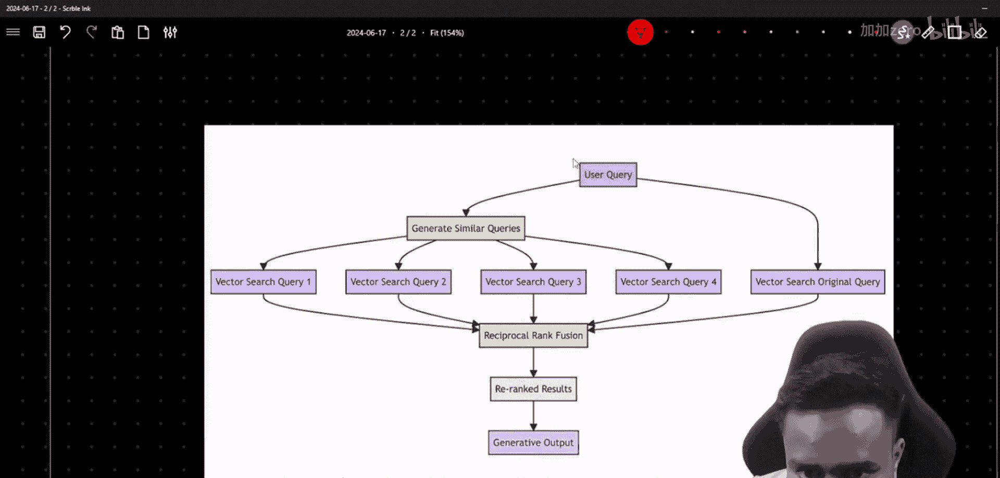

# Sunny Savita【中英⚡生成式AI：从初学者到专家｜Generative AI In-Depth Roadmap from Beginner to E】 p43 P43 Advance RAG 06- RAG Fusion (Get More Relevant Results for Your RAG) ｜ Rerank [BV1Uht8zDENA_p43]

He hi everyone。 welcomelcome to my YouTube channel。

 My name is Sunni Savita and this video will discuss about this rank fusion。

 So guys I was working on this retrieval site。 this retrieval actually it's a very important part of the rank pipeline and there are so many things so many concept related to this retrieval So while we are retrieving the topic so we can retrieve the topic based on the different different methods and after retrieving we can rera also so this retrieval document is called the rank document and again we can reran it means like we can perform one more retrieval on top of the rank on top of the rank document and that is called the second stage retrieval and that is also called reranking So inside this reranking chapter I discuss about this sentence transformer Bm25 cross encoder cohe API Mo retrieval or long context reorder where I discuss about this loss in middle phenomena now we discuss。

This rank fusion what is this rank fusion and after this rank fusion I will come I will discuss about this flash ring okay this is one of the like one of the module inside the L chain itself one of the class basically and the entire code is also available related to this flash ring I will be talking about it in my upcoming video Now first of all let me show you my YouTube channel and let me let me show you that model thing actually I have covered so far so related to this retrieval and all guys I have created one separate series。

So the series name is what the series name is advanced rag okay so so far I recorded five video inside this particular series this is this is sixth video now apart from this I am thinking about a couple of more video so in those video I will discuss about the different different retrieval we have self query retrieval okay we have sentence window retrieval。

small to big retrieval that is called pen retrieval right or compressor retrieval contextual compressor retrieval there are so many retrieval which is available so definitely we're gonna discuss inside this advanced rank series and yes you will find out around4 to five more video with respect to this one if you want to start really if you want to start from the retrieval you can start from here from this particular session there I have talk about hybrid search how you can perform the hybrid search like keyword search and the vector search which is a very important part of the retrieval at many places actually you will find out for making a robust pipeline people are using this technique okay now let's to the agenda So today I am going to discuss about this rank fusion Now what is this rank fusion along with along with this rank fusion one more topic is associated that is called reciprochcal rank okay Raciprochcal rank fuser so I will talk about this。

I seeprocal rain fusion as well this is looking like a very heavy thing but it is not guys if you are familiar with the basic rack pipeline easily you can understand these topics and all and easily you can implement it also my solution is ready here you can see my solution of the rank fusion and apart from this one guys Im working on the very amazing thing and soon you will get it okay soon I will be uploading this video as well like basic rackflow self query retrieval and apart from this one see many more topics many more like retrieval types I have kept and I'm already working on it see retrieval with the hypothetical answer document hide which is called hide right and yes so if you haven't subscribed the channel please do subscribe it's a request to all of you because see guys this AI is going to be a very important part okay of the softwareer development of this IT industry and this is just a starting of the AI。

In the upcoming days， in the upcoming year， you'll find out the advancement okay you will find out the huge advancement in this AI field and the story begins from here itself if if you want to build something using this AI using this AI concept if you want to become a successful AI engineer definitely you should learn this concept and you can learn this concept where on my YouTube channel please subscribe please hit the like button please share with your friends with your peers whoever is whoever is time to learn this generative AI this AI because it's a future and definitely we should invest the time on top of this AI and all and don't worry soon I will be starting my Hindi channel as well so there also I will be uploading my content or my Hindi channel and many more thing not only this geneative geneative this concept like Ra fine tune。

The core concept as well okay goal concept like machine learning deep learning like a few concept related to the an okay the few concepts related to the MLOs and LMOs everything you will find out over here so that you can become one robust AI engineer one successful AI engineer from learning here from learning my YouTube channel so let's do one thing let's try to understand the concept of the rank fusion but before coming to the rank fusion let me revise the architecture of the rank so this is the architecture of the rank and here guys see。

So guys， this architecture， this rag architecture is a very dynamic architecture。

 and we can make a changes inside this architecture at each and every stage right so misly we divide this architecture into three the main parts。

 so the first part or the first stage is called the data ins from here to here。

The second is stage of this architecture that is called retrieval from here to here this one。

And the third stage is called a generation， from here to here。

now see you guys why it is dynamic So let's say we are collecting a data。

 So first of all this data could be anything。 it could be in any format。

 okay un structure structure in a structure CSv Tsv X and all in semistructure Json Xml STml or in structure text video voice data right it could be anything So after collecting a data we always have to divide it to the chunks now here guys see this chunks also plays a very important role inside this architecture inside this pipeline if we are not deciding the optimal chunk size inside in that case I can I can get the error I can I cannot get the good result so this chunking also plays a very important role and definitely I will upload the video related to this chunking and all how you can how you can decide the optimal chunk size that this embedding embedding actually there are so many hundreds of model of the embedding and there are。

So many model right the model related the higher dimension。

 lower dimension Okay so upper higher dimension like more than 1。

024 and all you'll find out each and every type of model of the embedding and many of them I already cover on my YouTube channel So now this is all about the data in and see mainly the main component of the data in is what this database where actually we are storing a data and in my previous in my videos if you will go and check with the videos right so already I discuss so many database or like neo4j Mongo Db8 pine go every database I try to discuss and even I show you a comparison as well So here is a list of the vector database here is a comparison of the vector database based on the different different factors definitely you should check it out if you want to become a robust rank pipeline right So this thing is clear now see。

So the second part is called the retrieval part now what is my topic of what I'm going to discuss here。

 I'm going to discuss Re Fusion。

Right fusion so this right fusion I can divide into two parts。

First part of this right fusion is called the retrieval， okay retrieval。And the second is called。

The again， is called。Rciprocal rank fusion， reciprocal rank fusion here we use a specific formula。

And using this formula， what I can do， I can rera my result。This particular stage is called ranking。

Branking。And here， this is called the second one is called re ranking。 And comely， I can say it， Sir。

 who is stage retrieval。 What is this。The it is called。2 is stage。

Retrieval got it now where it lies So first retrieval。

 first rank result so I can I can take my result from here。 Okay。

 I can perform the semantic search based on my query and I can retrieve the result and this this is called my rank result now after the rank result what I can do I can use the formula of the reciprocal rank okay I can use the formula of the reciprocal rank and then I can perform the fusion I will let you know what is a meaning of the fusion So in simple term in simple term if I can explain you this fusion that is not that's a melting Okay melting or come my name。

Com mining the multiple things Okay come mining so that's a meaning of the fusion and definitely we're going to discuss over here。

 So let's look at the architecture of this right fusion how it looks like and where it comes guys tell me it comes inside this retrieval means from here to here and then second one is what second one is a re ranking it after collecting the rank result again we can rerannk it So this is the architecture of the rank fusion let's start to understand it as I was telling to you that we。

