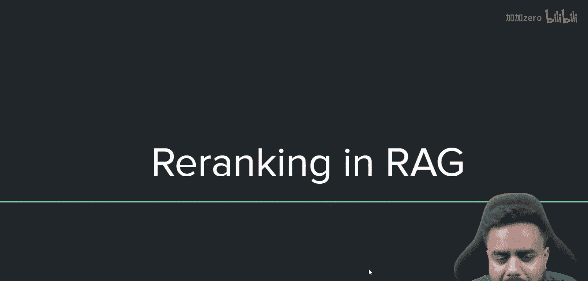
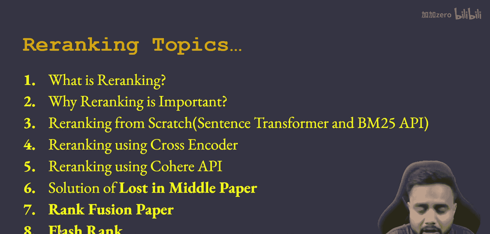
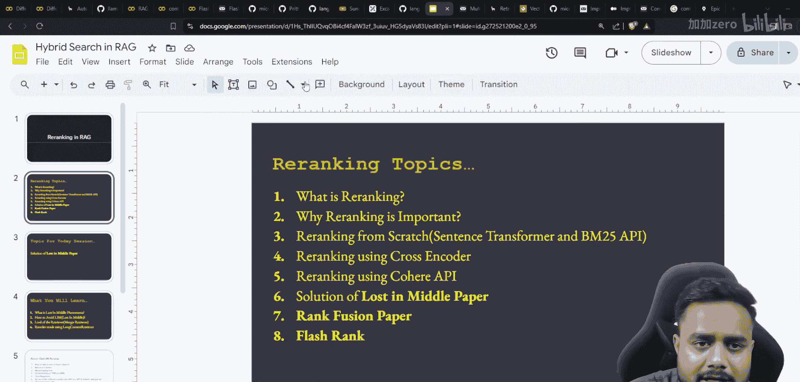
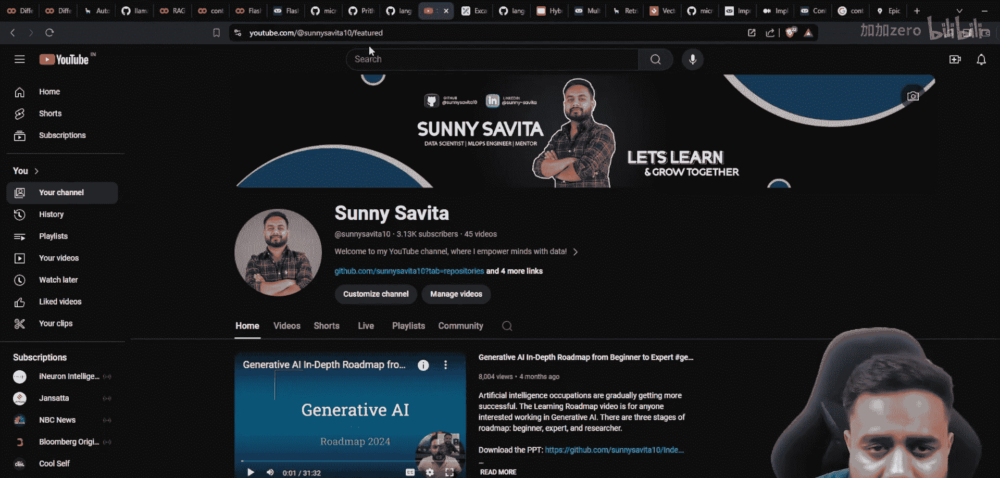
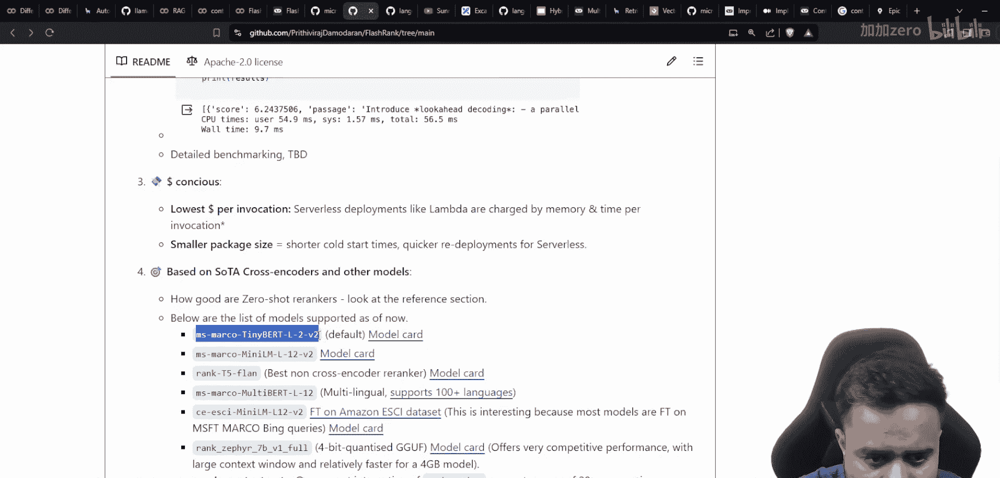
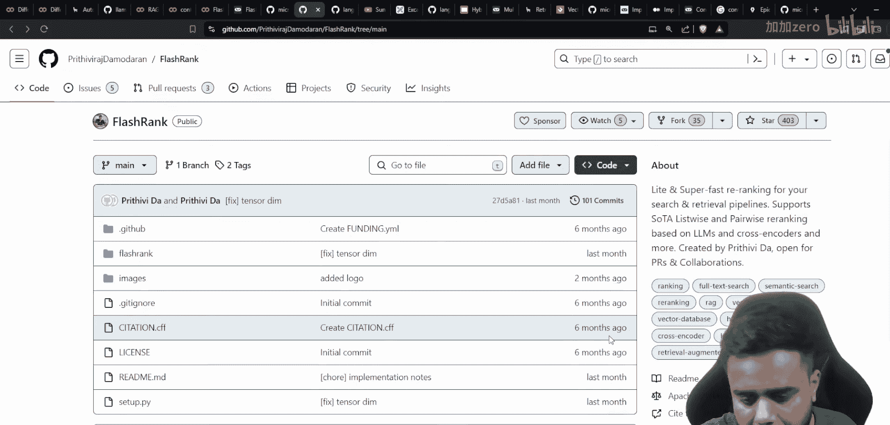
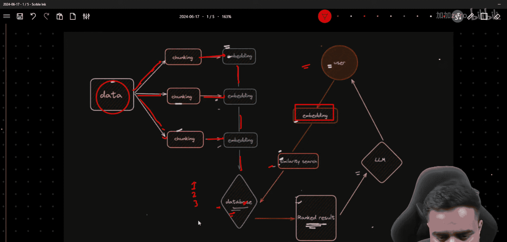

# Sunny Savita【中英⚡生成式AI：从初学者到专家｜Generative AI In-Depth Roadmap from Beginner to E】 p44 P44 Advance RAG 07 - Flash Reranker for Superfast Reranking [BV1Uht8zDENA_p44]

Hey hi， everyone。 Welcome to my YouTube channel。 My name is Sunni Savita。 And in this video。

 guys will'll discuss one more important and very useful concept of the reranking。 Yes， guys。

 So I was talking about this retrieval and the reranking with respect to this rag pipeline。

 I already discuss so many topic so many things， if you will go and check with my YouTube channel definitely will get it。

 So first of all， let me show you the complete syllabus the syllabus， basically。

 which I covered in my recent days。 So I started with the reranking。

 Then I I explain the importance of the reranking， Then I discuss about the reranking from a stretch using this sentence transformer and this Bm 25 API。

 Then I discuss this reranking using cross encoder and I discuss about this cohe API and all。

 Then I came up with some advanced concept。 like I discuss this lost and middle phenomena。😊。

I discuss about the merger retriever long context the order and all then I discuss about this rank fusion。

 Yes this was a very much important guys and by using this rank fusion we can create a very robust pipeline Yes very robust rank pipeline Now it's time to discuss about this flash rank flash rank or fast rank so what is this flash rank who is created this flash rank where you will find out this flash rank the code and all everything we are going to discuss in today's session So let me show you my YouTube channel guys So here if you will go and check with mytu channel you will find out all the video related to this reranking and all not only the reran if you will slow down so many video with respect to this rank related to the different different framework and the databases and now I've created one more new playlist the name is advanced rank I already record6 video this is a seventh video of this particular playlist now。

I will I will record so now basically we will find a few more video with respect to this advanced rag andal because after this redden I'll be working with a retrieval and all okay and then we'll come to the chat board and a different other topics which I'm having the complete list so don't worry I will share with all of you the complete plan and each and everything and I'm planning a couple of live session as well going forward So if you haven't subscribe the channel please do it and if you will go inside the live session and see already I have covered one project four months back actually when I started my channel at that time itself now i'm planning well full flex series in the live mode itself so the session won't be too long the session will be。

As as small as possible， but yeah that too will be a so please guys。

 please subscribe the channel and please hit the like button if you're watching to the video。

 please share with your friends and colleagues in all whoever is required to this kind of video related to the Gene AI chatboard rag soon I will be uploading few more video so I'm thinking about the basics and the fundamental of the deep learning NLp and the computer vision and also that you can familiar with the basics as well then machine learning Python object or in programming modelular programming industry level project and all everything I am planning so if you haven't subscribe please do it guys it will give me the benefit and yes if you are sincere with your learning and all definitely you can align to your dream job as well from learning here because I'm covering each and everything to the industry level so yeah let's begin let's start。

So first of all， let me show you this particular project。

 Okay the project name is flash rank So this person has created this project。

 the person name is pred as the mother this person actually is a quite amazing one and he's a very wellknown person in a open source committee If you will go and check the repository of this person right you'll find out like so many stars and folks and the different different framework and the different different project with respect to the different different thing right so definitely you can check out you can check out the profile of this person YouTube link okay and the other reposities and all So he has created one more repository。

 the name is a flash rank This is the repository basically which we are using for what for the reranking Yes guys if you don't know about the reranking don't worry I will explain you about the reranking Now what is like the different thing actually we have inside this flash rank why we are。

Using it and one more thing guys this a flashing actually is available。

 it is available inside the la as well。 Yes this。Integration is there inside the length。

 I will show you in some time。 So what is what is a like important thing inside this flashing。

 So first do one thing just check out with a readmi file So inside the readmi file。

 the person has mentioned each and everything。 So here has mentioned about four type of model first is ultra right so four type of model So nano okay then medium then large Okay and one more type of model I will just show you now apart from this one guys here you can see the feature of this particular project feature of this particular repository it's ultraright super fast okay it's concise and it is based on the So cross encoder and other model So cross encoder I already discussed cross encoder itself is a repository which you will find out inside the hugging face and there you will find out the different different type of model cross encoder actually we use for for the reranking and all and yes it is very much important。

Now guys， this person also use something from the cross encoder itself。

 but the model is a light weighted model。 Now one， let me clarify one thing over here。

 So whatever model you can see over here， this M macro tiny word MS micro minim this rank t5 M macro multi word this model has not been created by this person right this person nothing created anything。

 nothing train anything from a sketch， this person aggregated everything inside this project okay and this a particular package we can use inside our application and while we are using it guys because it is giving us each and every combination each and every combination of the model at the single place right and here the main thing。

 the main thing of this particular reposor will find out so it is ultra light and super fast why guys because this by default default model this M macro tiny word model it's a super light model and if you will see the size of this this particular model really will be surprised。

Even you can run inside your system as well。 the size is just around 4 m right if you will go and check related to this model now So just do one thing。

 try to copy it and then paste it inside your browser。

 So once you will do it guys here it will get the H and every detail of this particular model as I told you it is already available It said the cross encode repository and this model actually cross encoder for m micro just click over here just click on this particular link you'll find out this like model actually has been developed by the micro Yes so this is a data said guys micro machine reading comprehension this is a data basically they have used for developing this particular model。

 you can read the complete detail and all everything basically they have provided over here。 And yes。

 this person is using this particular model not this one guys this one this person actually is using this particular model inside on a project directly we can read it directly we can use it for what for the reranking I hope the thing is clear now if。

Scroll down guys here you will get the complete implementation and all。

 So I was talking about four type of model。 One was the nano is small medium man larger sorry I forgot the one was the small than medium right and apart from this one here has given you he has given you an example as well So let's say if you have query and here is what here is your retrieve answer right which you are retrieving from the database now what you can do you can pass it to the you can pass it where you can pass it to the rank or request okay this all the thing and then finally you can rera it So what you will get you will get the rera response over here as you can see right So this is the complete implementation the person has given to you now you can use this flash rank is this rera anywhere inside any architecture。

 whatever database whatever like embedding model sorry whatever database whatever technique。

 whatever architecture you are creating anywhere basically you can use this particular model this particular library I hope。

This introduction is pretty much clear to all of you now coming to the next point so first of all guys let's try to revise about the re rankingking and then I will show you some more interesting fact and finally lets start with the practical implementation Okay so first of all guys here this is the architecture of work it's the architecture of the tell me。

Rg， right。 So where this rera lies。 tell me guys here。

 I think I already explained you in my previous video， but don't worry again。

 let me give you a quick overview。 quick a recap of it。 So I have a data。This data could be anything。

 Now this data Im dividing into the multiple chunks as you know right now after this one I'm performing embedding Okay。

 embedding means numerical representation of the data and then we areoring inside the vector database This is my database what it Then here is my user which is asking the query So the query actually is going to be convert into the embedding now after the embedding guys what I'm doing I'm performing semantic search based on this like query and all Okay and here is my record let's say here in total I am having a number of record。

