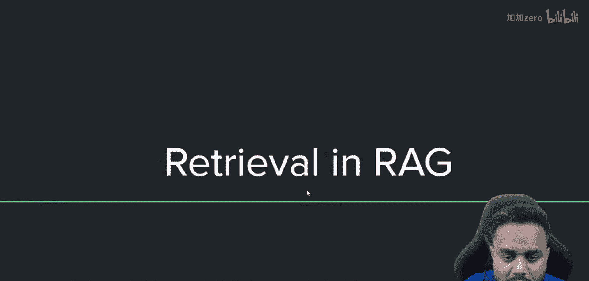
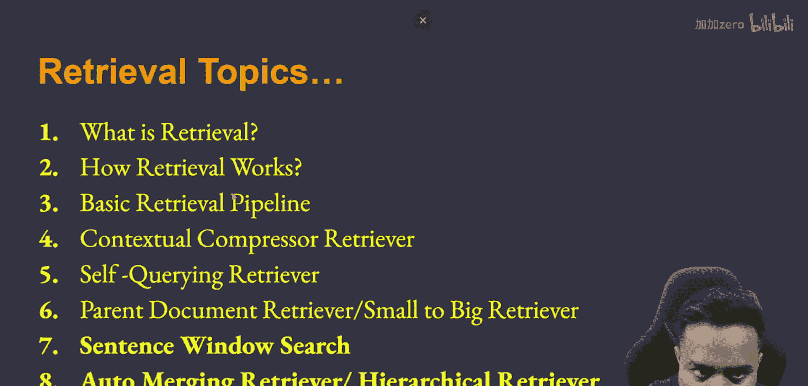
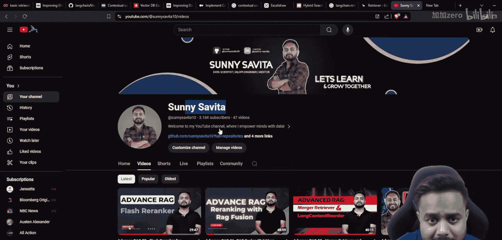
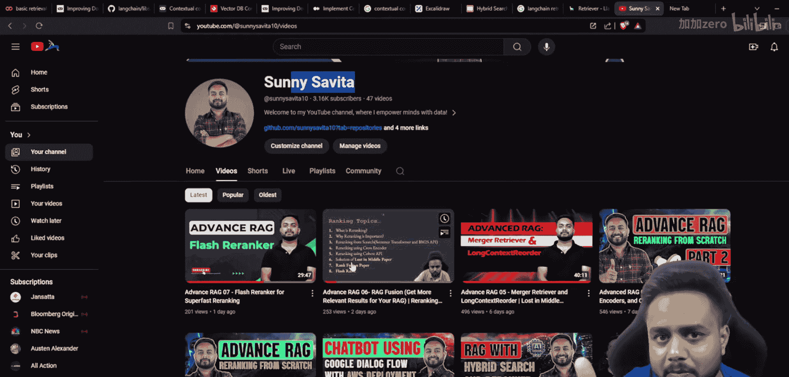
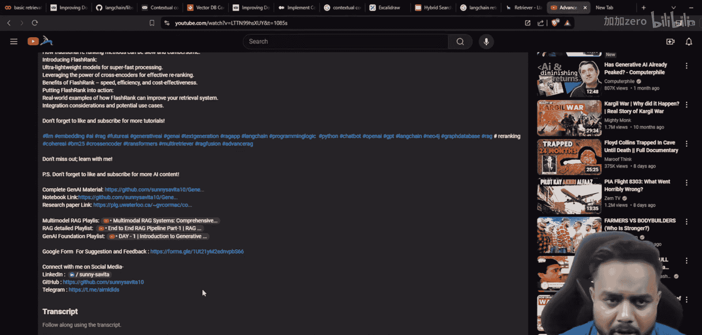
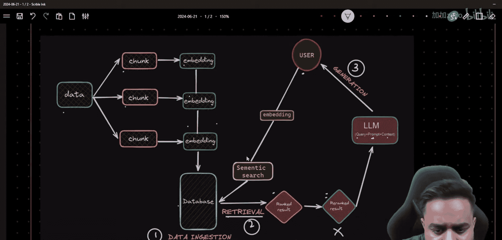
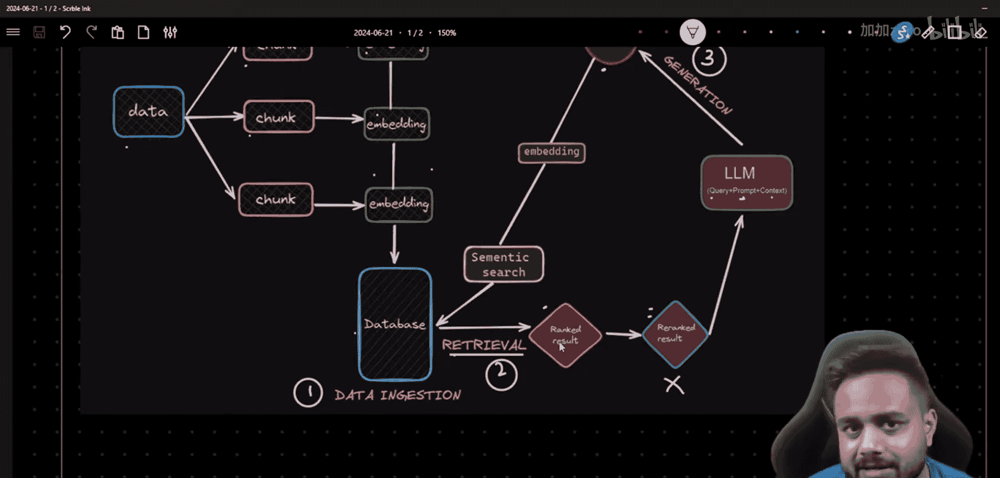
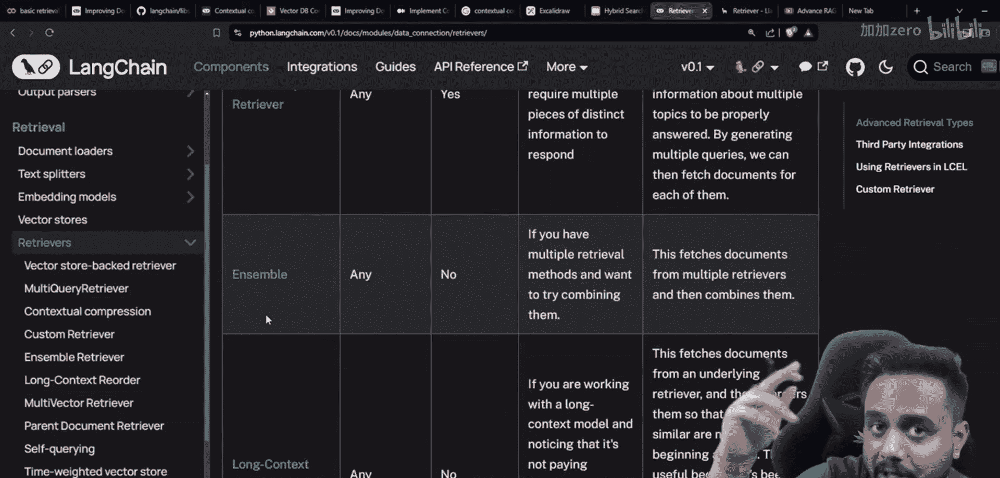

# Sunny Savita【中英⚡生成式AI：从初学者到专家｜Generative AI In-Depth Roadmap from Beginner to E】 p45 P45 Advance RAG 08-  Powerful RAG with Langchain Contextual Compression Retrieve [BV1Uht8zDENA_p45]

He hi， everyone。 Welcome to my YouTube channel。 My name is Sunni Savita。

 and I'm back with another exciting and important video。 Gu in this particular video。

 we'll discuss about the different different retrieval techniques of the rag pipeline in my previous videos I was talking about the reranking method of the rag pipeline。

 I discuss various reranking method。 And if you don't know about it。

 definitely you can check out with my previous session。 or don't worry。

 even I will show you inside this video itself。 guys， based on that。

 I got so many command so many messages and all。 Sir can you discuss about the retrieval retrieving technique as well。

 So first of all， guys， we have to understand what is this retrieval I will let you know the concept of the retrieval。

 Although we have already discuss about it in my reranking and all But again。

 I can explain you that particular part。 Then after that， after understanding this retrieval concept。

😊，Well discuss the different different method of retrieving the document from the database from the vector database okay so let me introduce the syllabus so here is a complete syllabus guys so we are talking about this retrieval inside the right and this is the syllabus the different different topic so first we'll discuss about what is retrieval then how retrieval works then basic retrieval pipeline I think we all know about this basic basic retrieval pipeline and all we have implemented so many times then contextual compressor retrieval it's a retr from the lan I will show you all the retrieval and all from the la Lama index。

Then self query retriever it is one of the important retriever Okay then parent document retriever means small to big retriever。

 It is also very useful retriever and definitely we should learn about it also then a sentence window search okay sentence window search and auto me retriever this two retriever actually you will find out inside the Lama index Yes so these many things I'm going to discuss so I will take around three to four video so in the first video in this particular video well discuss still fourth point and then in the next video we discuss about the self query then parent and in the final video we talk about this sentence window sentence window search and auto me retriever now apart from this one guys we have one more very important retriever that is called hide okay we are actually we generate the hypothetical document this is also very important retrieveval and definitely I will include it inside my retrieveval topic。

I will create a video on top of it， as well。I hope this syllabus is clear to all of you now first of all we need to understand where this retrieval exists and whatever thing we have learned so far right this reranking and all so how we can relate this reranking with this retrieval so each and everything I will teach you over here inside this particular video guys。

So first of all， let me show you my YouTube channel and there let me show you all the videos related to the reranking and all and then we'll come to the retrieval topics。

 So here guys if you will go and check with my YouTube channel if you will search about Sunny Savita you will get it and this is the topic related to the reranking and all and I'm keeping all this advanced topic inside one specific playlist the name is advanced rag I will create it and this all the video right in total I have recorded seven video with respect to this advanced rag and all now I will record a couple of more video so after this retrieval I will come to this evaluation and all rag evaluation and couple of more topic like differences between rag and chat bar there are so many thing which is like which is in my mind and definitely I will discuss the whole sort of syllabus with all of you in the going forward So if you haven't subscribed guys。

Please subscribe the channel and if you are liking the video then please hit the like button please share it and please support to the channel so now let's start with the video and guys please go through with this reranking topic and all if you want to build one advanced rag system definitely this reranking at all it will help you a lot to build a very efficient rack system if I forgot something if I didn't cover something that definitely you can live inside the comment I will look into it and I will create a video on top of it or Im attaching one form as well where inside the description if you will go and check now soll find out one form Google form you can fill out this particular form and you can fill out your suggestion feedback anything in your mind with respect to the topic contain channel me whatever now coming to the explain。

So first of all， guys will have to understand the architecture。

 Now one more thing guys here I would like to tell you。

 So here I'm explaining you each and everything。 So sometimes the video is going to be long or sometimes my explanation is slow So in that case you can speed up the video so for better experience either you can watch it at 1。

25 x or you can watch it at 1。5 x so you will get a better experience and better understanding Now coming to the now here guys you can see this is the architecture this is a complete whole sort of architecture of the rag So first of all let me explain you about it here is my data as you know that like this we always divide the data inside the chunks so we are dividing a data inside the chunk and then we are generating embedding from that particular chunks right now guys I will create one separate video on top of this topic on top of the chunking itself how you can create a better chunk and。

Practical， okay， with the practical demonstration， I will show you。

About this chunking and all everything right now after converting into the embedding guys we are storing inside the database So this entire process actually it is called a data ings Okay so what is this tell me it is a data in j now after ingesting a data guys there is a second phase of this pipeline so let's say my user is asking a query so here my user is asking a query right。

Or let me remove it from here。 what I will do guys。 I will keep it over here。

 Now my user is asking a query。 I will convert this query into the embeddedbedic。

 then I will perform the semantic search to my database and then I will retrieve the relevant document So guys here this particular stage right so we are actually we are going to retrieve the document from the database that particular stage or a step is called the retrieval Now this result actually it's called rank result so this is my second stage now this is this one is called rank result okay now after the rank guys what we can do we can perform one more level of retrieval this is called rerannk okay reranking So so far actually we were discussing about this reranking concept that after retrieving the data after retrieving the document how you can rerannk those document But guys now we will have to understand about this retrieval also the first stage retrieval because it comes before the。

Reranking and I think we should I should have recorded I should I should have recorded this particular topic at the first place。

 but no worries like later on I can arrange everything inside the single playlist and you can understand in an Eg way that is not an issue So after the reranking guys what we do we pass each and every information to my Lm so that Lm can understand in an Egs way all the context and all So what all thing actually we pass to the Lm tell me so here we pass queries prompt and context So this rerank result or rank result let's say we are not performing this reranking it's not a mandatory again I'm saying if you want to do it。

 you can do it if we don't want to do it you cannot do it because again it will add some latency inside your pipeline So sometimes actually we avoid it also we directly pass this rank result means this will also call the context where to my LLM along with what along with this particular query which。

user is asking and the prompt okay the prompt if we are going to define any specific prompt like just just to like filter out the just to filter out the important information from the context based on the query definitely we can do it right and finally this is my third estate this is called generation now I hope you got to know that where this retrieval like this and now with respect to this retrieval guys we have a different different topics right so first of all guys here let me show you the different different retrievetrieval which is available inside the la and lama index then I will discuss the very famous retriever right or a very useful retriever from the la that is contextual compression retriever right so let me show you the retrieval techniques from the la and all so here I already search L and retriever and I got this particular page now let me open it and see the result so here vector stored。

documentcu retrieve that I was talking about then multi vector retriever Okay self query retriever I will discuss this one as well in my next video contextual compression this I'm going to discuss in my today session then time waitedted a vector retriever multi query retriever ensemble retriever we already discuss right if you will go and check with my YouTube video guys So inside that I already discuss this ensemble retriever Now what is the ensemble retriever in the ensemble。

