# Sunny Savita【中英⚡生成式AI：从初学者到专家｜Generative AI In-Depth Roadmap from Beginner to E】 p46 P46 Advance RAG 09-  Powerful RAG with Self Querying Retriever #ai #llm #openai [BV1Uht8zDENA_p46]

Hey hi everyone。 welcomelcome to my YouTube channel。 My name is Sunny Savita。

 and I'm back with another exciting and useful video。 So guys。

 I was talking about different different retrieval system inside the rag the previous video itself I discussed the first retrieval system that was the contextual compressor retriever if you don't know about it definitely you can go and check out with my previous video So first of all let me introduce the syllabus。

 the complete syllabus which I've created with respect to this retrieval system。

 okay with respect to this retrieval technique So here guys you can see I like couple of important reval technique which will help you a lot whenever you are going to create any kind of rag system and the architecture So the first technique basically contextual compressor retriever which I already implemented as I told you the second technique is self credit retriever which we are going to discuss in today's session guys。

 yes then。😊。

App parentent document retrieval sentence window search auto merg and all So yes definitely in the upcoming videos we gonna discuss this all the remaining retrieval technique So yeah stay tuned with me please subscribe the channel if you haven't subscribed you will get important and useful topic like this with respect to gen and all so first of all let me show you my YouTube channel guys there I started this particular series this advanced rag and like I already recorded8 video and this retrieval guys it's a part of this advanced rag series only and before this retrieval basically I have discuss about the reranking and all so if you will start from here from this particular video this powerful rag using hybrid search keyword plus vector you will get the complete agenda right what is this vector search hybrid search what is this reranking and all everything basically I tried to cover now based on the different different message。

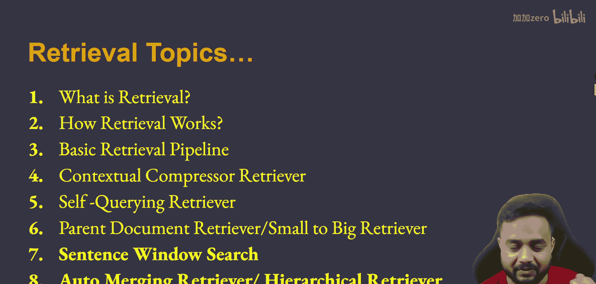

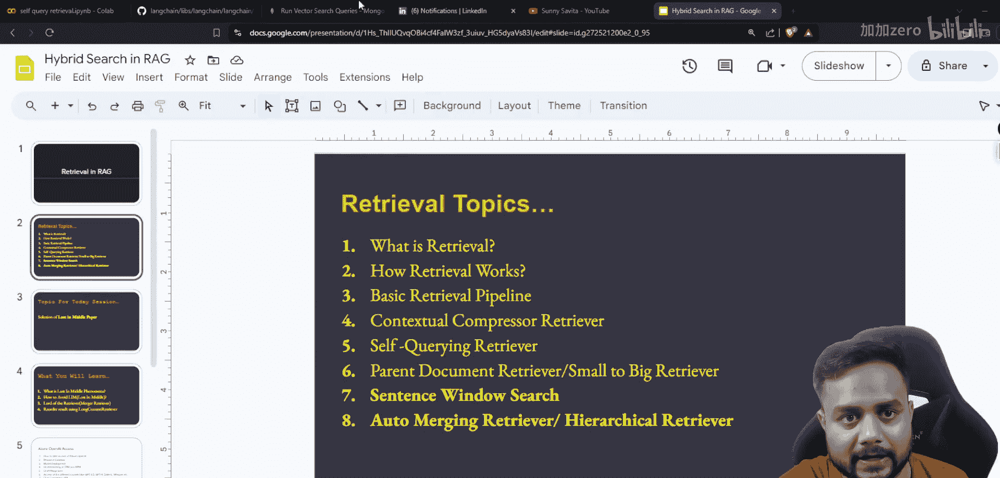

And behalf of like so many student and all I'm covering this retrieval part as well and yes the first video is out definitely you can check out you will you will learn a lot it is my guarantee to you now coming to the topic so first of all guys let me introduce the agenda the complete agenda with respect to this self query retrieval so this particular video I divided into three main section so I can write over here The first one is first I will show you the basic rank flow What is this basic rank flow along with the code and all。

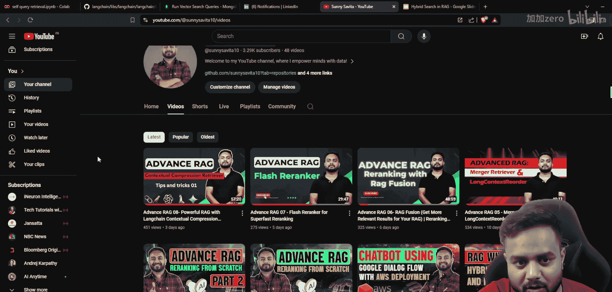

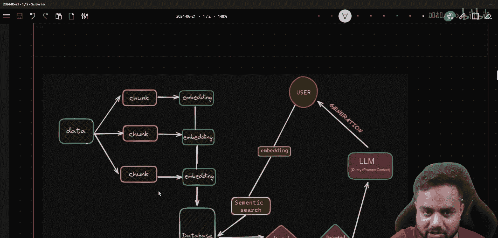

Then after this， basic rag flow， well discuss the theory of the。Fory of work。

 theory of the self query retriever。Heary of self query retriever。

 SQ arm means what self query retriever， The third point practical of the self query reval。 So， yes。

 we see the practical also。How you can implement this self query retriever。

 Now let's start with the first part of the video basic right flow。 So within a five minute。

 I will wrap up this thing because it is very much important to understand the further thing the further concepts and all。

 So let's say we have a data we can collect the data from the variety of the sources then we are doing chunking in all after the chunking what we can do we can get the embedding why embedding is required so that we can store inside the vector database and we can perform the similar t search right now after the similarity search guys。

 this retrieval comes means we are performing similarity search based on the query and this document which I have stored inside the database and then whatever document will be the higher highest similar one so those particular document I will retrieve and this particular process is called retrieval Now we have different different approaches for retrieving this data because this basic search actually this basic similar semantic search。

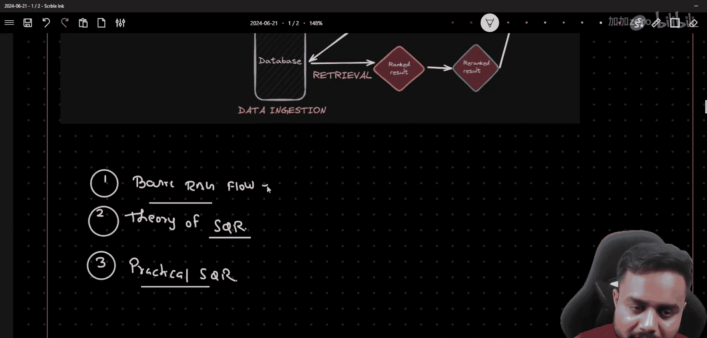

Does not work similarity search， you can say similarity search or semantic search both are same okay。

Now this basic similarity search actually it does not work like with so many conditions at all and we want some advanced technique with that actually we can retrieve useful information so that further I can feed it to my LLM now this reranking I already discussed a couple of technique of the reranking the most important one definitely you can check out now Im on this particular part Okay so guys the very first one。

 the very first technique of this retrieval。 It's a basic technique where we just perform the similarity search and based on that we retrieve the document Okay so let's look into that particular technique now first of all。

 let me give you the the broader picture of this retrieval part over here what I'm doing here guys。

 let's say。

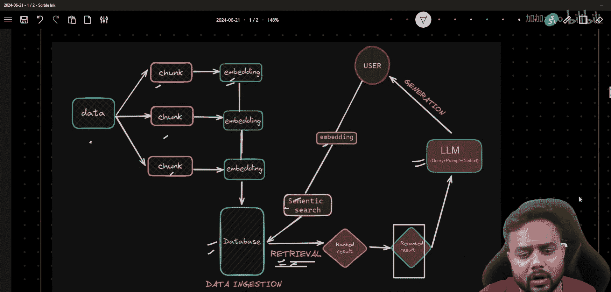

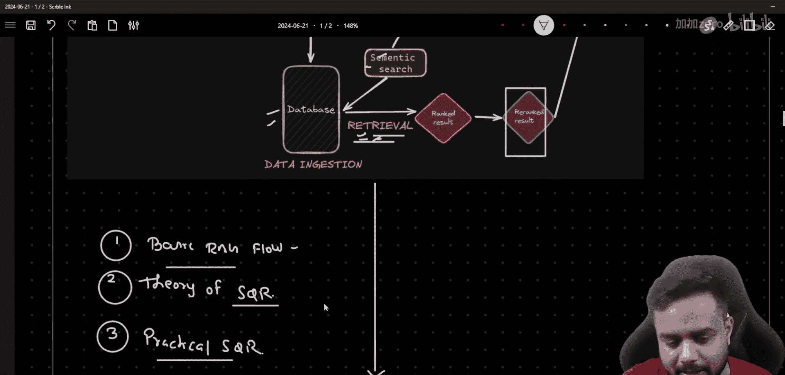

My user is asking query。Now， the squd is going to the。Document。😡，Here is my document， this one。

Document me like vector database。 I kept like so many documents and all over there in the form of embedding。

 So here what I have I have my embedding means my document。Now。

 what I'm doing Im performing similarity such， similarity such。

I can write this similarity search here as means what similarity I' am writing in short so that I no need to write other complete and the full form and all Okay it's a quite hectic sometimes then based on it what I'm doing I am getting the。

I am getting what I am getting my result okay， rank result or most similar result。

 so here I can write most similar result。I hope this thing is clear to all of you now and one more guys don't forget over here so let's say we are we kept the embedding okay we are inside the vector database now along with the embedding guys there will be a document also okay。

Let's say this， this is my document。 I'm corresponding to this document。 Here is emy。

 This is my document corresponding to this。 there is my emy。

 whenever I will perform the similarity search or the similarity search。 So what I will get。

 I will perform the similarity search based on I ambidding this one。 See this is my query。

 I will perform the em。I will pass it over here。 This one。 I will perform the similar pieces。

 Let's say this one。 this one and this one。 This is my most similar document。

 So with respect to this with respect to this particular embedding Now。

 I will return this original document。 this original document So don't forget about it。

 I hope the picture is getting clear to all of you now。 coming to the code part of it。

 let me explain the code within2 to three minutes， and then I will come to this theory of the and I will show you the architecture of the self query retrieverieval that how this self query retrieve is working and the architecture is being from the here itself。

 There are a couple of other step。 definitely I will include it。 So I already paper the code。

 let me show you the code guys， this is my code。 I kept the architecture and all everything。

 So whenever you are going through with this code you can easily understand and you can easily revise。

 So I have a document which I am going to split okay then。

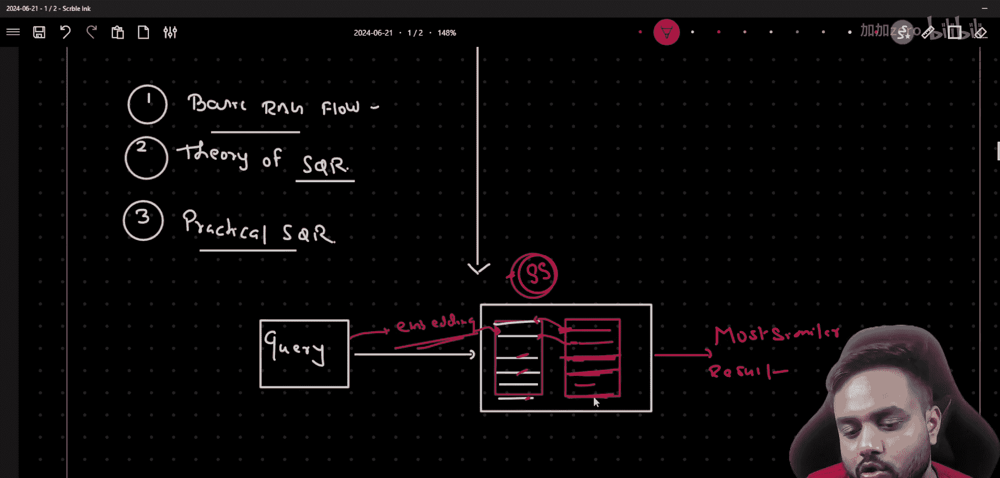

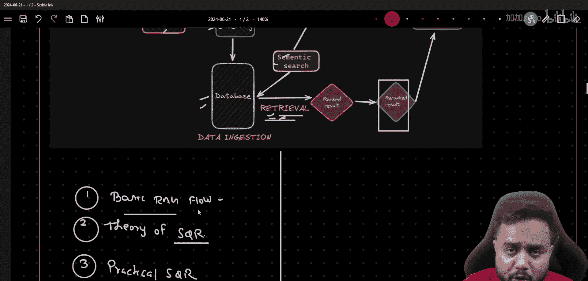

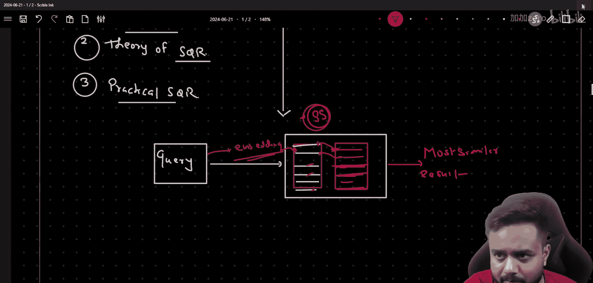

I'm storing somewhere retrieval and output Now when we have to use this particular approach So here I've written the particular condition lets just read this condition I'm saying this is the most basic flow this flow basically which I shown you but would be very effective in the document like P so whenever we are going to store anything inside the P like text the sequence of the information and all I can give the example that like books or the research people and all which we see anything which we are restoring inside the P and all we are actually there is a linearity in the data as I'm telling you the linearity in the data so we can make a chunk in all with respect to the data we can keep it somewhere and we can perform the similarity search on top of it so so just read this particular line what I'm saying P where there is a linearity in the data and no measure interdependency among different part of the document so my data is we have a linearity in the data but there is not measured dependency in between getting my point so I can。

Give you the example of the book， let's say in the book we have100 pages So hardly okay let's say we have first page and the 15th page so hardly this 5th page will match to the first page it is indirectly matching but not directly dependent getting my point so in this particular situation definitely I can use it anything I kept inside the P and the linearity in the data means the sequence of the data the text return on okay and no major dependency。

 please keep this thing in your mind now this approach is having some issues also So here in the issues similar will filter out only top case similar chunk as we know so which is similar to the user query but it might not be a relevant chunk it might not be a relevant chunk means what So whenever we are fetching the information I think in the previous video also have shown you in the compressor retriever that most of the chunk basically it's not at all the relevant one so those chunk basically it was not relating with the query So what I will do with those。

If I'm passing to my Lm model in that case hardly like I will get a good answer。

 So this is the issue guys， because here everything is depend on the。Fctor search。

 okay whatever word and all is coming inside the particular sentence， it is based on that。

 So yes like this problem might occur Okay the second thing is what hit it will give you the top key chunk only based on the word represent the query as I as I was to to you right without having knowledge of it dependence on the other chunk。

Did you understand what I am saying so here I am trying to say let's say here I retrieve two chunks here' is my query this one。

Now， here is what here is my ch。 I God first ch。 Okay， now here is my query， and there is my。

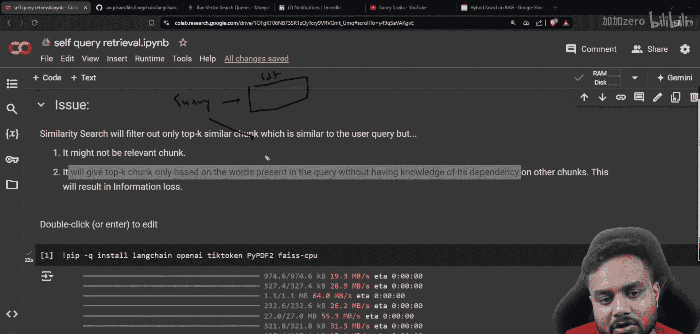