# Sunny Savita【中英⚡生成式AI：从初学者到专家｜Generative AI In-Depth Roadmap from Beginner to E】 p47 P47 Advance RAG 10-  Powerful RAG with Parent Document Retriever #ai #llm #opena [BV1Uht8zDENA_p47]

HeH everyone。 welcomele to my YouTube channel。 My name is Sunri Savita。

 and I'm packed with another exciting day and useful video guys。 So from past few days， guys。

 I couldn't upload a video I was busy with some other work at all and during that I didn't get I didn't get much time to upload a video and in between basically I was getting a lot of messages and all and even I get a lot of comment as well when you will start with that particularlist when you will continue like when we'll get the next video and all。

 So yes， I'm here with the next video like from the same playlist and first of all。

 let me give it a quick background so whatever we have covered so far whatever we have learned on my YouTube channel because on my YouTube channel I'm uploading each and everything with respect。

😊，Gative AI and that to in a particular sequence。 So guys。

 if you will go and check with my previous video， which was related to the advanced retrieval。

 Okay which was related to the retrieval technique and that technique was the self query retrieval So it was a part of the advanced series and here when I uploaded if I can show you then you will find out I uploaded that particular video and 25 June so it's been around 35 days35 days I haven't uploaded any video but don't worry now I am back like and we are going to start from the same point actually where I left where I left like 35 days ago So here guys inside this video I was talking about this self query retrieval now a couple of more retrieval technique was remaining definitely I will try to complete it and apart from。

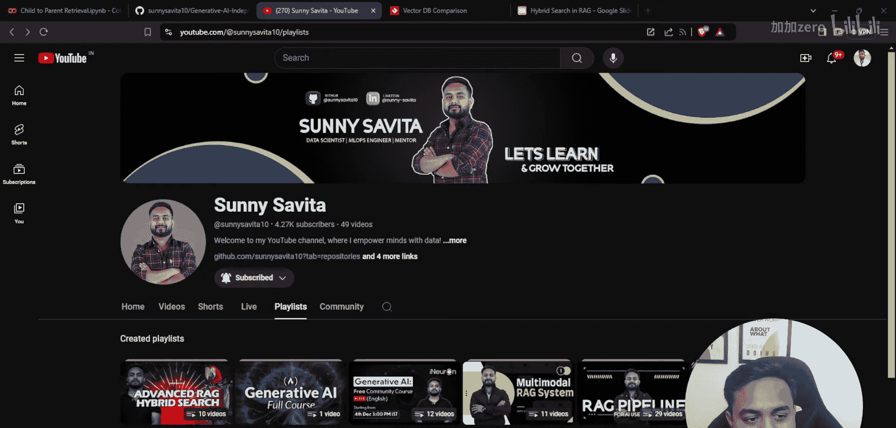

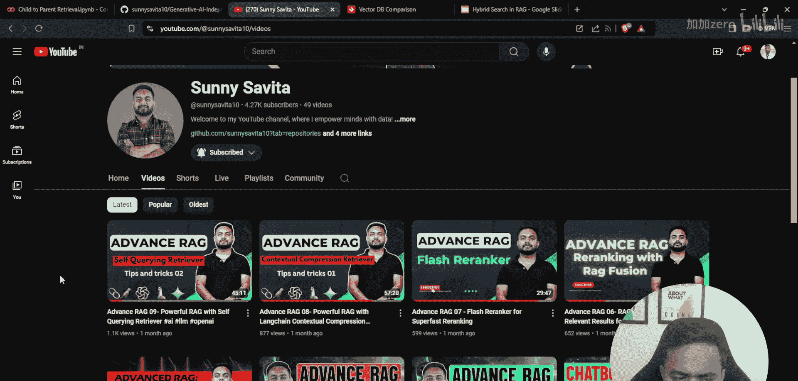

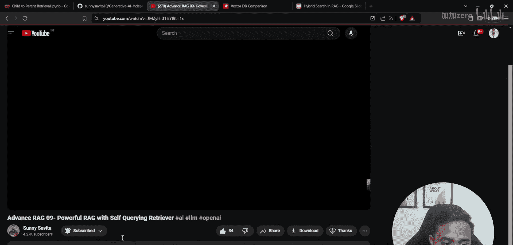

That I have created some amazing solution for all of you and yes guys so what solution basically definitely I will give you the update regarding it and one more thing if you are new to my YouTube channel let's say if you' are visiting first time and if you want to start your geneative VI journey in that case you can follow this particular playlist because in this playlist。

 everything I'm uploading in a sequence okay for the playlist name guys tell me the playlist name is geneative AI from basic to advance everything you will get it inside this particular playlist along with a rolemap and all but definitely you should start your journey with a geneative A if you haven't started so far and one more thing guys so far most of the video most of my video related to the rag only but geneative AI is beyond the rack。

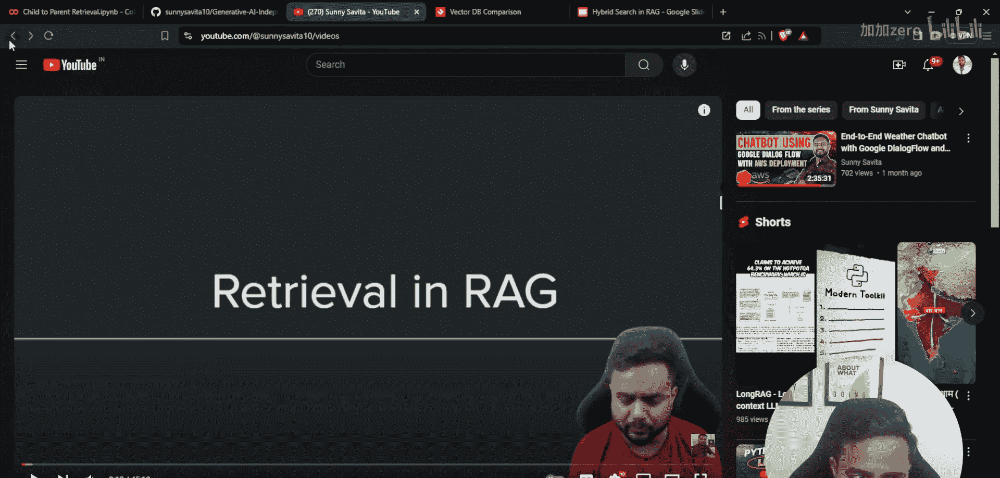

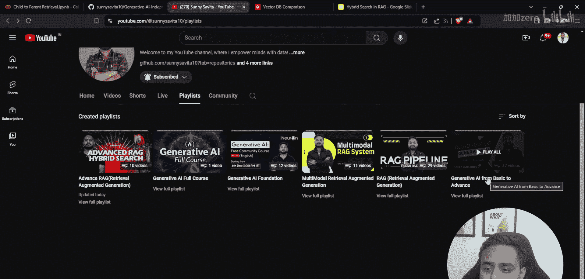

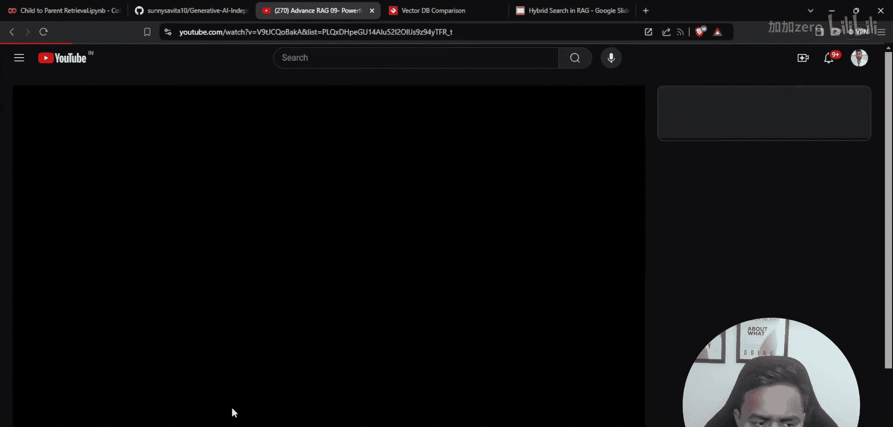

And that too I will cover very soon and I will be uploading like many more video related to the other topic as well and I'm thinking to start one free course as well for all of you the course frame is going to be generative AI bootcam and it's going to be a live course on my YouTube channel if you want that course from my end definitely you can let me know you can like let me know in the comment section。

 Yes， sir we want it please start from here and there and you can suggest me the topic as well sir I want this topic that topic based on that basically I will prepare my curriculum and that course basically is going to be around for the three months a minimum minimum time basically which I'm calculating but it could be more than that and on a daily basis on a daily basis actually I will be taking one live session every night okay after9 o'clock so。

Everyone can watch it whoever is going to office or whoever is busy with their work and all。

 So I'm going to designed for everyone。 now without wasting a time。

 let's start with a video So the today's topic is going to be guys child to parent retrieval here is the solution basically which I prepared most of the thing basically I didn't keep but don't worry I will be explaining the entire thing what is a meaning of this child to parent retrieval and while we are using it apart from this one guys here let me show you the topic basically so this was a topic with respect to the retrieval So here I have completed till fifth point that was a self grade retrieval now it's time to understand about this parent document retrieval or this is called small to big retrieval or child to parent retrieval anything you can see then in tomorrow's video means in the next video basically I'll be discussing about this sentence window search and then auto meulging retrieval and。

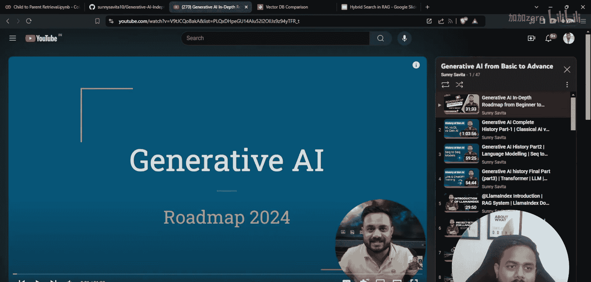

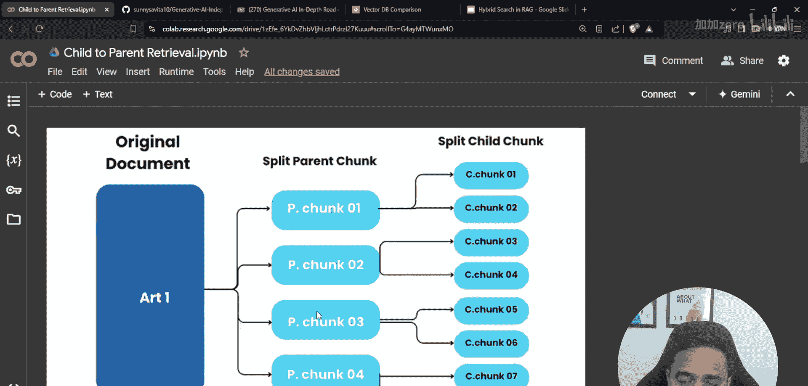

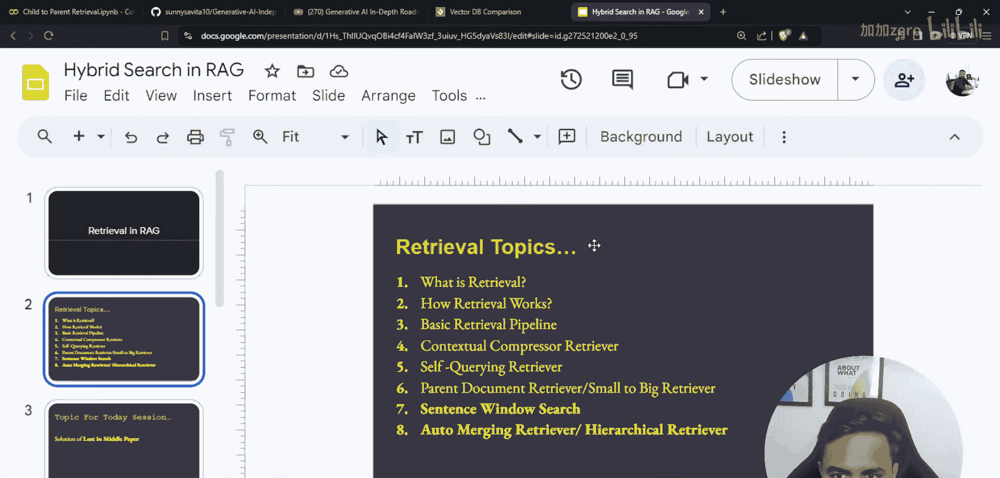

Of other technique technique like hide and all which is a part of like of the Lama index documentation I'll be covering the further technique from the Lama index documentation itself Okay and that I have shown you in my very first video of this retrieval if you don't know you can go and check you will get a basic overview of it nowa is here see retrieval basically I was covering but apart from this one what I have seen people want some random topic as well so recently you know metta has launched this Lama 3。

1 okay and many people want to create a rack using this Lama 3。

1 they want to access it but it is starting actually when they are starting with their solution and all they don't get a proper guide okay。

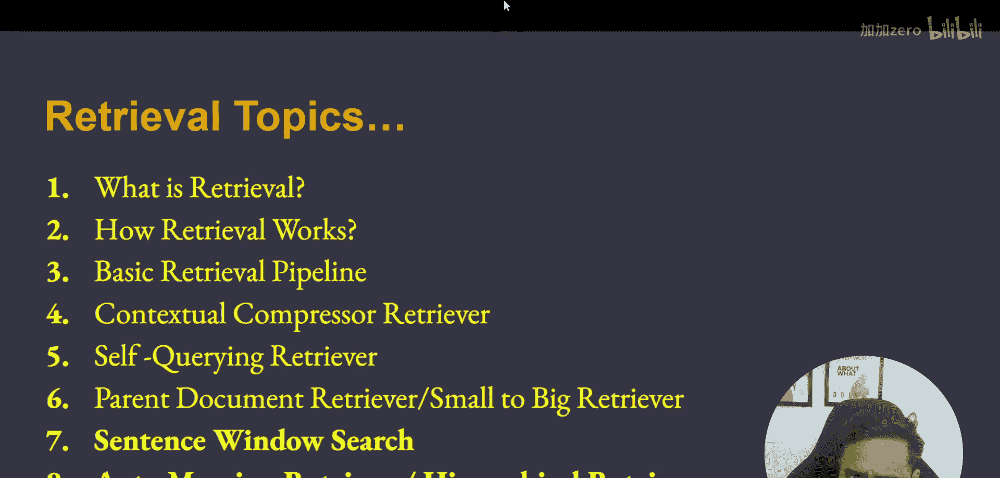

Don't worry I'll be coming up with those kind of solution okay how you can access Lama sorry this Lama 3。

1 using the  lama using the hugging phase okay how you can basically get it from the hugging face hub right and if you are not able to get it from there than what other solution we have I will let you know so I'm preparing those type of solution for all of you and here guys you will be surprised that I have created one more solution this rag rag with Lama 3。

1 as's a quite amazing solution so right after this particular video you will get this rag with Lama 3。

1 as well and here guys you won't believe that Im running this o lama inside where inside the collab itself and I will let you know how you can set up this o lama inside the collab only so that easily you can test the different different model no need to install or download it inside your local system right so I hope Ive given you the enough amount of information now let's start。

With the solution guys， so here inside the solution guys。

 what is a pro what is a like retrieval name so the retrieval name is child to parent retrieval。

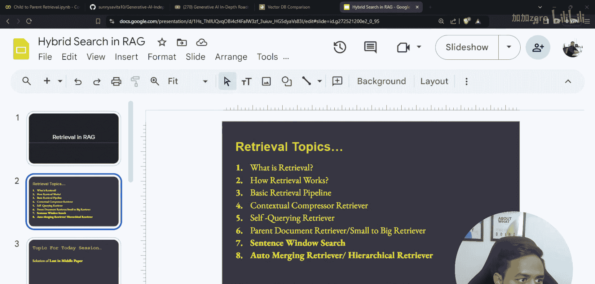

So inside this parent inside this child to parent retrieval what we do actually let me explain you each and everything。

 But before starting with this child to parent retrieval。

 well have to understand the basic rack flow okay so if you are not aware about the basic right flow in that case you will find out some difficulty so I would suggest you please go and check with my previous videos now here guys I cap basic right flow So what is the basic rightflow let me again revise this particular concept So we have a data this data basically we are dividing into the multiple chunks right why basically we are dividing so that I can perform the embedding at all。

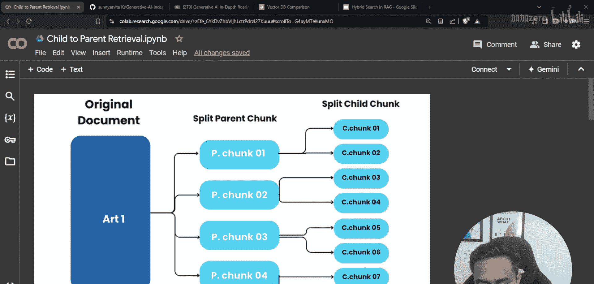

And we can store inside the database。 Now， this particular stage is called data ingesion。 Okay。

 so here is my data ingsion。 This the first。 then after the data ingsion guys。

 what happened the next stage is called the retrieval there we retrieve the data based on board based on the user query So let's say if user going to ask any sort of a query。

 So instead of passing that query to the LLm directly。

 what we do was we pass that query to the database and we perform the semantic search or similarity search right and then we perform the similarity search based on the semantic meaning and wherever this query is going to be match with whatever document。

 we retrieve those document and here after the retrieval， we pass it to the Lm。

 So after retrieving guys like what we do So after retrieving basically we rank the document So which is the most whatever is a most relevant document。

 we kept at the first place。 and thiss the document we keep in。Asly。

In a descending order right so at the first place we'll be having a more relevant document and then the relevency is going to be dec。

 So that is called the rank result。 Okay and this retrieval operation is also called the ranking now here after the ranking if you want to perform the reranking Yes。

 you can do it it is up to you if you want to do about more level of fration like it is possible and even created a video of the reranking as well if you will go and check definitely you will find out those video as well now then what we do we this result like rank result or reran result to the model So this model this rank result actually is called the context。

 Okay and here we are passing the query we are asking the same query based on this given context based on given this particular result and here we are given the prompt as well prompt is nothing prompt is instruction to my model I can explain you in a simple So let's say I'm giving the。

tex， I'm giving the query and I'm telling to my model， okay， you have to do it like this only。😊，Okay。

 you， you are a happy assistant， you are a angry assistant right or you are a said assistant。

 So here we are giving emotions。 we are giving an instruction to my model like using this particular problem。

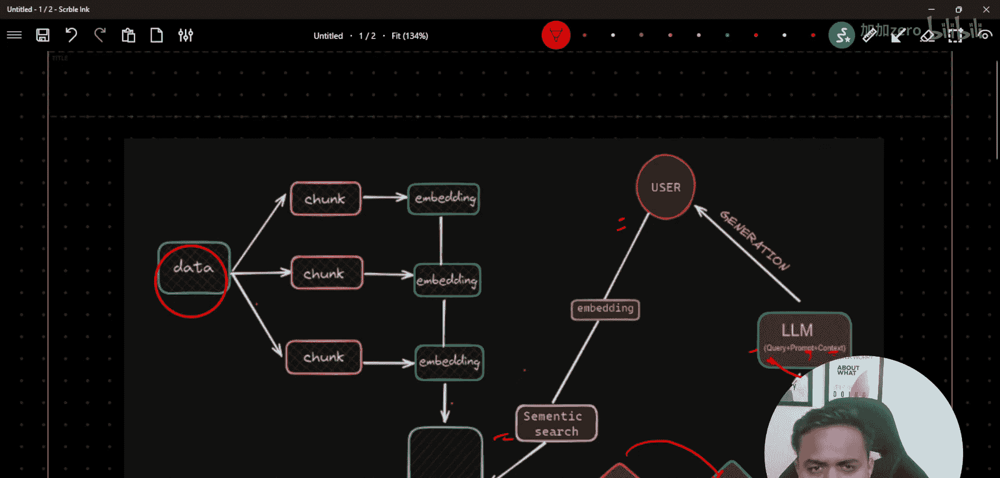