# Sunny Savita【中英⚡生成式AI：从初学者到专家｜Generative AI In-Depth Roadmap from Beginner to E】 p48 P48 End-to-End RAG With Llama 3.1, Langchain, FAISS and OLlama #ai #llm #llama # [BV1Uht8zDENA_p48]

Hey hi everyone。 welcomelcome to my YouTube channel。

 My name is Sunni Savita and in this particular video we'll see how we can create a powerful rag system use a Lama 3。

1 So guys meta has released one more new model and it's quite amazing it's a quite huge as well and here you can see this model actually it's a completely open source and you'll find out that different different variant of this particular model。

 So in today's video we are going to see the introduction the detailed introduction of this meta Lama 3。

1 and after that on top of it basically we are going to create one rag system as well。

 So if you haven't checked with my YouTube channel guys please go and check like me show you my YouTube channel So recently I completed 4000 subscriber and first of all thank you guys thank you for showing this much of love and yes on a daily basis basically I am getting messages and come。

😊。

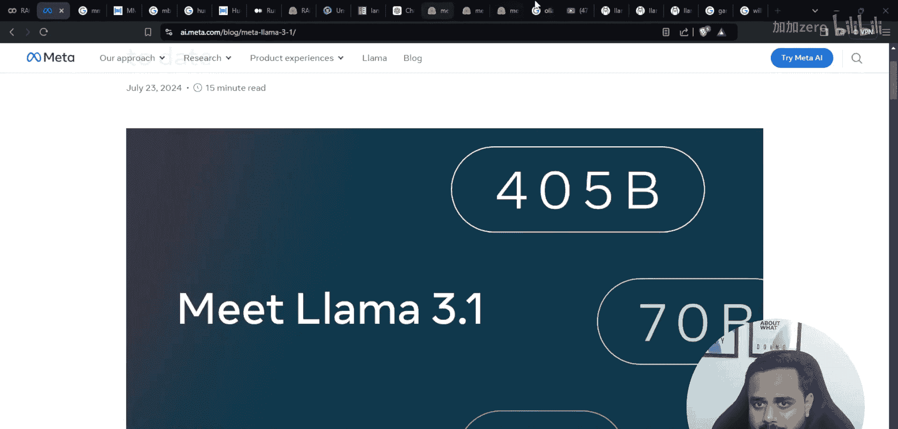

As well please upload this that and each and everything you guys from your end it's quite motivating。

 so please subscribe the channel please watch the video if you want to start your geneative A and here most of the content Im uploading around to the geneative AII and soon Ill be uploading few more content with respect to the fundamental and all fundamental means natural language inc deep learning machine learning statistics everything because Im having experience in every of the data science and definitely I will bring that experience on my channel So yes guys the last video with respect to the don't worry couple of is remain will uploading I will be uploading soon video it's already recording after this video within one or two days you will find out that video as well coming to the point here So I was talking about the Lama 3。

1 first of all let me give you some like introductory point。

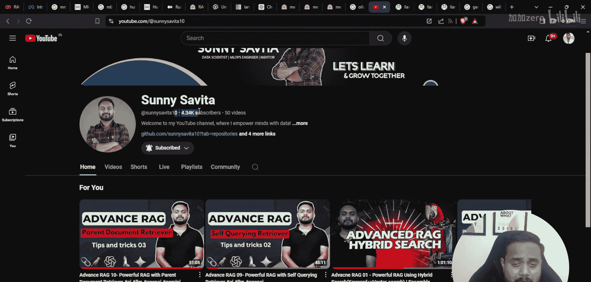

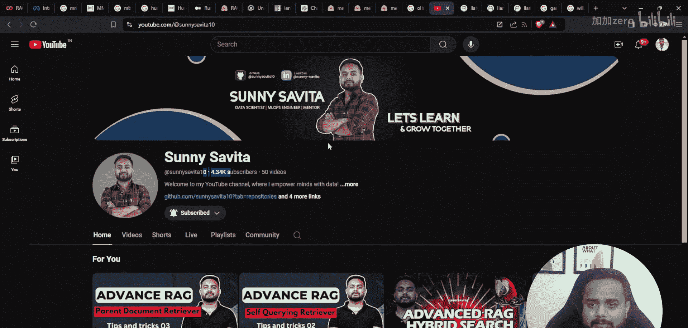

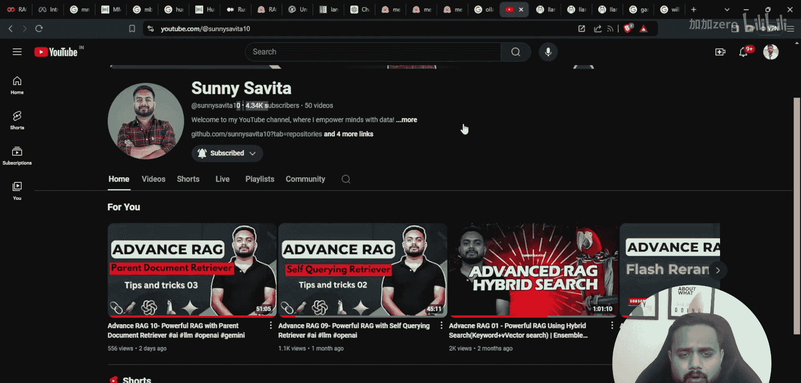

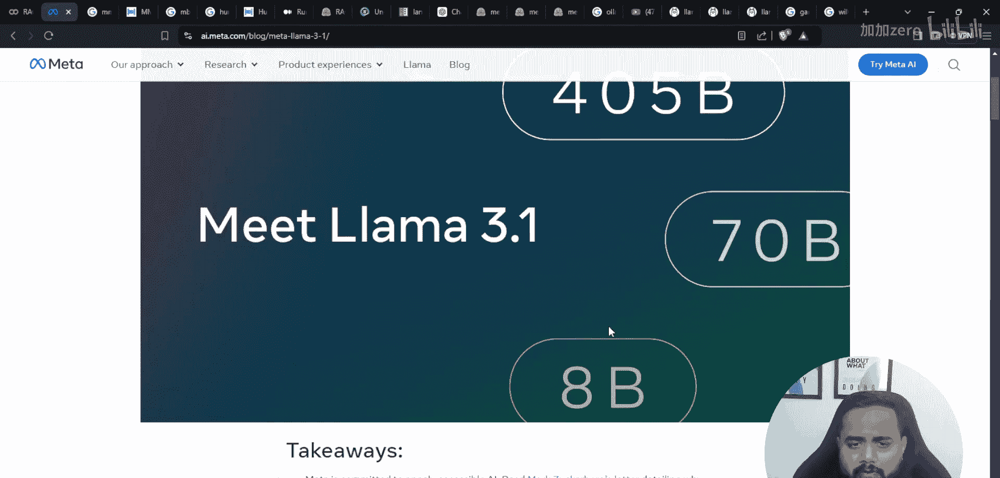

specpect to this model and then we'll come to the implementation。

 So here guys it's a complete solution。 So let me show you the solution and for accessing this particular model。

 we are going to use Lama three point we are going to use  lama because we have a certain challenges in some other in some other ways and all we can access it but I will show you those particular challenges and this is quite like easy and interesting as well because I configure this  lama inside the collab only So yes。

 let's say some key like let's take some like important point from this particular documentation So yes this meta actually it's open source model and the high end variant of this matter okay in the highest variant of this the number of parameter is around 40。

5 billion guys it's a quite h right then other than this one you will find out the context length is 128 Now what is a。

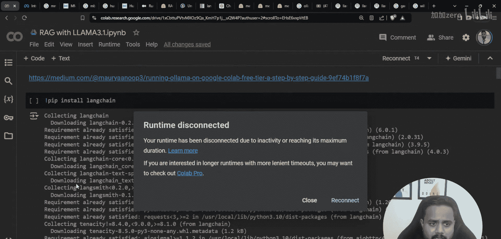

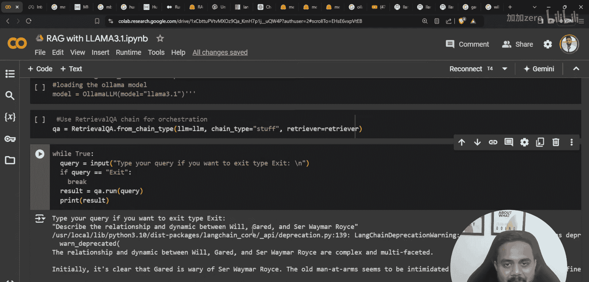

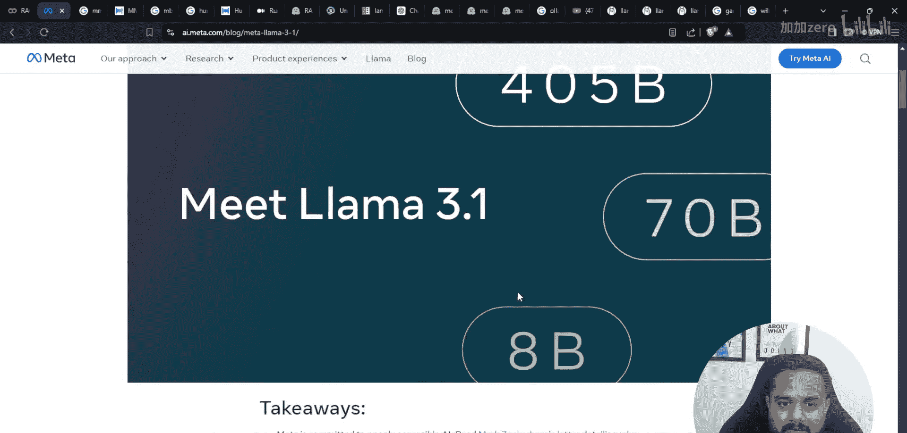

Ex length， so context length means the input which we are providing to the model。 So this is a like。

Highest number of token which we can provide to the model Okay I kept the definition of the context length so just to show you this one because I will discuss the context length from the different other model as well So here you can see what is a context window guys context window or context length anything you can say the context window is a maximum size of the context means the data or the token document which we can give to the LLm for example let's say LLm like chat GpT means Gp model has a following context window so 3。

5 actually is having4096 so approximately 300 wordss and 6 pages it just approximate a number so guys token means one single word but guys this token in the AI world this token is having a different definition So this token actually is having around just425 character right and every platform every model is having their own definition with respect to the token but what。

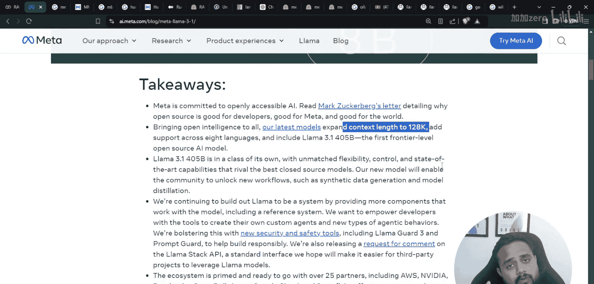

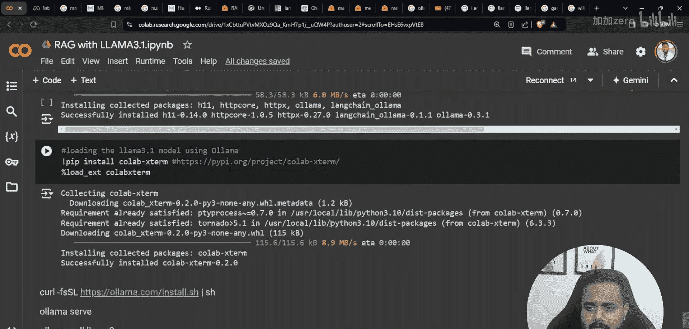

I have seen its just the 75% length of the average length of the world Okay 75% average length of the particular word right means around 3 to4 character you can consider inside one single token so yes here you can see the chat like here you can see the context window of what4 so the base model is having around8192 okay19 to token means this much of data you can provide to the model right and somewhere you will find out a context window definition so the total number of the total number of input and output which model can process okay so this is also a definition of the context window I hope you are getting my point now coming to this PDFf again So yes this point is clear now guys let me show you some other thing here if I will scroll down so here you can see the model evaluation so definitely you should look into this data set this benchmark data guys let me。

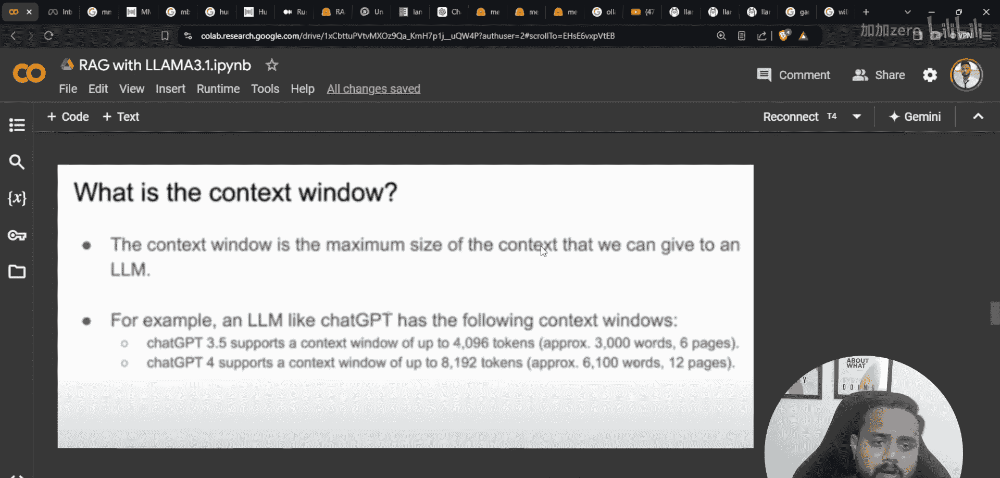

SoU MMLU probe then human E MPBB， GSMHK math， so these are some benchmark data set。

Now what is the meaning of the benchmark dataset So benchmark dataset are those dataset。

 which is creating by the community which is creating by the researcher right which is creating by the specific organization just to and it's a global dataset on top of this dataset only a model is going to be validated so I can give you a couple of other example So have you heard about the like Ms data or imagine a data or C4 data or we have copo data right So this was the quite famous data in the computer vision industry right a couple of year back if you know that like evaluating their model their computer vision model on top of this dataset is still they are doing it and now this dataset actually this human sorry and thisP it's quite famous dataset inside the MLP community here guys you can search about this particular dataset let's say m benchmark you'll find out the complete research paper of it see here's a。

😊。

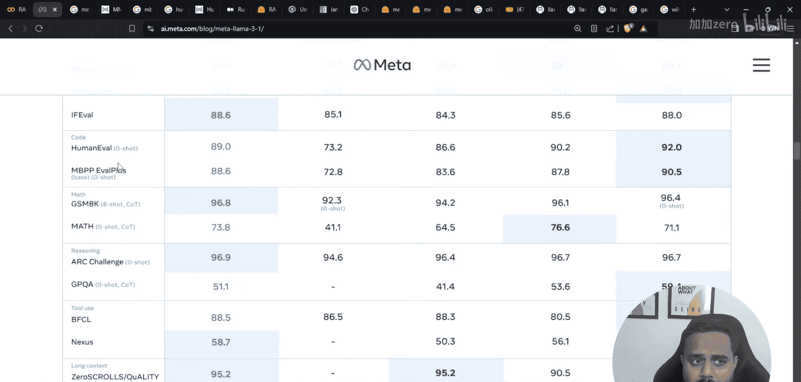

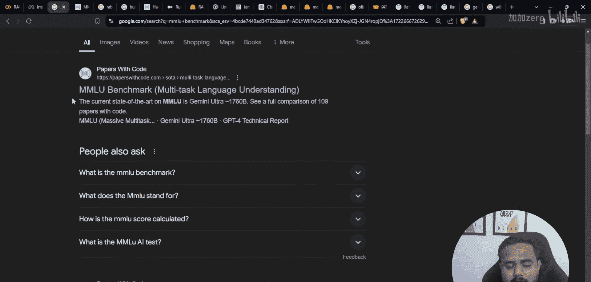

Complete research paper of the MMLu and they have given the complete detail。

 Okay which model like how basically it's performing now as the number is going to be high right means the model performance is gold So whatever model is going to be a launch right in the market So they are going to be represent okay they are going to be represent their capability in terms of this particular data in terms of this benchmark data now here you can see so multitask m so what's a full form multitask language and understanding now we have other one So this it's nothing it's a programming data is programming data it is having around thousand python programming then we have this human benchmark So in the human benchmark also you will find out the code related data here is a complete detail of it so here also you will find out the code related data Now this benchmark is having their own specific research paper if you want to check you can check out now let me show you some other capability of this particular matter So here guys。

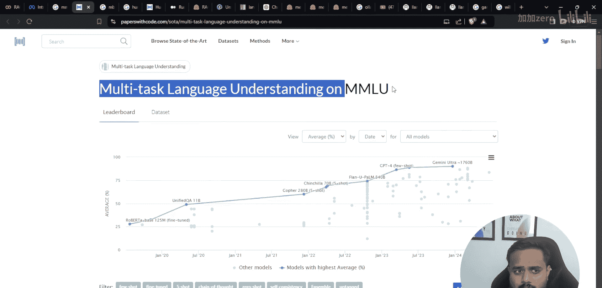

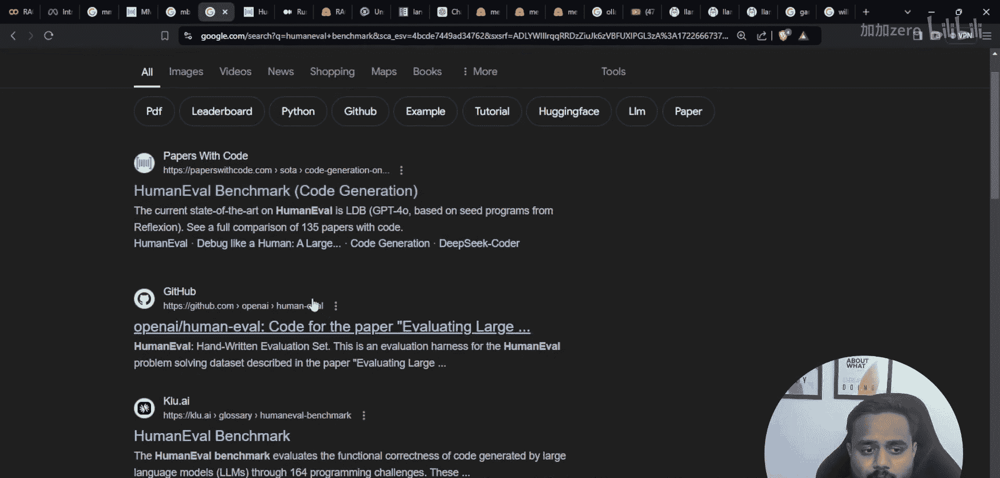

This is the some other different some other like challenges and all so how basically this Lama 3。

1 is going to deal with respect to the other model so you can look into this particular matrix win tie and loose with respect to the other different different model then basically here you can see the model architecture so it is completely based on the transform architecture itself and the code is code is a open source one I will show you the Github also how you can access that particular Giub now here after that like a couple of more thing so now let me show you some point okay which is very much important if you want to do real time and batch infencing you should use this particular。

Model， real time and batch influencing me， you can directly load the model and you can predict the value right supervise fine tuning Yes。

 you can do the fine tuning as well evaluate your model for the specific application me here after the fine tuning you can use it for the domain specific task or for most of the task basically you can use it because number of parameters very much high or 0。

6 billion me around 15 billionion2 and I will show you that now here you can see evaluation so continuous pretraining you can change the base level structure also of the model as they have given you the complete source code you can perform the rag so we are going to do it's a important one most of the like application inside like geneative A with respect to the LLm you will find out find it out find it out of the rag only agents find tu memory prompting's a very important topic of the Geneative then you can do the function calling means you can call the thirdpart API general and this。

very much important and I've seen many like organization and many model basically they are following this synthetic data generation now So this is also very very famous and definitely you should look into it if this is your KRA means key workinging area right so here from where actually you can access this model on each and every platform you will find out this particular model whether it's AWs data breaks dialll Nvidia G right IBM Google platform where actually you can access this model and these other thing these other thing you can perform right on top of this particular platform now apart from this one guys here you can see so if you want to start the Lama3 if you want to directly start from here itself they are giving you the way you can simply click on it and you can download the model you can take access read the research paper here is the Gi means code and all and then download it from the hugging phase right so we are going to use。

Again phase。 And here。

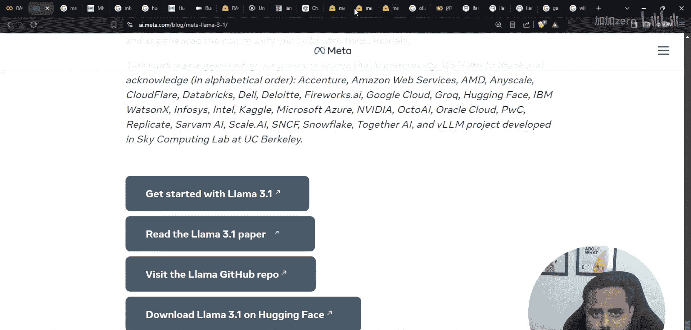