# Sunny Savita【中英⚡生成式AI：从初学者到专家｜Generative AI In-Depth Roadmap from Beginner to E】 p49 P49 Advance RAG 11-  Powerful RAG with Sentence Window Retriever using @LlamaInd [BV1Uht8zDENA_p49]

Hey hi everyone。 welcomelcome to my YouTube YouTube channel。

 My name is Sunny Savita and I'm back with another exciting and important video。 So guys。

 I was talking about different different retrieval technique and after a couple of video means after one or two video I'm going to like complete this particular series this retrieval part then I will start with a new chapter so that chapter basically is going to be a memory how basically we can sustain the memory inside the rag pipeline anywhere we are using this LLM So that's going to be a very much important chapter and if you want to learn that if you want to understand then please subscribe the channel please be updated with my channel content and all and definitely soon you will get those particular video it is still like in a recording phase and once it will be recorded most probably from the next week convert I'm going to upload those things after the memory guys。

 one more chapter， which is。😊，Cruciial and very important as well。 That is evaluation， right。

 So right after the memory chapter， I will start with the evaluation technique。

 How basically you can。😊，Evaluate your different different LLM based model So yes like I'll be coming up with this kind of thing now apart from this one everything guys in future after completing this two things two topic because there was a lot of demand with respect to this topic and a couple of other miscellaneous topic with respect to the L channel like Lng graph L lengths of miss everyone wants to understand the complete ecosystem which can help the people to create a best to best Lm based application don't worry I'll be coming up with those kind of videos and all and yes where you will get those thing on my YouTube channel so if you haven't subscribe definitely you can subscribe and yess my promise I won't disappoint to you now here guys I was talking about the retval technique and these other retrieval topic which I mentioned sentence window retrieval which we are going to discuss into session and in the next class basically were gonna to discuss about auto me。

😊。

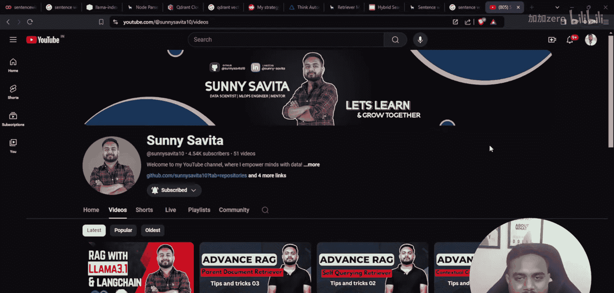

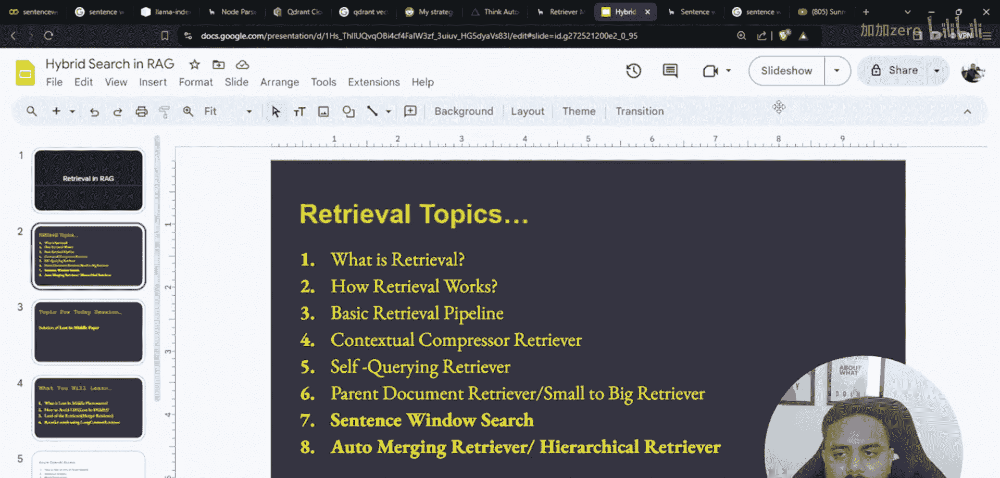

Retval or hierarchical retrieval now apart from this one one more retval is there which I have used in my pipeline in the real time as well that was the hide okay h Y D E there are actually we are going to generate the hypothetical document and we are there actually we are going to generate the synthesized data and we are using that a thing for the。

We are using that thing for the basically retval and all how we can do it in the next video I will let you know so lets start with this sentenced sentence window search and let me explain you the meaning of this one guys。

😊。

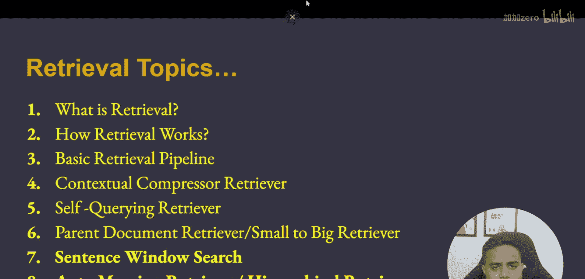

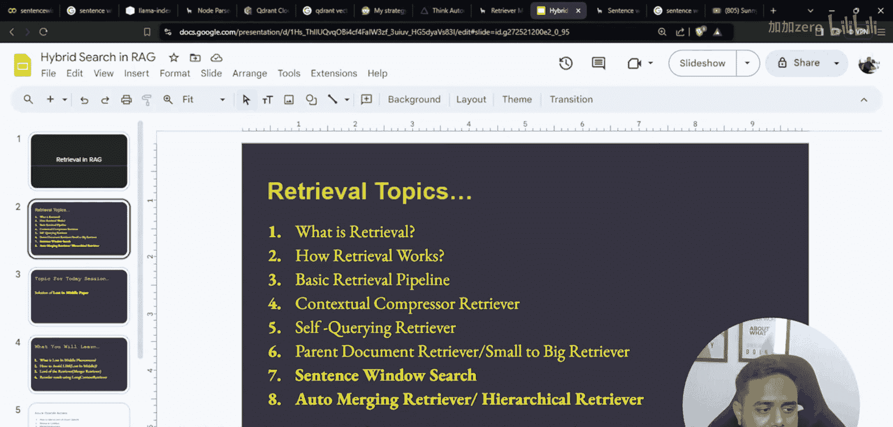

So for explaining you this sentence window retrieval guides here I kept one image so let us try to understand the meaning of this sentence window retrieval so lets say this is what this is my document okay this is my complete document and here is a part of the document this one。

😊，Understood now what happened actually in the retrieval process lets say someone is going to ask the query so this query force it interact with a database。

 it interact with a vector database so lets say my query is going to be interact with a database and just as suppose over here。

 this is what this is my this is my most relevant document。😊。

Relevant document means what this is my most similar document。

 which is having a similar T with this particular query。😊，Understood guys， tell me yes or no。

 to guys， this is， if this is my most similar document， If this is my most relevant document。

 definitely I will fetch this data from the database。 Yes or no， Yes， okay， great。 Now guys here see。

 Here is a twist in the picture。 So we are not going to fetch this specific sentence。😊。

No we are going to fetch the entire data surrounding to this sentence and that is called the window understood what Im saying here and that is called sentence window retrieval let me explain you with one more example and let me compare it with a basic retrieval technique maybe you will get the clear cut understanding in that case right so here guys see this is my document。

😡。

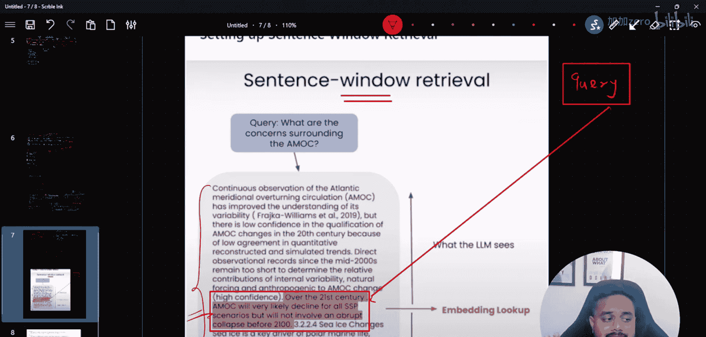

I think it is not blur maybe you can clearly see this one otherwise you can just like check with the full screen or something let me increase the size now I think fine so here is my multiple document this page content basically is representing to the document Now let's say when queryries is coming Okay so here here is what here is my query whatever query basically which user is asking now let's say user is asking you can see Lo princess feels like Kingdom so here I can write who feels like kingdom So who feels like kingdom。

😊。

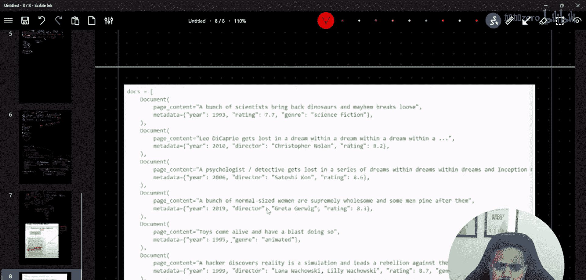

This is my one question， so this query will interact with this document means it will be interacting with the emtting of this document like in my database right so this document accurates a more similar document this one。

😊，Understood so it will fetch this data after fetching this data further what we can do we can pass it to the LMn all and we can generate the answer right but here guys see this is the normal retrieval we are we are just going to fetch this document we we are just going to fetch the chunks number of chunk we can fetch one chunk2 chunk three chunk right but here guys here see inside the sentence window retrieval what is happening so whenever we are doing a chunking right so along with the chunking basically we are going to define the window size let's say we are going to define window size is equal to。

😊。

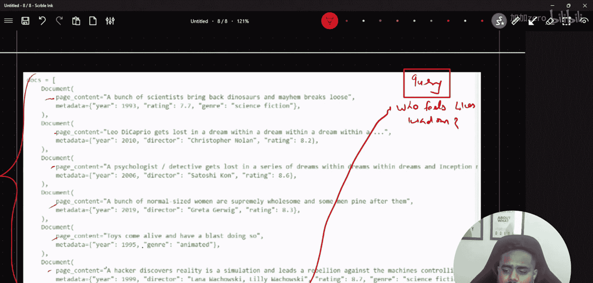

3 so what is the meaning of the window size equal to 3， you know， so let's say this is my sentence。😡。

Okay， this is my document， which is a more relevant document。 So what will happen， you know。

 so it's going to be it's going to be connect。 Okay。

 it's it's taking a window is equal to three windows window is equal to three means it is taking a surrounding content it is taking a surrounding content to this particular document Now how to calculate the surrounding content how what is the meaning of this window is equal to three let me explain you that part also so that the meaning will be more clear to all of you Now here guys for that I cap couple of sentences So let's say this is my sentence now here what I can do I can write window is equal to three what is the meaning of it So see here is what here is my three sentence this one right now here I have my more three sentence right and here I have my more three sentence So till here till here。

😊。

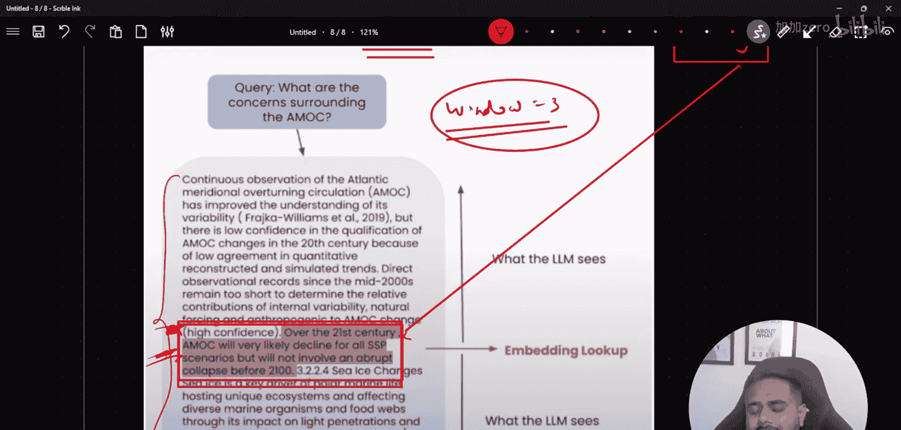

Till here I have a data right I have a data now here you will find out So this is my first window。

 this one， this one and this one， okay first second and third then just look into the second window see this one。

 this one and this one。I is the second window Okay， now just look into the third window， this one。😡。

Okay， this one and this one so this this data， okay， if I am saying window is equal to 3。

 window is equal to 3， so it' is going to be captured this entire data。😊，Understood or not， guys。

 tell me。 So here somewhere my document will be available。

 but it's going to be connect with this entire data。😡。

Understood now let me show you the practicalcle guys and I hope so in practicalcle you will get a clear cut understanding。

😊。

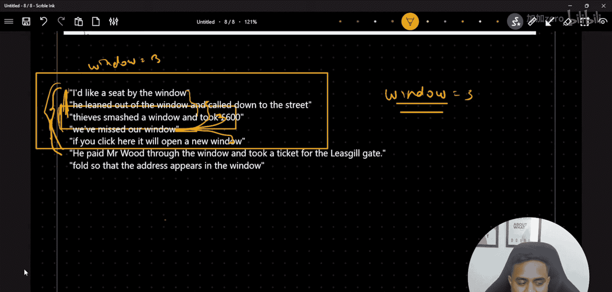

So here is my solution guys。 and now you can see the solution I have created using Lama index So last all the solution I have created using the la we can write the code from scratch as well means we can write our logic as well if you don't want to use this la or Lama index but here I'm using Lama index because the Lama index also we have a couple of couple of retrievals and all so simply you can check with documentation itself if you will go with the documentation you will get a different friend retrieval So Bm 25 reciprocal rank automo automod I think which is remaining one which I will let you know in the next one met data replacement this is nothing this is a sentence Windows search guys So if you will go and check with this meta data replacement you will find out it is a sentence window parser or sentence Windows search So so far we have explore about the la rer now in this video we are going。

😊，To explore about the Lama index retriever。 Now， again， I'm saying guys， it is just a framework。

 So this framework， you can create it by yourself as well， means。

You can write the code from a your and as well related to these particular retrieval techniques and all so let's do one thing let's go ahead with a solution and let's try to understand the coding mechanism like behind this particular retrieval technique and we try to create an end rag so don't miss out this solution now here let me scroll up here guys I kept one picture which is representing to the complete Lama index so Lama index is a framework is a package which is giving it a complete solution related to the rag or the other thing as well agents Okay rag agents。

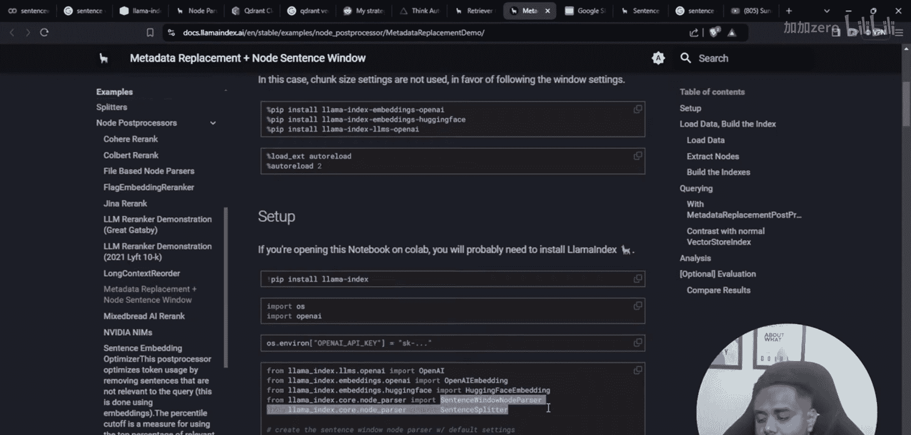

Different different document loader， different， different third party integration all everything you will find out over here you just need to use the abstract classes and you can build your solution within minutes thats up like approach of the Lama index and Ive created many more video on my YouTube channel related to the Lama Inice in future I'll be coming up with the entire series。

😊。

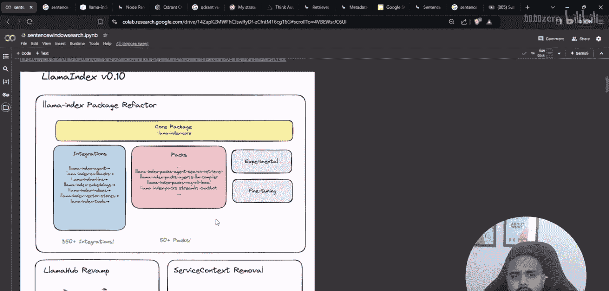