# Sunny Savita【中英⚡生成式AI：从初学者到专家｜Generative AI In-Depth Roadmap from Beginner to E】 p50 P50 Advance RAG 12-  Powerful RAG with Merger Retriever and Hypothetical Documen [BV1Uht8zDENA_p50]

Hey hi everyone。 welcomelcome to my YouTube channel。

 My name is Sun Savita and I'm back with another exciting and important video。 So guys， yes。

 I' am here with one more retrieval technique with respect to our rack pipeline So this is going to be a last video with respect to the reval because I think I cover almost all the retrieval technique if you will go and check if you will go and check with my YouTube channel So I think I have uploaded 11 video inside my advanced rack playlist and in those 11 video most of the video relative to the retrieval only So if you want to understand the retrieval part if you want to understand the rag from basic to advance definitely you can check out my YouTube channel。

 not only the rack you will find out many more things once you will go through with it different different project and all and even I have uploaded a couple of other playlist with respect to this geneative AI where you can understand the foundation of the geneative AI and my other courses。

😊。

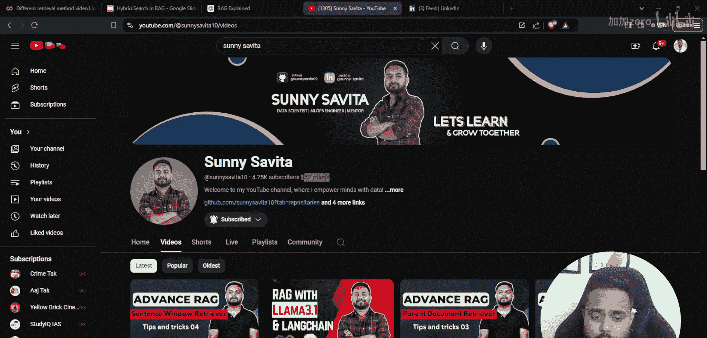

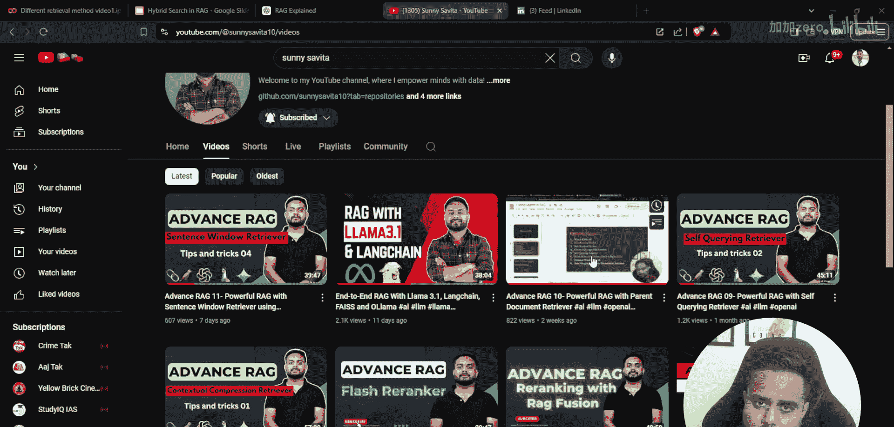

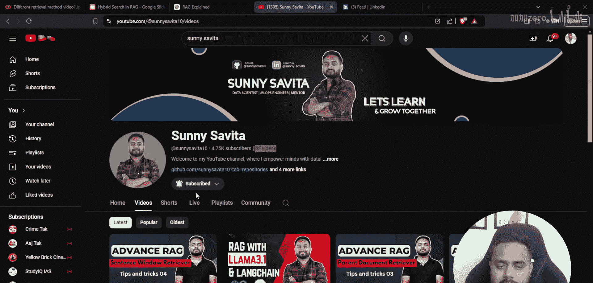

Wch was published on the different different other platform。

 So everything you will get in my playlist section right whatever you want to learn and whatever you want to understand everything you will get it over here now guys what is my aim for the upcoming days for the upcoming classes So right now I will cover one more technique with respect to this retrieval that is a hypothetical document emitting and I will explain you this auto me retrieval also right in today's video now。

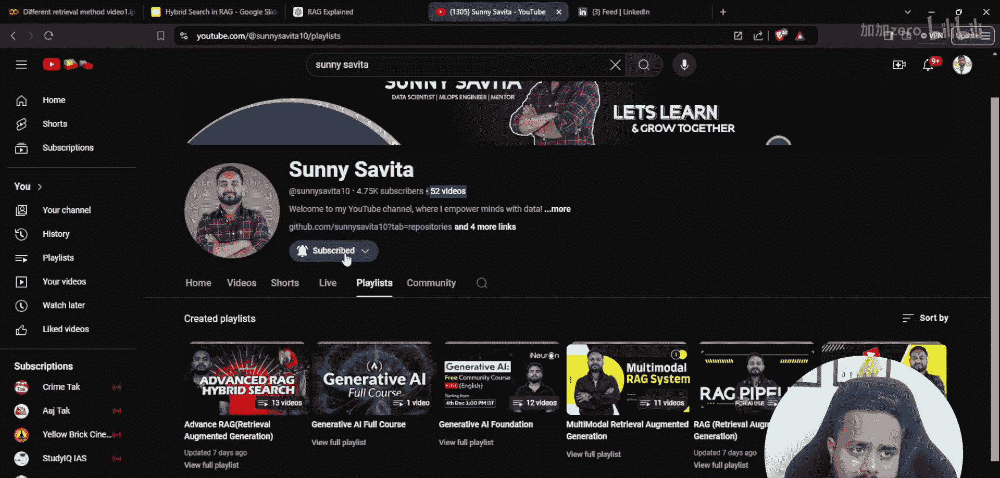

For the upcoming days。I'm planning this memory concept Okay that how basically you can take all the memory inside the rag inside the chat board and I'll be discussing about the evaluation technique with respect to the rack because which is very much important whenever you are going to like like implement any rack pipeline or any LLM based application so definitely you will have to evaluate that how my LLM model or how my pipeline is working So those technique is pretty much important then only our end to end。

Solution will be ready， so I'm planning those particular technique for my upcoming video and apart from that I'm planning one lain based series as well。

 So there I will be discussing each and everything with respect to the L that how basically you can take a lab as much as benefit from the la because it's amazing package L and lama index as well So I will let you know each and everything with respect to those particular packages those particular framework So this is my plan for the upcoming days and already here is up like playlist and video so if you want to like start your journey with the geneative definitely you can follow my YouTube channel you can look into the video if it is adding some value in your learning right so yes that would be great for me if if you think that it's a worth then you can share to your friends whoever willing to learn you can subscribe the channel and you can support little。

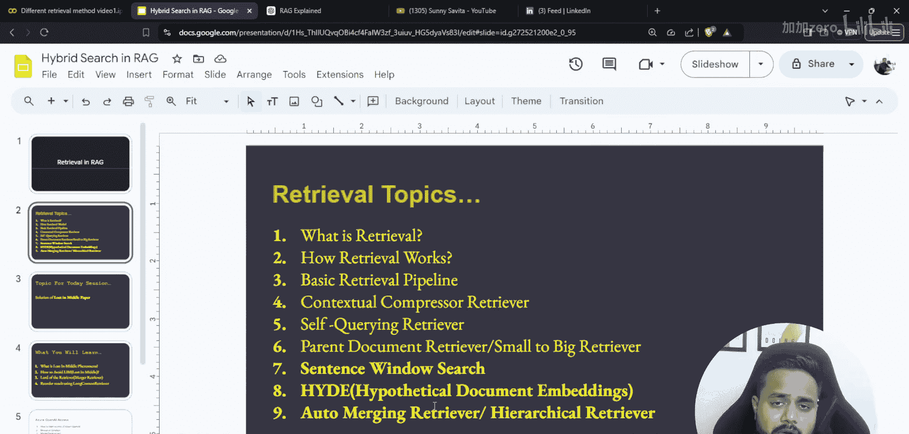

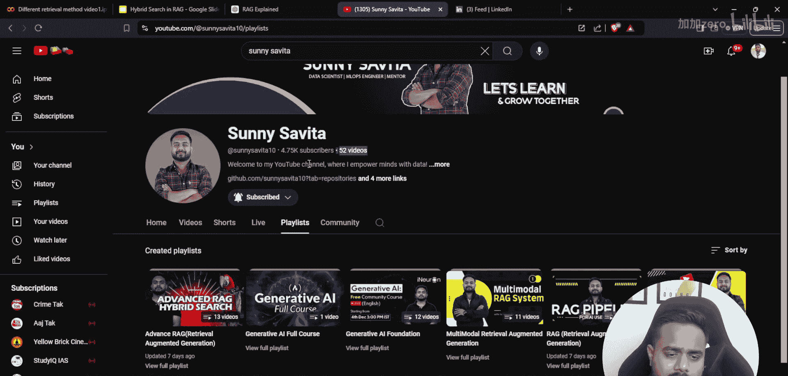

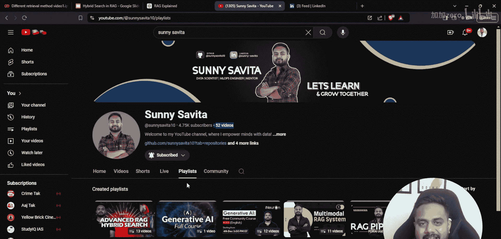

And yes， I would like to say sorry as well because there is certain delay in the videos。

 I understand that because I'm busy with some other work recently I switch my company as well where I was working previously now I change but Im working with the same role Gene engineer only Gene engineer machine learning engineer anything you can say because everything comes inside the machine learning only so yes there is certain other responsibility and all I have so yes I'm going to streamline each and every process don't worry in some time means within 50 to 20 day you will find more and more content on my YouTube channel with respect to Gene so that you also can crack your job and I will be coming up with many more courses right so on my YouTube channel or whatever the platform definitely I will let you know so stay tuned with me and let's begin with the session so so far I discuss many different different other technique with respect to this rack pipeline guys。

😊。

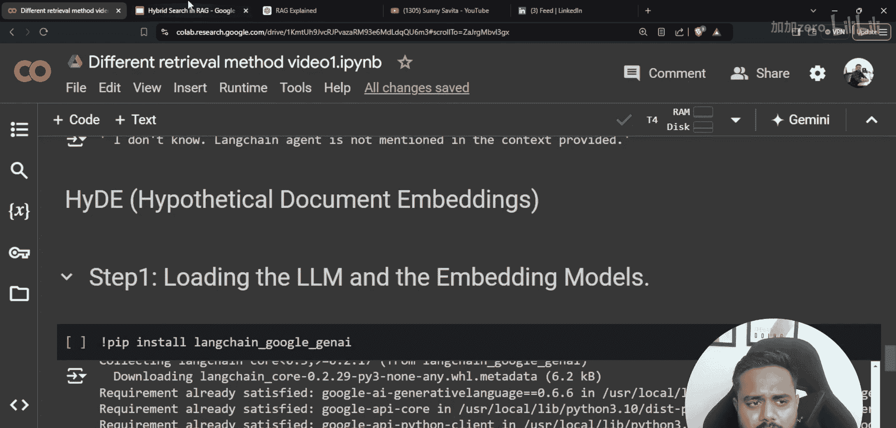

Now it's time to discuss one more that is high hypothetical document embeddeddding and then autom rerieval。

 So one one technique this automodgene reval， even though I have a solution but I I won't show you in my video I will give you that one as up challenge and I will explain you the critical concept of it so that later on you can implement it now here is up like hypothetical document emdding so first of all let me connect with my GP which I already did now here I am going to install this Google why Im using this particular package so that basically I can load my model and as a model Im going to use gym API because it is free and we can load this gym model just to test my pipeline just to test my rag rag project rag application we have other option as well if we will go with a you will find out like10 number like1。

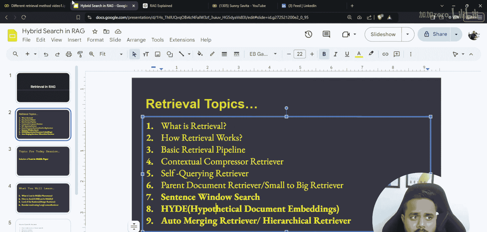

15 a， but here we are go to here we are using the g only because I already having a key and easily I can load the model so I have installed this gni Google gen package now I am going to install the。

Langgen community as a vector database， I can use the chromroma D where I can install my all the vectors and all Now here。

 a couple of other library like warning and all。 So this is the libraries guys。

 which I've installed now here I am going to set my API key right so I hope till here everything is perfect means I just loaded the library and here Ill just define the API key if you don't know about this API key。

 how to set it， how to get it you can follow my previous session there already you will find out like how to generate this API key。

 how to like set it over here again， I'm not going to repeat this part because again it will take some time so I don't want to waste over here So guys after loading this after setting this API key as an environment variable and after loading after installing all these packages now I am going to import it。

 So for the import guys here I am going to use this la in Google which already inside the La community only。

😊，And here again from this particular package we are going to import this two module。

 So it is two classes。 First is chat geneative AI embidding second is chat Google Geneative A so let me import and after import guys here I can load this Lm right this one so chat Google Gene and here I am passing my model name So inside this particular variable I will get my Lm and here what I'm doing so here Im passing my embedding name emdding model name so what I will get I will be getting my embedding model name so that I can perform the emdding with respect to my chunks okay with respect to my data So till here I hope everything is perfect to all of you now first of all before starting with this main solution let's try to understand the architecture of this particular application and after understanding the architecture will implement further guys。

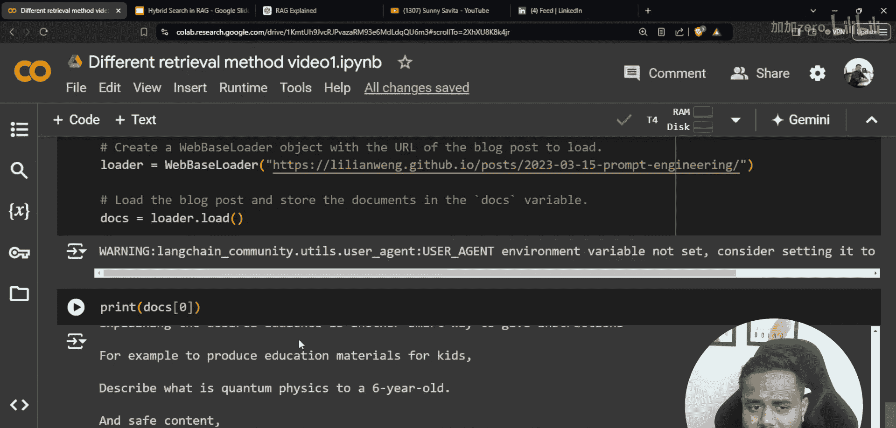

So guys here you can see the architecture of the rack I think this architecture have explained you many time in my previous video but let me explain you again with respect to this hide or rer technique so how it is working with respect to the hide h Ype now what is the full form of the height so the full form of the hide is hypothetical document embedded so see you guys in this retrieval sorry inside this rack pipeline we have three stages for stage。

😊，First stage is called the data engine。 The second stage is called the retrieval。

 and the third stage is called the generation here you can see the generation called it Now I see whenever we are getting a data So this data we are always we always splitting into the chunk so that we can provide to my LLM and my LLM can generate something basically I can provide to my LLM through this like semantic search or similar search and then LLM can generate a final answer here is my chunks and now what I'm doing Im just going to be performed the embedding of those sh and I'm keeping inside a database right this database actually it' a vector database I think in my previous video I explain you one more additional vector database that was tell me guys which one I have explained if you have seen that video maybe you can write it on the chat So the database name was a quadrant right and it is a very amazing database definitely you can check out that video。

So inside this inside that video I shown you how you can set up the cloud variant of the quadrant right now I can use the vector database to store the embedding along with the document document also will be there along with the embedding then Gu see we are going to perform the retrieval retrieval based on what retrieval based on this user query so whenever I will get my user query I will convert that query into the embedding and I will pass that embe into my database now here is a twist whenever we are talking about hide GuC this approach which I am showing you right now。

I will get the user query， then I will pass to my database and then basically I will find out the relevant result or rank result。

 This is the simple approach or this is also called nave approach NAIPE na approach right but inside the hide approach whenever we're talking about the hide Y D So inside the hide approach what happens let me tell you so inside the hide approach see what happens whenever we are well let's say here is a query Okay so this is my user user is asking any sort of a query。

😊，Now， thisqu。We pass to the L M， Yes， guys。Yes， you are listening correct。

 so this query you are passing to the LLM。😊，And based on the prompt， based on the prompt。

 you are going to。

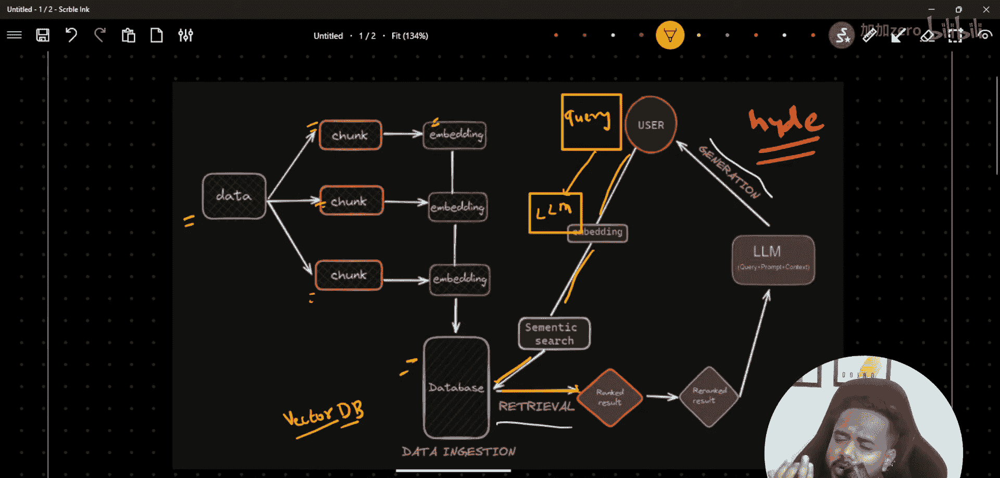