# Sunny Savita【中英⚡生成式AI：从初学者到专家｜Generative AI In-Depth Roadmap from Beginner to E】 p51 P51 Complete @LangChain Essential in 1 shot ｜ LangChain Core ｜ LangServe ｜ LangG [BV1Uht8zDENA_p51]

He everyone， welcomele to my YouTube channel， My is Sunni Savita and I'm back with another exciting and useful video guys So yeah I hope you have seen the title of the video So in this particular video we're gonna discuss complete L I will try to discuss each and every essential concept of the L guys and believe me after watching this video you don't need to go anywhere for learning L I will guide you throughout a complete documentation and throughout a complete product different different product of the L So in this video we'll discuss about the core module of the L will discuss about the Lsmith L graph and will try to understand about the L service So yeah this video is going to be quite interesting So if you haven't subscribed my channel YouTube channel so please go and check please subscribe it and first of all let me show you the。

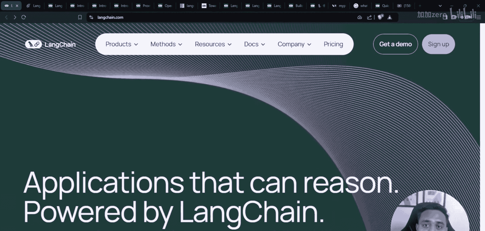

Ive covered so far so if you will search about Sunvita you will get my YouTube channel guys here I have uploaded around 53 video and all the video it is with respect to the rag so rag and the different other concept of the geneative AI definitely if you are willing to learn any concept like related to the geneative AI you can reach out to my YouTube channel and inside this particular concepts somewhere I covered many more thing with respect to the Lin as well but again I thought that why should not I go through with the L because it's getting like too much popularity it is very much essential as well as a geneative AI engineer if you want to understand the geneative AI and if you want to create something right using the Lm that definitely you will once in a life definitely you will go through with the Lin because it is giving you those concept right it is giving you those frame it is giving you those。

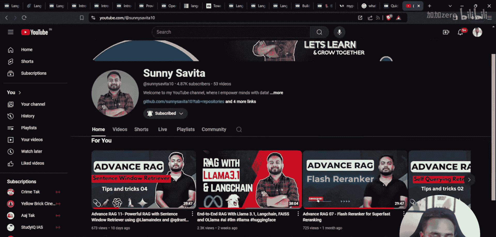

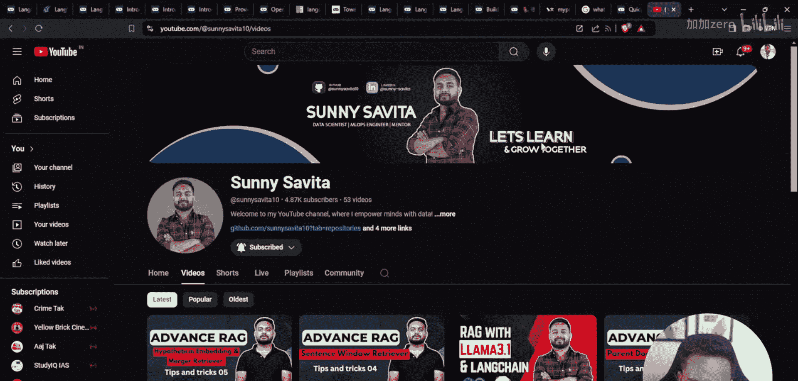

Seet those platforms so that easily easily you can will your ecosystem easily like you can create an application around the LLM So yeah inside the playlist guys。

 you will find out the different different playlist as well I segregated many more things so definitely you can visit my YouTube channel you can learn many more thing with respect to the AI so now let's begin with the video begin with the la so first of all。

 let me give it up a little brief about the la it will take one two minutes and then I will come to the topics that what are topics basically la covers and what topics we are going to cover right so this is going to be complete agenda of so I will set the complete agenda of this particular video and don't leave this video guys because I will discuss the L graph okay which is very essentially concept C if we are talking about。

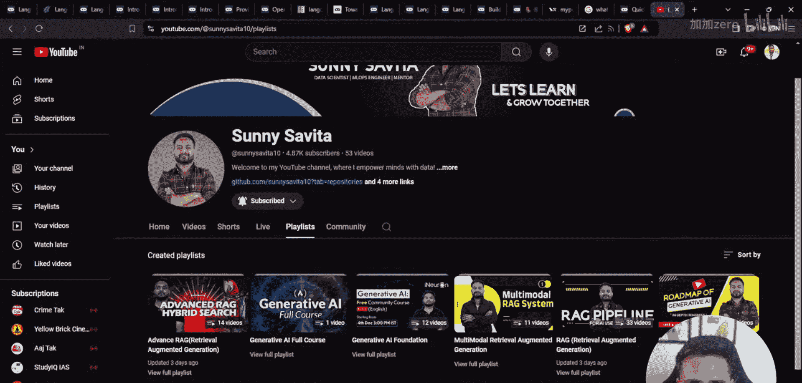

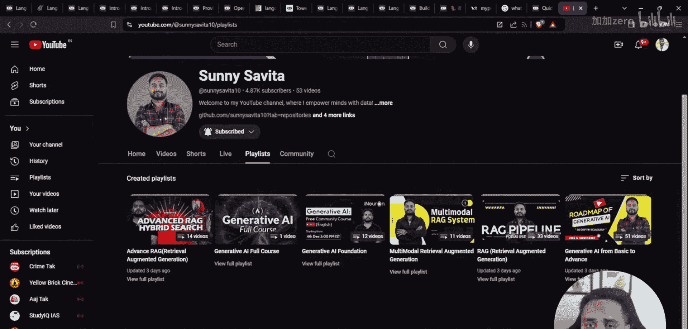

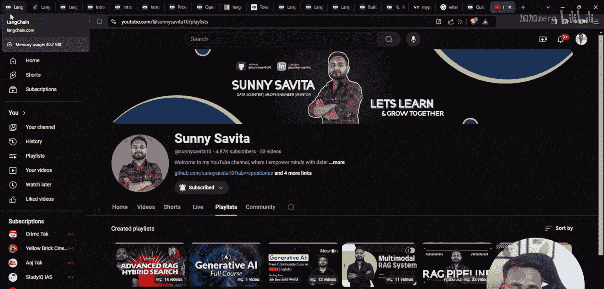

冷静。It is having a different different concept and for those concepts right regarding those concepts I can create a dedicated video as well dedicated play is dedicated video so that also I will create in future okay in the upcoming days but as of now I thought I should cover the essential part of the language so that let's say some begin is starting let's say somewhere you are stuck okay let's say some experience guy who want to use want to use language is instantly you want to understand the use of the language or language graph so where from where we need to learn sometimes the thing we are not able to understand from the documentation right so that's why I'm creating this particular video and don't worry in future I will be coming up with language graph dedicated series on the language graph dedicated series on the language Smith and the other concept of the language。

So let's start。 first of all， guys here。If you will look into the L So it providing you the three things first is Lang itself the second is Langysmith and Lnggra it's like inside the product they have mentioned and many more things you will find out over the website So Lang is a company I find out very interesting thing about the L the company which founded in 2022 and yes through 43 employees working inside this company and maybe recently they close some deal as well like a financial deal and here is an investor6 investor you can read more about this L you will get detail about it So it's a us based company Lang Inc and the website name is what Lang co which is providing you a different like a platform for building an application around the L So I hope this thing is clear Now let's look into the platform look into the product of the L So first if I'm showing you this Langsmith So why we are using。

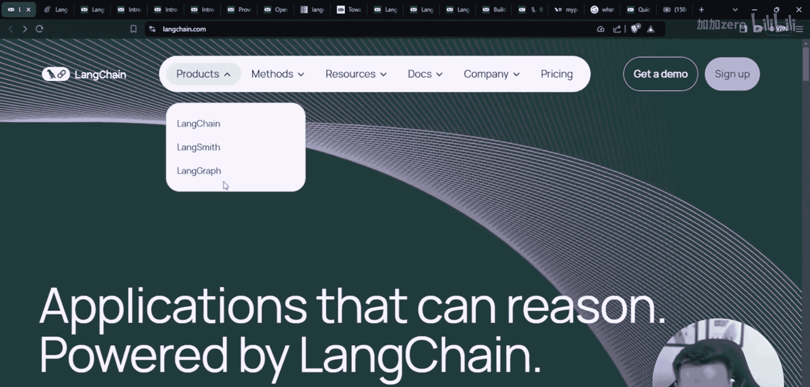

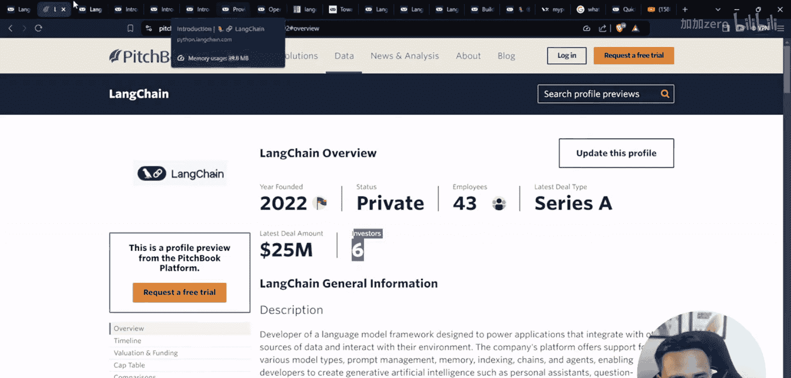

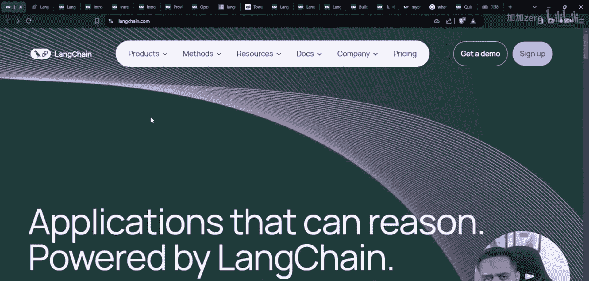

Langsmith so Lsmith guys， we generally use it for deworking。

 collaborate test and monitor lLm application I will show you the real time use of the Lsmith。

 but as of now just think。If we want to monitor our element based application right if we want to debucate so in that case we can use this la is the monitoring tool now coming to the next product so here this product is very amazing it' a land graph just like just just like read about this land graph right don't worry I will let you know in a detail i'm just giving the overview as of not so land graph basically what is this so forget about the length just just think about the graph over here what is the graph graph basically the graph we have。

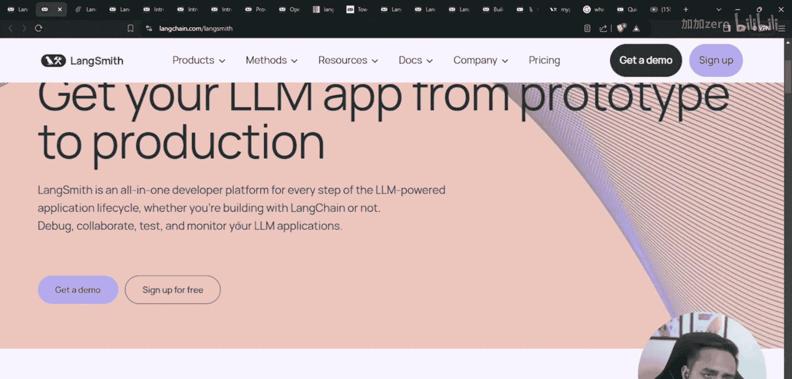

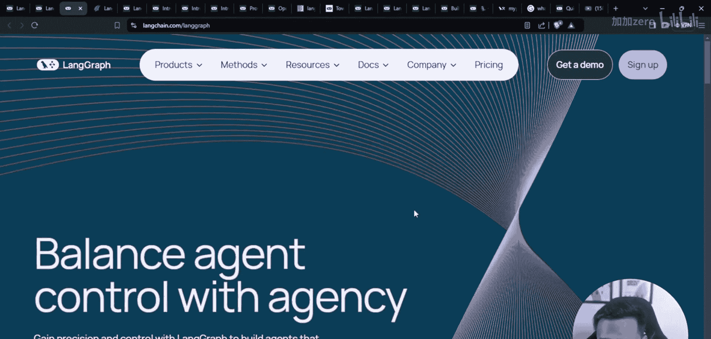

As right and nodes so what we are doing you know we are going to create kind of workflow we are going to create a kind of workflow using this node and pagess so here the node is going to be some sort of agents。

Okay and this ages is going to be some functionality I will let you know how it works。

 but graph means we are going to create node and ages kind of functionality that said the thing is and yes recently they have at least one more thing with respect to this la graph that is what that is la graph cloud okay so here you can see as of now it is in betaface so if you are going to create a la graph if if you are going to create a graph using your agents so this graph based la graph generally we use along with agents okay so yes recently they have released a cloud as well and right now in a betaface definitely you can check out you can read more about it if it is essential for you you can use it and don't worry in upcoming days I will be creating one dedicated video or dedicated a series on top of it because I think iss important now coming to the next part here so guys here you can see。

Ping also with respect to this L Langn is providing you a startup developer plus and this plus an enterprise So plus an enterprise against paid one。

And here guys see what is like what this pricing is all about I think you hear that Langern is a open source but they are giving you the pricing okay they are providing you the many services with respect to the language so in a better way you can debug your platform you can monitor your platform okay the product basically I was showing you language grab right so you can deploy it。

Okay after creating the agent and graph you can deploy so they are providing this two services。

 I hope this initial introduction is clear to all of you now guys coming to few more concept now whenever you will go through whenever you will go through with the link this is a documentation guide which directly you can redirect over here from the from the main website itself so this is a documentation of the link and here guys one thing I would like to show you just just go through with this induction right and if you will scroll down so this is a complete picture which you will get with respect to this complete ecosystem So inside the we have link itself La graph integration different integration link La graph cloud and languagem so this landm and La graph cloud they have mentioned as a commercial one means for that maybe you will have to pay if you are going to use the many service but rest of the thing right the core module of the La graph。

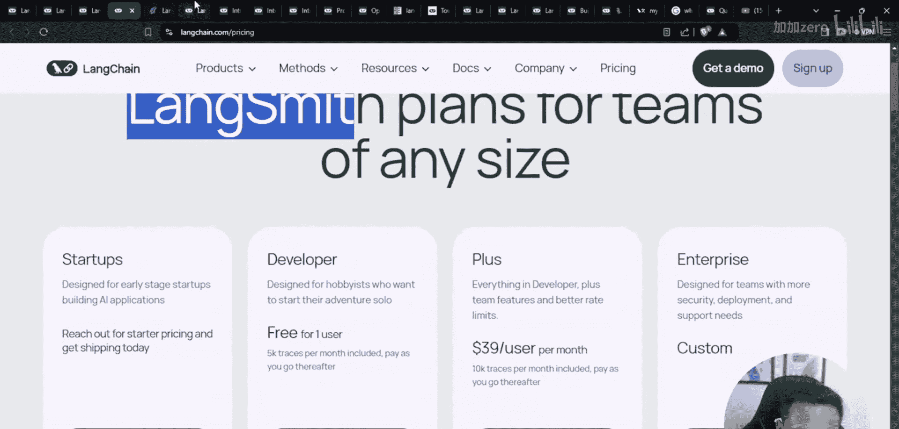

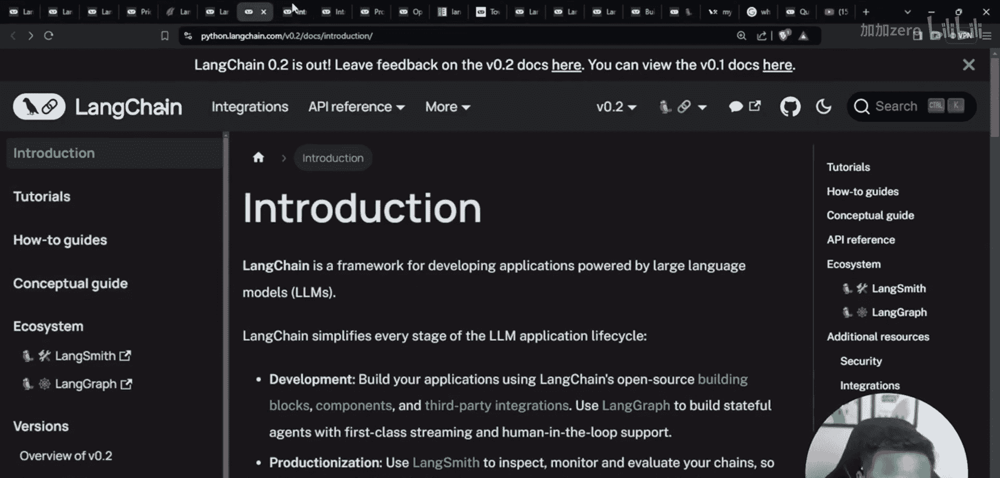

The la graph the initial model of the La graph without this cloud version okay the managed platform and this integration different different kind of integration it is completely free and open source and even you can get the code from the Gi as well directly you can download the raw code from the Gi and according to your requirement you can modify now let me show you a couple of more things with respect to this la and then I will start with the practical because this is very much important。

So guys here once you will click on this letters Okay。

 so here you will find out some packages inside the la one is score。

 one is L itself access splitter community and experiment。

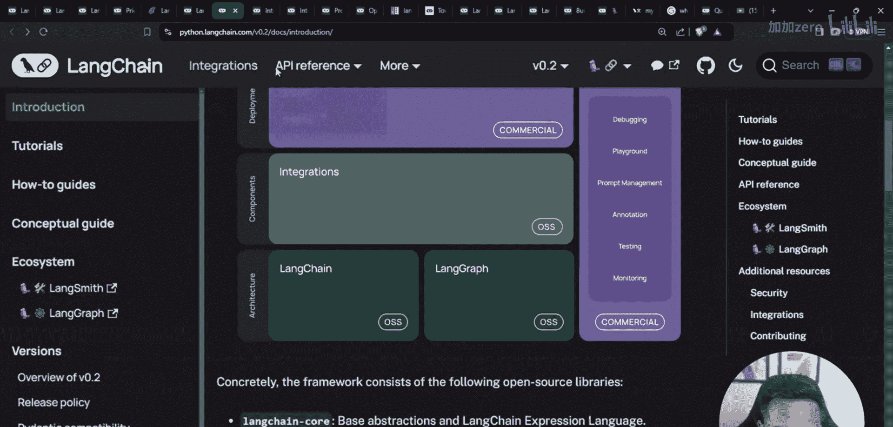

So wherever we are installing Ls so we always installed the la in terms of these packages based packages so core package actually recently like well this year itself they have introduced it previous year they were everything was there inside the L itself now they have updated is this la package they have updated it to the core and they have created。

Other module as well like community and experimental site the single roof L is a single roof inside that la L core is the main package which is having all the functionality then a L community L experimental so they have segregated some sort of a functionality here and there thats it but whenever we are going to create an application so we generally download this L。

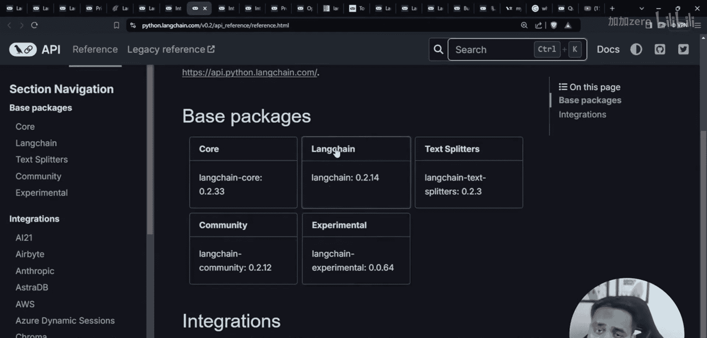