# Sunny Savita【中英⚡生成式AI：从初学者到专家｜Generative AI In-Depth Roadmap from Beginner to E】 p52 P52 Chatbot Using @LangChain With Memory(Chat History) ｜ LangChain Core ｜ LangSm [BV1Uht8zDENA_p52]

Hey hi everyone， welcomee to my YouTube channel。 My name is Sunny Savita and I'm packed with another exciting and important video guys。

😊。

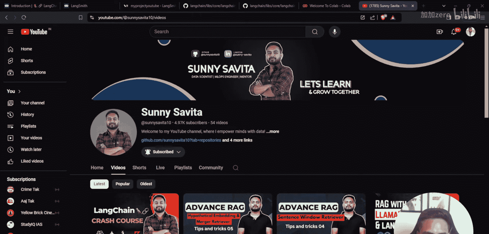

So in my previous video I discuss I think everything with respect to the Lin if you haven't checked with my previous video guys。

 please go and check out you can see within one day I I got more than 700 views on top of this video Yes I was aware about the importance of this Lin I was aware about the importance of this particular video that's why I have lease before starting or before covering any other concept So if you haven't watched this video please go and check out you will get the link or the i button you can click on that and you can reach out to the video apart from this one guys I think I have covered most of the thing with respect to the rag and precisely I will prefer you this multimodal rag series where actually I have created a lots of concept with respect to the rag where you can handle the different different type of。

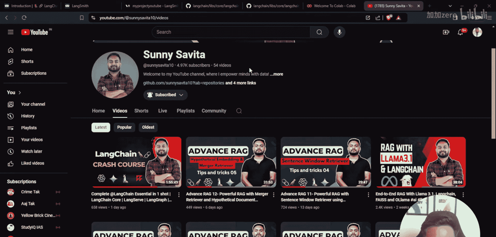

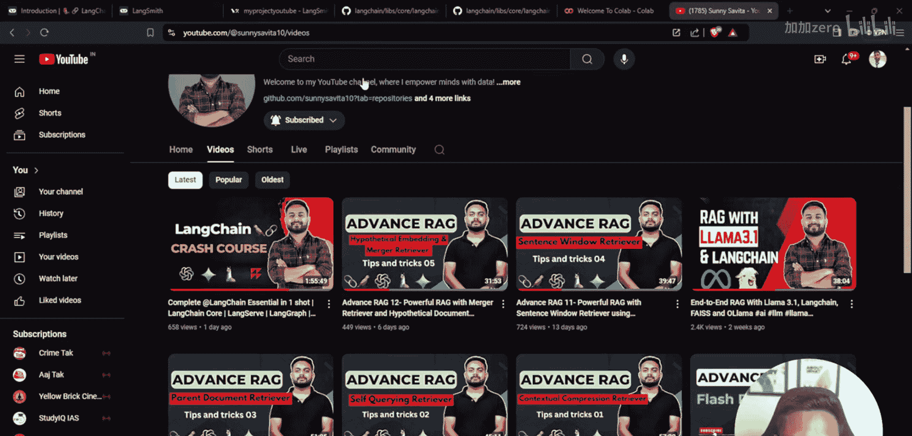

I on and apart from this one guys， you will find out many more video with respect to the Ra and generative AI now in order to that I'm going to discuss one more like a use case one more very important use case that how you can create a chatbo using L and how you can sustain a memory how you can sustain the history okay how you can sustain the state of the conversation so this video is going to be very very amazing guys and here inside this video you will learn many more thing this is my promise to all of you so please watch this video till end。

😊，And at the end， I will let you know very like important thing and I will let you know my future plan as well with respect to the generative AI and NlP as well and I'm going to share some resources as well so let's begin let's start so first of all guys what you have to do see this every we are going to implement inside the coab itself so here Im going to create one file and inside this file I'll be writing my each and every line of code and later on we migrate this code to the Vs code means like in some other session or I will give you a hint that how you can migrate it to the VS code how you can create and to an application okay because already I have created it on my group channel and I have uploaded that video as well so just check out with this chatboard E can chatboard with a deployment there you will find out UI and along with UI。

😊。

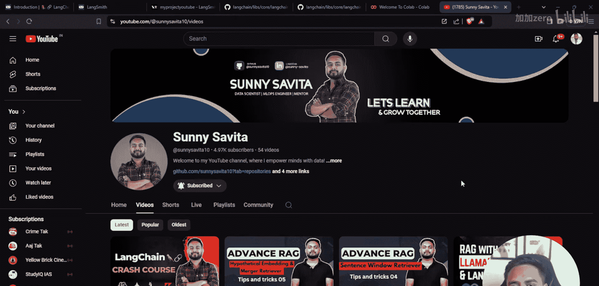

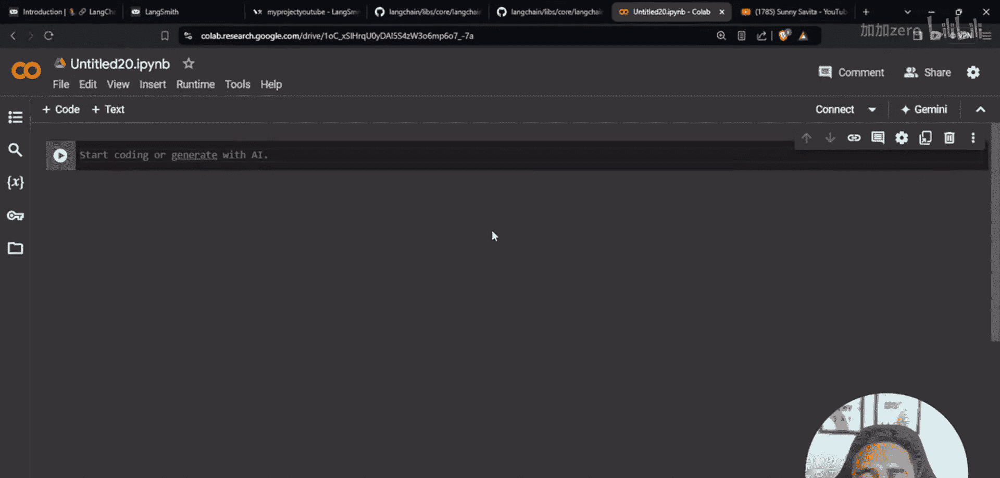

Basically I implemented complete functionality of the chat board now why this video is important。

 which I'm recording today because here I will mainly tell you how you can maintain the history how you can maintain the memory of your conversation and that that is what I told you in my previous previous video I'm going to start with this particular series where I'll be teaching you the different different type of memory okay the different different type of concept with respect to the memory So let's begin this is the very first video and I believe I hope you will learn many more thing over here。

 So first of all， let me rename the file and here my file name is going to be chatbo。

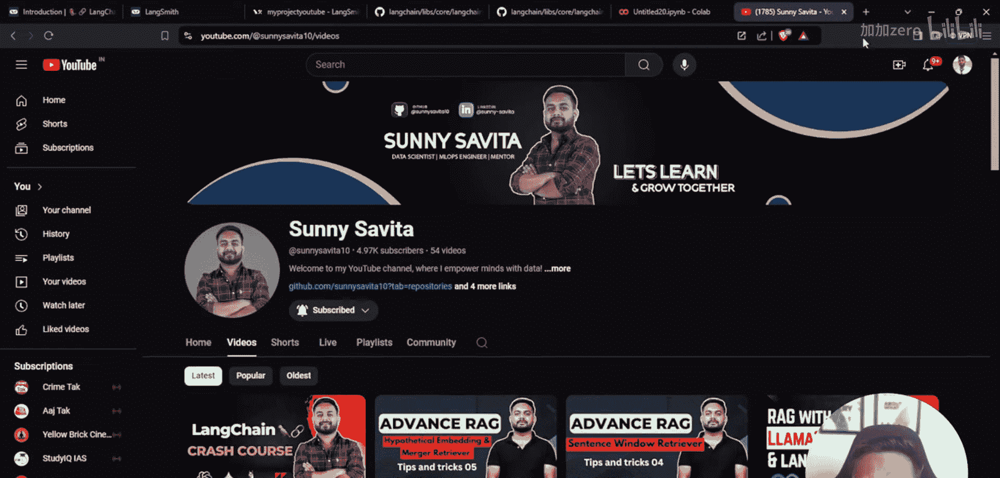

Using。Langchain with memory so this is a suitable the suitable title for this particular video Now guys in this video I will let you know what is the difference between chatboard rag and agent okay because many people like they they confused like with this type of town if someone is new like newbie right who just started the geneative AI journey who don't know much about the geneative AI and the concept and the use cases of the NLP of the geneative AI that should definitely focus on this thing Now。

 first of all guys， what I will do So here I'm going to import couple of library I required a model So for model guys I'm going to use free API okay free API from the Google from the Google AI studio so that I can access the。

Google gymni model Im not going to use open A guys because it is paid and it takes charges so here let me install this L Google generative AI。

So， Pip install。IPh Q and here the package name is going to be Langin underscore Google underscore Gen AI。

 So my package is going to be installed now apart from this one。

 I can install some other the package as well。 So here I let me install the la。

 So Fip install Langin iPhone Q Lang iPhone Q means in a quiet mode。

 So here I'm going to install it Lcha and then I can install one more package over here。

 Pip install Lang community。 If you don't know the differences about these packages so you can refer to my previous video where I already explain you each and everything related to the different different。

Byage related to the different， different package of war。Of the link chain。

 So here I am going to install this package as well and see all the package is getting installed。

Now I installed all the library， whatever is required over here。

 Now see you guys one more thing I'm going to configure over here inside this notebook。

 the thing is L issmith。 Yes， so that I can track each and every stage each and every step okay of my implementation I want to capture each and every log okay and that is why this is Smith is important if you don't know about it。

 please reach out to this particular video there I discuss about the L is Smith also so how we can configure it first of all I will have to configure a couple of parameter okay environment variable so here guys I just it in my I just kept it in my like a notpa and here I am going to copy and paste so we required this API key we required this endpoint URL it is not required see you can remove this endpoint URL we required the project name Yes this is important and here this Google API key for accessing the Google。

😊。

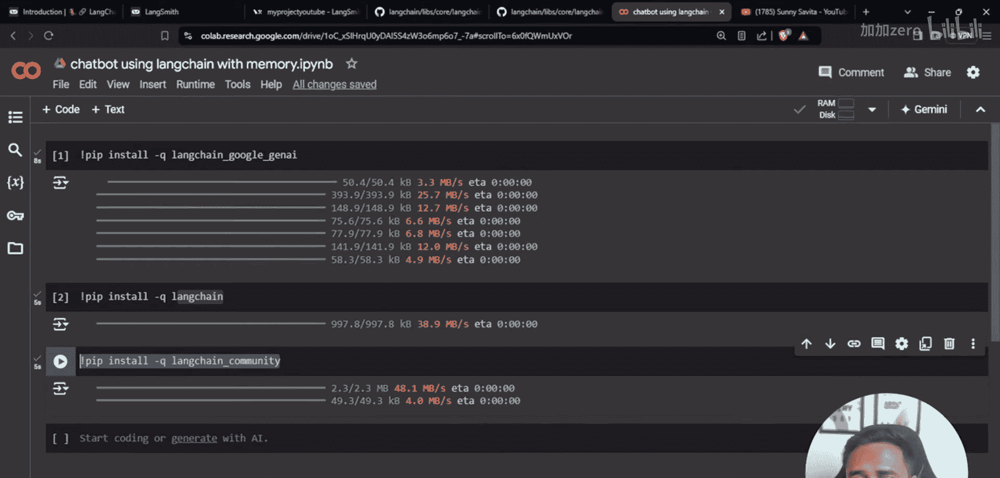

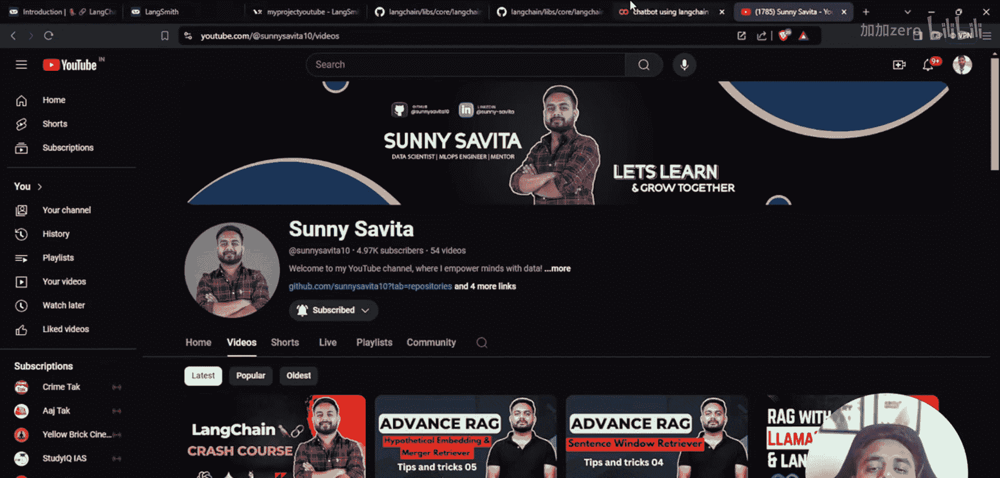

Modral now here let me install OSs OS mas operating system and lets see whether we are able to run it or not。

 So Im setting all the values over here， so let me run it and see we are able to do it where you will find out this all the variable Okay related to the languagesmith。

 So for that you will have to search about the length chain， let me search about the length chain。

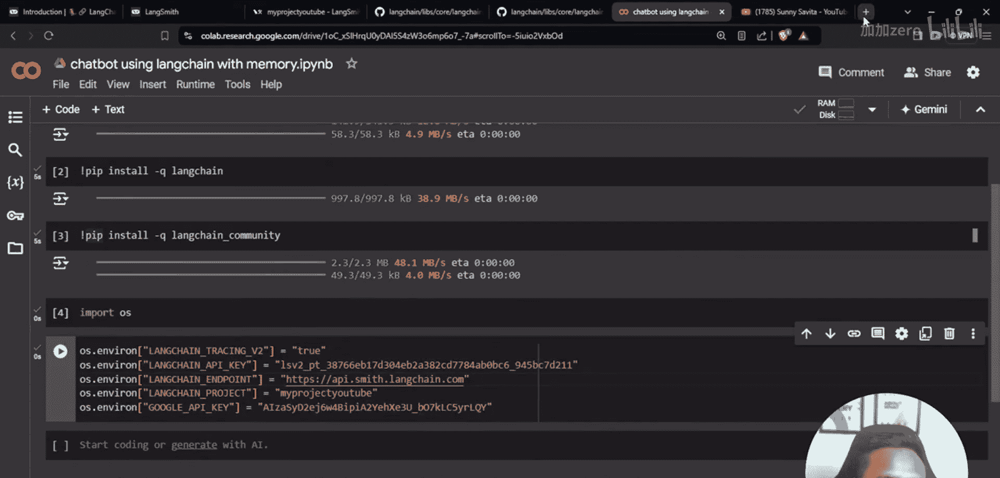

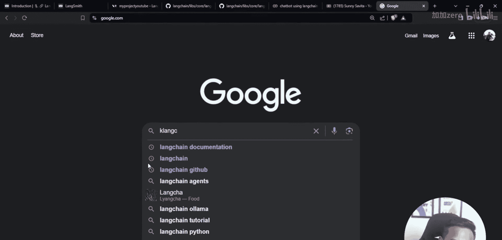

Just the second L chain， okay。Now here is the website， official website of the Lin。

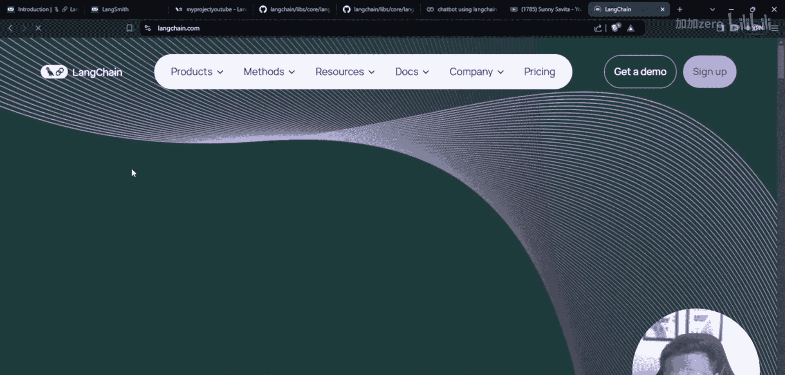

So just click on this product and then you will get this Langsmith right just click on this Langsmith it will give you the option right for the sign up to sign up over here if you already sign up it will be directly redirecting to you over the project so just click on the project and here what you can do you can create a new project so just write your project name let's say my project name is chat board with L or let me put the hyphen or underscore let chatbot with L chain。

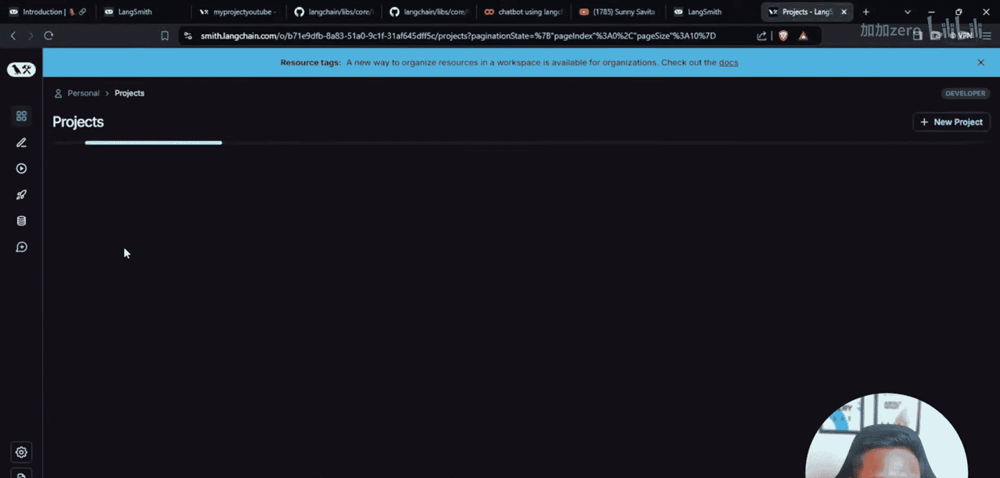

So I hope it is fine to all of you guys now see this is all the thing which I need to copy and paste So all the thing is same Okay this through this URL this API key I just need to change this particular name so that everything I can capture inside under this particular project and if you don't know about it you can check out with my previous video I have explained you in very detailed manner so let me read it and let me cite my environment variable so it is done guys now what I will do I will load the model soing the model guys here is my。

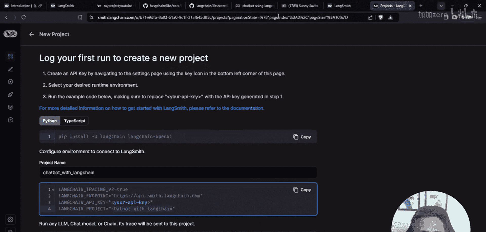

Following the model， here is my。basicallysically import a statement So let me run it and see we are able to import it now let me create an object of this particular class so here I' am going to copy and paste and let me define the model name over here so what is my model name Let me keep it over here I'm going to import the g model and one more parameter I'm going to define convert system message to human So here here here this particular parameter convert system message to human which is true right so this is going to be my model。

Now let me capture it inside the variable。Okay， I got my model after getting a model guys。

 I can check it so how I will check it guys， I can pass the message。

 Okay I can invoke this particular model so let me call this model dot invoke so here I can write moral dot invo now I can pass the message I can pass hi so what I will get I will get my response right so here it is giving me response the response is hello there how I can assist you now after getting a response what I will do so see I don't want to like much detail about I don't want to like much detail okay related to this particular message I just want my message simple contain so simply I can call the content on top of it right so contain once I will learn it I will be getting my content or else I can use the see this is what is my content now it is giving me on warning The warning is what convert system message to human will be deprecated in。

In the upcoming like variance， okay？

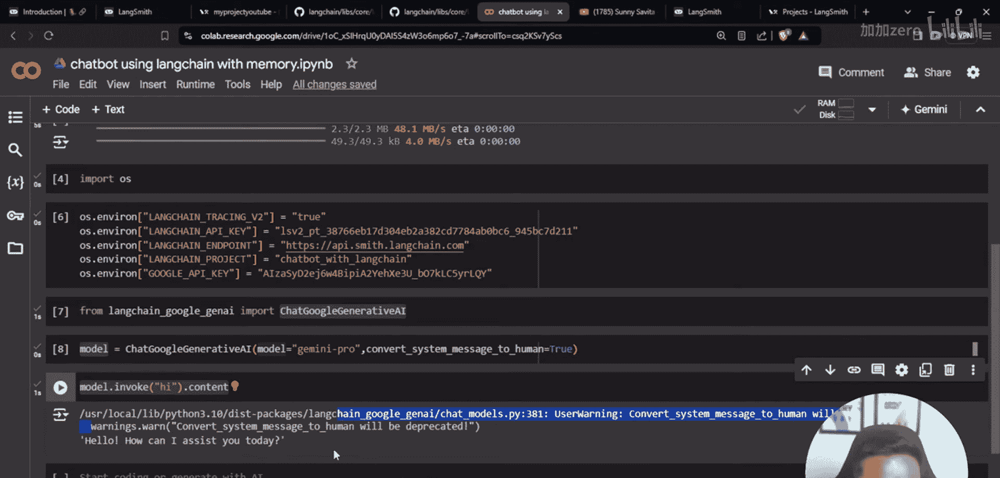