# Sunny Savita【中英⚡生成式AI：从初学者到专家｜Generative AI In-Depth Roadmap from Beginner to E】 p53 P53 RAG Based Chatbot With Memory(Chat History) ｜ Creating History Aware Retriev [BV1Uht8zDENA_p53]

Hey hi everyone。 Wele to my YouTube channel。 My name is Sunnia Vita and I'm back with another exciting and useful video。

 So guys in this particular video， we gonna see how we can create a ragbased chatbo with memory Yes guys so in my previous video I've explained you how you can create a chatbot with memory now if you want to integrate the rag pipeline inside the chatbo how you can do it and how you can sustain the memory over there so my discussion my complete discussion will be around to that only and along with a practical。

 I'll be explain the theoretical point as well。 and at the end you will get to know how we can create this kind of pipeline。

 guys let's start let's begin first of all， let me show you my YouTube channel So here guys just a second this is my YouTube channel if you haven't visit so far。

😊，Please go and check I have uploaded like very amazing content with respectful Geneative A and definitely it will help you to start with your Geneative A journey so this was my last video with respect chat board this one please go and check out please try to learn about the chat board and this video will help you with respect to today's tutorial itself and before that I uploaded the L and Q course also so yeah both video you will get inside this particular section if you want to learn a couple of other things with respect Geneative A so definitely you can check out with my playlist there I cap a different different kind of playlist and soon Ill be uploading many more video so guys I hope this thing is clear now let's start with a solution so solution of this rack with memory so here guys I try to cap the code okay。

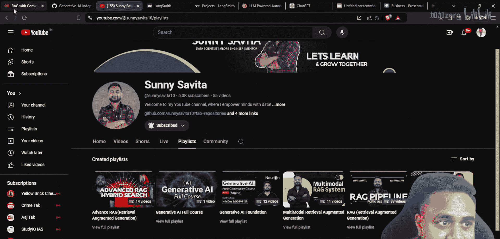

this code is like its a waste right until we are not going to understand the architecture under until we are not going to understand the theoretical itself related to this particular problem Okay so first let's try to understand the problem statement let's try to understand the theoretical point then again I will come to this particular implementation so here on my。

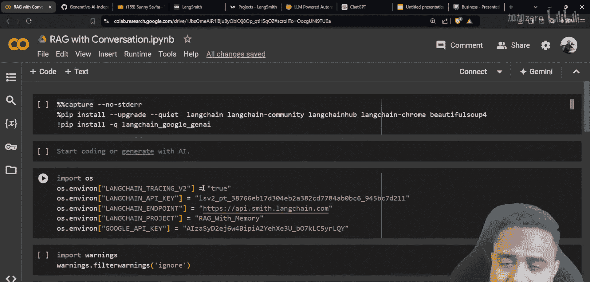

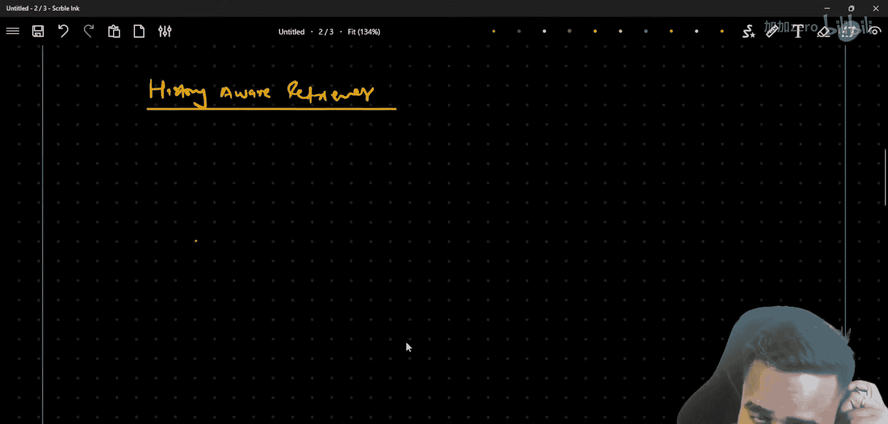

Blackboard itself guys I try to cap everything first of all let me remove it from here so that I can start from a scratch if you don't know about the rag guys I created a dedicated playlist on top of the rag definitely you can check out and you can learn from there about the rag so this is a architecture of the rag guys now before coming to this architecture let me give you some theoretical point theoretical stuff so here let's say what I have I have my LLM model okay。

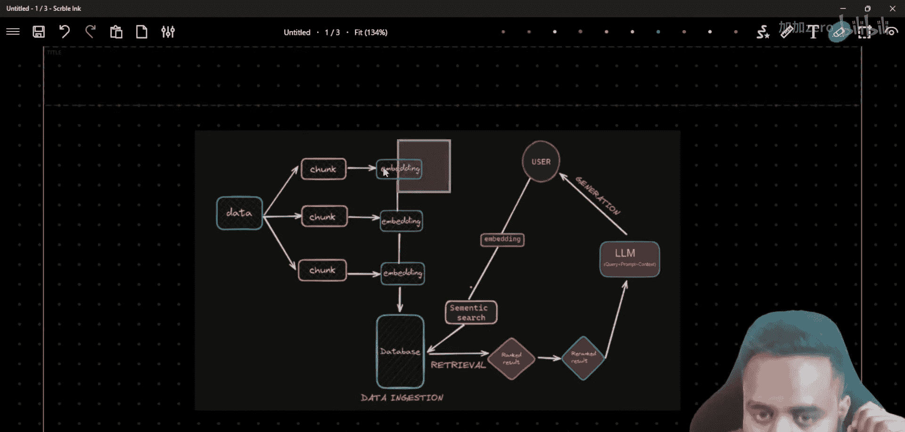

This is what this is my a large language model now to this LL model。

 lets say I am passing one question okay， this is what is my input pro I can write over here。

Prom right now this is going to be my input pro Now what I will be what I will get tell me guys。

 so I will be getting my output just a second。 Let me write in a。Good way。

 So here is what here is my prom Now what I will be getting I will be getting my output。

 so here is what here is my output。Right so this kind of mechanism is called like a basic quo answering。

 so here I can mention about it， So this is nothing this is。

Quion and answering right where I'm asking the question to my LLM and it is replying to me now guys。

 let's say if we are able to maintain okay， we are able to maintain the history of this particular conversation right and if we are able to serve this application somewhere with respect to any sort of a domain right so this is what this is my chatbo So here if we are able to maintain the history history of what history of this particular conversation right if we are able to maintain the state like we do inside the chat Gp So this is what this is my chatbo okay now guys。

 let's say some my LM is not able to answer something so let me remove this part as well sometimes my LLM is not able to answer something So in that case what we do we connect this LLm okay we connect this a large language model with a rag pipeline So Ra is nothing it's a retrieval argument generation。

If we don't know about the rag so let's understand about the rag architecture so what we do guys we never answer directly so here we are asking the question directly to my LLM we never do it what we do we create the rag pipeline okay means whatever question we need to ask whatever input were gonna pass we pass through this rag pipeline how to do that let me show you so this is a complete rag architecture so first guys inside the rag pipeline we be always having one database okay our knowledge base we are going to create a chance from that particular knowledge base okay and then we are going to create a embedding of that and somewhere we are storing inside the database this is usually this database is called vector database okay now guys let's say user is asking any sort of a question。

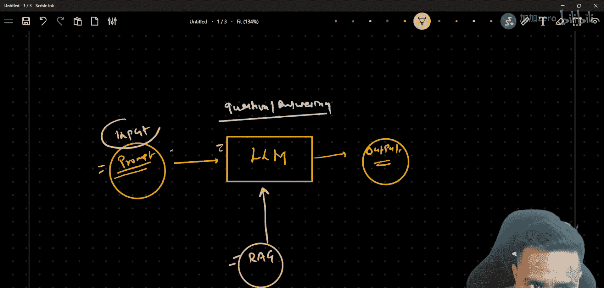

So we convert this quotient into the embedding， then again it come back to the vector database and then。

We perform the semantic search or we perform the similarity search and based on that semantic search and based on that similarity search。

 we find out some rank result， rank result means what top result， topmost result。

 And here if we want to perform the reranking I can do that Also it's my second level filtering this all the thing I already uploaded on my YouTube channel if you don't know about it。

 you can go and check with this advanced rank playlist。 Okay now guys， what we do， we pass this data。

 this complete context and all this query this prompt prompt means the instruction to my model and here is a context context is nothing this is the rank answer or re answer。

 we pass everything to my model to my Lm model and finally we generate the answer。

 Okay finally we generate the answer and we pass it to the user。

 This is my rank pipeline So guys instead of passing direct question to my Lm what we do we pass some more context using this rack pipeline here is a complete rank pipeline。

 which we connect。

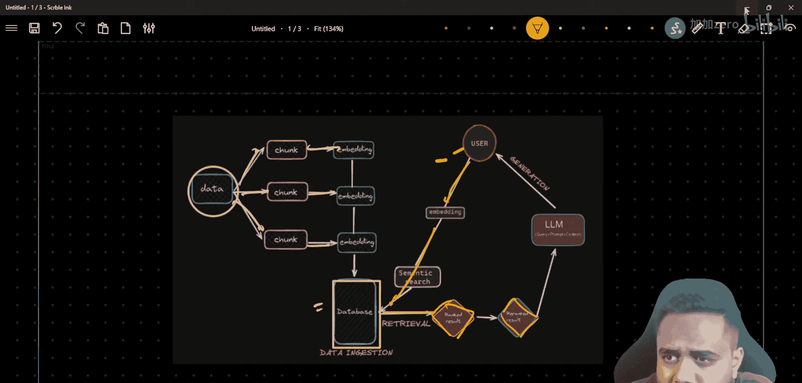

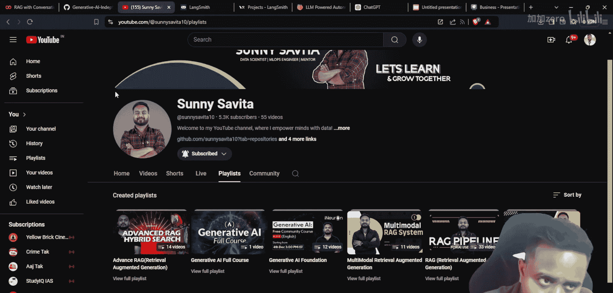

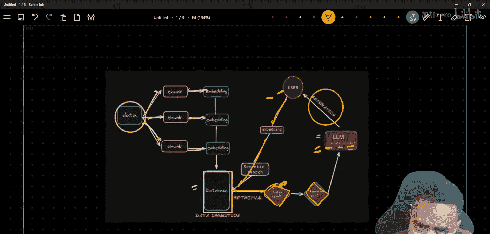

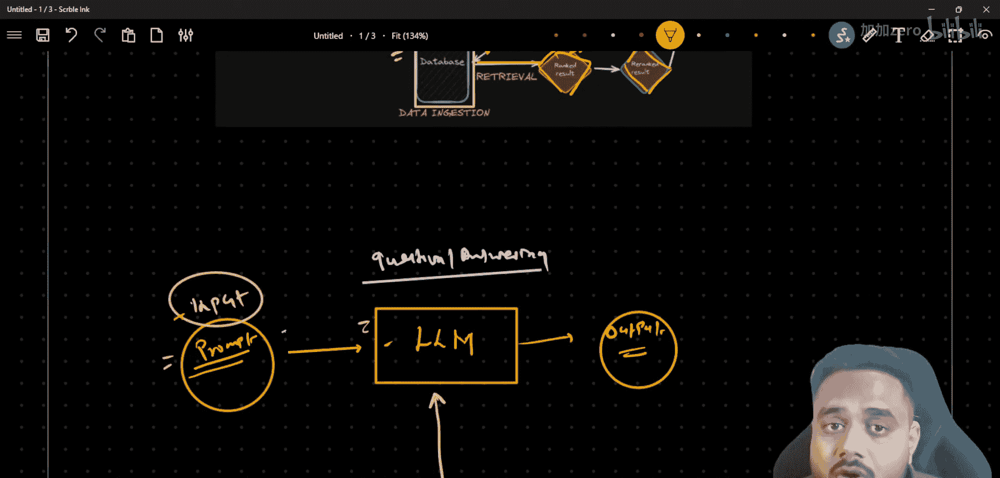

To the LLla and then we generate the answer I hope this thing is clear so first of all let's do one thing let's try to create this rag pipeline and then I will show you how you can create the history ofware rag because that is very much important and before this history of rag guys history of retriever pipeline history of rag anything you can say so well have to understand the complete coding of this rag so guys here I kept this particular coding now let me show you first of all let me connect it so either you can connect with the GP or CPU anything is fine right now because we are are not going to do very heavy implementation so guys here it is getting connected so let it connect。

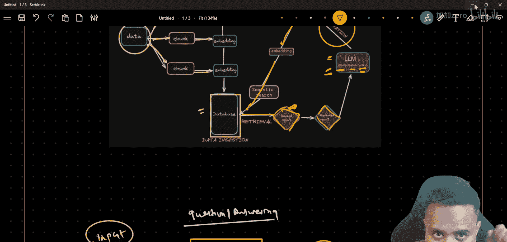

Okay， so my system is connected。 Now what I will do， I will install the necessary library。

 So I'm going to install it guys see and after that， after installing it。

 I have to set a couple of variable as well。 So this is my variable guys which I am going to be set over here So this variable is related to the logging。

 So if I want to capture the log of this particular implementation So that's why I'm defining this variable and if you don't know about it。

 you can check out with this this particular video Langion one short video there I have explaining the use of this Langsmith Langsmith for capturing the log log of the implementation。

 So I can give you a glimpse of that how basically I'm getting this particular variable。

 this is with respect to the I'm using the g model that's why I it now here this other variable from where actually Im getting it So once you will go through with Lng website here inside the product if you will search about this Langsmith。

 So there here is the Lsmith guys you will get this type of interface right now what you can do you can click on this。

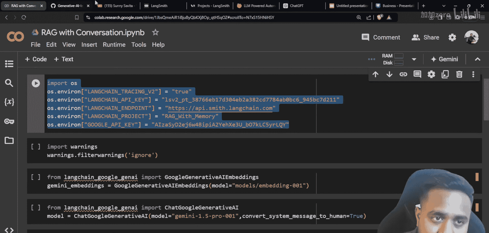

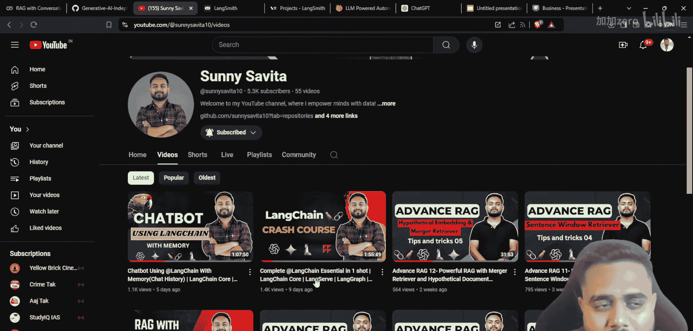

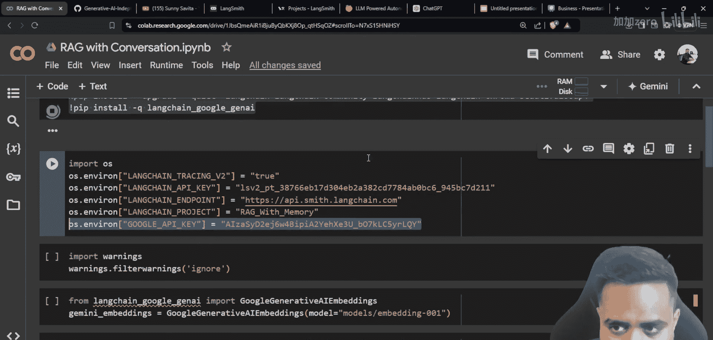

New project once you will do it guys， it will give you all this variable Now this particular variable。

 you have to set it as an environment variable Okay here you need to pass the API key here you need to pass pass your project name。

 whatever you want to pass okay and from where you will get the API key so just do just click on this setting icon So once you will do it guys here it will give you the option for generating the API key see here you are getting it So once you will configure all the variable So see I already created couple of project and here is a complete log log of those particular log of those particular implementation so easily you can track what is happening at which is step So if you application is too complex in that case you can in that case actually you can track the complete application using this log I hope this is clear all of you now let me know it let me set all the environment variable and this is a project name so the new project will be created automatically over there So it saying import。

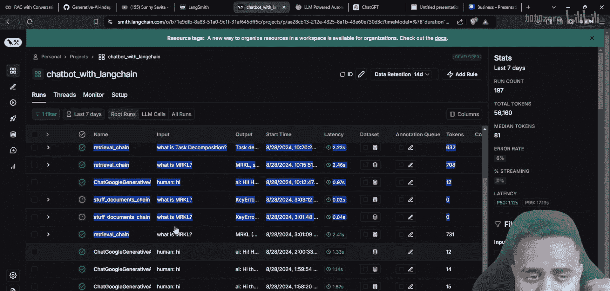

Okay， let me run it again。Import us。Here it is working fine Now here I'm going to import this warning because I don't want to any sort of a warning in between my answer So thats why I'm importing it now here I am going to be load the emttting model it is Google gni but it is up to you you can utilize or you can keep any sort of a model inside your implementation I'm not going to stop you Okay now apart from this one guys what we have we have a model so which model guys we are using this gney model gni 1。

5 pro 001 why I am using it so that easily。

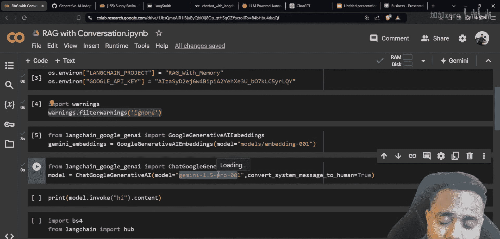