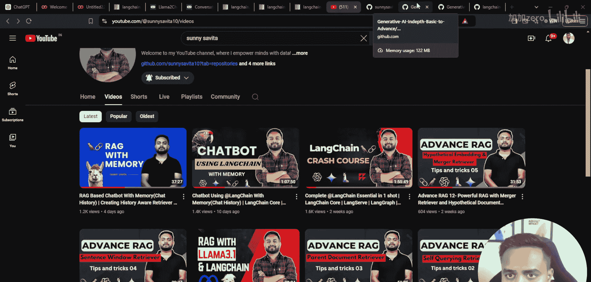
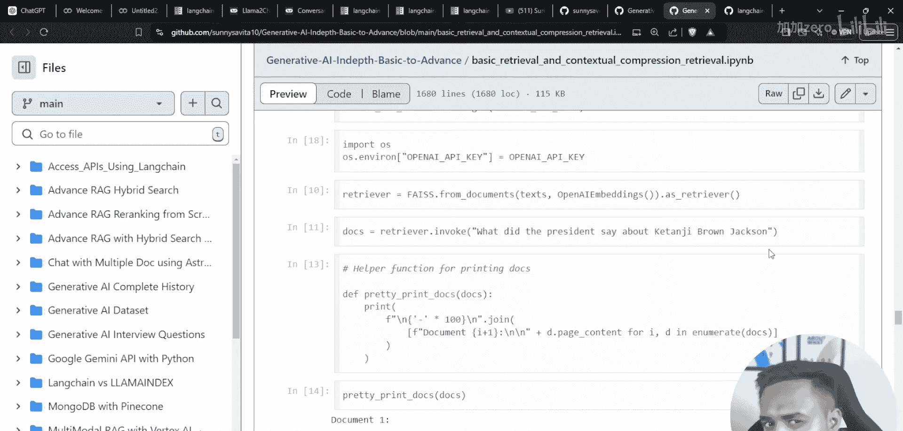
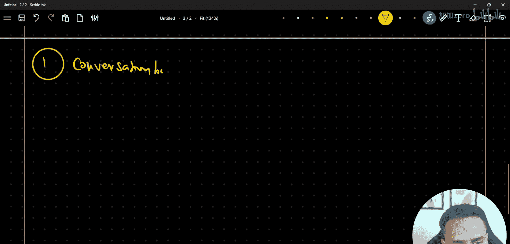

# Sunny Savita【中英⚡生成式AI：从初学者到专家｜Generative AI In-Depth Roadmap from Beginner to E】 p54 P54 Langchain Conversation Buffer Memory vs Conversation Buffer Window Memory ｜ [BV1Uht8zDENA_p54]

He hi everyone。 welcomele to my do channel。 My name is Sunni Savida and I'm back with another exciting and important video guys。

 So guys I started with the memory chapter with respect to this generative AI with respect to this large language model and I have already uploaded two session on my do channel if you haven't checked so far。

 please go and check So in my first session， I explain you like how you can sustain the memory inside the chatbo if you are going to create any sort of a chatbo using any LLm and inside the second video I discuss how you can sustain the memory inside your rag pipeline and even I discuss about the history of your retrieval as well how you can create a history of your retrieval So if you don't know about it about this particular concept so definitely you can check out apart from this one guys see I got a lot many messages。

😊。

You discuss the old classes which which were using which basically people were using for sustaining the memory and all like the conversation buffer memory conversation windows memory so easily we can do the discrimination between this new concept which you told okay because here if you will look into this particular video this chat board or this rag with memory right so here I was using the latest classes which was introduced inside the Lin version two right but before that also LIn has introduced a couple of more classes like conversation buffer memory conversation window memory conversation summary memory conversation summary buffer memory entities and all right so in today's video guys Im going to discuss those classes and we'll see like what is the difference between this new class and those old classes okay and here guys if you don't know right if you don't know about this particular implementation so you can go and check with my Github。

Over my Github I'm uploading each and every kind of like each and every kind of file。

 whatever I'm discussing whatever I'm implementing throughout the video so for that you just need to search about Sunny Savita and here just look into this particular repository geneative AI in depth basic to advance right so here guys see this is the file from the previous class from the previous video and here is a file from the previous previous video now if you will scroll down so you will find out that inside this particular file I have implemented my solution using this inmeory class so where it is just a second like we show you where it is this one I see in memoryory chat message history now here if you will look into this particular solution you will find out I'm using this in memoryory chat history but apart from this one I'm using the history aware retrieval also so please go and check out every solution is there every。

Ttorial is there and I think so you won't be able to find out any sort of issue still if you are getting anything any doubt or something you can mention inside the chat box I will look into that now guys let's start let's begin with those particular classes like conversation buffer memory and conversation buffer window memory in this particular video I will give you three solution and two solution conversation summary memory and conversation summary buffer memory I will explain you in the next class but this video is very much important because here Im going to cover all the basic stuff so let's begin guys now first let me explain you the complete theoretical like theoretical stuff with respect to this memory classes right the different different memory classes then only I will come to the practical implementation so here guys I'm talking about the memory chapter so let me write ahead。

ok。世娟。Memory chapter right so guys here of C here in the previous session as I told you that we have discussed how you can sustain a memory during your conversation right throughout your conversation so memory。

With chatbo。So this I already completed。Okay， now here memory with the rag。Memory with。

Right okay so these are two topics I already completed and I shown you where you will find out the tutorial now which class I have used so here I have used in memory chat history class okay which is a latest class inside a la now coming to the couple of different different classes so here guys inside the different different class so first of all let me explain you about the LLM so let's say we have LLM guys so lets this is my LM。

Now to do to this particular LLM what I am doing I'm passing some input， so here my input is coming。

Okay， and here my output is great。G my point， I think yes right now I see。My input is coming。

 my output is going， so this is what this is my normal。😡，You way okay。

 my normal question and answering。 So here guys what I'm doing I am going to sustain the history of this particular conversation I'm going to maintain the state of this particular conversation。

 So here if I am going to add on the。History， right？History of the conversation。

So this will become what this will become the chatboard。Okay， chatbot now guys。

 let's see if I want to implement the domain specific chatbo so what I can do I can add the rag pipeline over here。

O。I can handle the rag pipeline if you don't know about the rag architecture you can go and check with previous like previous previous video right in both video I discussed the rag pipeline just just follow the previous video the idea will be clear now here guys let's say if my rack is not able to answer something let's say we don't have that particular data or let's say if I have to fetch any sort of information from any third party API so here what we can do we can create agents agents agent is also like L agent is also a chatbot right but it's a specific one it's like like a custom right so here we can create our own custom method I hope youre getting my point now whenever we are going to create a realtime chatbo so inside the realtime chatbo right we have several other functionality apart from this LM is stuff like you will find out the user interface you will find out some other statistics functionality like some predefinine conversation so no need to like it again in again this LM model。

Okay so we can give some like the buttons and all right buttons drop down and also we can like hit those particular button or drop down and like based on the predefined conversations predefined rules will be getting our answer right so this type of stuff some is stuff you will find out inside the chatboard or maybe you can upload some file you can download some file from there so this type of functionality also you will be getting with respect to the chatboard okay upload file or download file whatever so I hope this thing is clear all of you now coming to the different different classes if this definition is clear。

Now see and guys what you will do you can watch it to this 1。

5 y so that you will get a better experience because sometimes my explanation might slow so please like speed of the video So here we have four classes so the first class name which I am going do right here con session。

短着。Station。播放。Of course。唔系冇的。Okay， now here we have a second class。

 the second class is conversation for。温州美毛。Okay。Wdow memory。Then we have a third class。

 so the third class is which one。So here， conversation buffer。咁body妹妹。O。Somebody memory。

 And here the fourth class， which is hard。 So， okay， so here this is the conversation。

 somebody memory。So let me mention this convo。I think do you。

Converse summary memory right and the next memory the next pair memory is going to be conversation before summary memory。

I will let you know what is this， So merely this thing I will discuss in the next class conversation before。

到么啲。唔咩目的。Okay， now we have remote class。So the class name is called entity， okay。

 conversation entity memory or you can you can just like okay。

 let me take a different color and let put write over here entity okay。And。一定。

So here actually we decide everything based on the given entity inside the conversation I will let you know what is this and in detail I will discuss about it so I hope so far whatever I have explained you this part is clear now lets understand each and everything in a detailed manner so here we have the first thing the first thing is what conversation buffer。

Me毛 okay。

