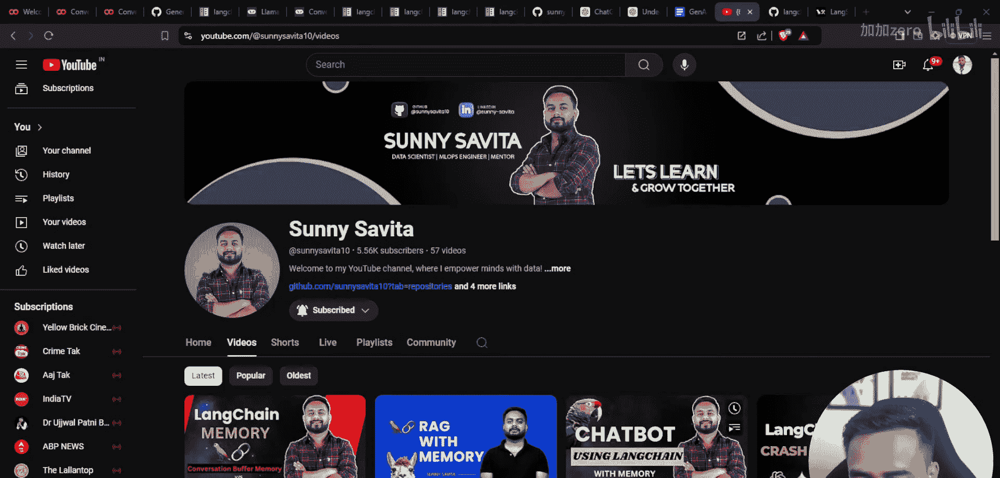
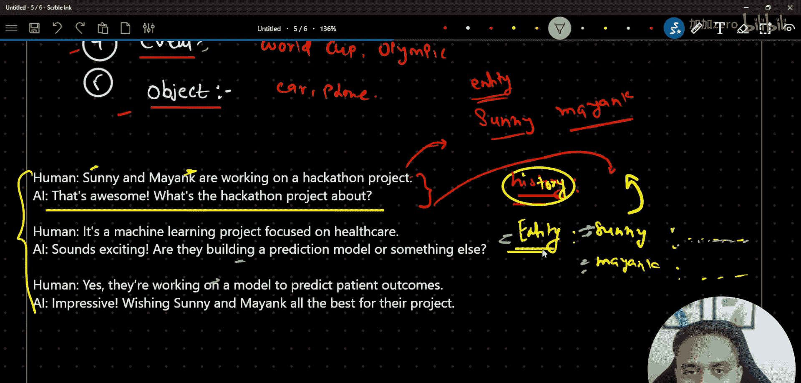
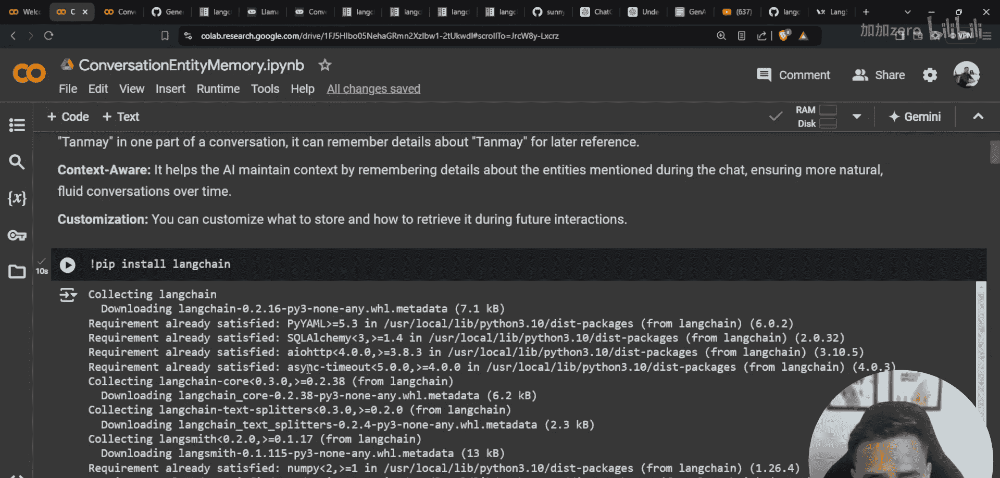

# Sunny Savita【中英⚡生成式AI：从初学者到专家｜Generative AI In-Depth Roadmap from Beginner to E】 p55 P55 Langchain Conversation Entity Memory ｜ Langchain  Memory Class ｜ Chat Histor [BV1Uht8zDENA_p55]

He hellello everyone。 welcomele to my YouTube channel。

 My name is Sunny Savita and I' am back with another exciting and useful video guys。

 So guys I started with a memory chapter and in the previous class。

 I discuss about the conversation before memory and conversation before window memory and before that guys。

 I discuss about this rag with memory， how you can sustain the memory inside your rag pipeline and how you can create a history of your retrieval before that。

 I discuss how you can sustain the memory inside your chatboard application if you are using the Lm large language model for creating a chatboard application how you can maintain the state of your conversation So guys if you haven't checked with this particular video。

 please go and check， it is very much important， if you want to create a full flag system full flag application along with a conversation history or if you want to manage the。

😊，Different different state of the conversation with respect to the different different user so this video will help you this video will help to you now related to this memory guys if we concept was still remaining so first of all let me tell you those particular concept and I hope you have seen the title of this particular video and I hope you got to know the idea that which class we are going to discuss which memory class we are going to discuss but let me give you the recap So this is a notes guys which I written in my previous session if you don't know about it。

 please go and check with my previous class itself so guys there was a four main class basically which which I introduce with respect to this memory and all so the first class was the conversation buffer memory which we already discuss okay conversation before window memory I also discuss this classes now guys a couple of more classes like conversation summary memory so how。

To like keep the memory in the form of summary that we have to see now。

 So like in the next video I will show you this third and fourth of like this third and fourth point Okay。

 this two classes I will be clarifying over there now in today's video we're gonna discuss about this conversation entity memory that with respect to any entity how we can sustain the memory Okay。

 so let's begin let's start first of all， let me give you a quick idea about this conversation of summary memory sorry conversation entity memory and then。

Well discuss the practical as well。 So conversation entity memory here you can see basically so let me explain you。

 first of all about the entity So here you can see inside this particular term we have three words first conversation Second is entity and third is a memory so I hope you got to know the idea we are going to sustain the memory with respect to the conversation okay so here we have a conversation and we have a memory right but this memory guys is directly belong to the entity right this memory is directly belong to the entity now let me explain you this thing one more time so we are going to sustain the memory with respect to the conversation means whatever talk we are doing and this memory guys。

 this memory it belong to the entity Now you must be thinking Sunny what is this entity Im not getting your point I are not getting your point at all Please tell me about this memory So guys here I written a couple of example with respect to memory。

So inside the conversation inside the text okay so this example could represent to the entity right so let's say if I'm saying person person means sunnyny let's say sunny myang or any sort of a person any any person whether it's a male or female doesn't matter that person itself is an entity okay then a location location wise any any location is Paris New York。

 Newhi or whatever location right if the location has been mentioned inside your inside this location has been mentioned inside your conversation means that is representing to the entity then organization like any X Y organization like Google Microsoft NASA or meta Netflix whatever organization we have those are representing to the。

Enity now any sort of events， Okay， so events wise it could be anything like any sports event。

 any like aomega event， any cricket event right or any Olympic event or maybe any any type of event。

 whatever kind of event basically you are able to think in your mind those event it will come inside the。

entity only then object like car phones okay non living object those also come inside the entity so I hope you got the clear cut idea with respect to the entity now let us understand using the example guys。

Gs here I kept one example of the conversation It just a dummy conversation okay which I kept over here So let's understand the meaning of entity okay。

 memory entity related to this particular conversation then I will show you the practical part Go it So let's say here we have a human human is asking some question to the AI so he is talking to the AI guys so the question is all the like messages Sunny and my are both working on the hackathon project Okay so now AI is saying that's awesome what is a hackathon project about So here human is saying means the person who is chatting。

It is saying it's a machine learning project。복다 healthcare part。Then AI saying sounds exciting。

 Are they building a prediction model or something else So yes。

 they are working on the model to predict patient outcome and impressive using you the Sun menu this this is the conversation right I hope you got to know this simple conversation between this human and the。

Here itself now where this memory and where this entity lies over here， let me explain you that part。

 and then I will give you a practical guys。 So let's say if we are taking the first sentence so here inside the first sentence easily you can identify to this sunny。

Hony and myan。There is both guys right this could be any name I just taking example so don't be confused over here so this sunny and is representing to what it is representing to the entity okay。

Now， guys here， whenever we are going to， whenever we are going to create a。

Conversation entity memory。 So here first a variable。 Okay， it will keep the entire history。

 the entire conversation。 So this is my conversation。 Okay， this this。

 this particular conversation will come over here as a value。

 So it will create a dictionary basically So let me mention the dictionary over here So it will create a dictionary。

 let's say here is a history and here what I will get I will be getting my message。

 this this particular message now guys， what it will do， it will identify the entity。

 okay from this particular message。 So let's say here Im writing entity it will identify the entity from here。

 So let's say my entity is what so my entity is sunny over here。 Okay。

 sunny and let's say my one more entity is what my my young So guys。

 what it will do it will write some summary summary with respect to this particular entity based on this history getting my point So this is this memory。

 this class， this class， what it is doing on you know。

 So why we use this conversation entity memory class So this。As guys。

 it is going to capture the history it is going to capture the history with respect to the specific entity getting my point。

 So let's say let's say here in my conversation I have a multiple I have a multiple entities。

 let's say here is what here is my company。 Okay， let's assume that we have one exp company Now we have one location Okay。

 so let's let's say one specific location I can write let's say Delhi over here here we have a person Okay。

 let's the person name is sunny。Or we have some event。 Okay， let's say here I'm saying Olympic。

 So we are going to capture the conversation。 but from that particular conversation。

 we are going to extract this entity。 Okay， and we are going to capture the entity specific information。

 I hope you are getting my point。 again， I'm repeating and then I will go to the practical guys。

 here here you can see this is my conversation。 This is my entire conversation。

 Okay so I'm starting from the first point itself from the first question and answer itself。

 So let's say here I pass this message to my model。 and this is what this is my answer。 So guys。

 this is going to become my history now。 Okay， so this particular conversation。

 it will be capturing inside the history。 Okay inside this particular key。 I hope you got it。

 now guys， from this history， what it will do。 Okay， from this conversation， what it will do。

 it will it will try to capture the entity and it will try to keep the it will try to keep the summary。

 it will try to keep。Summary with respect to this particular entity so whenever my next conversation will happen so related to this particular entity I can ask anything。

 I can ask any sort of a thing so this is entity is specific memory I hope this thing is gathered all of you now lets like go back to the practical。

For the practical guys we required a couple of library and here we are going to implement the entire practical inside the Google collab itself later on I will be so after this one and after one more topic the topic name is evaluation part I will come to the end project and there I will show you the complete development using the VS code how you can use the VS code for doing the complete development at also so no need to worry as of now just look into the like a single single solution okay and then like I will。

😊。

