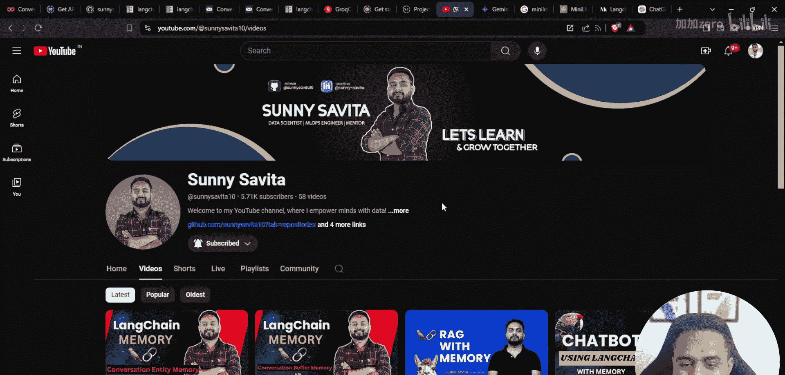
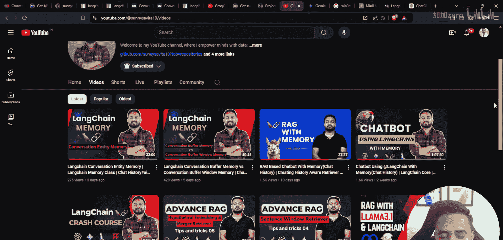
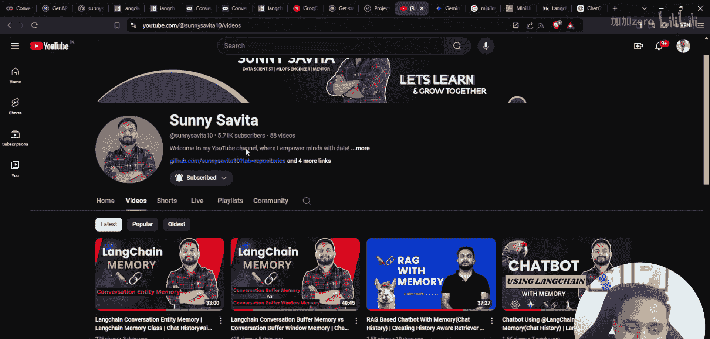
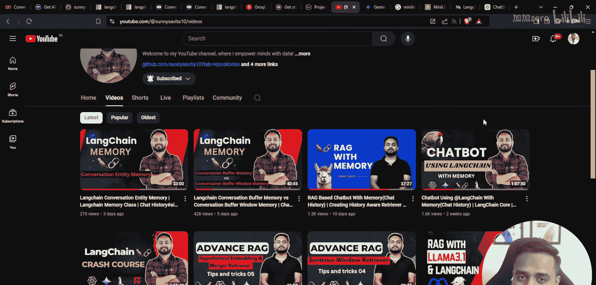
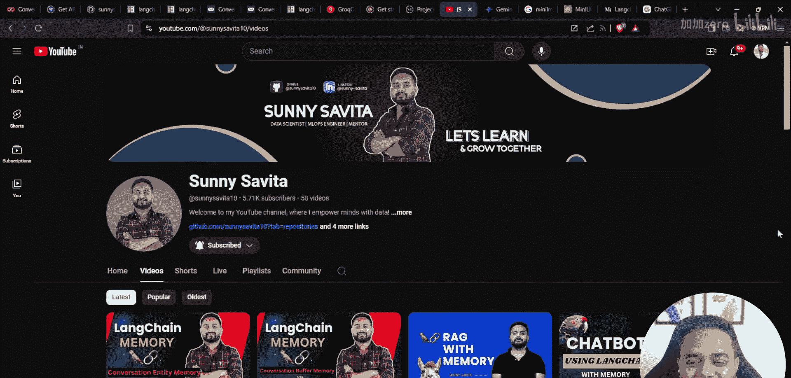
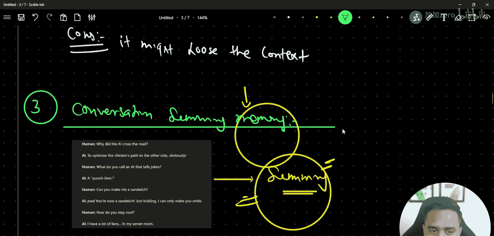
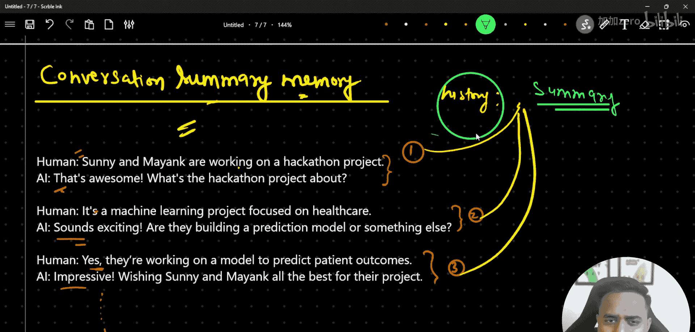
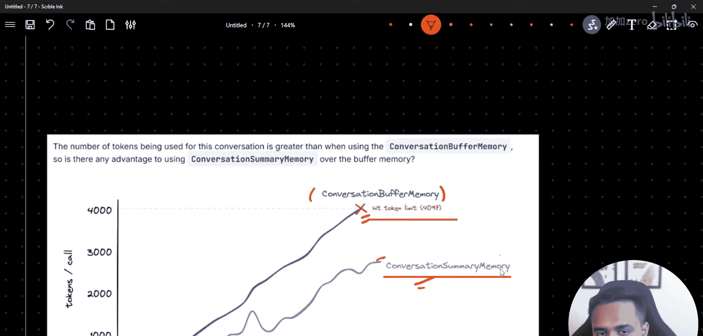
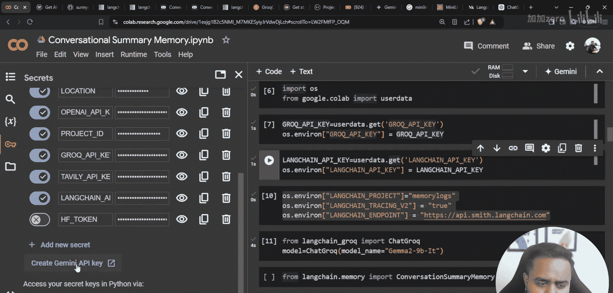

# Sunny Savita【中英⚡生成式AI：从初学者到专家｜Generative AI In-Depth Roadmap from Beginner to E】 p56 P56 Langchain Conversation Summary Memory vs Conversation Summary Buffer Memory [BV1Uht8zDENA_p56]

He hellello everyone。 welcomelcome to my YouTube YouTube channel。

 My name is Sunni Savita and I'm back with another exciting and important video。 So guys。

 I started with this memory concept and I already uploaded for video related to this memory how you can sustain the memory inside your LLM based application。

 So inside the first video I discuss if you are going to create the chat board right So how you can sustain the state of the conversation right。

 how you can sustain the memory of that conversation then I came to this rag rag with memory。

 So here I shown you how you can create the history a retrieveval。

 and then I discuss couple of old classes which belong to the language and documentation1 So here I discuss about this conversation before memory and conversation before window memory you can utilize these classes as well。

 if you are going to implement your solution anywhere。😊。

And then basically I discuss about this conversation entity memory。

 how you can sustain the conversation with respect to any sorry how you can sustain the memory with respect to any entity and now in today's video we want to discuss one more class okay not one actually two more classes the first one is conversation summary memory and the second is conversation summary buffer memory okay so let's begin let's start first of all。

 let me give you the idea that what it is and why we should use this particular classes instead of this conversation buffer memory and conversation buffer window memory and then I will show you the practical implementation now here guys if you haven't follow to me so far so please follow to this channel please subscribe the channel press to this bell icon and if you are liking the video if you are liking the content please hit the like button please support the channel because it motivate a lot to me and it motate to me to。

Put like a more and more content and guys， if you will go through with the channel you will find out there is no click bit nothing。

 it's a pure content which you will get inside any paid course and believe me guys if you are following this particular content so this interview right Gene I interviews nothing for you is my guarantee all of you okay so yeah let's start let's begin with the concept so first of all。

 let me give you the quick recap from the previous sessions so here guys I started with a memory chapter as I already told you we discuss this memory with chat board and memory with rag okay and here I use the classes here I use the latest classes from the L documentation L documentation version two okay but I told you that I discussed couple of old classes as well from the L documentation one so already I completed this three classes let me tell you which one。

So the first one， the second one and the fifth one Now this two classes。 Okay， which one tell me。

Conversation summary memory and conversation summary buffer memory theres two classes remaining。

 So here in today's video we're gonna discuss that。

 So let me tell you what is this conversation summary memory and then I will talk about conversation summary buffer memory so here this is the entire notes which I discuss in my previous classes So if you don't know about it please go through with those particular classes you will get the complete details about it。

 Now here I cap this conversation summary memory at the end of this notes。

 Yeah this one So what is the conversation summary memory。

 So here I took one example here I took one example of the conversation。

 So let's say this is my first conversation means my human is asking some human is like saying something and my AI is replying。

Okay， it's a kind of dummy conversation which I am doing with my LLM。 Now here again。

 human is saying something then AI is replying。 then again， human is saying something AI is reply。

 So this will go up to the a number of conversation So here I can write and number of conversation I think you are getting So right now how many conversation is there。

 So right now I have three conversation。 So first one and the second one and here the third one right So guys here see what we are going to do inside this conversation summary memory So here we are going to here we are going to sustain the memory。

 Okay in terms of the summary if you are not getting let me explain you it one more time then definitely you will get a clearcut idea。

 So let's say guys here I have one history variable Okay now inside the history variable what I'm going to keep see if I'm going to use the conversation before memory Okay so inside that conversation before memory I'm going to keep all the conversation as。

meanss the first one， the second one and the third one and a number of conversation Im going to keep it as it is。

 but if we are going to discuss or if we are going to use this conversation summary memory if we are going to use this particular class why Im saying class because Langch has provided everything in terms of the classes only guys if we are going to use this particular class conversation summary memory so here instead of keeping this conversation as it is okay what Im keeping tell me Im going to keep the summary Im going to keep the。

Tell me guys summary of this particular conversation。

I hope the idea is getting clear Now why we do it。 Okay， let me tell you one more time。

 So here inside the conversation buffer memory we are going to keep the conversation as it is right but inside the conversation summary memory we are going to keep the summary of this particular conversation Okay now guys why we are doing it what what what is a aim behind it So this aim you will get to know by seeing this particular graph。

 So here you can see this graph is between conversation buffer memory and conversation summary memory So let's say。

😊。

I'm interacting with my model I'm interacting with my like LLM model。

 So after number of instruction guys see let's say here how many instruction how many instruction。

 let's say like there are five interaction 10152025 like it's a never ending process right my user can my user can chat up to the n number of conversation Okay my user can interact with the model up to like n right and number of time it can that my user can interact with the model So this the never ending process now just just think over here if the conversation is going to be too long in that case just just think over here if the conversation is going to be too long my model will not be will not be able to handle that use text right my model will not be able to handle that use text So here what we are doing we are hitting the total limit getting my point So here this conversation before memory is going to be fill after。

Some sort of interaction but on the other hand， we have this conversation summary memory which we can regulate according to our requirement。

 Okay so here what we are doing。 We are just going to keep the summary of the interaction Okay we are just going to keep the summary of the interaction and how we are going to generate that particular summary tell me we are going to generate the summary using the Lm only so if we have an involvement of the L so definitely we can regulate okay we can regulate that particular summary means we can say okay we just have to generate up to this much of token getting my point so here this summary basically it is not hitting to that upper to limit because it is not a fullfl conversation it is just a summary of my conversation I hope this idea is skill to all of you if not you can replay the video and again you can understand it so let's look into the practical let's see how we can implement this particular concept。

y first we have to install a couple of library So inside this particular implementation。

 I kept like a different different thing right so I'll let to tell you what I thing basically I cap and how you can make it interesting means how you can like make this infencing faster and how you can capture the log while you are implementing this conversation summary memory first as usual like this la and the second is a la community okay then after I cap this la rock So I'm going to read my model Okay for faster inferencing I seen instead of old instead of keeping the model inside the local right so what you can do if you are going to implement any sort of as any sort of a solution right so just just for testing the model you can read the model from the rock itself then we have this。

Like Lang API key as well。 So here Lang API key then here is the Lang project name Lang tracing V2 right means version 2 is is going to true。

 Okay I'm going to set this also as environment variable and here is Lang endpoint So why I'm going to configure this thing So if you don't have any idea about it what you can do you can go and check with my previous video right which video So here you can go and check with this chatboard using Lang Okay using this inside this sorry not this one Lang crash course So here inside this particular video you will get to know like how to use the Lang issmith。

 Okay so this entire con， which I'm going to make I'm going to make it for the Lang ism only So that。

So that basically I can capture the log okay log of my implementation got it so this one guy this is not required Google API key I am going to delete it I am not going to read the Google gymni model if you want to read it you can easily read it here this collab also is giving the option for creating a gmni API once you will click over here。

