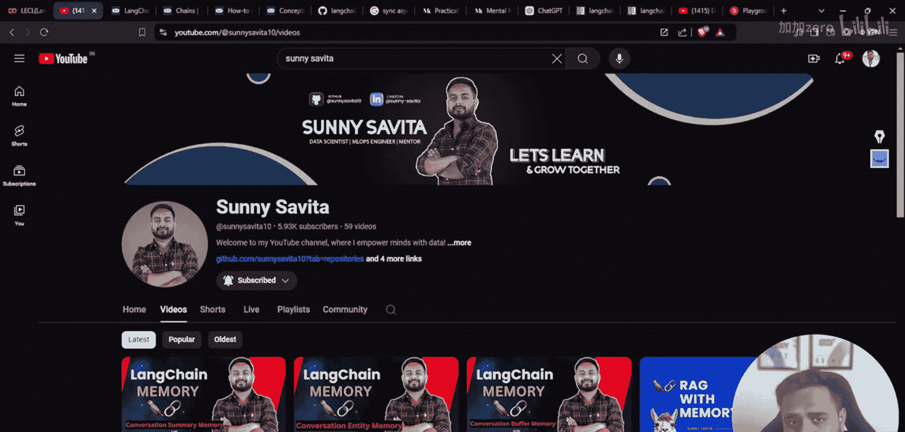
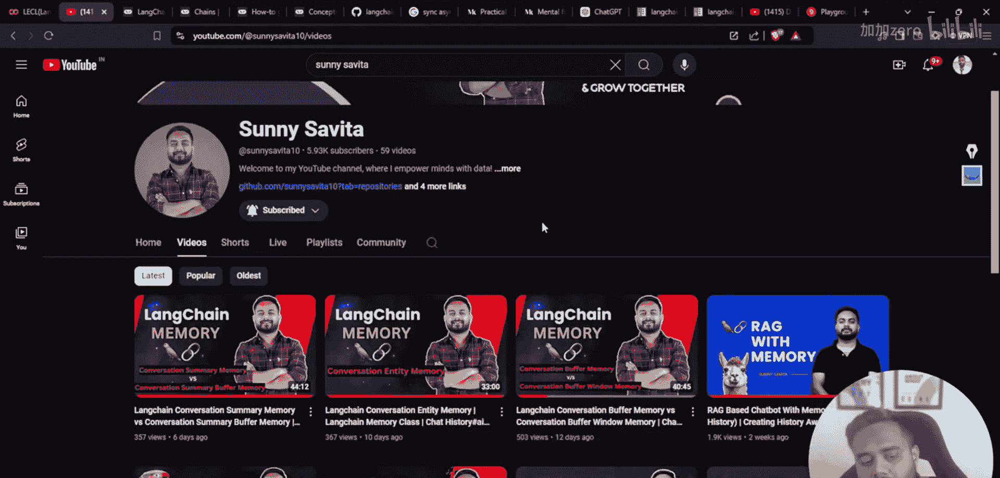
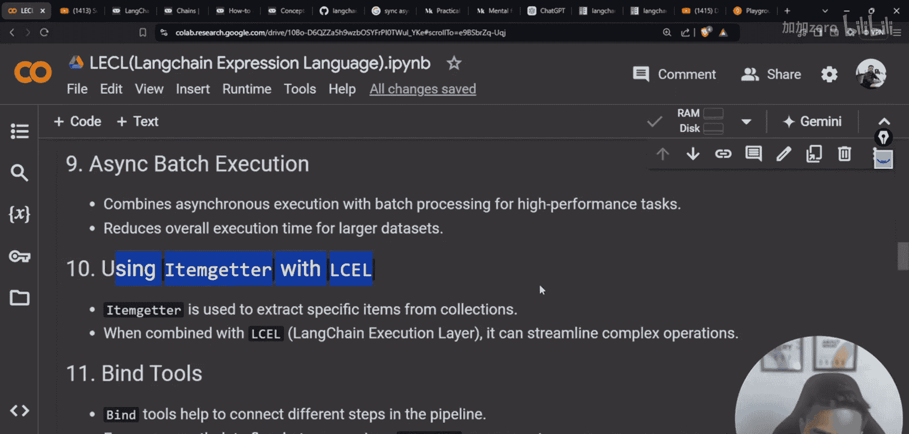
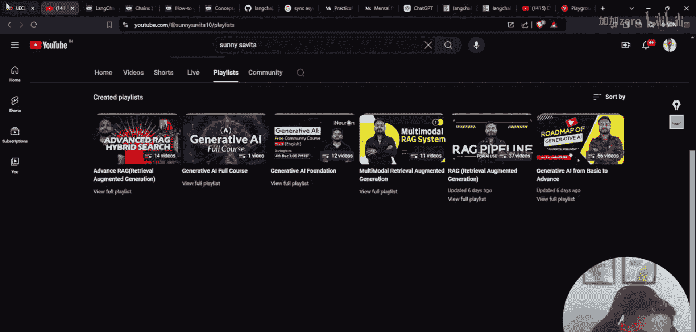
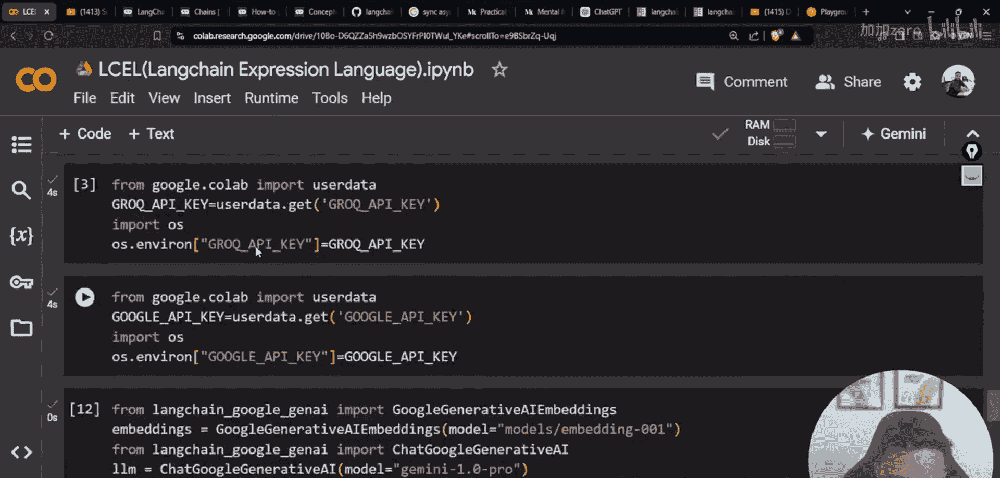
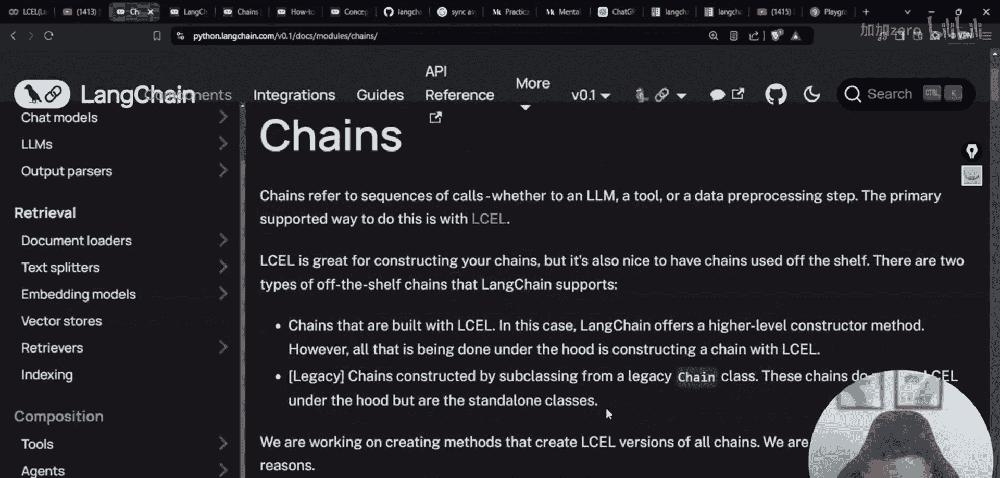
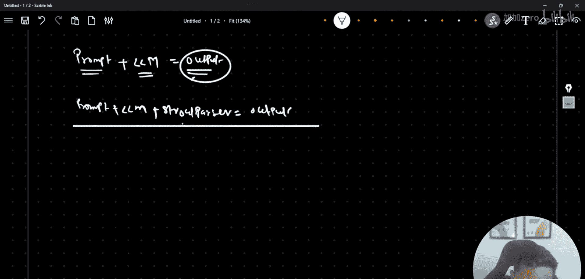
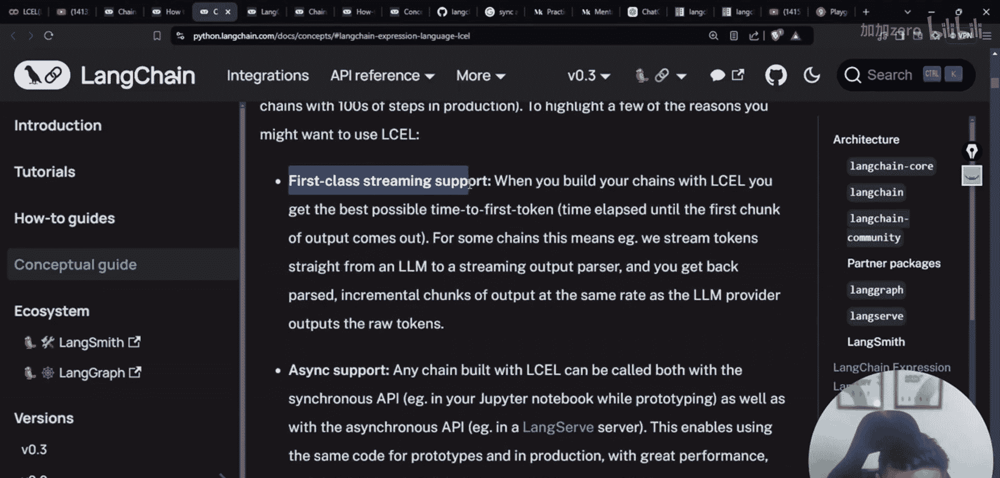
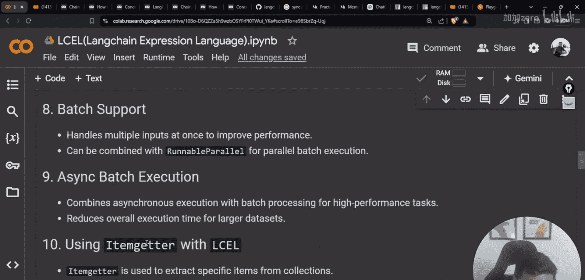

# Sunny Savita【中英⚡生成式AI：从初学者到专家｜Generative AI In-Depth Roadmap from Beginner to E】 p57 P57 LangChain Expression language(LCEL) for Chaining the Components ｜ All Runnab [BV1Uht8zDENA_p57]

He hi everyone welcomelcome to my do channel。 My name is Sunri Savita and I'm back with another exciting and important video So guys in this particular video were gonna to discuss about the LCL So what is the LCL So the full form of the LCLs LCL is L as special language okay now why we use LCL whats like concept what's the agenda behind this LCL each and everything we are going to discuss in this particular video So first of all guys I'll let me show you my YouTube channel here see if you will look into my YouTube channel just go inside this video section So you'll find out the recent video around around to this memory how you can sustain the memory inside your application。

If you are going to create an LM based application like rag or if you are going to create a chatbo right rag based chatbo or like simple chatbo right if you want to deal with a different different memory classes。

 everything I covered over here now one more concept guys that is LL and after that I will start with the la graph now why Im covering this particular concept like LC this memory or the other concept like this L and agent tools and all everything so that I can easily explain you the la graph because this la graph actually it is directly associated with this basic concept of the L because L graph has been created on top of the L itself So yeah let's begin let's start first of all let me give you the the introduction that what thing we are going to discuss in this particular video So first of all we'll understand how we have transition from the older classes to the new pipe operator that we understand about the enables different。

Runniables， we have like runable pel。Reable pass through Reable lambda okay and we'll understand about the assign function What is this then we'll look into the performance improvement using this async library async method how we can use it how we can improve the performance of our influencing then we'll look into the item getter item getter with LCL will look into the rag as well I will show you how you can use this LCL while you are creating a rag pipeline many times okay plenty of times I have I've shown you this particular concept in my previous video in my rag playlist so just just go and check with the rag playlist there is a complete playlist front of the rag itself here see but yeah don't worry I will let you know when code snippet that idea will be more clear will' look into the bind tools bind tools basically I will explain you this particular part in the next video I will just give you the glimpse of it because it is more related to the la graph only then we'll discuss about the streaming。

Support how this like how this LL okay， how this chaining actually it is supporting to the streaming streaming of the output So these many concepts we are going to discuss with respect to the L C EL okay L EL nor laon expression language it is L CL。

lC嗯 ok。Great， so first of all let me clarify a couple of theoretical points are not going into very depth Okay depth of the theoretical point general I'm just giving you the overview I will more focus on the practical part so that whenever you are going to like use it okay inside your inside your application you won't feel like a much difficulty over here right so yeah let's begin it so first of all see you guys if you will open open the length documentation right so inside the la documentation you have to navigate to the things so just a second。

There it is。都我 the多食。Yes， so let me make a duplicate of it first。You cant duplicate。

 duplicate do one thing， click on this component。And here inside the component， right。

 you'll find out the chain。 Okay， this one。Now this is the first version of the length shade so let me open it once I will open and I see here what I am getting I am getting the complete detail about the chain so what is the meaning of chain tell me let me explain the meaning of the chain first and then I will come to this particular like of implementation in all so I see let's say we have LLM。

O。LLM So using this LLM what we can do we can create a whole sort of application。

 Okay around to this one。 But guys， just tell me this this L right this large language model alone it is enough no right we have to give the pro to this one right we have to give the pro we have to like connect with our pipeline if required them or what I have to do let's say like on top of it basically what I can do I can create agent means basically I can give some capability to my L so it can think it can connect with the tools and all right many more things we can do like tools we can use we can append the memory as well So many more things is possible with respect to this L。

 and then finally I'll be getting my output So here what I'm getting I am getting my output just tell me guys see this is what this is a component Okay this is the component around to this particular L Now I can give you very basic example。

 Let's say I want to add around two component So the first component。

I the prompt okay prompt and the second component is what LLm so what I want I want okay first I will pass my prompt and then it will directly go to the LLM and finally I will be getting my output。

Right likewise， I can connect as many as component I will show you the depth of the I will show you the depth of this LCL right in LCL in how much depth actually you can create。

How much depth actually you can create the chains。So what I'll be getting I'll be getting the output over here and this is what is my final answer。

 All let's say here is my prompt right Im passing my prompt I am passing my LLM I am passing my STR parel Okay SR output parcel output parel。

And then what I'm getting， I'm getting my final output。 So yes， this is also possible。

 Likewise Also I can do it。 Okay， we can come connect like as many as component over here。

 So this is called a chaining guys right this is called chaining and for this chain this was providing the different different classes So here if you will scroll down So they have given you one heading legacy chains So these all are the legacy chain like API chains API open end point chains Con that we chain it's a quite famous chain right maybe you have used it right are different different applications applications and all and let me scroll down So you will find out document chain。

 we have we are using this as well let me show you one more chain which is a quite famous LM chain。

 So these are what these other。

Like a old one right old ch legacy legacy means what the history Okay， so now guys。

 there is one more way of connecting this component。Not only the chains。 Okay。

 we can do it using the LCL。 So LCL basically provide the declarative way。

 declarative way means what you can use the operator using the operator actually you can connect the many components。

 Okay and it is having a different different runable also what is the run what is this what the concept the runable I will let you know that So here see chains is what they are clearly telling you chains refer to the sequence of call whether to an LLm tool or a data processing is step right the primary support supported way to do this is L now basically the primary supported way is nothing LC we forget about this we forget about this legacy chain and all So recently I have introduced couple of classes if you will look into a previous tutorial they are actually I have discussed about the history of a retrieve and in between I was using the create stuff document chain like these kind of chains and also guys。

 these all the chains。 this latest chain actually it is inspired from the L only means。

like the development developer has created this particular classes。

 okay directly you are using but in backend the concept the which concept is being used they are using the LCL concept la and expression language on the so what is the syntax of the lengthin expression language。

 how to do it， how to write it。Everything we are going to discuss over here about it guys I hope it is clear right so just look over here。

 you can read about this as well chains basically how to chains that are built with LCL in this case electron offers a high level construction method however all this being done under the hood constructing a chain with LCL means they are saying LCL basically it's a way of defining a chain whatever functional is there they are defining it in a backend Okay you are just need to use the high level abstract okay operator syntax only no need to go inside the in depth functionality right。

Then they are talking about the legacy chain as well。 So legacy chain was nothing。

 It was just a simple classes。 Okay as we know now let me do one thing。

 let me go with this latest version of this link Okay and let me show you what they have defined with respect to this LC So here they are talking about this LC and here it is a complete detail of it okay so you can find it out now inside the LC what is the designed to streamline the process of building useful apps with element combining related component and all complete detail So let me show you some points with respect to this LC。

 the important point which is very much important So once we will go through with it once you will click on it this LC So here they are giving you the different different point first it support to this streaming what is the streaming I will let you know I kept this particular point inside my notebook。

