# Sunny Savita【中英⚡生成式AI：从初学者到专家｜Generative AI In-Depth Roadmap from Beginner to E】 p58 P58 LangGraph 01： Syllabus Introduction of End to End LangGraph Course ｜ LangCha [BV1Uht8zDENA_p58]

He hi everyone， welcomel to my YouTube channel。 My name is Sunni Savita and I'm back with another exciting video。

 So guys I'm going to introduce one end to end course on top of the Langla Yes so first of all let me show you the complete curriculum of this course because it was the very demanding topic from all of you and I was getting lots of requests after uploading the Langchhen video so first of all let me show you my YouTube channel let me show you that wall video I have uploaded so far So guys once you will go and check with my channel so here you will find out the video related to the Lang not Lang basically I have so many things if you will go with playlist itself So inside the playlist Ive created two playlist on top of the rag one with respect to the basic one regarding the advanced rag apart from this one you will find out many more video on top of the rag。

😊。

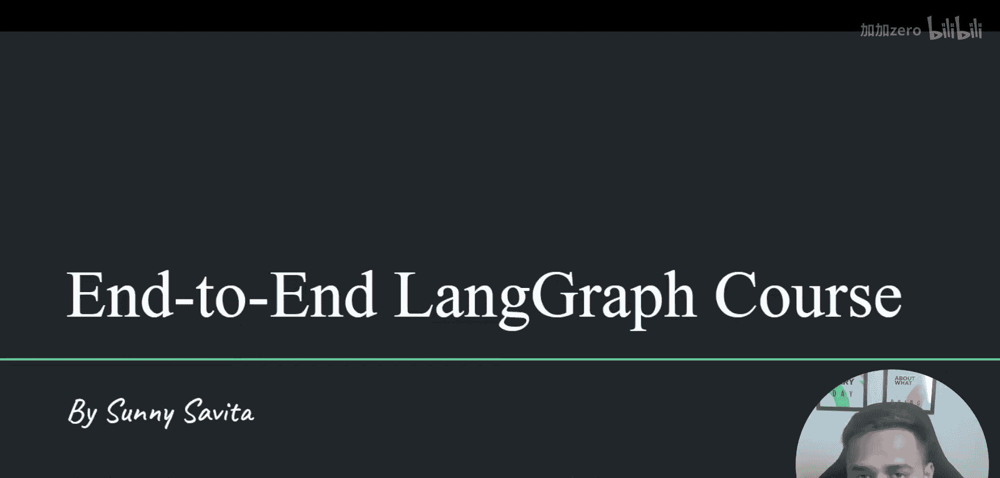

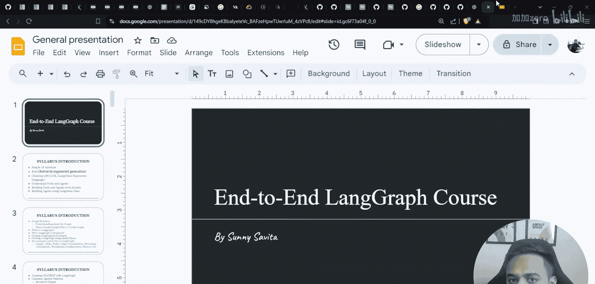

every framework I try to cover and recently guys， I uploaded a video with respect to the memory that how you can sustain the memory when you are going to create assistant。

 Yes now apart from this one guys you will find out a video on top of the L you will find out the video on of the LCL that is Lin exhibition language and many more so please visit the channel and youll find out very amazing video and content which will help you to learn and understand this gene stuff So guys here I am back with another exciting course as I told you So first of all。

 let me introduce a complete syllabus of this particular course that what all thing Im going to discuss within like next 10 to 15 video Yes10 to 15 video right so first guys Ill be starting with a simple assistant what is a simple assistant then I will let you know the chain with LCL then we'll try to understand about the two。

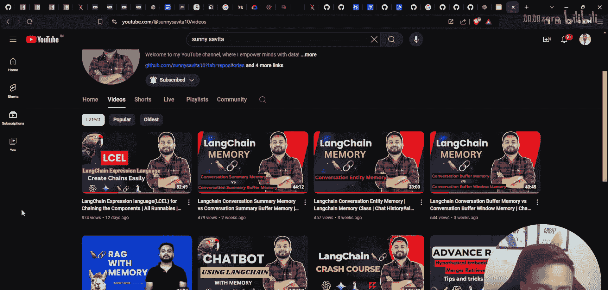

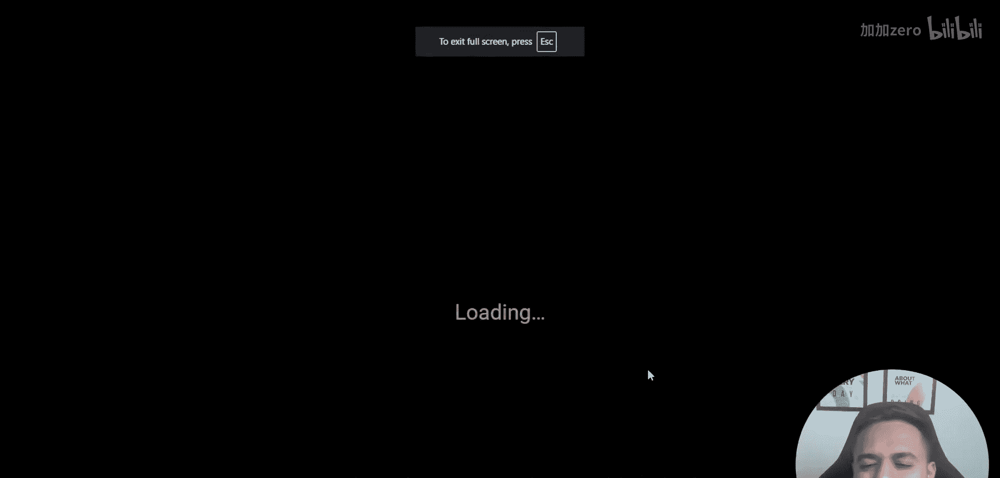

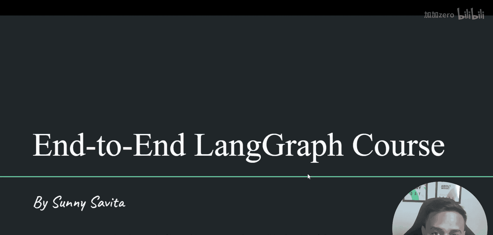

an agent and then will come back to the tools and agent and will try to build it using Python so I will try to create agents and tool from scratch using the Pythonscript。

 then I'll be using the lain classes and guys this thing actually it is very much important if you want to understand the concept of the La graph Yes so why this is important if you don't know about the like LC right if you don't know about the training you won't be able to understand about the La graph like why they have introduced the La graph if you are not familiar with the agent right what type of agents we have what type of tools we have okay now how they have coded the agent what is a react agent selfask and the different different agent pattern if you are not aware about those thing you won't be able to understand the La graph So guys before starting with a La graph we should have good command on top of these。

pic and mainly I would say mainly this agent topic so I will try to cover this thing in a very very detailed way so you will get to know about so you will get to know each and everything about these particular thing and definitely it will help you to understand the la graph concept now guys once I will like cover of this like basic stuff right then I will come to the la graph so here inside the la graph guys first I will discuss about the graph while there is a graph structure what is the requirement of the graph structure what is a cyclic graph a cyclic graph and whenever we are creating a graph using this la graph so which kind of graph we are creating whether it's a cyclic or a cyclic right then I will let you know about the la graph like with more theoretical point I create a complete slide for all of you then I will come to the practical implementation will create a la graph using python from a scratch right I'm going to write a Python script。

😊，And then I will use the inbu classes as well。Different different in classes from the La graph itself will try to understand the me more termology。

 okay， which was introduced by the La graph like graph E state node ages visualization streaming checkpoint。

 ratepoint， confiation memory etc graph。 Now， guys。

 once we are done with this basic step of the La graph。 I will come to the advanced part of it。

 So let me tell you the advanced part of this leg graph。

 So here using the La graph will try to create our own custom chatboard。 Okay。

 then we'll come to the agent pattern， common agent pattern like structure output， human loop。

 react and all right whatever agent pattern is there will try to understand those in a very detailed manner and we try to code as well。

 So that wherever you are going to implement inside your project So you won't face any sort of a difficulty and that thing for sure。

 I will keep in my mind Now， guys， I will come to this multi agent system。

 It is very much important will try to discuss each and everything with respect to this。

Multi agent system。 then we'll try to create a different different kind of rag。 Okay。

 different different kind of rag means what like C rag means what corrective rag than a agent rag self rag right。

 and all the rag Basically we are going to create using the la graph。

 then we create some real world project as well。 Okay。

 so this is a complete introduction of the ss guys， I hope it is clear。

 and I hope you are pretty much excited to cover this particular ss。

 and soon you will find out the other different different videos。 So guys from couple of days。

 actually， I couldn't upload the video。 See if you will go and check with my last video。

 I uploaded 11 days back。 well it is back。 So don't worry I will try to keep myself little more consistent on my channel and definitely。

 I will try to upload a video。 Now here guys， you will find out that I already created a refined slide for all of you see。

 What is system。 What is a rag right diagram chaining。😊。

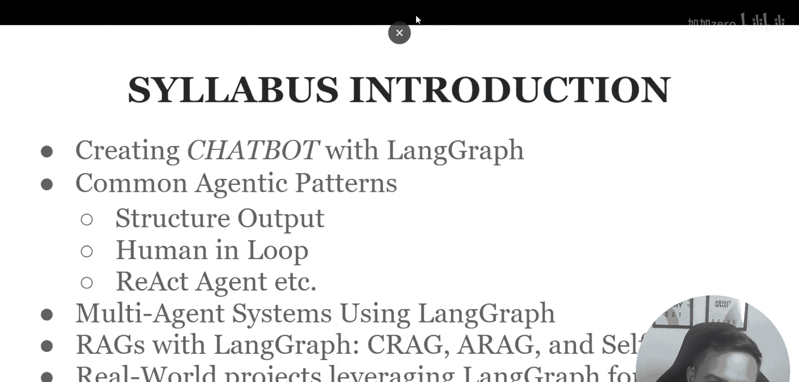

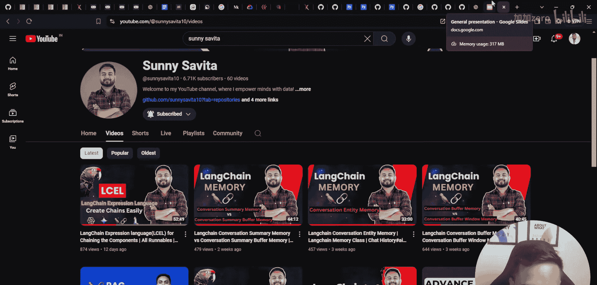

Then here you can see agent then you'll find out the tools right means the different effect like a graph and images of the agents so that you can understand every kind of agents then tools is there Okay。

 then here you can see the difference between the ra agents and the simple assistant and from here guys see the type of the agent。

 what type of agents we have then benefit of the agent。And then basically after this one。

 the la graph will start every kind of slide I have created for you。 and this is。

 this is only for you guys。 So soon we'll try to discuss each and every part of it and I hope you are also excited。

 Now， first of all， what I will do what I will suggest you。

 please try to make a setup up along with me Okay， before coming to the next like before coming into the next before watching to the next video So that you will be up and ready for implementing the project。

 So what do you have to do guys let me tell you that first of all， you need to open your CMD。

 now after opening your CMD here， you need to create a directory now directory is going to be。

 let's say here I'm writing la graph Okay lang G R P la graph and。😊。

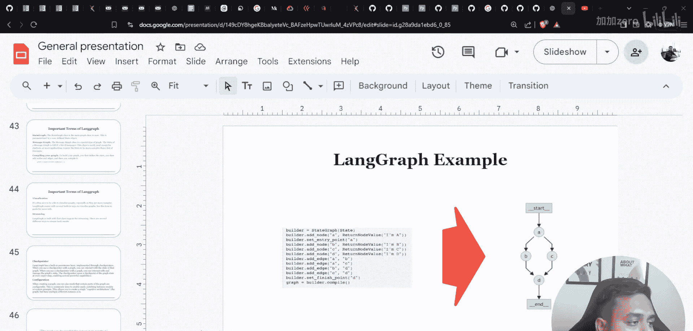

杜。And。Then after this one guys， what you have to do C， so La graph enter end。

 then change into the director three。Okay， la get off。

And to and then guys launch a V VS code from here itself。

 So please make sure that you should have Vs code If you don't have guys。

 you can check with my you can check with my like project set of video I already discuss those stuff those thing。

 So once you will go with and check with my YouTube channel。

 So here you will find out that video let me show you that this particular video。

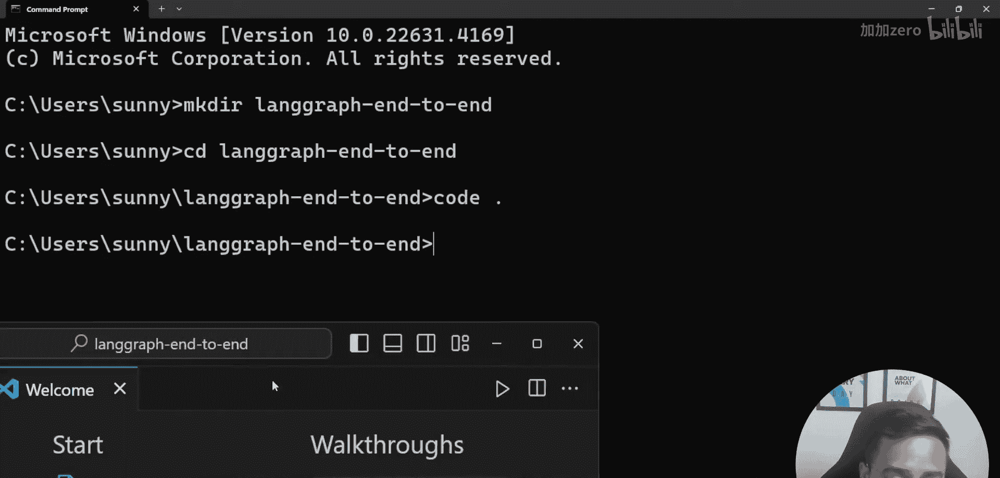

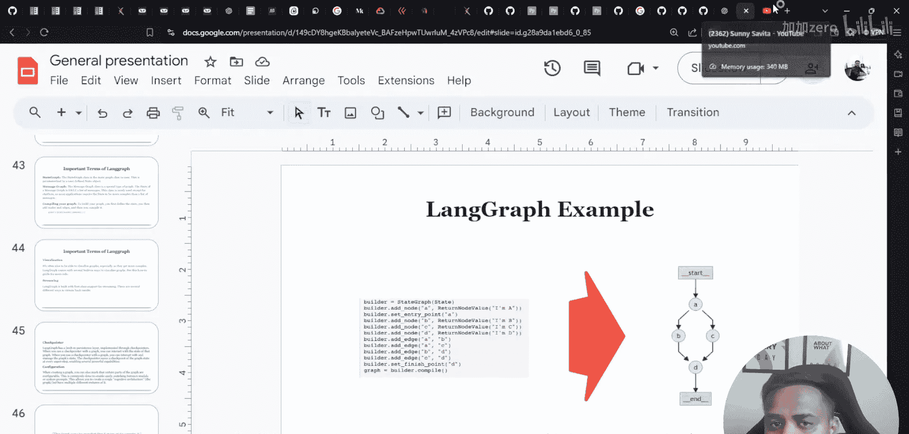

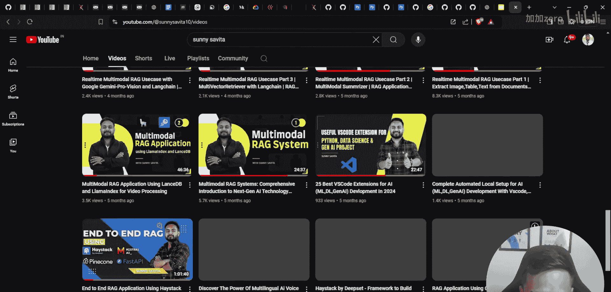

Have to do the complete automated setup inside the VS code。 Now after opening a Vs code。

 what you have to do， you have to create an environment。 Okay。

 now let me create an environment for all of you。 Here is the environment。

 please open your terminal after opening a terminal。

 you can open your CMD either you can open your cD or get bash so you can create a virtual environment using Python or conda。

 anything is fine I'm using Conda because I have conda in my system if you don't have it if you cannot use it So don't worry you can create up like virtual environment using the Python itself。

 So I'm selecting a Python interpreter。 So here I'm selecting the base interpret as as of now。

 So from the base interpreter itself， I will be creating my environment。

 So source activate activate base Now guys here what I can do， I can clear it。Okay。

 so now I can write Con create， So here Con create。C， R E A T conduct create V， E and V。Conduct。

 create a V， E， N， B。Then byython。Is equal to 3。10 Okay Conda create hyp P hyphen P means what the present directly Okay so Python 3。

10 use Python 3。10 now inside this present directly。

 the environment will be created so see you guys here my environment is created now once I will press yes so I got my environment now I can download everything inside my environment itself okay every sort of a thing so whatever library and all is required so first of all I will create my requirement or Tx requirement Rq RM and Ts do Txt okay now I will keep my all the library inside my requirement or Tx3 so that those thing I will let you in my next session and then guys we required the different different kind of notebook right so I will let you know like what all notebook is there what all notebook is required and basically how to write a code from the scratch and all everything we are going to discuss here inside。

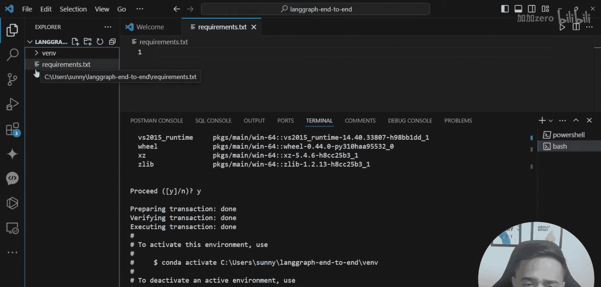