# Sunny Savita【中英⚡生成式AI：从初学者到专家｜Generative AI In-Depth Roadmap from Beginner to E】 p59 P59 LangGraph：02 LangGraph Course Pre-requist ｜ AI Assistant ｜ RAG I LCEL ｜ Tool [BV1Uht8zDENA_p59]

He hi everyone。 welcomelcome to my Ro channel。 My name is Sunni Savita。

 and I'm back with another exciting and important video。 So guys。

 I started this end to end a Lagra course。 and I already upload the video related to that course curriculum If you haven't check out please go and check with my group channel。

 you'll find out that video inside the video section。 Now in today's video。

 we're gonna discuss about all the prerequisite for this la graph。

 So in this video well try to discuss about the AI assistant rack LC and willll try to take a little glimpse of this tools and agent as well。

 So guys tool an agent basically I will create a separate means after this one。

 I will upload like a separate 3 to4 video because that is very much important。😊。

Because this entire la graph okay its a replacement of of the old classes right so inside the la we have different different classes for creating that agent so this land graph actually a replacement of it so well have to understand the tools and agent in a very detailed manner so I I have created like a four to five extra video for tools and agent and that I will be uploading after this particular video only now first of all let me give you a quick recap of the slas so here is a ss guys in today's video we're gonna discuss this four point now from next video onwards you will find out entire thing right relative to this agent only then I will come to this La graph so basics of the La graph okay and then we discuss the advanced concept of the La graph like chatbot agent take patterns okay multiagent and different different kind of right cell rack which we can。

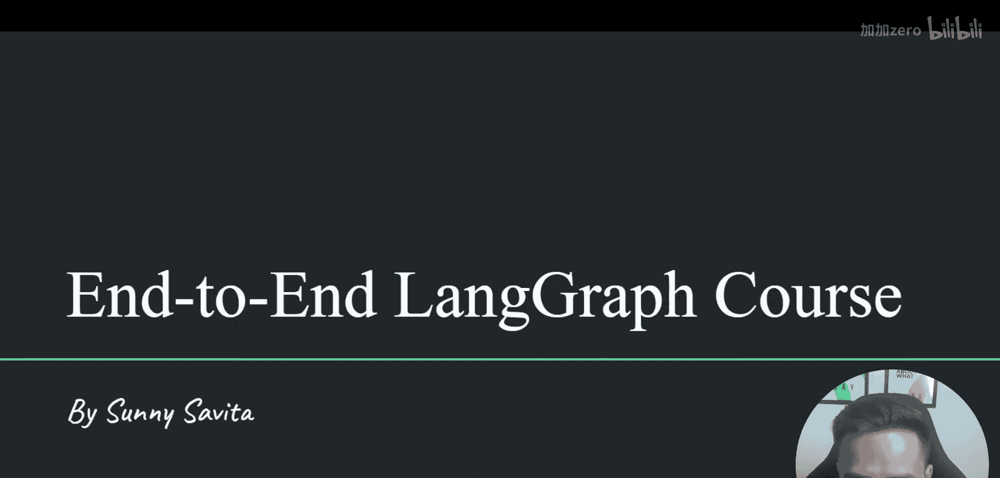

Create using the like agenttic pattern itself and then we'll see the project now。

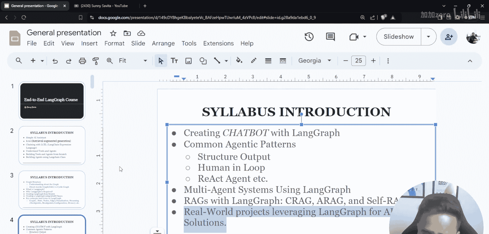

Apart from this one I see here is my Lagra course introduction video and not only the course introduction before that there are so many things so many video like this LCL memory rack chatbo。

 everything you will find out on my group channel， whatever is required just to correct the interview so。

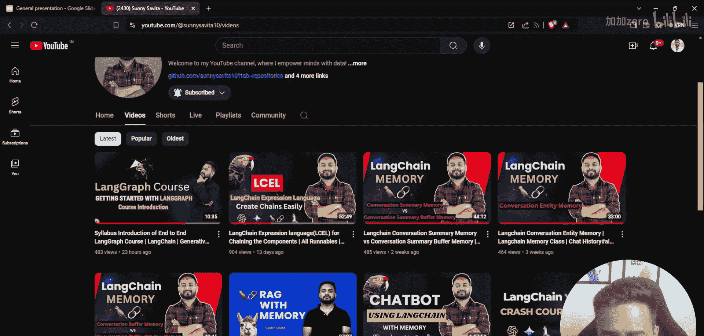

Like please go and check if you haven't checked so far and if you like in the content then please subscribe the channel now so first of all。

 what I can do here let me do the entire setup and one more thing I would like to tell to everyone here I created a slide okay so created a slide with respect to each and everything and I will give you the walkthrough of it at the end of this like video so if you want to like revise the theoretical stuff you can directly revise it from the slide only now first of all we have to do the entire setup for our project sorry for our implementation and here guys see here I created our environment so which I already shown you in my previous video here is a requirement of PxC file。

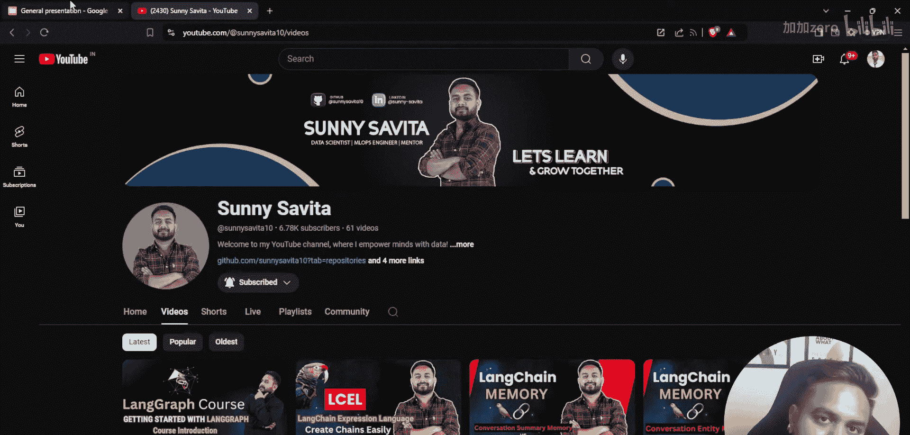

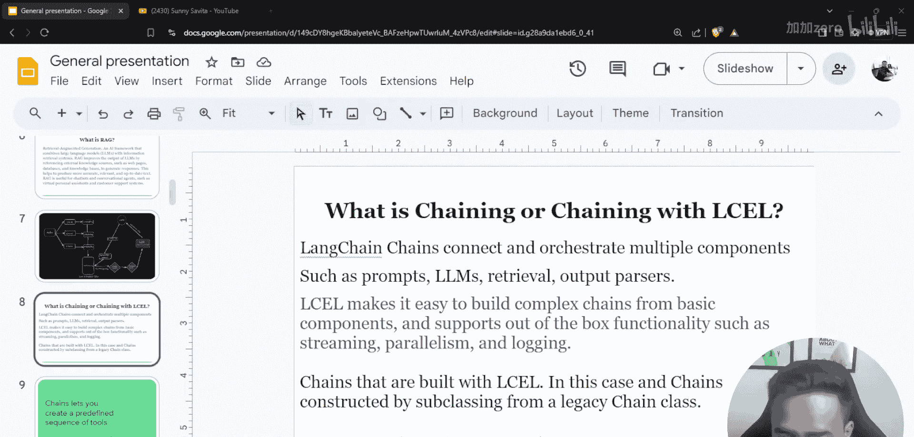

Okay， this one。 And here is my like file。 Okay IP andV file where actually I'm going to code each and everything。

 So let me check whether it is running or not。 yes。

 it is running because I already installed the kernel and all everything。

 So what do you have to do first of all guys you need to open your terminal。

 So here is the terminal you need to like select the current like current virtual environment So this is the current virtual environment just click on it Now what you can do you can now what you can do you can activate it So right over here source activate just a second let me show you that So right over here So。

Activate dot slash V E and V Now here is the environment and I already like installed all the library prerequisite library so let me show you how you can check the list of the libraries So once you will like paper place we will get it Now guys just look into the required Pxc here I kept all the required library Okay。

 whatever is there for this particular project Okay， these are the libraries。

Like Langon community Tiktoane Langon hub chromat okay Langon is there the land graph tabli Python and so and so forth you can read the name as like will come to the different different libraries I will introduce all these libraries Okay so after this one what I can do so now let we do one more thing。

Here guys let me initial slice the kit so that I can provide you this entire code you will get this entire code from the github only okay so directly from the Github you can take it I will mention the link inside the description got it great so I initial slice the gi and let me create one file over here the file name is going to be get ignored so dot get ignored。

So here， if I don't want to push anything something。

 I can keep it inside this getting note like this V and V， I don't want to push this V and V。

 so that's why I'm keeping it over here。 I hope this is clear now coming to the implementation part。

 but before like starting with the implementation I would like to explain some theoretical stuff and then basically Ill be coming to the coding part。

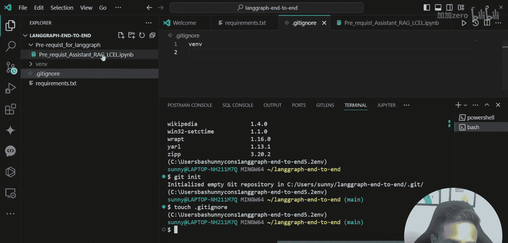

first guys let us try to understand the differences between this simple assistant rag based assistant and this agent okay now inside this simple assistant here you can see what we have we have a LLM right。

We are passing any sort of input to my LLM。Any kind of input to my NLM right prompt And based on that we are generating a answer。

 This is my simple assistant。 And here I see like you can say simple assistant you can say simple bot or anything now on top of it。

 let's say I am creating a Ui Okay so let's say I' am creating a Ui on top of it or let's say what I'm doing I am going do at the memory also right So it will become it will become my simple assistant it will become my simple bot right UI will be there or memory will be there or the different different way of giving the input like images or text So this is my simple assistant That's it。

 Now inside the rack what happens you know。Inside the rag actually we are going to connect our LLM with a knowledge base right so here instead of passing this simple prompt。

 we are fetching the information from the knowledge base and both information we are passing to the LLm and then we are generating a answer So guys rag base in chatbot so rag based chatbot it is very much important it is very much important for what for the like domain specific information if you want to deal with a domain specific information if my LLM is not able to answer anything right So in that case what you can do you can connect create a rag pipeline and then you can work with your LLms。

 Now the third type of assistant is called the agent based assistant agent So agent based assistant is also assistant it's an advanced assistant right there are like couple of more things which is going on which we need to understand so just look into the diagram and here you can see inside this also we have a prompt which we are passing to the LLm and we are generating a answer but guys after generating the answer here is。

Couple of more thing Okay so here what we do， we observe this particular answer。

 whatever answer we are going to generate and this observation So here you can see like inside the diagram。

 the observation is nothing it's a reasoning only So we do the reasoning we do the observation and based on that what we do we take action okay so means let's say this answer is not correct or maybe this Lm is not able to generate answer in that case what we do we take a action we connect our like we call any thirdpart tool okay we call any third party tool and based on that actually what we do we generate answer if we are not able to getting if you are not able to get this particular diagram don't worry I cap a couple of more diagram So with that the idea will be more all of you now see。

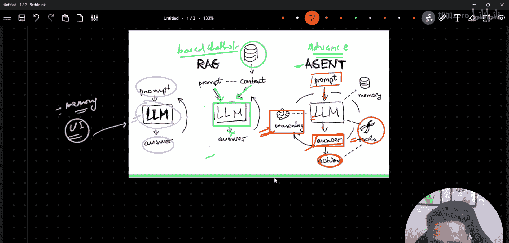

This diagram just look into this diagram So this is the three commonest inside the agents。

 so inside the agent what we do so first we think okay think about the quot。

 let's say whatever prompt we are passing to my LLM we think about that。And based on that what we do。

 So first we think we take an action。 Okay again we do the observation and again we think about it。

 getting my point So we are passing any sort of a prong to Lm。

 we think about it and we take action based on that action it could be anything like how we have to generate answer like via tool or maybe basically Lm only and then again we do the observation if it is not good。

 then again we think about it if it is good then we give the final output final output So this is the entire process of the like agent or if you're not able to getting with this diagram like one more diagram for all of you I try to I will try to explain you with each and every possible way So here I kept one more diagram it's the original screenshot of generating the output from the agent end Now see guys whenever we are passing the example whatever question is there So it is thinking about it I hope it is visible Now based on that actually。

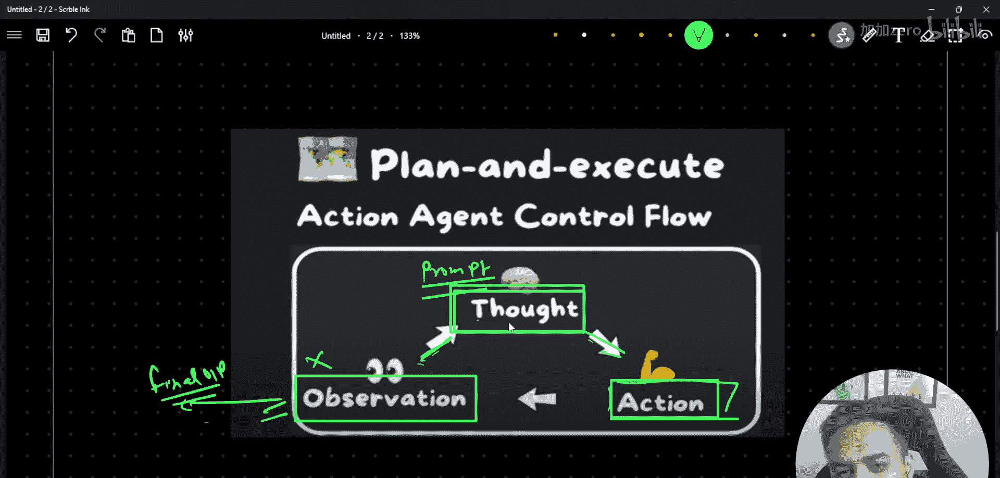

taakking a action okay how we have to answer for this particular question based on this thoughts then again it is doing a observation whether it is correct or not then again it is thinking so it is a kind of loop basically which is going on okay it is a kind of loop basically which is going on and once it is going to be satisfied once we are getting a final answer okay inside this loop then finally we are giving the answer so if we are talking about the agent so agent is also an advanced assistant but it is working inside this loop okay。

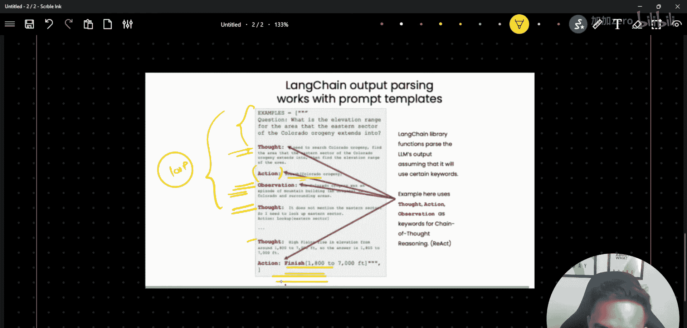

This thought action and observation So this entire thing I kept inside the I kept inside the like inside the presentation also so see all the diagrams you can go through with it see this is the basic diagram then again this is the like diagram which I created。

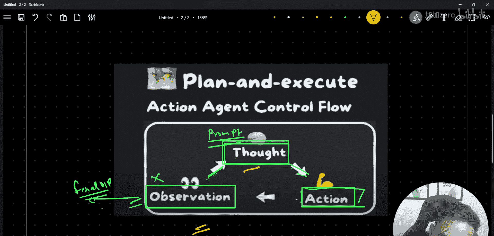

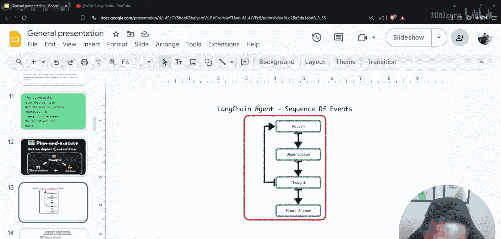