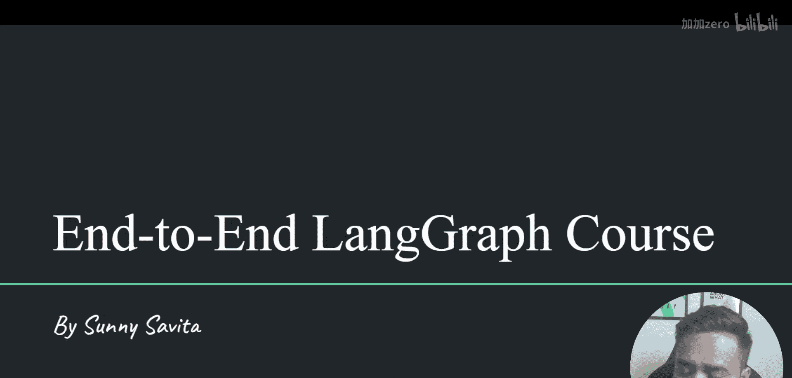
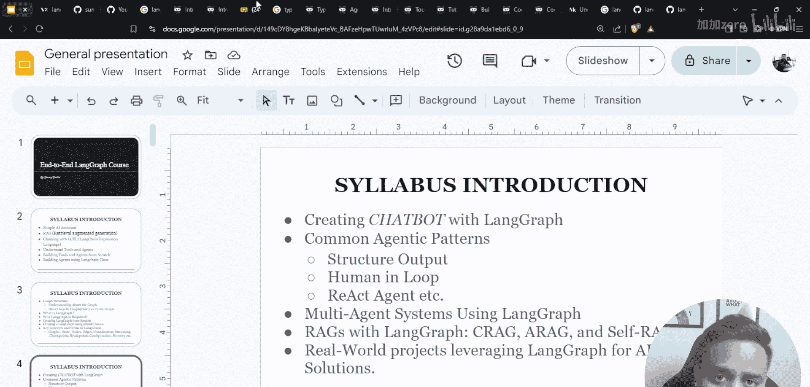
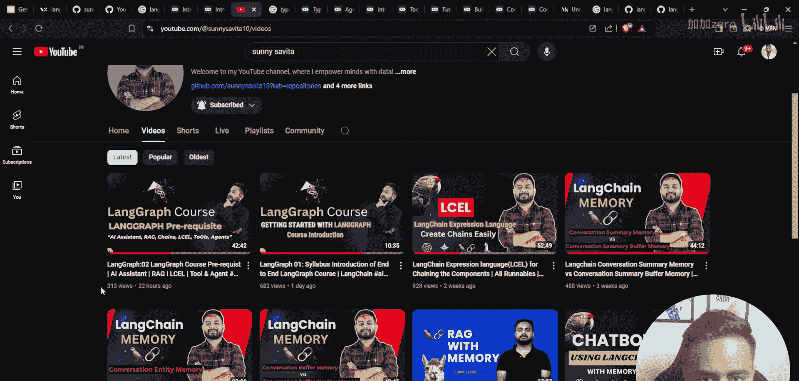
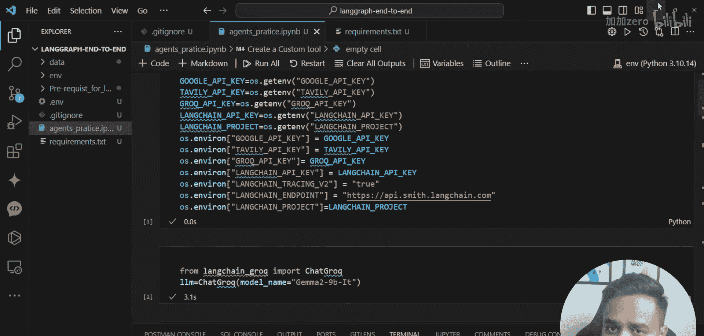
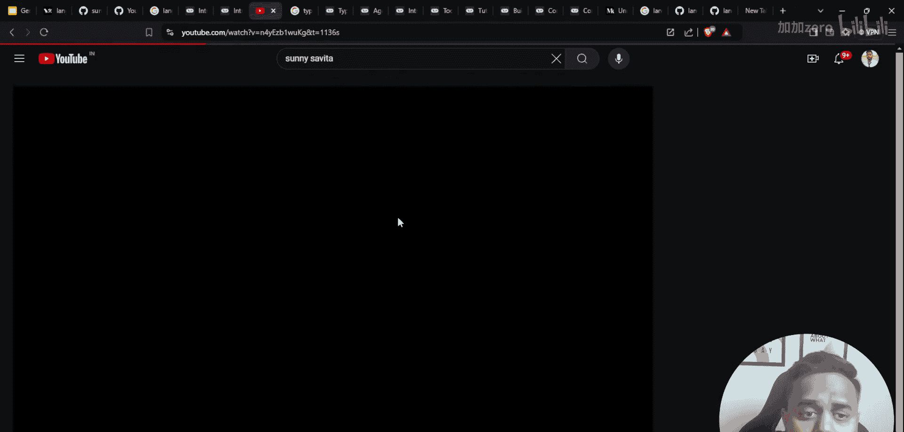
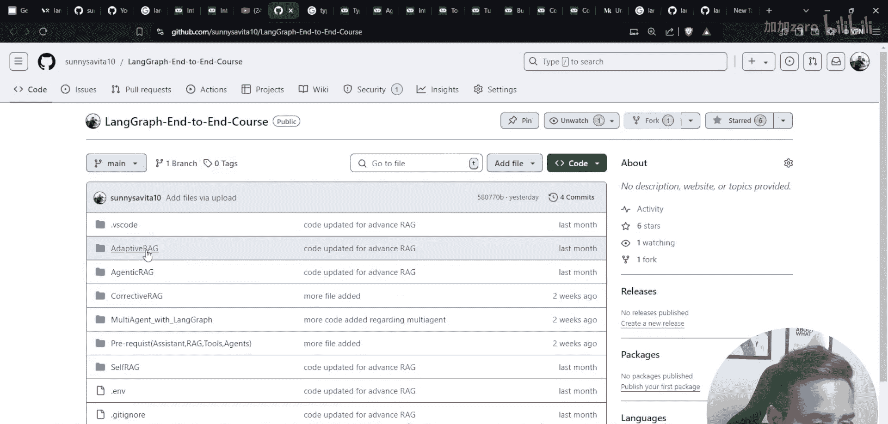
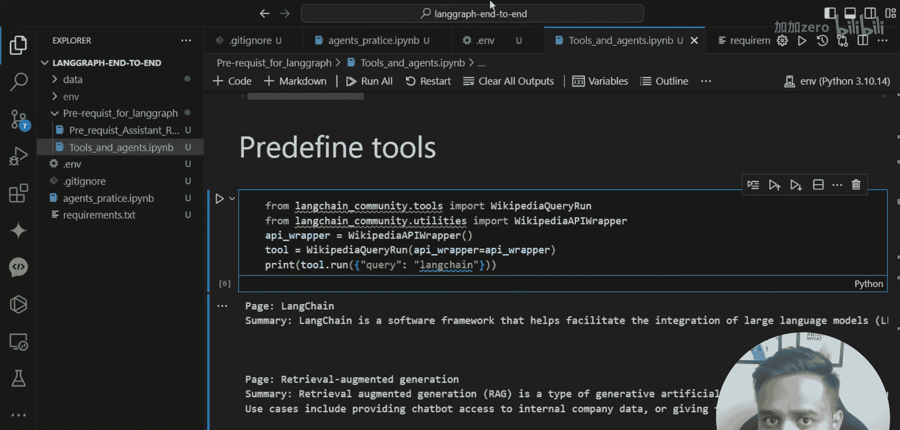

# Sunny Savita【中英⚡生成式AI：从初学者到专家｜Generative AI In-Depth Roadmap from Beginner to E】 p60 P60 LangGraph：03 LangChain AI Agents ｜ Tools ｜ Tool Calling Agent ｜ ReAct Agents [BV1Uht8zDENA_p60]

Hey hi everyone。 welcomele to my group channel。 My name is Sunny Savita and I'm back with another exciting and important video。

 Sur I started with the S2 end Lagra course and I already uploaded to video So in the first video I already discuss about the course introduction So what thing actually I am going to discuss each and everything I talked about in that particular video if you haven't checked so far。

 please go and check then inside the second video I discuss all the prerequisite So if you are not familiar with the prerequisite So what prerequisite is required to start with the La graph to understand the La graph So you can check out with that video now in this video will try to discuss about the agent because agent is pretty much important and this entire land graph concept it is around the agent only So using the land graph we are going to create a agents and I already discuss that what is the difference between simple chain or the chain which we are going to create using the LC and the agents。

Okay so agent is nothing agent basically just to just a smart assistant where what is happening where actually everything is going inside the loop itself so agent is a smart assistant where ANM is thinking by themselves LNM is doing some sort of a reasoning based on that only it's taking a decision now in this particular video will try to understand about agents the different different classes of the la like different different classes of the la for implementing agent different different tools and all and I will give you the comprehensive walkthrough of the L agents so guys Ln has introduced this agent in L in la like 0。

1 itself in the first version itself but now guys in the latest version of the la you won't find out any agent class any agent executor directly they will redirecting to you over the language graph itself getting。

My point so let's do one thing let's try to see let's look into the syllabus first and then I will let you know the videos right already I uploaded the video to video and then we'll come to the practical part will come to the coding part so here guys this is a syllabus I already complete this four points this one now guys what we are doing we are going to create an agent tool and agent from scratch and we are going to build a agent using the la classes so instead instead of selecting this point okay instead of selecting like this particular topic and'm just going through with this topic at the first place because what I am thinking so first we will get a idea of the different different agent classes okay different different classes of the agent from the L side so you will get a better understanding of the agent and then I will show you how you can create an agent how you can code the agent from scratch so here what I will do I will show you the react agent okay I will show you the react agent how you can code the reasoning and action。

From the scratch using the Python itself now apart from this one。

 we have like a different different framework as well， like crew AI auto Jane okay。

And the different other framework from the Azure and AWs So we'll talk about that。

 but not in this particular plist I will create a separate video for that Okay and later on I will include over here so guys let's do one thing let's try to build the agent using the LaIn classes and then in the next video I will show you the tools and agent from a scratch got it got it now apart from this one you will find out the second slide So inside the second slide here you can see this is a complete syllabus of the La graph itself but as of now I'm not touching this particular part until unless I'm not going to complete the agent once I will complete the agent within this two to three video then I will come to this la graph part then guys this is the advanced part of the La graph just to create some project just to create some advanced stuff using the La graph using this C a self rag and create a multiageenttic system create a different different agent pattern and creating a chat board using La graph each and everything I kept over here so that no need to go anywhere if you are following。

P you will understand everything in the easiest way And guess one more thing if my video is going to be quite long Okay so I seen like my video is going to be around 40 to 50 minute so what you can do you can watch it at 2 x so for the better experience for the better understanding and maybe you can save your time by seeing the video on just2 x because sometimes Im not able to wrap up this thing within like 2030 minutes and I'm taking like more than that so this is just a suggestion from my from my side now apart from this one see here I already uploaded two video so Lra 01 lara02 you can follow this video and then you can watch this particular video now。

Let's begin with the agents and tools So first of all what I would do。 So here guys。

 this is the entire codeord entire stuff right so inside the VS code itself I am going to write it down each and everything so this is the code with respect to the agentnet tool which I am will to write which I return from the scratch itself and let me tell you where you will find out this entire stuff okay so once you will go through with my Github So okay just do one thing just open my video this is my video now after opening my video go inside the description section of it So here is a description section this one now inside the description here is a Github link and La graph course just click on it okay click on this Github now here is the complete resources now many people are asking about this PP so here guys this P right you will find out inside the same Github repository let me show you that also where it is not here。

Okay， where it been this one So guys here this is the this is the like PPT so you can download the PP from here itself or you can like download this entire repository itself or you can start it for it whatever you want from ur great now I think I given you the complete detail about the syllabus scores and resources Now let's start with the coding all this agent and this tools So first of all guys what is required So here inside the prerequisite folder okay。

Let me do one thing Okay， I think I create already created a separate file for this one。

 so let me rename this file I just created by myself so here here here。Okay。

 I already created the tools and agent over there。 Let me do one thing。

 Let me keep this file over there itself。 So here I am going to explore in the file Expr。

 and here I am going to cut it down from the root folder。And let me keep it over here。

 And here I can delete this file。So I can rename this file now for just a second。

 let me rename it from here itself， agent and practice。

So the file name is going to be now tools and agents。都十。😔，嗯。呢阵词嚟。So guys， please do it。

 please create a file of IP entry file now everything is done。

 everything is perfect so over here you can see what I did。

I created sorry I kept like all the required thing required stuff so first we required this particular keys and then after getting it from the environment variable I am going to set up as a environment variable so see this all the keys basically I am getting from where me so this all the keys actually I am getting from this Eb dotb and then what I'm doing here see I'm going to set after reading all the keys okay I am going to set up as an environment variable so just a second。

Yep， this is a key now guys after this month what Im doing I am going to read the model。

So here is my model and after this one here is my embedding model so if I want to create any sort of array so I can do it I can like easily use this embedding model now one more thing you will find out first of all let me read this one the necessary cell and let me select the kernel also so this is my kernel I already created an environment if you don't know about it you can check with my previous video I created this virtual environment okay using the con itself and I told you that if you are not able to create an environment using the conda。

What you can do， you can create an environment using the Python itself got it now， so yes。

 I selected a kernel。After selecting a kernel I just need to execute this part so that I can I can set up every key Okay I can set every key as an environment variable now after doing this one here I am loading my embedding model so this is the open source model I am going to load it from the hanging face itself and here is my LM model so which Im going to load it from the G so I loading the model from the G let it complete and then my model will be done now after this one guys so first of all let me discuss little like let me give you a glimpse of this tool itself and then basically I will come to the engine part So yes I loaded the model and here I loaded the embedding model as well if you want to check a model so simply you can call the invoke method on top of it。

Now here I can write LLM dot in avo and I can write my message。

How are you So if everything is perfect everything is fine it will reply to me and this all this each and everything else I already shown in my previous video you can go and check out from there So I'm getting a message means my model is working fine now let's discuss about the tool Okay so what is a tool tool is nothing It's a predefined functionality So already I discuss this is stuff this tool in my previous video but again I am giving you a quick overview of it and what I will teach you here I will teach you how you can create your custom tool Okay so first of all。

