# Sunny Savita【中英⚡生成式AI：从初学者到专家｜Generative AI In-Depth Roadmap from Beginner to E】 p61 P61 LangGraph：04 LangChain ReAct Agent with Custom Tool and Self-Ask Agent with [BV1Uht8zDENA_p61]

He everyone。 welcomele to my dope channel。 My name is Sunny Savita and I'm back with another exciting and important video。

 So guys， I started with the S2 and Lagra course and I already uploaded three video related to this course。

 if you haven't check so far。 So please go and check with my do channel you will find out inside the video section。

 now in this video guys， we are going to discuss the remaining Lang AI agents。 Yes。

 so guys like this land graph is nothing。 It's a way of implementing the agents it's a way of implementing the AI agents the different different pattern inside the agent like the react agent tool calling agent okay self ask with search agent right So guys before starting with this La graph。

 we should definitely understand the different different classes from the from the L itself we should definitely。

Understand the different different type of AI agent from the L only okay because inside the first version of the Lin they have introduced a couple of classes which is very much important because if if we are not going to understand those part those section so we won't be able to understand the core concept of the La graph even though La graph is it is like a little different they are actually we are going to create a graph and all from sketch but yes the concept is directly associated with that the concept is directly associated with like those like a classes itself different different agent classes if if we are able to understand these particular classes easily we can understand the concept of the La graph so guys heres the syllabus if we haven't seen the syllabus please go through with the syllabus I have completed this first slide so like I'm on to this particular point where I'm going to build a agent using this la classes and then。

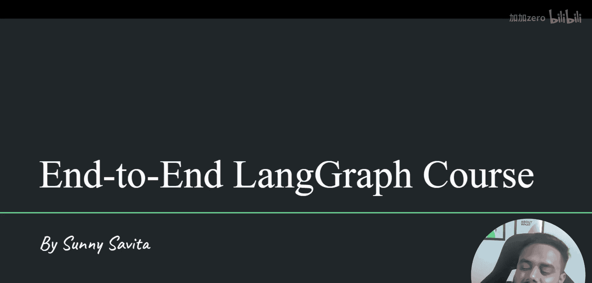

After I will show you how you can build a agent from the scratch as well using the Python Python script。

 then I will come to this like graph， okay， graph and this la graph will try to code the la graph。

We try to understand some key concept relative to the land graph like graph estate node， ages。

 visualization and a different different concept then guys will come to this like a third slide so there will try to create some application。

Using the land graph like we try to implement some agent pattern well try to create a chat board we will try to create a multi agenttic system。

 we will try to create a rag a different different kind of rag like corrective rag， agent rag。

 self rag and all and。We look into some real time project as well。

 So this is the whole sort of a syllabus whole sort of idea and here guys inside this particular slide we have many more things I already updated this slide okay this presentation in my description of the previous video so guys please check out with my channel here is the YouTube channel with the Sunny Savita with this name Sunny Savita and inside the video section you will find out this la graph related video So once you will open it and after opening it guys check out with the description click on this description and see this link this particular link just click on it once you will click on it you will be directly redirecting to the Github repository So inside the Github repository I have updated the complete code and over here guys you will find out this p as well so once you will click on this p you will get a same p like this one only so。

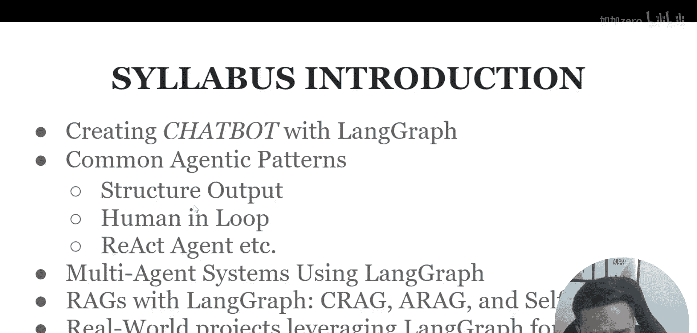

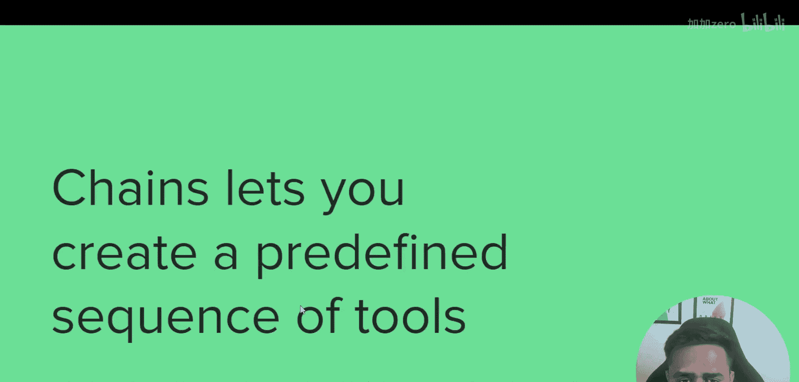

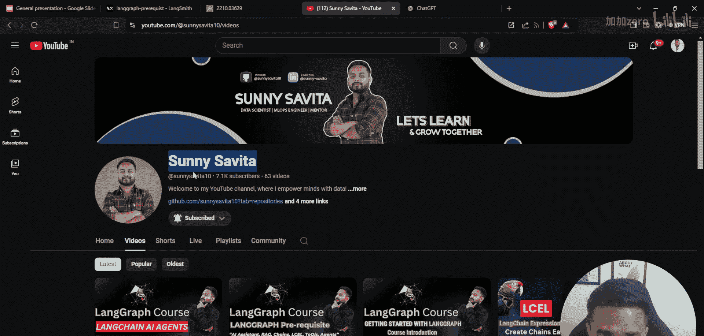

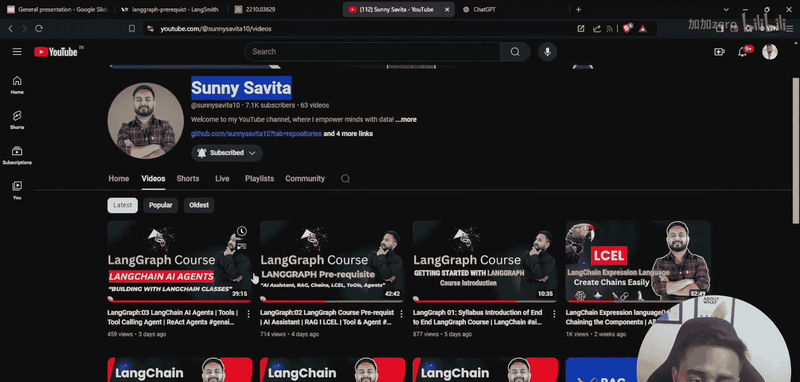

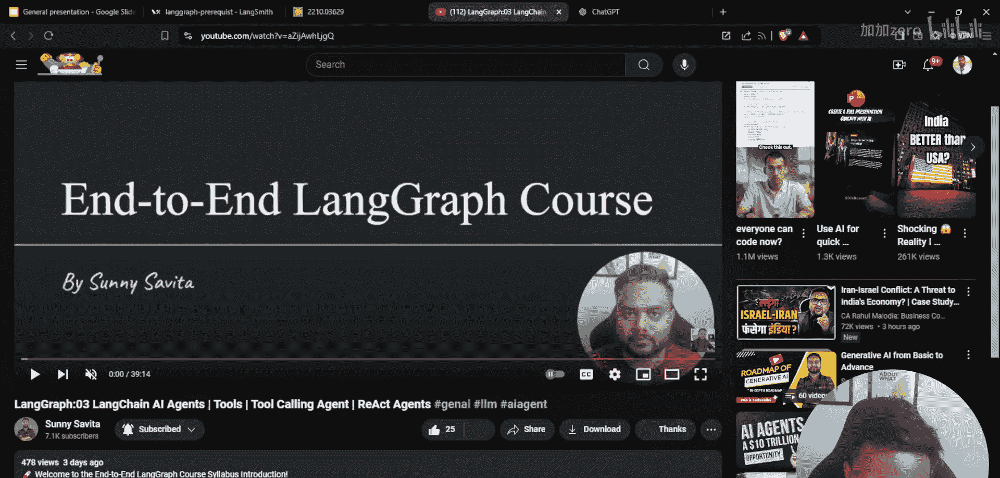

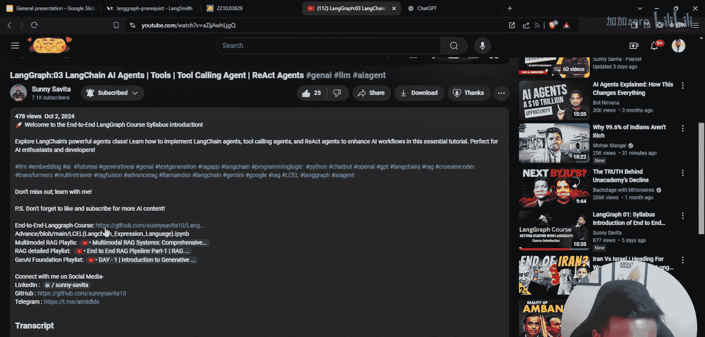

Clicking on clicking on it what you can do you can download it directly from here so yeah。

 this is clear now coming to the next point so what is the agenda of today's today video。

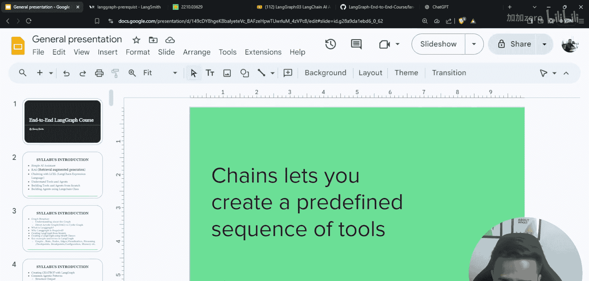

So first of all let me tell you that So here guys see reactor agent and this function calling is the tool calling agent and we are going to discuss about the self ask agent as well。

 so let me tell you the agenda So in the previous video guys we have seen we have we have seen the tool calling agent now inside that agent itself we are going to add one more tool so let me write over here add add one more tool。

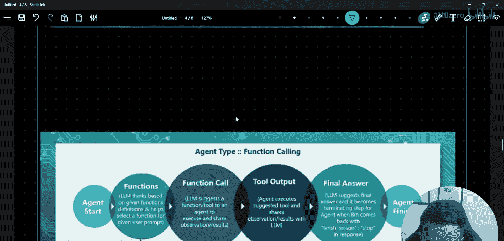

One more。Tool okay and this this tool guys， you know what it is going to be this this particular tool is going to be a rag Okay we are going to use this rag as a tool then guys after adding this tool so I will show you the react agent I will try to code the react agent in front of you and inside the react agent Okay what I will do I will be creating the custom tool So here react with custom tool I have created my own like own sort of a logic so I will show you that particular part react with custom react with custom。

ol now after completing this one so I will try to discuss a couple of more concept relate to the latest version latest version of the L okay I will show you latest version of the la where basically will try to I will try to show you this agent class itself okay world agent class is being supported by this latest version of the la and like I will show you that okay so they are saying now most of the thing is a depred okay those lain classes you can move to the la graph so this thing also I will show you so you will get a clear cut idea you will get to know okay up to which point we need to follow this lain documentation with respect to this different different different agent classes and then when we have to move to the L graph okay so these many things now first of all guys so here if we will go and check with the L documentation so such。

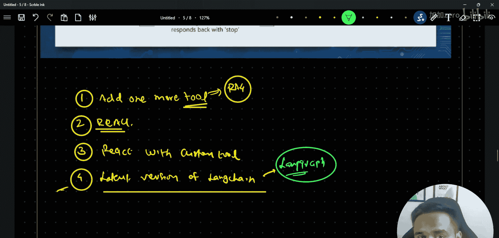

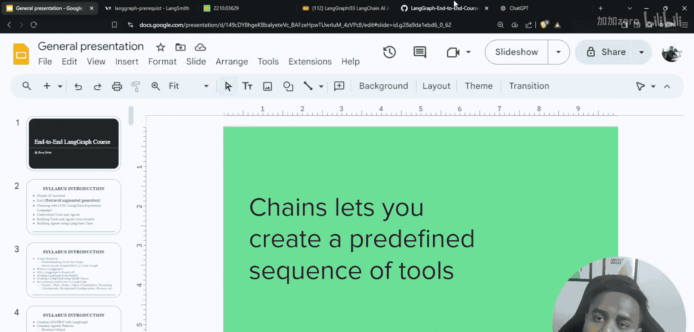

About the L documentation here guys， So what you can do。

 you can check out with this first version just click on this view1 and inside this component you need to click on this agents you guys here you can check with a different different type of agents Okay just click on it and you will get these type tool calling like structure Jason react and self ask with search so in today's video guys I'm going to discuss about the self ask with search Okay okay so this this particular agent Im also going to cover self ask self ask with with search。

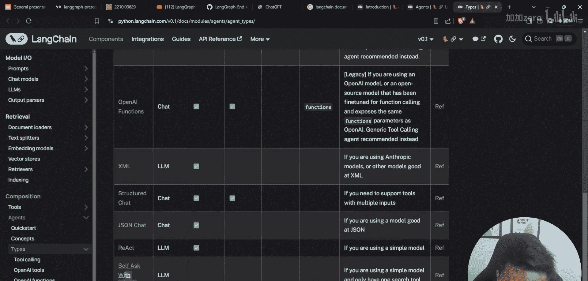

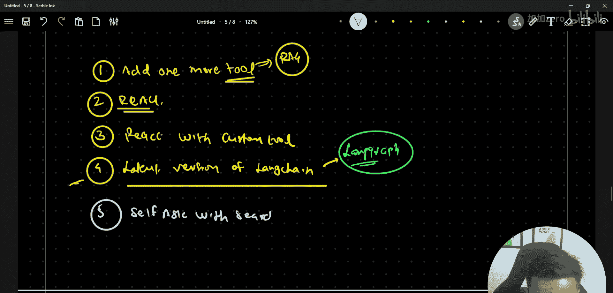

I hope so each and everything we are now， let's begin so if we will look into the code。

This is my code。 So guys here inside this particular code I started from the I started from the tool so I was using the tool see this was the entire con and after doing the con after reading the model and all everything after setting up the L Smith for that logging and tracing here guys what I was doing I was calling the tool this Wikipedia tool then Ive shown you this YouTube tool then I shown you basically this tab and all for crawling the web and then I created this custom tool as well。

 So like you can add any sort of a functionality any sort of a custom functionality inside your application then after this custom tool guys I came to this concept of the agent So here I explained you this initial classes which was introduced by the L itself and here I have added this Wikipedia tool and I was trying to like a search right so I was trying to ask my question and it was。

To search of using this particular tool。 and based on that， it was giving me a final answer。 Okay。

 this was the final answer。 And here guys I have explained the concept of the agent。

 So this image mainly this image mainly related to this react agent where actually everything is working inside the loop okay we have a different different agent pattern。

 So here you can look into this particular chart。 look into this particular table So we have a tool calling we have this structure chat Jason chat react and self ask with search So first of all let me clarify a little bit about it and then I will come to the code part。

 guys， whenever we are talking about the agents。 so here let me write it down So whenever we are talking about agents So agent is nothing it's Lm only So based on this L we are giving a response whatever input is being provided but guys over here whatever。

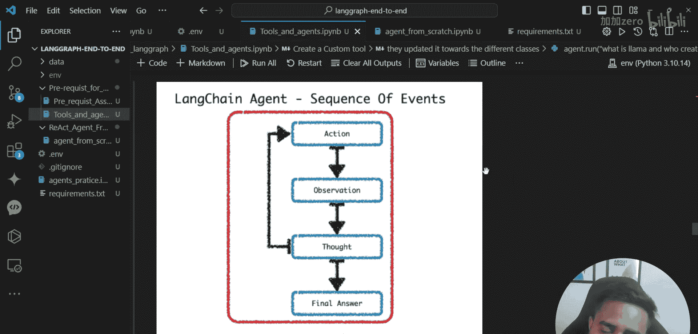

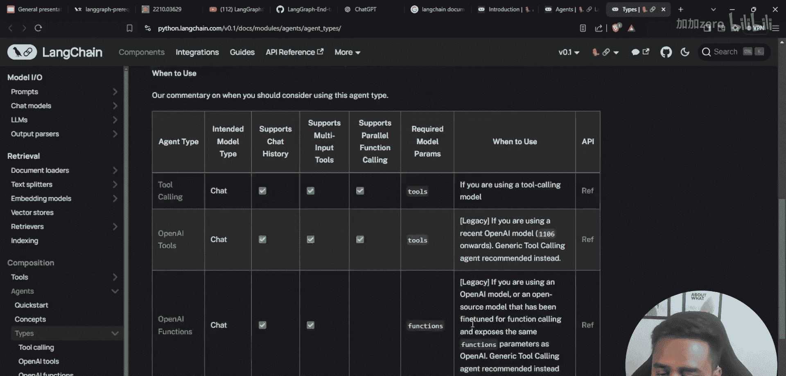

we are providing this input is called prompt。 This input。 Okay。

 this prompt is having different different kind of instruction。

 so we are passing different different kind of instruction to this prompt。

 and here guys along with this LLM we are going to connect one tool as well Okay we are going to connect a tool or we are going to connect the toolki toolki means we are going to connect a multiple tools So this tool is nothing it's external functionality okay so if my LLM is not able to answer。

 so I will look into the I will look into my answer over here inside this tool and based on that。

 we are going to generate a final output。 now guys here we have a different different agent pattern。

 And one more thing guys what we can do So over here we can connect the memory as well Okay we can sustain the memory of the conversation and we can we can like remember the previous state or the previous conversation of the like previous conversation basically okay。

Nowadays， whenever we are talking about this agent， so here is what here's my agent now。

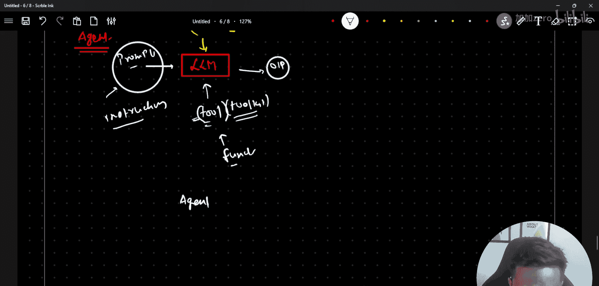