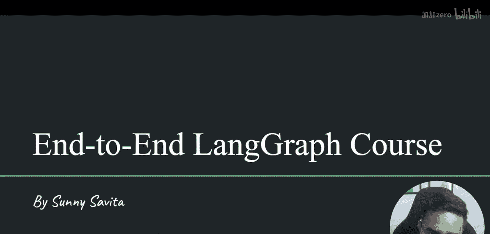
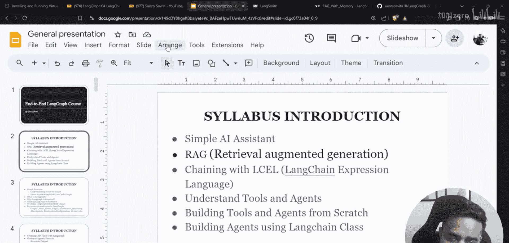
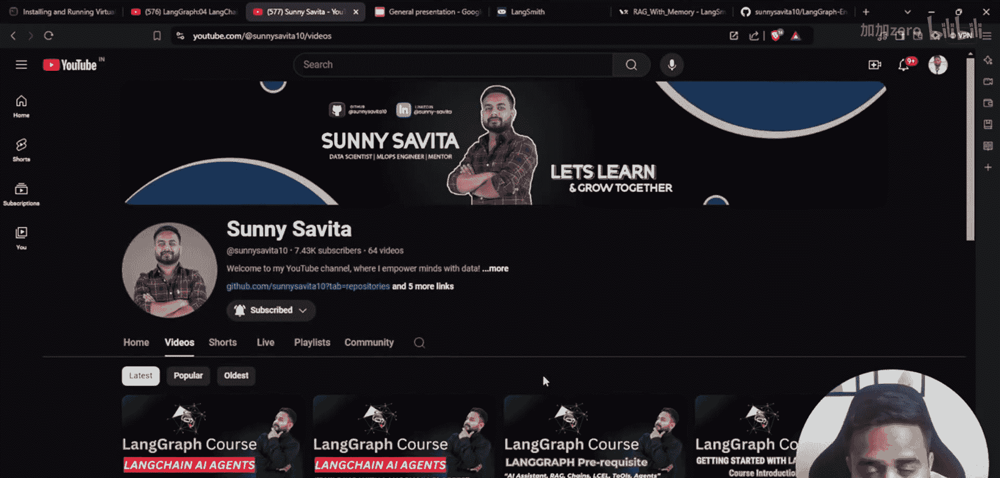
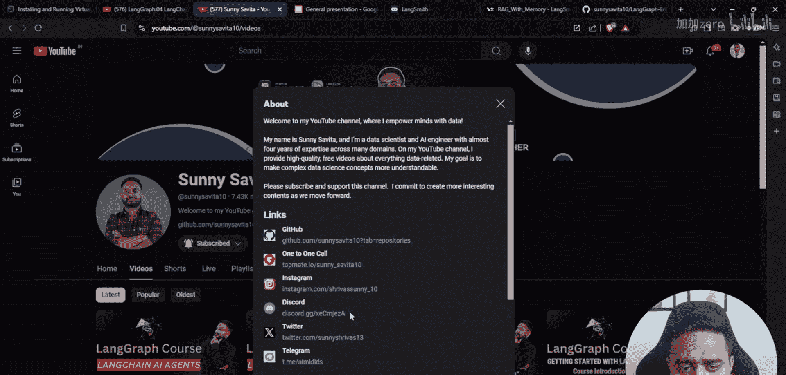
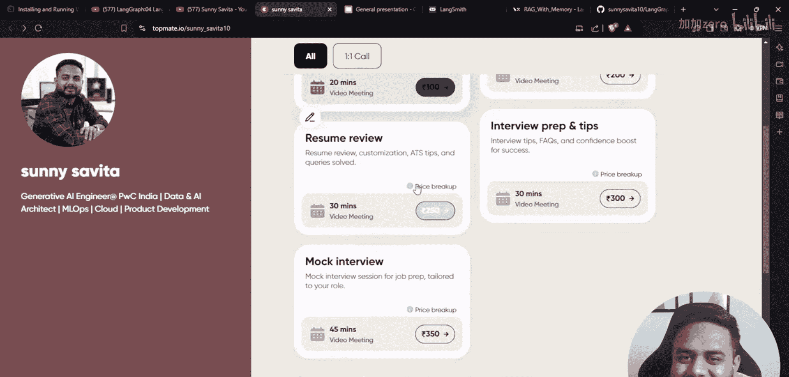
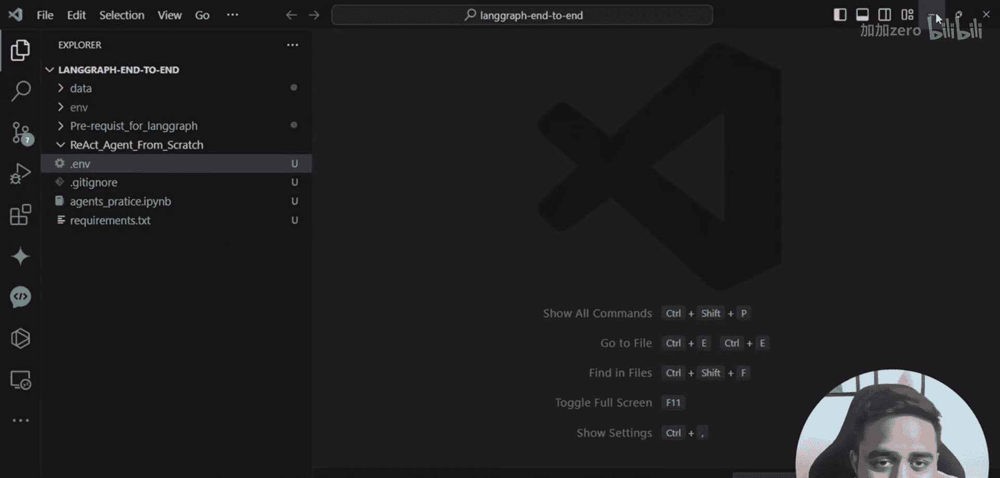
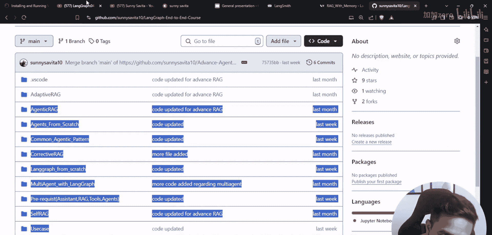
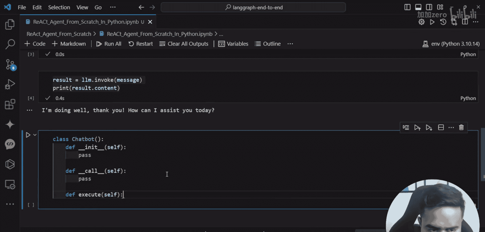

# Sunny Savita【中英⚡生成式AI：从初学者到专家｜Generative AI In-Depth Roadmap from Beginner to E】 p62 P62 LangGraph：05 Building AI Agent from Scratch Using Python with Custom Tool #l [BV1Uht8zDENA_p62]

Hey hi everyone。 welcomelcome to my YouTube channel。

 My name is Sunny Savita and I'm back with another exciting and important video。

 So guys I started with this end to end lagra course and I already uploaded four videos related to this particular course。

 Now in this video in today's video we are going to discuss how you can create react agent from scratch using Python in my previous video I discuss all the stuff。

 all the things related to L agents because those agents is very much important and after this particular video I'll be moving to the la graph I'll be starting with the Lagra stuff how basically you can code using the La graph how you can create a variety of the agent and variety of the application。

 So first of all， let me show you the syllabus Here is a syllabus guys this is the first slide I already discuss these many things only one topic is remaining creator agent。

😊。

From scratch using Python okay then guys I will move to this la graph here is a complete syllabus of the la graph I already discussed and this is the advanced syllabus of the la graph now I was getting many queries sir why you are discussing this la agents directly you can start from there itself directly you can start from the la graph so one thing I would like to tell you guys see my main agenda to discuss about this la agents so that you can understand the working of the agents okay。

You can understand the different different type of agents and this La graph is a new thing it came just like two to three months back only right before that everyone was using this la agent itself Okay la agents and the different another framework like through AI and autogen So my main agenda to like explain the working of the agent just to tell you the different different classes of the agent and this classes this la agents is its still it is being used inside the industry and I'm also working on it okay so guys it's not like this this is not important until unless we are not going to understand this particular thing you won't be comfortable with this part So that's why I included first this la AI agents okay now you are comfortable with this agent stuff and now you understood the working of the agent easily we can move to this easily we can move to this La graph okay so that was my main intention to discuss about this AI agents and all that said。

Okay now one more thing I would like to tell you。 So here guys。

 if will go and check with my YouTube channel you will find out all the previous video。

 all the four videos Okay and apart from this one guys。

 I added I have added one more feature So if you will go and check with my description if you will go and check with the description or just go and check with any description of the video you will find out one one more link for for the one to one call So many people are asking to me I got many messages on the LinkedIn or the LinkedIn and the comment section as well So can you connect with me one to one for the different different thing for the different different question and all So here I created my I okay here I created my account over the topmate so I kept the different different services like quick chat career guidance。

And here resume preparation or interview tapes， mock interview and I write the time and all everything for how much time basically I'm going to connect And along with every service guys。

 I associate one like a small price as well like 10200 as you can see and let me justify this particular price why I kept it So guys it's not like this I'm not going to discuss all this stuff。

 the career guidance resume interview preparation mock interview on my channel。

 definitely you will find out videos on my YouTube channel as well。 But guys。

 few people are having concern。 Okay， they want to connect one to1。

 and people wants to connect with the industry professional with industry expert and all。

 So that's why guys I cap those thing in my mind and I came up with this particular idea Okay so if you want to connect you can pay a small amount of money like 10 or 200 rupees according to your requirement and guys this money basically it will give you the seriousness because see if we are giving everything for the free。

So sometimes people don't value of it and whatever I'm doing or whatever you are doing right So it takes time。

 it takes effort Okay so just to like respect just to respect for that time and efforts okay so I kept this small amount of money so if you are willing to connect for any sort of guidance for anything you can do it and believe me guys I want to you you will get something if you don't want to pay guys don't worry you can to me over the Liedin if it is necessary I will connect in that case also great guys so now let's begin let's start so here's my code guys see this is the complete code complete code this complete folder and all I already on my Github if you want to take it from there you can directly take it from there see here is my Giub I uploaded the future code as well which Im going to discuss in my future classes and this link this Github link I already。

Why did you in my description So if you will go and check with the description of any video， okay。

 the recent a La graph video， you'll find out this particular link and to an La graph code so directly you can download the material from there now guys see。

So I was talking about the prerequisite。And I thought。

 let me tell you how we can code any any type of agent from scratch Okay using the Python so that you will be fearless whenever you are going to code any any kind of agents okay whenever you are writing any any code in your organization in your like in working like project and all you will be farless over there and that too we are doing and even even I'm also doing I'm working as a geneative engineer I know what requirement you might get okay what all kind of task you might get and I'm working according and I'm like creating a video according to that task only So here guys let's create a agents from scratch and then from the next video will move to the blank graph stop So here what I'm doing I'm creating a file So my file name is react。

Agent。From。The scratchch。嗯。闭腾。Dot I P Y and here I created iBn notebook and yes it is ready now I can write my further code so let me select the kernel I already created a virtual environment。

So here is my kernel I hope it is perfectly fine for all of you now first of all guys let me grab a couple of things over here which is required for reading a model and for the other stuff as well。

 so here is the complete here is the complete APIs and out。

Now guys what I'm doing I'm going to read this Google API key and here's a G and here is a Langin API key Langin project So this Google API for reading the j model。

 this G for reading any open source model from the G Tli it is not required for this particular tutorial and here guys this LangIn API key and the LangIn project name for what for the L is Smith okay if I want to capture the log so just for capturing the log guys I I have configure this particular thing so let me remove this T API key from here and rest of the thing I am going to run so if you want to use a Google model you can do it from here if you want to use any model from the G you can read you can get it from this G API key okay now。

Coming to the next part so let me test my model whether it is working fine or not。

 so here I am going to test my ama model okay Lama 3 from the G itself and let me execute it and lets see whether it is giving me answer or not。

It might take some time if you are running it a first time。 So yes， it is working fine guys。

 Now how you can provide input to the model。 So this is one of the way。

 Now let me show you one more way。 what you can do。

 you can provide input in this particular format like you can give the role roll this is the role of the system Okay and here is the user quot what is a role of the system。

 So this role of the system is nothing。 it's a defining a a model behavior。

 So here you are just defining a model behavior and here you are passing a quot。

 and based on that guys， it will be generating my answer。 So let me do one thing。

 let me check out with this particular stuff as well。

 So here I pass my message Okay this one and let me generate a country。

 So see here it is giving me answer and everything is working fine Now guys let's move to the main coding part。

So for implementing this agents I required a class。

 so I required one class the class name is going to be chatbot， let me create this class here。Jack。

Bt， okay， now guys， what I'm going to do here。 So here after creating this chat board。

 let me define the init function inside it。So here I am going to create a in function now let me write the pass later on I will be writing the functionality then。

I required one more method， so here I am going to write I am going to create this call method and to this particular method also I'll be passing something so let me keep it empty as of now Now what I'm doing I'm going to create one more method so here my method name is going to be execute so here execute。

Execute okay， now what I will do。 So after creating this particular method。This is my execute method。

