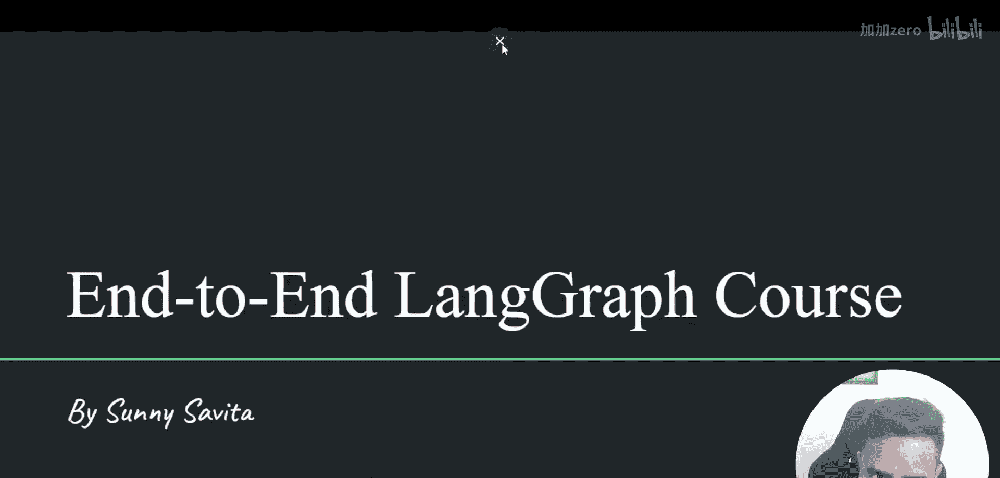
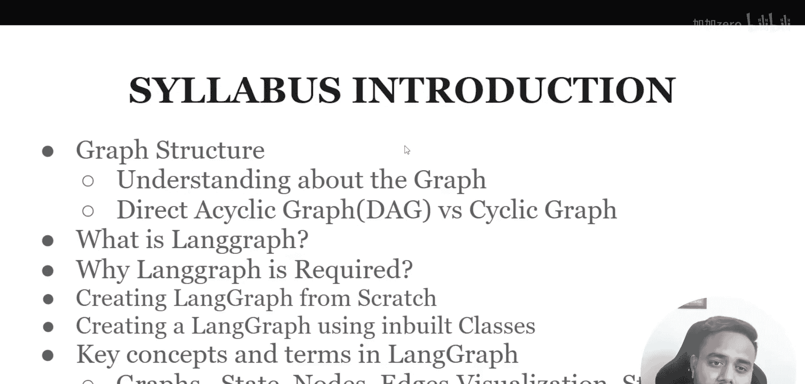
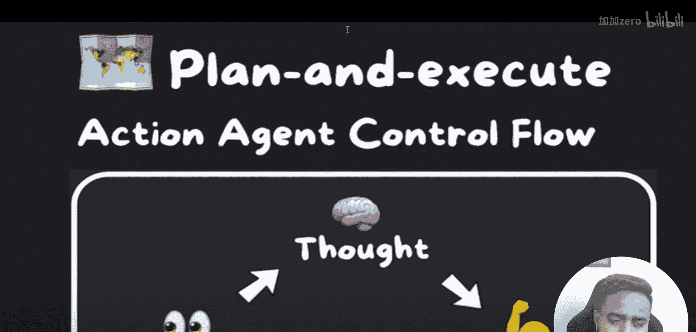
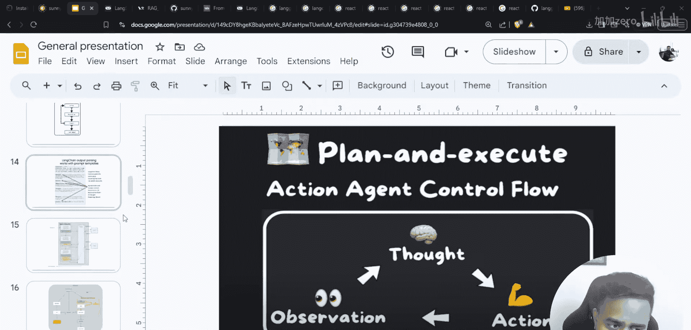
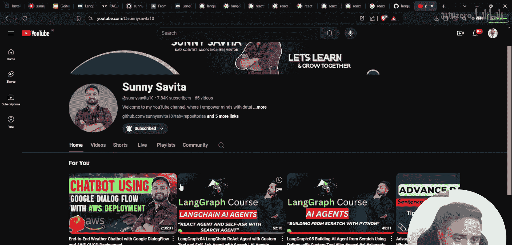
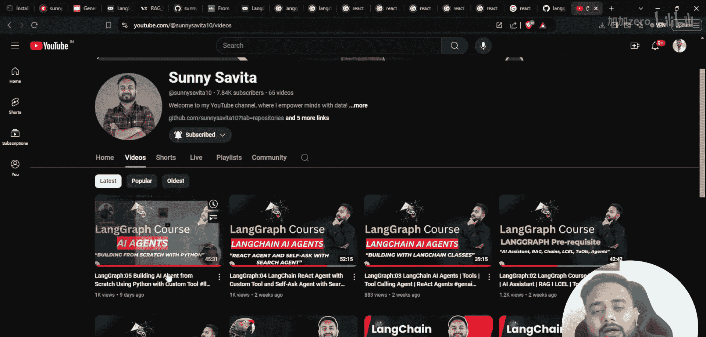
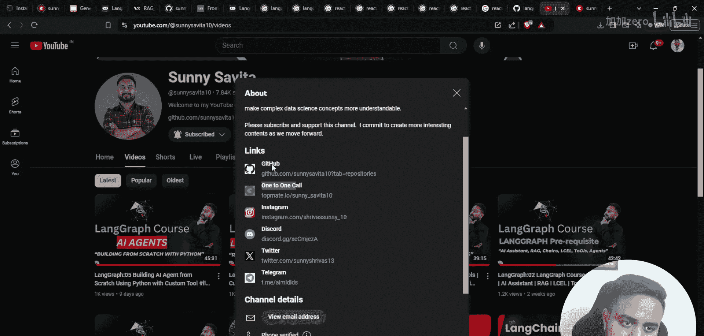
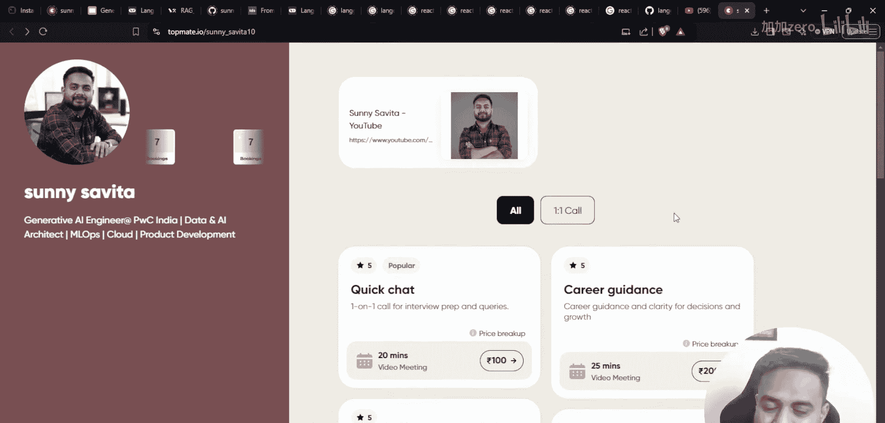
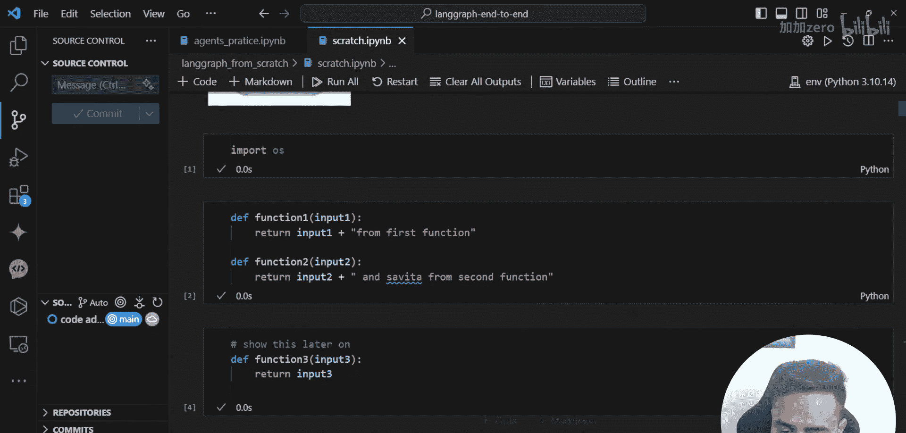
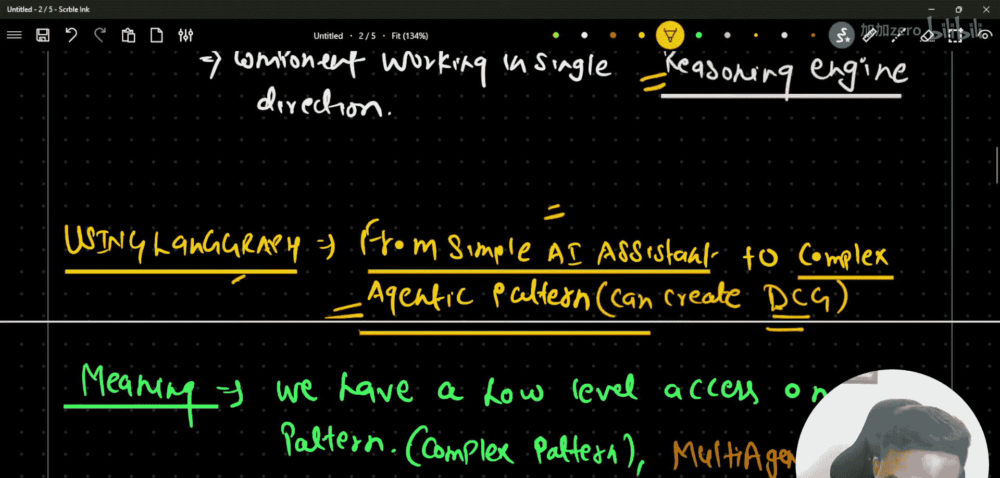

# Sunny Savita【中英⚡生成式AI：从初学者到专家｜Generative AI In-Depth Roadmap from Beginner to E】 p63 P63 LangGraph：06 Detailed Introduction of LangGraph #llm #genai #ai #aiagents [BV1Uht8zDENA_p63]

Hey hi everyone。 welcomele to my channel。 My name is Sunny Savita。

 and I'm back with another exciting and important video。 So guys。

 I started with the N2 end Lagra course and I already publish five videos related to this course if you are following to me that definitely you must be knowing about it now guys。

 this is a six video and inside this particular video will start from the core lagra module。

 So inside this video I will explain you the complete and detailed introduction of the la graph that why we should use it what is a requirement of it and what kind of pattern actually we can create using this la graph。

 Okay So first of all， let me show you the syllabus here guys So I already discuss this prerequisite whatever prerequisite is required for the la graph。

 And then like I'm going to start from this graph structure what is the la graph while La graph is required creating La graph from a scratch everything guys。

 I'll be talking about from now onwards and inside this video as I told。😊。

I'm going to discuss about the La graph Okay means the introduction of the La graph and then guys will come to the advanced part of the La graph like creating chat board with La graph common agenttic pattern。

 Okay we'll try to create some multiagetic system as well well try to integrate our La graph with rag as well and then I will look into some project okay how we can create a different different kind of project how we can leverage this la graph everything I will let you know so guys this slide is very much important where I'm going to discuss the introduction and the La graph creation from scratch because this slide will give you the detail like detailed understanding of the La graph okay if you are going to miss this session like this upcoming session and this particular session you won't be able to understand the la graph guys so please focus and please like be sincere from now if you are following to me here and yeah I will be providing each and every material and I will make sure that you will get to know each and every detail from my end now。

So guys I already created a notes complete notes for all of you and this slide I mentioned inside my description section If you will go and check with the description。

 you will find out this particular slide got it now let me show you my YouTube channel as well so here guys my YouTube channel and if you will go inside the video section you will find out all the previous video and it's going very well people are supporting a lot and people are reacting a lot so first of all。

 thank you to all of you for supporting and for reacting over the videos now apart from this one guys。

 I started one more service so if you want to connect with me1 to1 you can leverage that particular service as well so I mention the link inside the description and inside my like description of the you do now here guys if you will go and check with my topmate so you will find out like a variant option with chat career guidance okay resume review interview profession and mock interview and all so for any sort of a service you can connect with me I already discuss in my previous session as well。

And I justify justify the prize as well。 So why I kept just much of money like 0 to00 So just to like just for the sincerity okay just like for respecting the time and efforts every I discuss now I hope you got enough amount of understanding So let's start with a topic So guys in this particular video I'm not going to discuss any coding part I'm keeping this video as as small as possible because here in this particular video I will discuss the introduction of the la graph now from next video onwards I will be creating like a different different land graph basically here is an entire code okay everything I will show you from scratch every kind of pattern and all so first of all let me go back to my blackboard here I created couple of here I like something for you guys and I hope this will really help to you So step by step one by1 let me explain you each and every part of this particular blackboard and then will come to the。

Bard guys。So guys here is a detailed introduction of the la graph。 so step by step one by one。

 let's try to understand each and every aspect of the la graph Okay I hope it is visible So whenever we talk about the la guys so this la is into the multiple component So here are some parent component of the as I discuss in my previous video as well so the first component is a la as we know about it the second is lasmith。

 the third is a length sub and then la graph So before coming to the la graph。

 let's try to look into the other component as well other services of the la so the one service of the la is the la itself okay you will find out you will find out the document document of the la and this la actually give you the different different component Why give you a different different component so that you can build a solution on top of itM based solution So here I written couple of name so it will provide you the prompting prompt template it will provide you a different different。

Intig it will provide you the different different output and input par right and it will provide you the embedding model it provide you the data loader chain concept LL and all so there are like this is some important concept of the length chain and once in a while we we all have used this particular concept from the L chain itself right then coming to the so guys L issmith we use for the logging if you want to capture any sort of a log if we want to capture any sort of information in between the like execution so we use this Lsmith then length of is for serving the model so it is giving the it is providing the cloud basically so directly you can host your application using this length now guys our main agenda is a language graph itself so I think the name itself if we will look into the name so the name itself is justifying the thing if we are talking about the language graph guys so here what it is giving to us it is。

to us a graph right and what is the meaning of the graph So graph is nothing it is a node and ages Getting my point So la graph basically it is it is providing us to capability so that we can create a graph and what is a meaning of the graph graph is nothing it's a node and ages okay so using this node and ages what we can do we can create a workflow I think you are able to connect each and every points whatever I'm like trying to explain you over here got it now if we are looking into the definition of the la graph so here is a definition of the la graph So what is a la graph guys tell me so it's a product okay or it's a framework of la for creating a workflow as simple as that now what is a meaning of the workflow if if you will ask to me Sun what is a meaning of the workflow workflow is nothing basically workflow means orchestration okay so you will you will ask me sunny what is orchestration so here simply you can like think it's a pipeline。

Okay it's a pipeline or if if if I'm talking in more technical terms so it's a direct it's a direct cyclic graph so using the la graph what we can do we can create a direct cyclic graph I will come to this part direct cycling graph each and everything I will try to explain you in today's video and your understanding will be pretty much clear with respect to the la graph okay so now I hope till here everything is perfect everything is fine now why we require this la graph okay so whenever we are talking about this length guys so using this length and what we can do we can create a simple AI assistant as you know right we can create a memory based assistant we can create a memory based application we can do the chaining we can perform the LCL and all okay using what using la now。

This la itself， it provides the different different agent classes also。

 So we have seen in the previous classes like tool calling agent agent class via agent class self ask with the search okay agent class So it provides a different different agent class as well。

 now using using this la guys， what we can do we can like create a LLM based application。 Okay。

 and guys over here if we are talking about this la So using this la if we are using this L or this LM So we can create a da now what is a meaning of I will let you know in some time it will be it is going to be clear what is a meaning of over here now here guys。

 whenever we are talking about L So L basically providing us it providing us a capability to create this simple I memory based assistant chaining functionality or agent pattern Now what is agent pattern guys tell me So agent pattern is nothing So here we are giving a capability to LLM so that we can。

some sort of a reasoning using what using the LLM Okay we can run it inside the loop。

 we can create a third party tool and all okay， we can create a prompt in such a way so that LLM can think by themselves that that's a meaning of like agent okay that's a meaning of a reasoning based engine now whenever we talk about the la graph so guys using this la graph what we can do。

We can create a simple AI assistant that is fine， but from the simple AI assistant we can create a complex agent pattern。

Getting my point yes or no again Im repeating so whenever I I talk about the lengthn so using the la you can create a simple assistant memory basis and agent pattern and all。

But guys whenever we discuss about the la graph so using the la graph what you can do you can create a simpleier assistant that is fine that is well and good but guys you can create a complex agent pattern also and here you can create a dcg dcg is what dcg means so here see dcg means what direct cyclic graph get my point so whenever we talk about the la graph so using the la graph we can create a agent we can create a common we can create a complex agent pattern okay and we can create。

