# Sunny Savita【中英⚡生成式AI：从初学者到专家｜Generative AI In-Depth Roadmap from Beginner to E】 p64 P64 LangGraph：07 Code LangGraph From Scratch ｜ LangGraph Deep Dive #llm #genai # [BV1Uht8zDENA_p64]

Hey hi everyone。 welcomele to my YouTubetu channel。

 My name is Sunni Savita and I'm back with another exciting and important video。

 So guys I started with this endto Lagra course and I already publish sixth video related to this course guys there is the seventh video and now from this video onwards we are going to start the coding coding using the La graph module Yes。

 so in the previous video I explain you the theoretical concept I explain you the meaning of the La graph if you have seen my video that definitely you must be knowing about la graph that what is a la graph why we should use it and now in this particular video well understand that how we can create how we can create a graph using the land graph module and will try to create a different different type of pattern and all and everything will see like inside this particular video whatever is required like in terms of basics and all So first of all let me introduce the ss So heres。

😊。

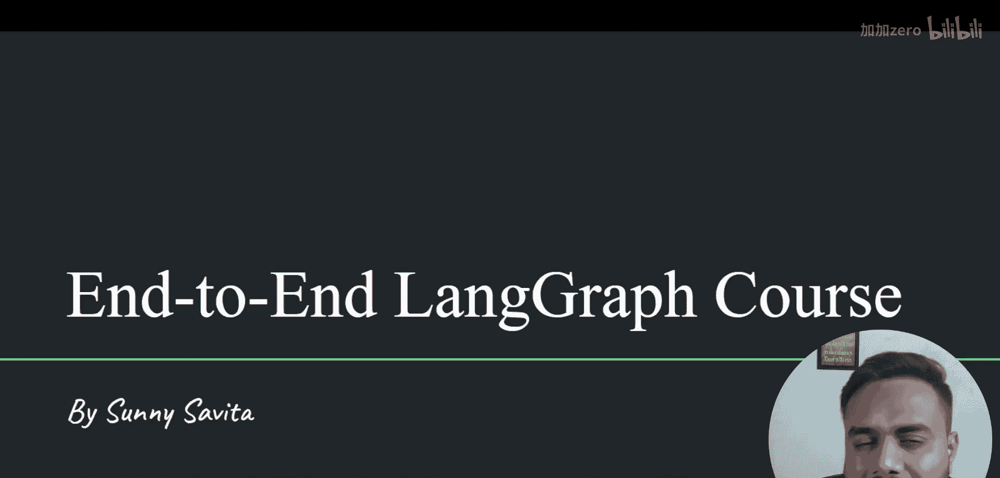

Computerte paperspers guys I already completed this first slide and then this is the second slide and I completed till the till this point while land graph is required now we are going to create a land graph from scratch and then guys will look into the different different concept of the la graph。

Which it will be included over here itself and then after this one I will come to the advanced part of the land graph like chatbot creation。

We' look into the agent pattern， different different agent pattern。

 multi agent system we'll see like a different different kind of rag okay using the la graph like C a and self rag C rag means corrective rag a means agent rag and then we'll look into some project as well So guys this is the complete sllabus and I hope so you know about this particular sabus and now let me show you one more thing So here guys my YouTube channel I already publish six video if you will go and check with the video section so please go and check out with the video section see this is the this is the video and I created a separate playlist also so here is a playlist of the land graph now guys if you haven't subscribe so far so please go and subscribe if I like the video then please like the video okay please hit the like button please like write your thoughts into the comment section。

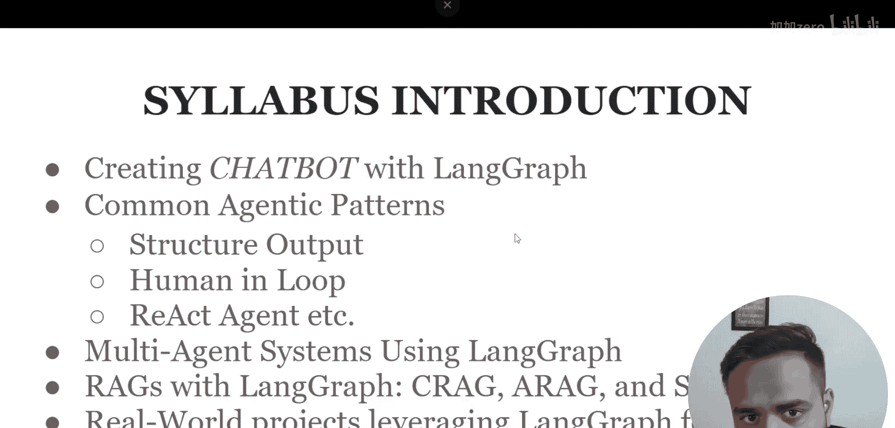

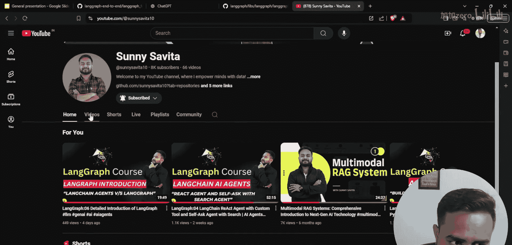

And if you haven't subscribed， please subscribe now I started one more service。

 So if you will go and check with the YouTube description my YouTube channel description。

 you'll find out the stopmate So if you want to connect with me one to one you can connect with me1 to1 through this topm So if you want to do the quick chat career guidance resume discussion interview patient mock interview for everything I I'm available whatever doubts you have related to your career and all everything guys everything I will try to solve and you just need to book the law and I will be available for you now so yes。

 I discuss I think most the thing now let me talk about one more thing So guys this is my getub repository and I copy every sort of a material over here。

 So see this is like older repository this one relate to the other videos and here I created a new repository for the land graph course So I created two repository in the first repository I already given you complete content。

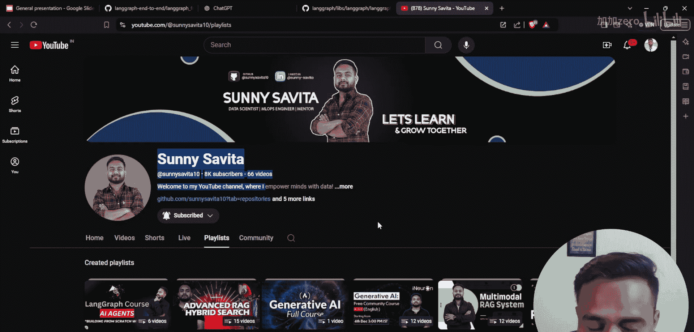

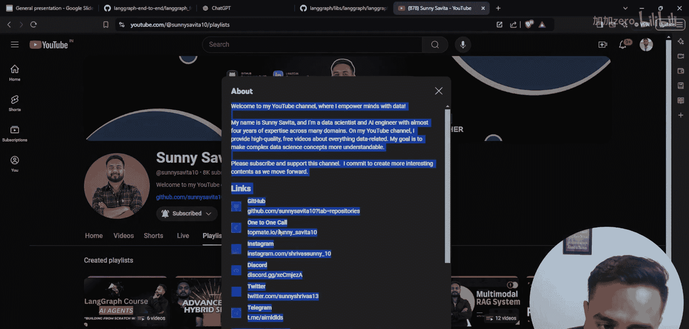

If you want to take a complete content from here you can take and this is this is a repository which I'm like sync up with a live with this videos itself okay so whatever I'm teaching inside the video I immediately I am uploading over here inside this particular repository both repository you can keep it with you here are basically we will find out some dynamic code and all okay whatever I'm writing inside the class okay whatever I'm writing inside the video itself。

I hope now every doubt is clear so let's start with a coding part first of all guys what you have to do you have to open your VS code so this is my VS code and inside this particular file Ill be writing the code related to this la graph now before coming to this coding part let me explain you some coner related to this la graph so guys these are the pattern which here are going to implement inside this particular video so let me explain you this particular pattern1 by one and then I will come to the coding so here what I can do I can like switch of the camera。

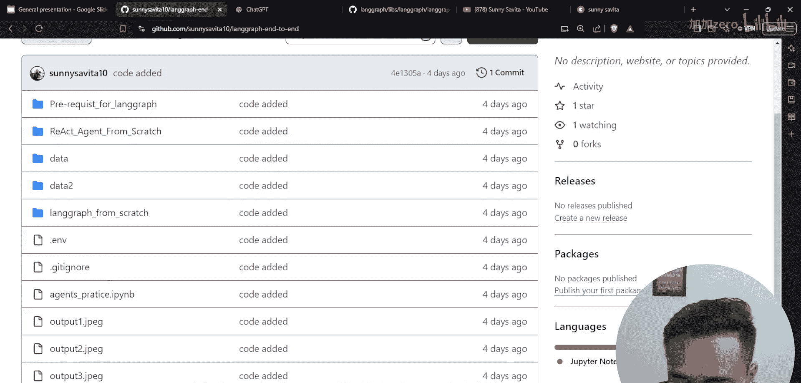

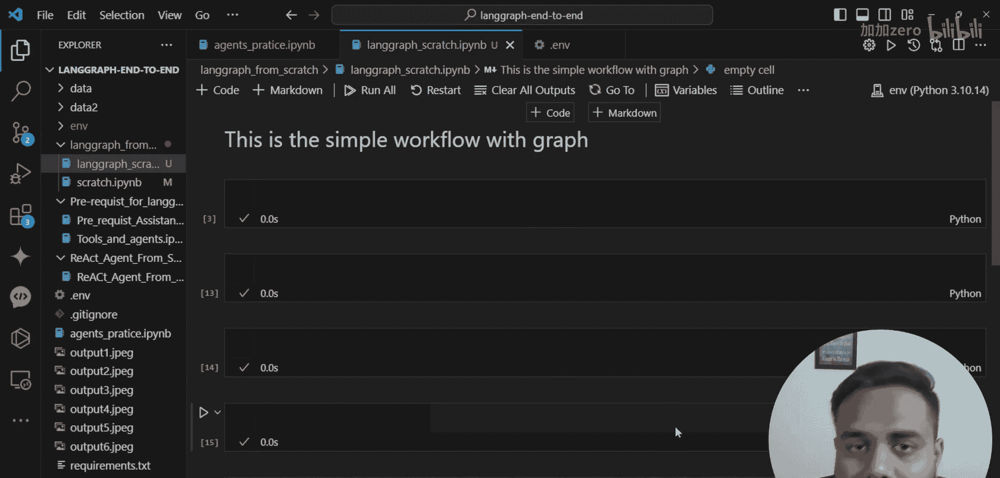

So that you can get a complete access of the screen。

 So this is the first graph which we are going to create。

 Okay here we are going to connect to simple function using the line graph。

 then guys I'll be using the LLm and I'll be using one function that function is going to be upper string and after this one means after this basic session Ill be using this function as a tool not from this particular session from the next session onwards。

 Okay then guys here I'm going to create a same thing。

 I'm going to create the same kind of graph so I'll be like connecting a function over here as well inside my L along with my Lm So this is a basic level this is a basic level graph which we are going to create from a scratch so I can write over here。

 this is a level 1 So level 1 this is level2 guys this one level 2 and I can keep this one is also on the same level it will be on also a level2 now guys this is going to be a level 3 because here I am going to connect my rag So this thing。

I will explain in the next video， okay， I will be creating a two part of this particular video so that it won't be too much long and easily you can understand the concept。

And here guys， this is a little complex graph。 So this is a level 4。 and here guys。

 this particular this particular graph also I'll be creating inside the next video So yeah。

 I hope everything is clear。 everything is fine so far now inside this particular graphs you can see we are going to connect different different component So this component basically this one this function one function this is what this is my function。

 Now this LL LLM is nothing it is my function thing is nothing it my function which Im going to connect with the edges。

 okay this this LLM is nothing is my function。 This is also my function。

 Okay this all the thing is my function Now here this is what this is my edges Now this edges guys this edges is called the normal edges and this particular edges is called a conditional edges So everything we are going to understand with respect to the la graph and then after understanding this particular thing this particular stuff from next from next to next video onwards Im going to。

Start with the advanced section of the playing rock， I hope this idea is clear。

 So lets let's begin with the coding part。 So first of all， let me do one thing。

 let me create a couple of functions。 Okay， so just a second， I hope it is visible。

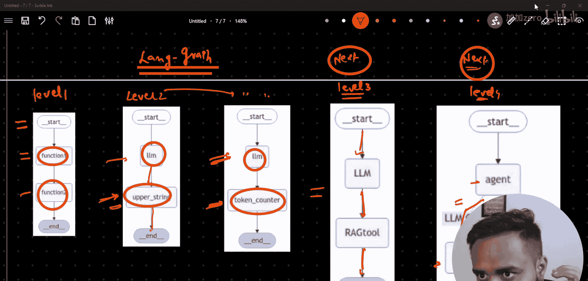

Now what I am going to do， I am going to keep some functions over here。

 Now this is my first function guys， first and second function now inside this first function。

 what I'm doing I'm just taking an input and I am going to concatenating with a second concatenating it with a string。

 Okay， now this is my second function now here also what we are doing So we are taking an input and we are going to concatenating with the。

With the is string okay now guys this input too basically it is coming from this particular function how I will show you that now here guys what I'm doing so first of all I'll be creating a function now after this one。

I will create my graph。 Okay， so what I'm going to do I'm going to import a graph。

 Now let me explain you one very important thing with respect to this particular class with respect to this La graph Okay so if you will check with the la graph。

 So just just go ahead with the Google type of the Google L graph Github So guys this La graph also is a open source project and you can find out the complete source code over the Google itself So you just need to write here La graph Github you will get that particular Github and just go inside this library inside the library here you need to go through with this la graph and here is the lay graph click on this la graph now inside the la graph guys。

 you will find out the graph this particular graph So here you will find out two type of graph first is a normal graph and the second is the state graph Okay so this both type of graph both type of graph we are going to understand normal graph and the state graph and Ill be explaining you。

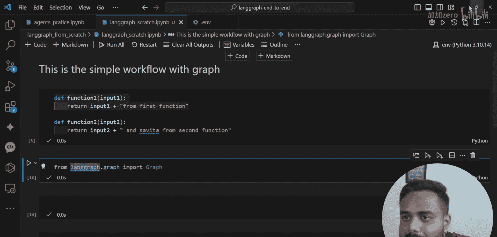

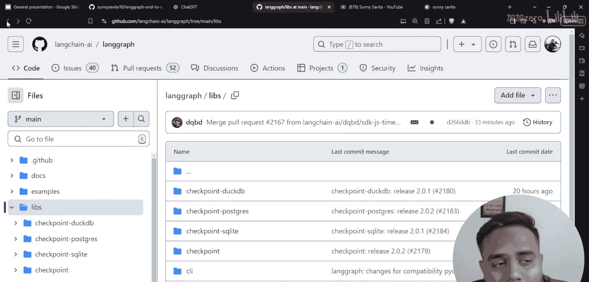

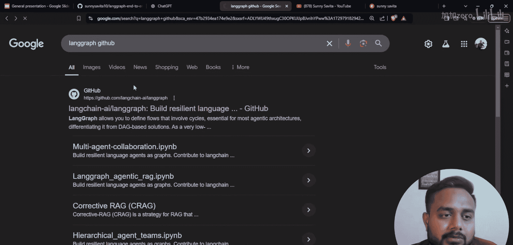

And I will be explaining you this particular graph this both graph normal graph and a state graph。

 but first I will start with this normal graph and then I will come to the state graph。 Okay。

 let me show you the class。 So here is graph dot py and now here guys what we have So we have this graph class graph so you can see the complete implementation they have already written the code we just need to use this particular class。

 Okay I already imported in my code as you can see over here inside this vs code Now let me show you the state graph as well So here what I'm going to do I'm going to open this particular file and here is spot here is my state graph Okay this one So state graph basically it required this graph itself and I will let you know how to pass the argument to this state graph I kept one solution using this state graph and going forward we are going to solve each and everything we are going to create our graph using this state graph only okay I hope this thing is clear now。

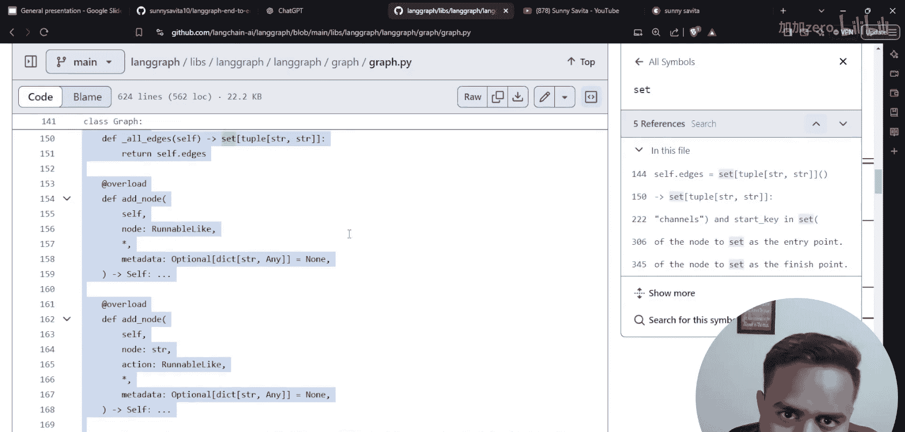

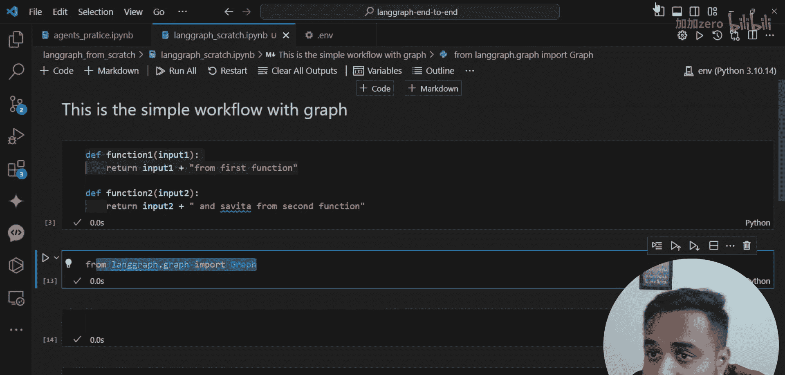

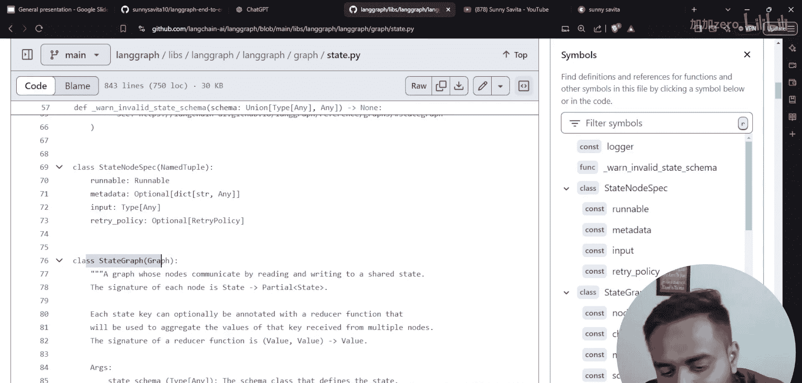

Let's start with the coding part guys。 So guys， first， let's create an object object of this graph。

 and then one by one， I will try to add the node and edges。 So here guys。

 I'm going to create an object of this graph this is my object。

 I will be creating a different different workflow like more than workflow as I shown you previously in my blackboard。

 So that's why I cap the name of this workflow workflow 1 Okay got it。 now what I'm doing。

 let me create an object of it。 and then what I'm going to do here I'm going to add the function。

 Okay let me explain you about it。 So here guys this is my function。 Okay， this is this function1。

 This is a name of the function。 It's a custom name you can keep any sort of a name I'm just keeping the function one itself。

 but even can write any name Okay that I will show you going forward now here like we are going to add the node。

 So as I told you， this node is nothing。

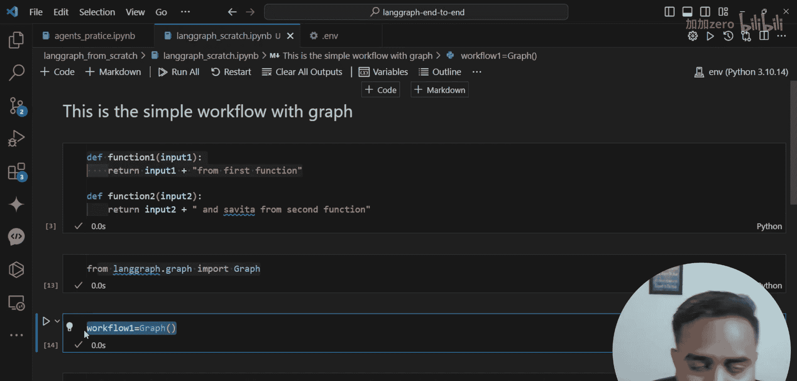

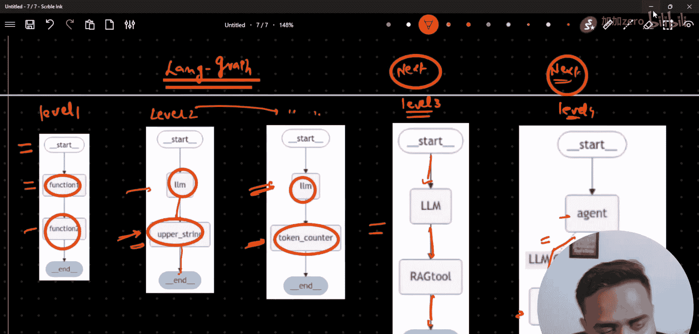

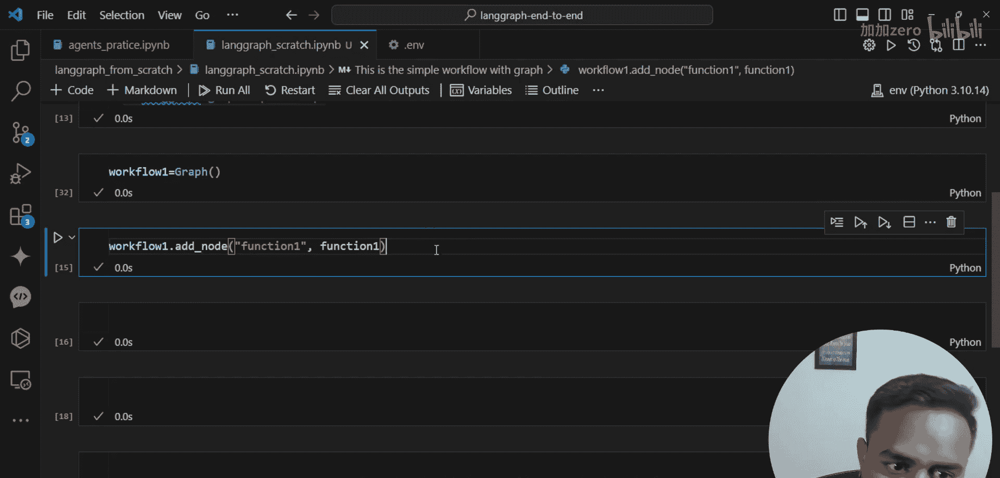