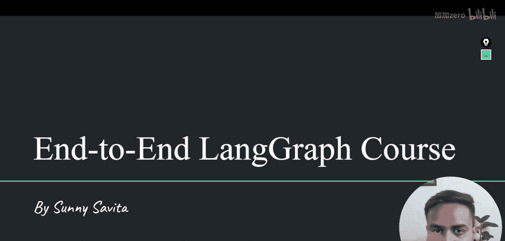
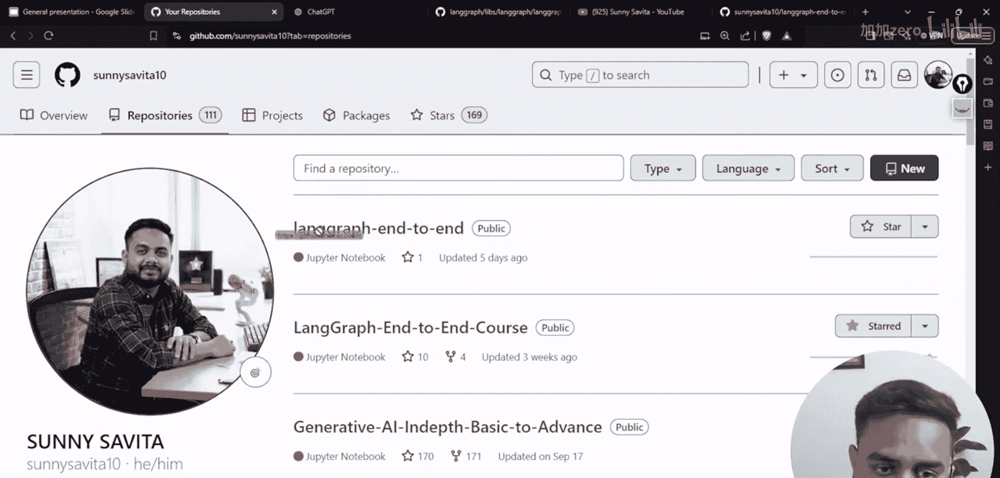
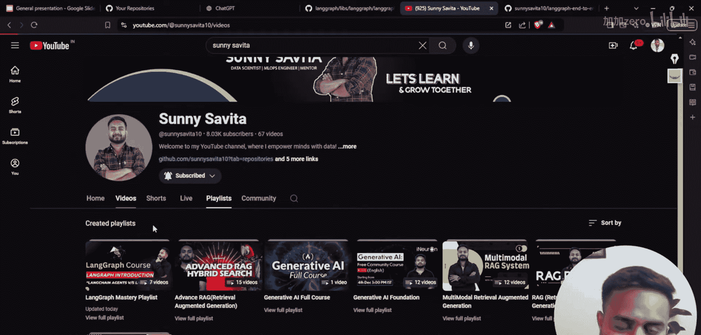
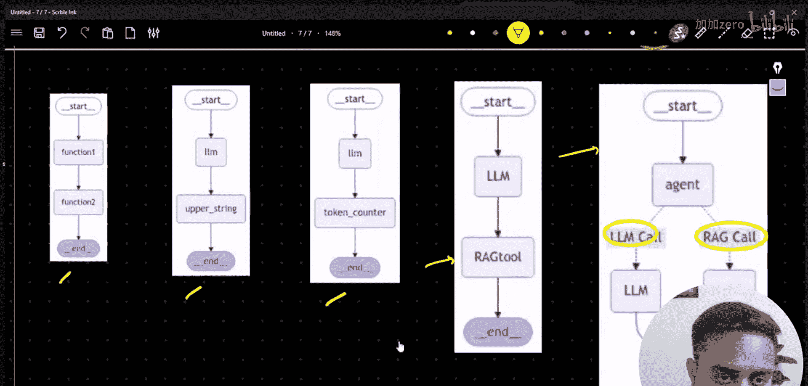
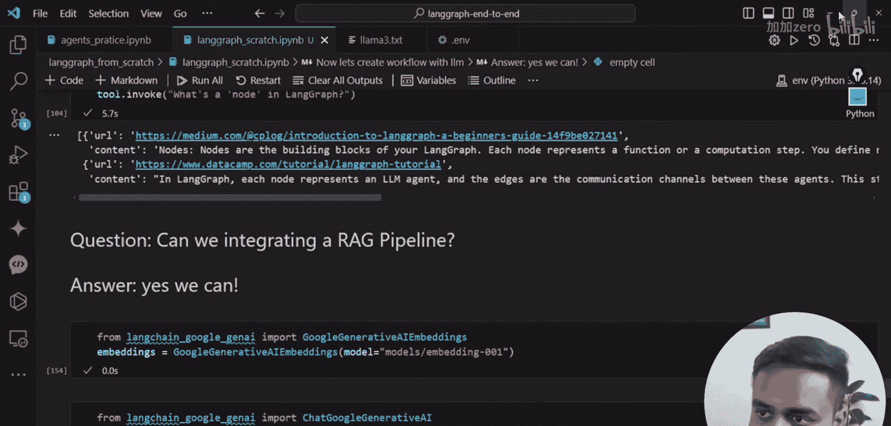
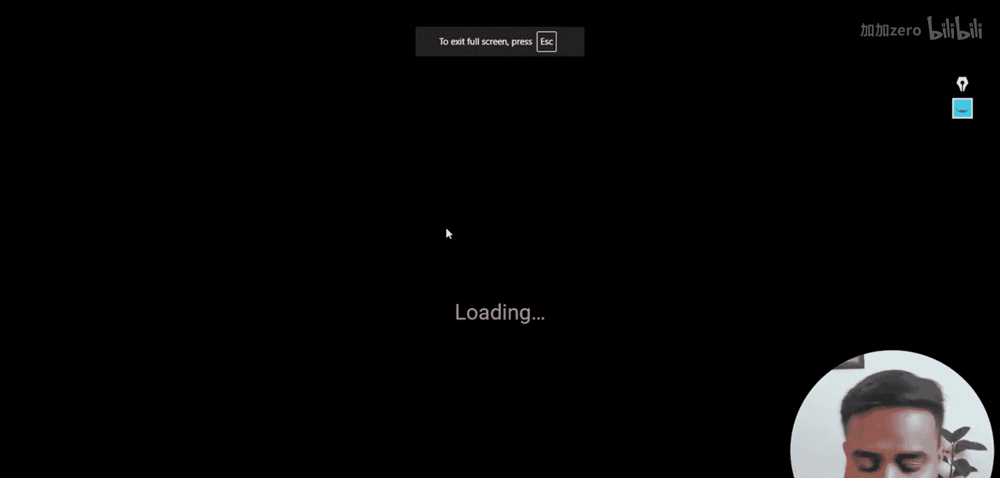
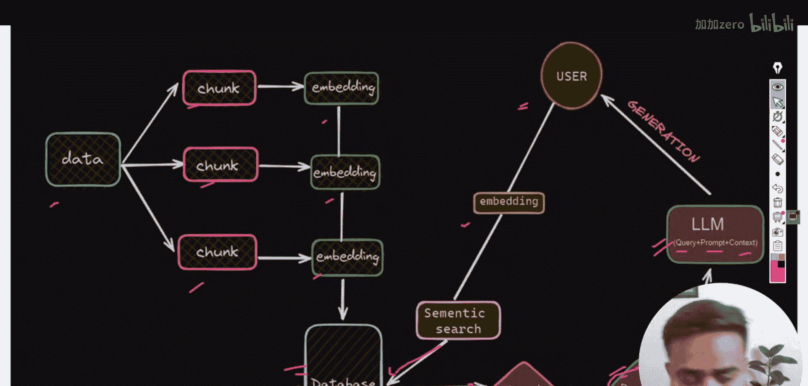
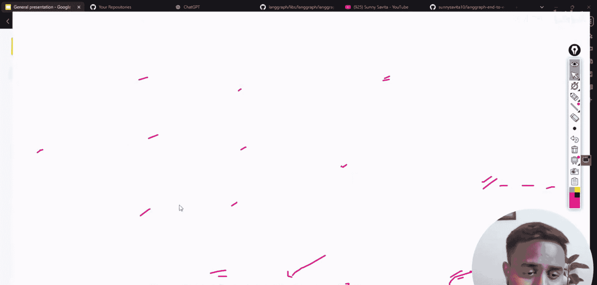
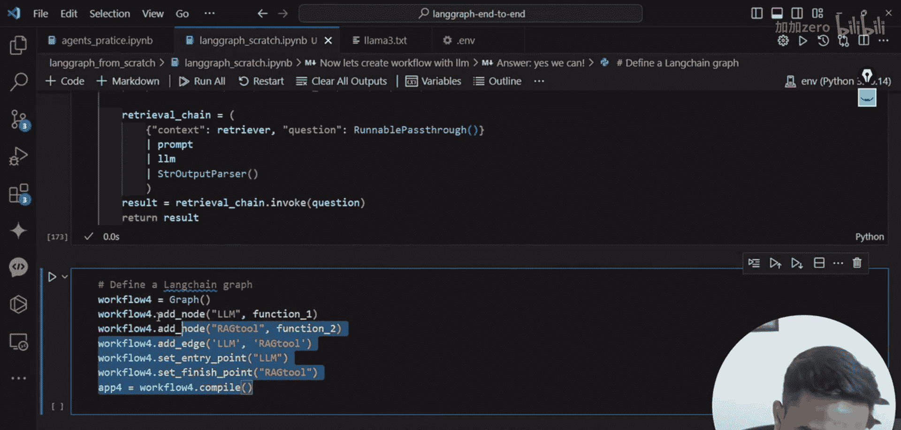

# Sunny Savita【中英⚡生成式AI：从初学者到专家｜Generative AI In-Depth Roadmap from Beginner to E】 p65 P65 LangGraph：08 Adding RAG to LangGraph Workflow ｜ LangGraph Deep Dive #llm #ge [BV1Uht8zDENA_p65]

Hey hi everyone。 welcomelcome to my YouTube channel。

 My name is Sunni Savita and I'm back with another exciting and important video。

 guys in this particular video， we are going to complete the remaining part from the previous video in a previous video I explain you how to code the la graph from a scratch and I explain you the graph class from the la graph module if you haven't check with that particular video。

 please go and check that video is very much important to build your basics and in this particular video guys we are going to implement a few more graph few more architecture and all so let me show you what architecture basically I'm going to create and then basically will come to the coding part So here is the complete syllabus guys this one as you can see I have the complete syllabus and knots over here so that you will get a good start if you are going to start your la graph journey if you want to understand the la graph and guys where you will get this entire material so you will get this entire material inside。

This repository so please visit to my Github repository this is the user name Sunnyavita 10 Okay and here you will get this particular repository you can easily download all the material from here itself Now the same repository see I created two repository with respect to this language of course So this is the first repository which is sync up with the。

Video tutorial okay and this is a Github repository where you will find out all the upcoming classes material as well。

 Okay now you can take both repository and you can keep it with you now guys so if you will go and check with my eo channel So here go just go and check with the video section inside the video section I uploaded seven video related to this la graph course and this is the eighth video and it will continue part of this particular video okay now what are architecture we have implemented inside the previous inside the previous basically class so here guys let me switch off my camera see here guys I implemented this three architecture the first three architecture this one this one and this one now in this particular video guys what we'll do will try to append the rag inside the workflow so we are going to create a graph workflow and we'll try to keep the rag over there right now。

So inside the next workflow guys I will be creating this complex architecture and this architecture I will be creating using the state graph and I will explain the concept of the this I will explain the concept of the conditional edges also okay so this is my agenda for this particular video now let's begin let's start so first of all let me show you the code code from the previous class this is the code guys here I cap the code inside my VS code and this file is available inside the Github okay so if you are finding out this file you can easily get it from the Github now so what I have to do guys I have to append the rag I have to append the rag inside my workflow okay inside the la graph workflow。

So the code is going to be start from here。So here I return a simple question Can we integrate a rag pipeline inside this workflow。

 Yes， we can do it。 So first of all， let me explain you about the rack here I have the architecture of the rag okay。

This one and if you are if you have seen my YouTube channel then you must be like aware about it that I have like so many video with respect to this rag and all like multimodal rag advanced rag every sort of a video which you are finding out with respect to rag you will get it on my e channel so please go and check over there now what it a rag guys so rag is very simple so here I have a data。

See， I have a data and this data actually I am going to convert into the chunks。

Okay then here I'm quick to create a embedding of it out of it and then keeping inside the database Now whenever my user is asking a question So first my query will come over here okay after converting it to the embedding and all and will perform the semantic search over here semantic search or similar search and then I will perform the retrieval Ill be getting the retrieve answer if I want to perform like one more level of filter I can do it this is called the reranking I already explain the reranking concept and then we are passing the data to my LLm for data we are passing the query we are passing the prompt we are passing the context so here guys let me switch up my camera I let me show you the complete architecture this is a complete architecture I hope it is visible to all of you you can take a snapshot of it and you can like whenever any rag will come to you you can take a reference of this particular architecture now。

So let's begin with a coding part。 So I cap the code inside my VS code itself。

 So here guys this is my complete code。 first time genetic I am sorry first I'm loading the em model here is my LLM then I'm checking whether my LLM is working fine or not So let me check it out in front of you I'm executing it and yes everything is working fine how to do this setup and all you can follow my previous session you will get to know about it now this is my all the import statement So output parts are template enable pass through text loader load chromma recursive character text So this all the import statement basically is for the so here Im going to here I'm going to implement the architecture So for that basically all the import statement is required now let me execute it and see what I'm doing So first Im loading the data then Im going Im converting it to the like chunks then I'm stor inside the database after。

Like after doing the chunk and all。Here is the database and then finally I'm going to create a rever on top of it。

 So this is my re now whenever I will ask the question so Ill be getting my relevant answer Okay so how many relevant answer tell me here I am mentioning the value K is equal to3 I'll be getting top3 relevant answer how many relevant answer top3 relevant answer from the database now guys see so over here I kept this particular data inside this data folder let me show you the data basically so the data is this one inside the data folder I have this Lama 3 do tx Lama3 is nothing it's a model from the meta AI meta AI generally provides some good open source model and Lama 3 is one of them are if don't if you are not able to use the openai model or any other model like which is a paid1 you can go ahead with this open source model which is completely free and useful as well okay now。

So this complete text it is related to the Lama3 itself and that a particular text we are going to be stored inside the database okay and we are creating a retriever out of it and here is what here Im asking a question and based on that it is giving me a relevant document relevant answer C so guys here I ask the question what is a meta Lama3 and see it is giving me three relevant document this first second and third so this data further I will pass through the LLM and then based on that I will be generating my output understood now let me do one thing let me create a workflow basically so here guys here I'm going to design a very basic worko where I will keep this rag so let me do it guys。

Now let me create a graph graph out of it so here guys for creating a graph we required a function right so here is what here my first function which I am keeping over here and this my now let me keep the second function as well and here is my second function okay I'm creating a very simple workflow and here basically I will explain the concept of this agent as well okay and then in the next implementation inside the next graph I will import the state graph。

So here I am creating workflow using a simple graph or module itself okay graph class itself now here is my workflow guys this is the like workflow and you can easily understand if you have seen my previous video。

 so I am creating an object of this graph。Then Im going to be adding the node。

 so here's my LLM and then inside a second。Inside the second note here I'm going to keep the rag tool okay this is my rag inside the second function and then guys here I'm creating an edge edge means what connectivity between this LLM and this rag tool so from this particular function1 from this LM where I'm calling the LLM inside of function1 from here what I'm passing so here from here basically I'm passing this agent is state and this agent is state basically is containing the message it is containing the message it is containing the user input which I'll be passing it over here and this user based on this particular user input I'll be generating my output from the rag so here I'm generating two output one output from the simple LLm okay and here I'm generating a second output from the rag and just for the sake of simplicity I'm just going to compare as of now what my LLM is generating and what my this like rag is generating this is this is agent of this main this is the agenda of this particular workflow nothing much but you can like tweak the logic according to。

Your requirement， whatever you want to do over here I'm just showing you the simple one here is the function one okay inside the function one we are getting a response from the LLm and here I am going to return the agent state after appending the message and this response now inside the second function。

I am going to capture the message from this agent instead and the same answer I am going to generate the same answer I am going to generate through the rec pipeline that said okay now let me create a workflow so this is my workflow now after workflow guys I have to like display this particular graph。

So this is the like code for displaying the graph。 Okay now after this one， guys。

 what I will do I will be invoking the graph。 So let me keep the cushion for invoking the graph So here it is this one。

 Now let me execute this thing。 So here is my function1。This is my function2。

