# Sunny Savita【中英⚡生成式AI：从初学者到专家｜Generative AI In-Depth Roadmap from Beginner to E】 p66 P66 LangGraph：09 End to End Chatbot using LangGraph With Memory #llm #genai #aia [BV1Uht8zDENA_p66]

Hey hi， everyone。 welcomelcome to my channel。 My name is Sunni Savita。

 and I'm back with another exciting and important video。

 guys I started with this end to end Lagra course， and I already uploaded8 videos related to this course。

 Now from this video onwards guys， Im going to start the advanced part of the lagra So in this particular video I will show you how you can create an end to end chat board using lagra module。

 and here in this particular video I will explain the concept of the memory as well。

 how you can sustain the memory inside the lagra chat board So each and everything I am going to show you inside this particular video。

 So please make sure you are watching till end and if you are liking the video。

 then please hit the like button and subscribe the channel。 So first of all。

 guys let me show you the syllabus。 So I already completed this first if you haven't check with my YouTube channel。

 please go and check and then I came to this like Lagra introduction。😊。

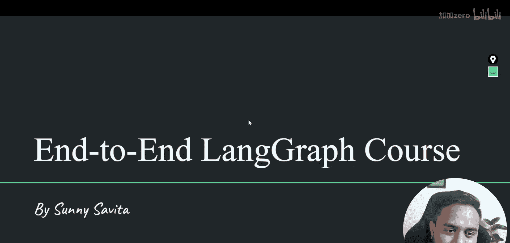

I explain the La graph concept I explain how to create a land graph from scratchch using the different different classes of the La graph like graph and the state graph and I explain with the couple of concepts like graph is straight node ages visualization is streaming and all Now a few concept are remaining like checkpointing breakpointing configuration memory so in the advanced videos of the land graph I will cover all these particular concept so this checkpointing breakpoint I will sorry checkpointing and memory I will cover in this particular video and the breakpoint in the confiation and all I will be discussing in the upcoming videos so let me show you the last slide where actually I cap the main and the very important syllabus of this land graph so I'm going to start with the chatboard with the La graph okay。

Then I will come to this agenttic pattern， different different agent pattern inside the la graph。

 then I will discuss about the multiagetic system。 will try to create a multiagetic system。

 which is very much important。 then I will like I will explain this concept rag with la graph will try to create a different different kind of rack pattern like corrective rag agent rag and the self rag and then we'll look into some project as well So this is the whole sort of syllabus guys now I' am into the last slide and I hope you are also following to me So guys here inside this particular slide I cap all the all the theoretical stuff if you want to check you can check out with my Github I already uploaded this particular slide to my Github now guys apart from this one here is my channel you can go and check with our video section you will find out all the videos and apart from this one I created playlist also so you can follow in the sequence everything you can follow in the sequence from here now if you have any。

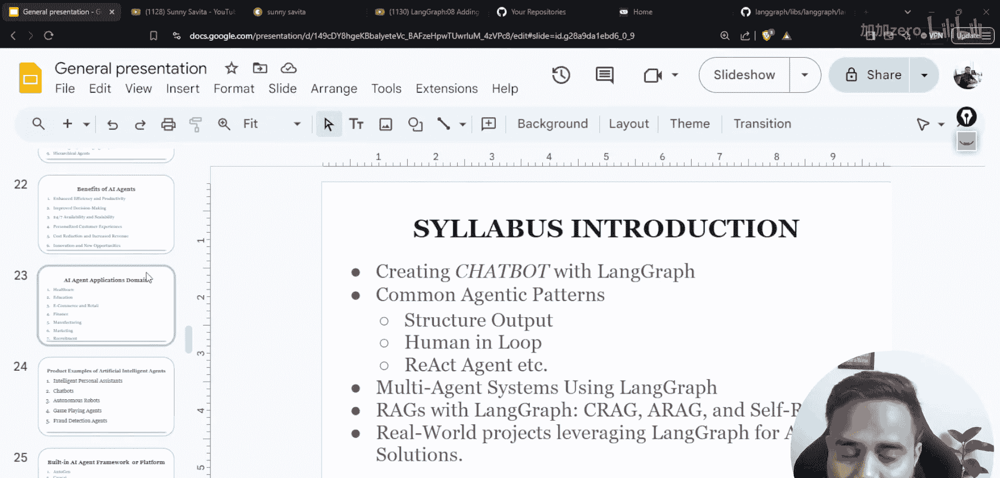

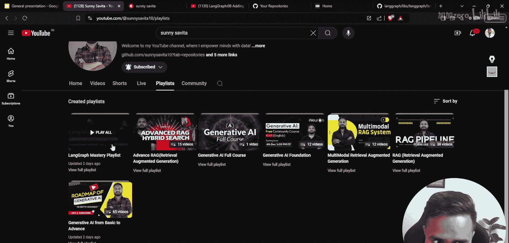

You can mention inside the comment section definitely I will reply otherwise you can connect me one to one as well inside the YouTube description I I given you one link okay one to one call link so you can utilize this opportunity and you can connect with me through the topmate okay I have a various option like quick chat career guidance resume review interview the patient mock interview and for any sort of service you can connect with me and I will be available at the given time okay now。

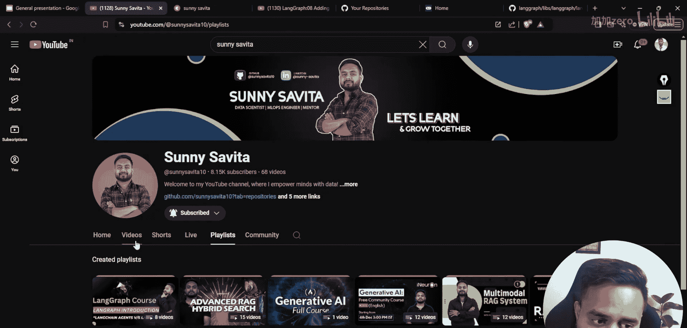

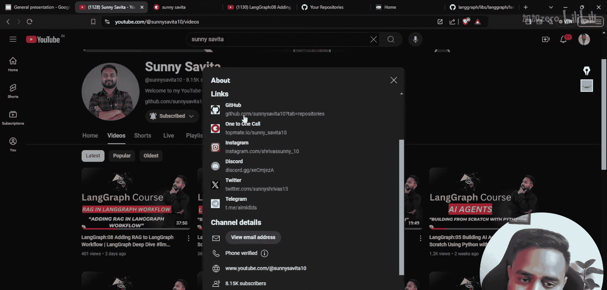

Let's begin， let's begin with the coding。 So first of all guys， let me show you one more thing。

 see guys each and every line of code basically I'm writing so each and every line of code basically I'm writing inside the Vs code and this Vs code I already sync up with my Github okay so this Github repository where you will find out this Github repository So once you will open the video let's say you open any sort of a video Okay so after opening the video just go and check inside the description inside the description guys you will find out this end to end La graph code Okay so click on this particular link So this link basically it will redirect to you over my Github repository Okay this one so just just go and check out with this La graph end to end okay La graph end to end and inside this La graph end to end inside this La graph end to end you will find out the complete。

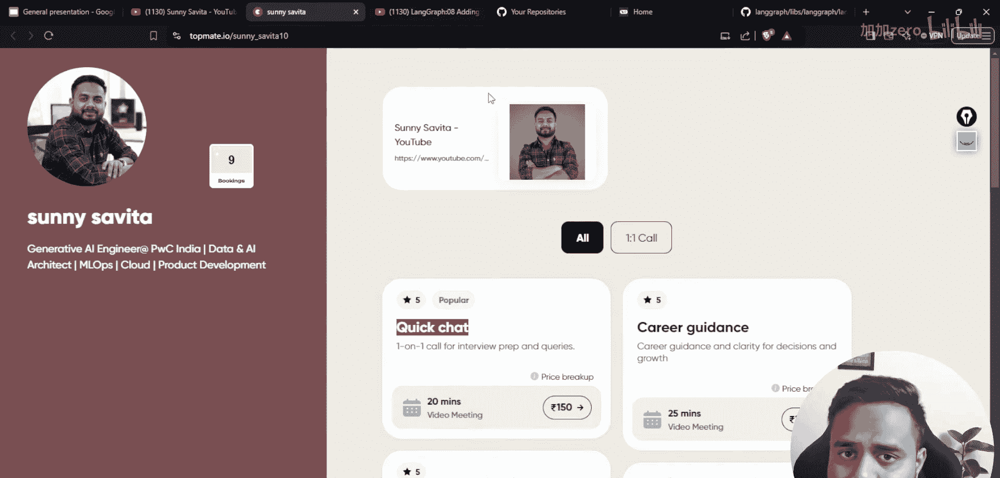

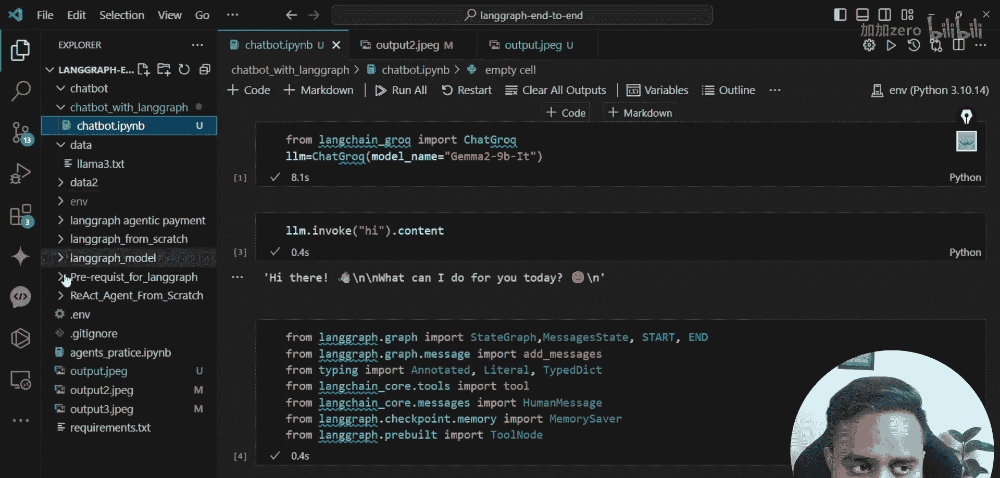

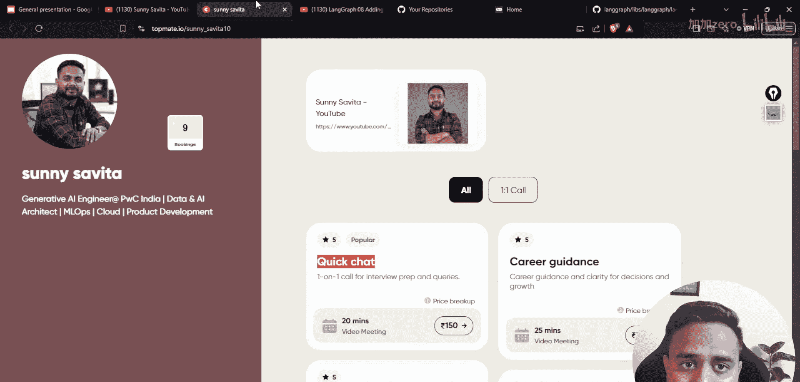

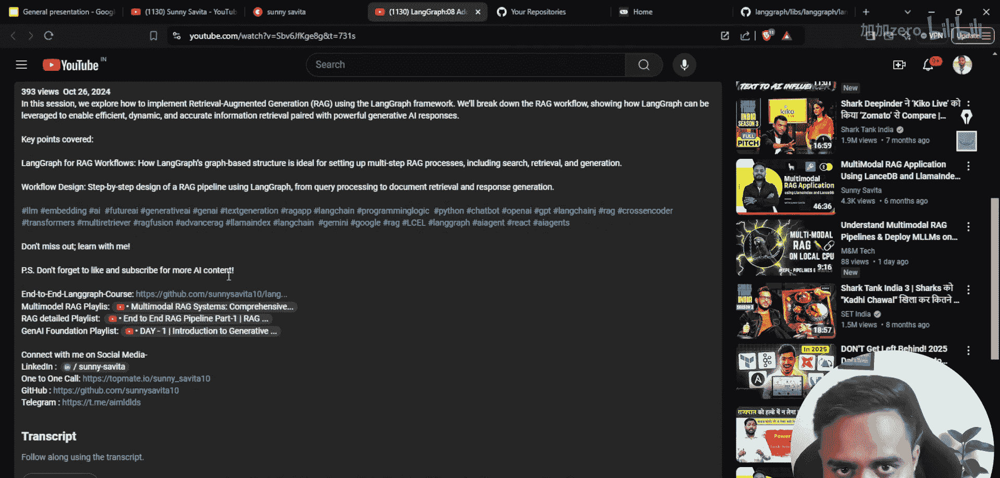

You will find out the complete basically nodes right and apart from this one I created one more repository so La graph end to end course you can check out with this repository as well so here I kept the future code as a future code so you can take this particular code and you can practice it from your end okay so now I hope everything is clear here so let's begin with a coding see here inside this particular folder I created one more folder chatbo with La graph okay this one。

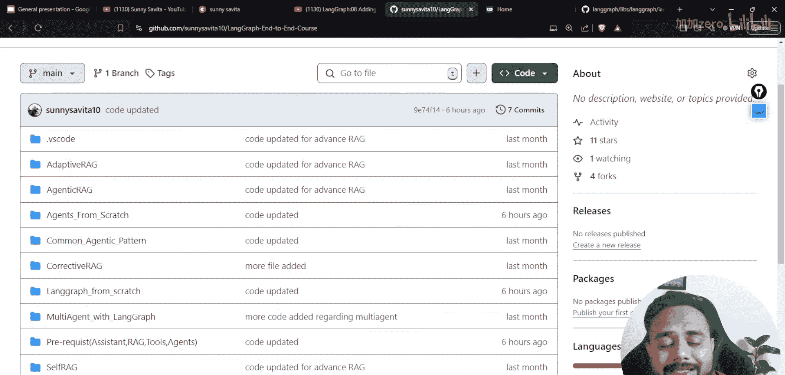

But don't worry this video is going to be very interesting because I will show you the end to end implementation of the chatbot and I will create a UI also for it first let me show you the first let me show you the implementation inside the IP V file and then I will come to the end to end chatbo like model or coding and all so if your manager is asking like create a poC for me using this using this la graph okay can you integrate this la graph inside the existing solution and all definitely you can do it can you can take up reference of my code whatever I'm writing interest video and then you can like implement any sort of code any sort of a chatbot from your end so here guys I created one IPy and V file chatbo or IPy and and I'm loading my model I'm loading the IM from the rock you can load it from anywhere it is just up to you and after loading the model what I'm doing Im just checking whether it is working fine or not let me show you that so yes。

I' am able to load and here I am able to check also then I am importing a couple of module so here basically I have different different module like a state graph message the state started。

Then add message type date， human message memory memory saver and tool node so different every input statement and I will progress in the solution you will get to know each and everything。

 Okay so first of all guys what I'm doing see let me show you what all type of architecture we are going to create in this particular video so here I cap the images of those particular architecture So this is the first one Okay this is the second one and here this is the third one so let me show you the first one guys see this is the architecture。

 just a second let me open it one more time here this one so here I am going to integrate with a simple chatbot function and this chatbot function basically it is going to be carry the LL model so my input is coming then it is going through this chatbot node in backend actually it's a function and then it will it will give me output this is the first architecture inside the second architecture we are going to create a conditional edges whether I need to select a tool or directly I need to provide。

From my agent itself from my LLM okay so this is my one node and here I put the conditional edges this dotted line actually it is representing to the conditional edges so whether I need to choose this conditional edge or I need to I need to give you the direct output in between basically I will decide got it so this agent basically is taking a decision now here inside the third architecture you can see what I am doing I am creating a loop okay loop so first I will start from here let me explain this part。

First I will start from here means my input will then it will go to the agent agent will decide whether I need to select the tool or directly I need to give the output So let's say I decided a tool so I will select the tool I will generate answer and then again I will go back to the agent and then finally I will give my output from the agent itself I will be generating my final output so here using this particular using this particular architecture what what I need to explain you I need to explain the concept of the direct cyclic graph so cycle is possible inside this cycle pattern cyclic pattern is possible inside this la graph we can create as much as loop and that functionality I will show you inside the multiagetic system also so this is one of the example of it and you can create as many as loop whatever you want and today I will show you how you can do it I hope the agenda is clear now let's begin with the coding bar So here guys I kept all the statement now。

啊。Im going to create here what I'm doing。 I'm going to create a method。

 My method name is going to be call model， so let me keep it over here。

 this is my call model Okay so this call model basically it will take a state instead is nothing it user input and here this state type is nothing it's a message state then I will fetch the user input from here and I will pass it to the Nlm and finally I will be giving the response in the previous class guys I was using the like custom custom class but this La graph is also providing one class the class name is message state message state and inside this particular class it is defining a message okay in the previous video I created a class now if you remember so I created a state class and then inside that message message was the key and then I was defining the type of that particular message if you don't know let me show you that so here guys I am going to open the Im going to open the Github of the La graph La graph code is a open source code。

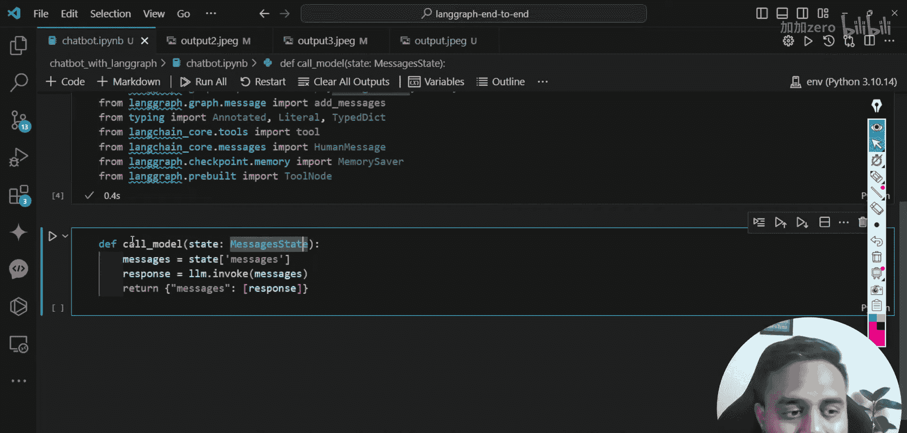

So here we have two type of graph versus normal graph and the second is a state graph okay now here they have given you one more file message py so just open this file and it scroll down so inside this file actually they have defined so just look over here inside this file they have defined this message state okay so here message state basically what's the meaning of it so the meaning is very very simple it will take a message and this message is nothing it's a list of message okay so message actually is representing to the key and the value is nothing it's a list of messages if you want to know more about it you can check out with my previous video。

Got it now what I am doing see here are basically I define the state and this is a state based from this。

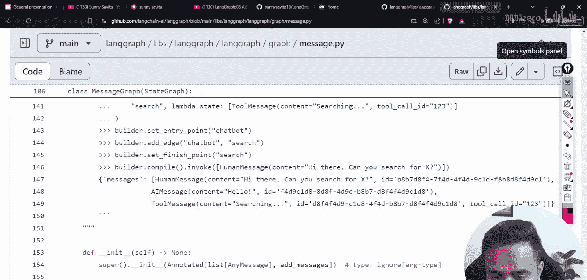

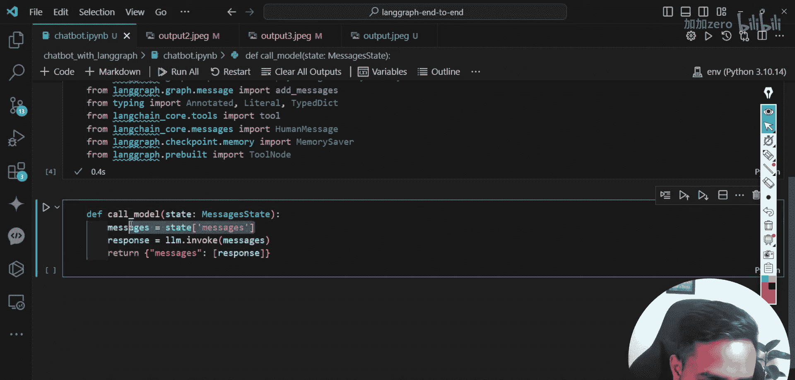