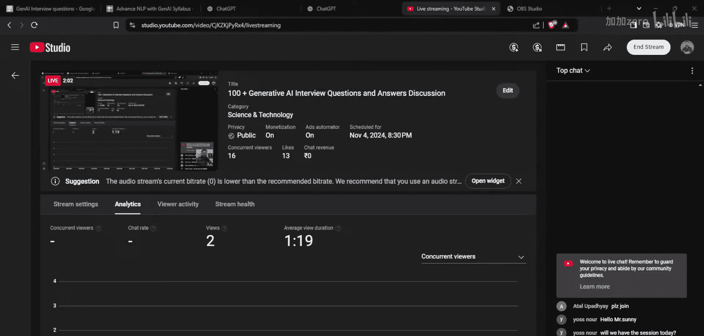
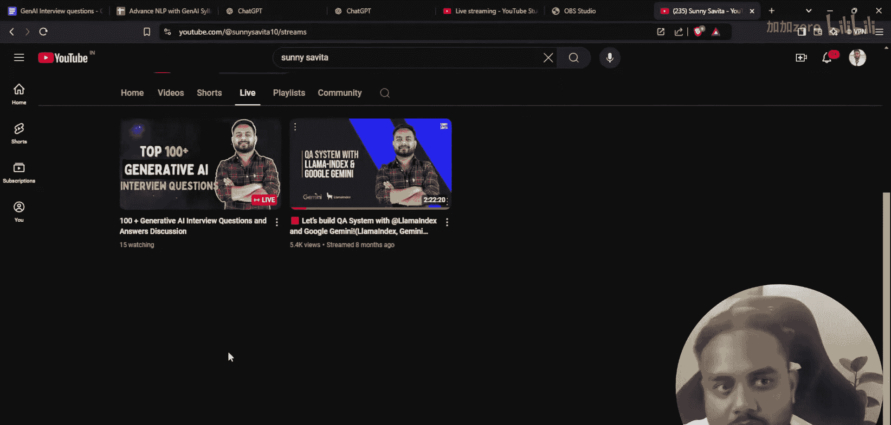
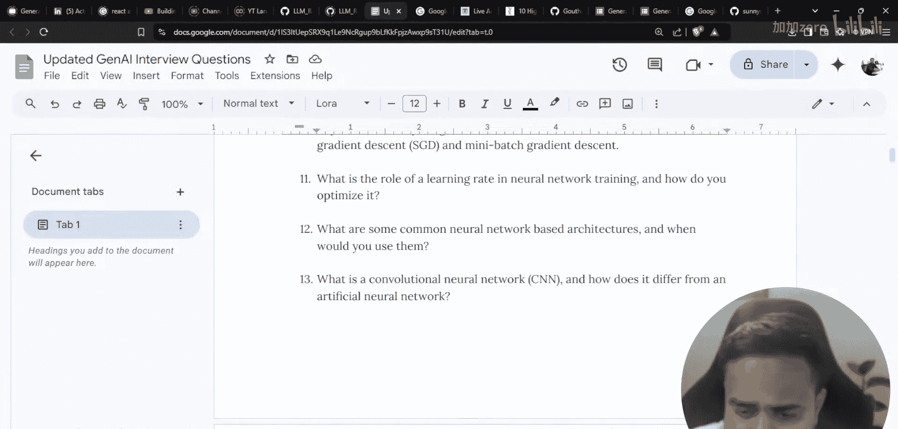
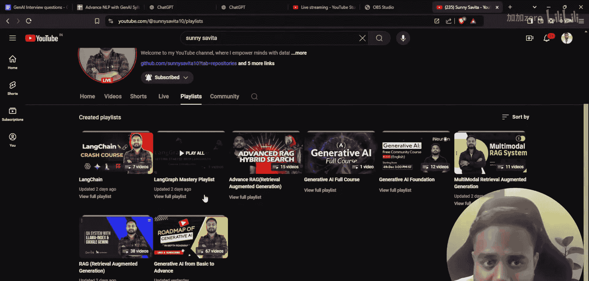
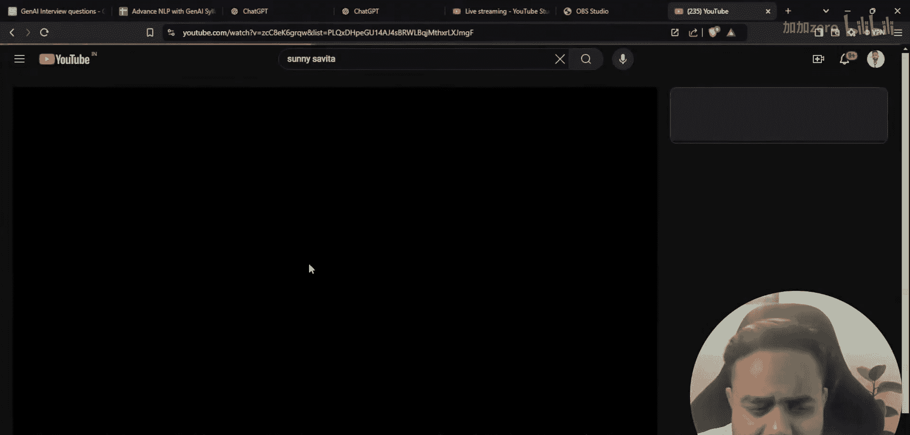
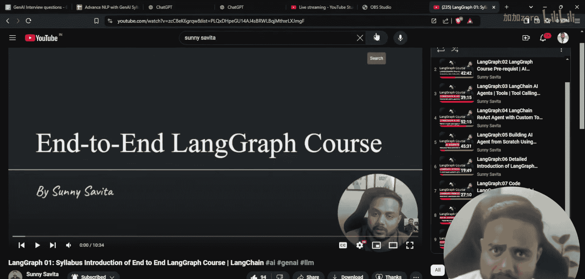

# Sunny Savita【中英⚡生成式AI：从初学者到专家｜Generative AI In-Depth Roadmap from Beginner to E】 p67 P67 🟥 100 + Generative AI Interview Questions and Answers Discussion [BV1Uht8zDENA_p67]

Okay， guys， so can you hear me， I am audible to all of you。

 Please do confirm the chat if I'm audible。You can mention inside the chat option。I'm audible guys。

 I'm audible and。Please， do confirm。FromI hope from mind， everything is fine。 Everything is perfect。

Over great。So I am visible， right， guys， any issue， anything。Please tell me guys， if I am visible。

 then。I think camera camera is a little blur。 Okay， let me check it out just aside。Wh is blur。Okay。

 great。 So still， it is blur about survive。I hope everything is perfect， from my end。食嘅。Okay， great。

 so。Let's start。So yeah now guys see we can start with the session I hope the agenda is clear so the agenda is basically I' am going to discuss the gene interview questions this is my second live on my YouTube channel if you will go and check with a live section so I took one live session eight months ago okay and this is the second live basically which I am doing。

So inside this session we will try to discuss some gene questions。

 How many of you you are following to me on my YouTube， guys tell me。

How many of you you are following this video on a regular basis？分明。

I hope guys you are following my YouTube channel on a regular basis and you are learning your learning is going very。

 very amazing right and see I created a different different playlist okay inside my YouTube channel so relate the language and La graph rag and here relate to the retrieval argument generation multimodal rag also so many playlist and all now in this session so what I will do I will discuss like couple of interview。

 not couple of interview I have more than100 plus interview and like I have a variety of the interview each and everything will try to discuss in today's session not answers answer is going if I will discuss the answers So this session will be too long so I will stick with the questions itself and I will give you the task basically with respect to those questions and I will let you know my plan what is my plan with respect to this interviews and the upcoming sessions which I'm going to do on my YouTube channel。

Yesterday I scheduled this session this live session but I couldn't like join that okay so I had some work so because of that I said reschedule it for today and yes I hope so everything is fine from my end so guys please give me a quick confirmation if everything is perfect from my end everything is going well so then I will come to the like interview question and all I will discuss the complete like so first of all I will let you the complete agenda and one by one step by step will try to discuss each and everything tell me。

Tell me， guys， yes or no。Yes， and then you can ask your doubt and all and I will try to keep I will try to conduct these type of sessions on a regular basis。

 I'm thinking to like keep this type of session thrives in a week okay at least twice in a week so we connect one session in a weekday and one session in the weekend So I can give you like some update and we can discuss some like some topics。

 different different topics and all okay the recent and like the recent topic recent basically in terms of project as well so well try to use a different different tools and component and framework and well try to create some amazing project also in the live and apart from this one did one post as well on my YouTube channel I think one month back itself So there I told you guys that I will complete I will come to basically I will come live for this Gene V。

L tutorial as well so end tutorial and here I asked the time as well but unfortunately I couldn't come live okay for this particular session。

 this live session because I was busy with my office work and all so now like what I'm thinking I will come like at least twice in a week live and will try to discuss some important topic and all later on once I will complete all this playlist whatever I have started so right now like I am teaching this land graph basically I started the end tutorial of this la graph and I discuss I uploaded around nine video related to this la graph if you will go and check with this playlist nine more video is about to come because I want to like complete it as soon as possible like I will let you know about the how you can create a different different kind of rag like agent corrective rag and then I will come to the multiagetic system with a different。

Different projects。 Okay， so this is my motto related to this particular playlist and then I will start with some new topic Okay。

 and in between in between this playlist and or in between this topic So I will come on live and I will try to discuss some projects some。

Like like this hot topic okay related to the Gene V and I will try discuss the interview questions resume and all how you can create a resume not only this Gene V I will try to start it from scratch okay whatever thing you have in your mind not with respectful gene even the machine learning deep learning classical MLldl everything guys like will try to discuss here okay and yes you will learn a lot from mind this is my promise to all of you so tell me guys how your learning is going on through my YouTube channel and can we start or not with today's agenda tell me yes。

You can give me quick thumbs up you can mention inside the chat let's like make this session a little more interactive okay and I'm not very much used to this live setup means let say YouTube live setup from my end I did a lot lots many like live session okay but this is my YouTube channels so this is just a second like live session and don't worry guys like in some days I will be like little perfect okay。

And yeah， so yeah resume also definitely will try to discuss about the resume and all everything I have like many more resume even。

