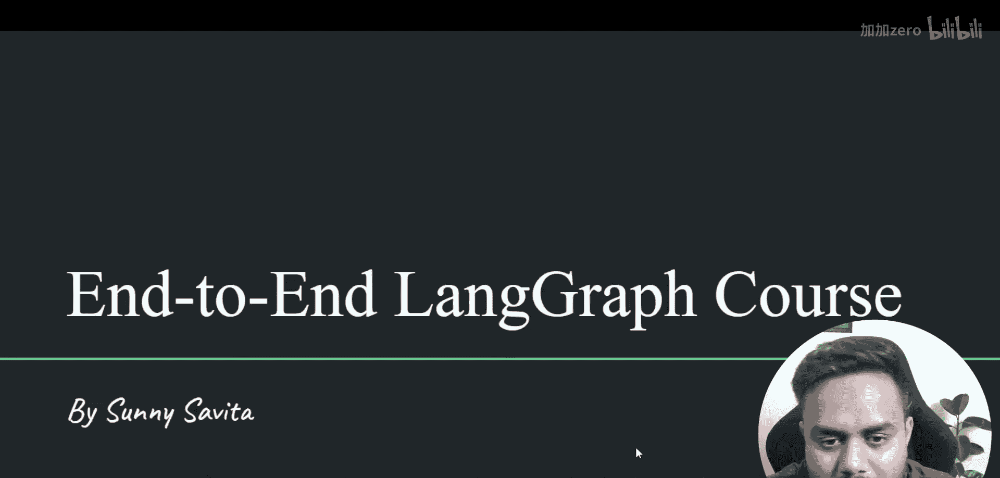
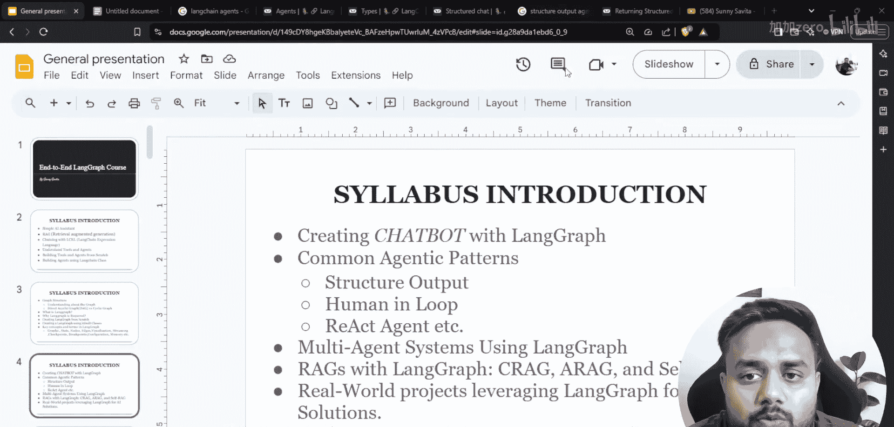
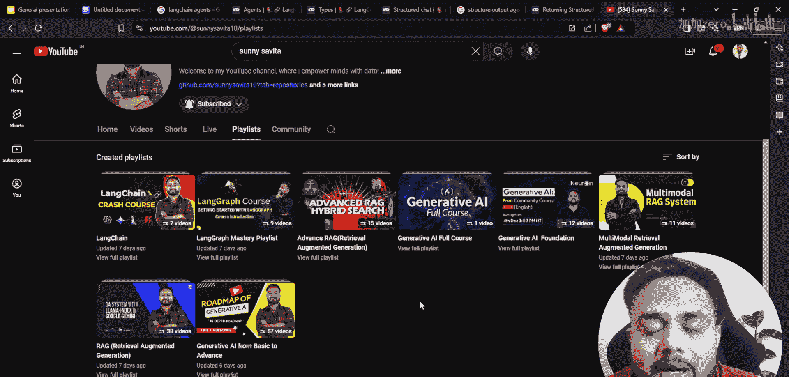
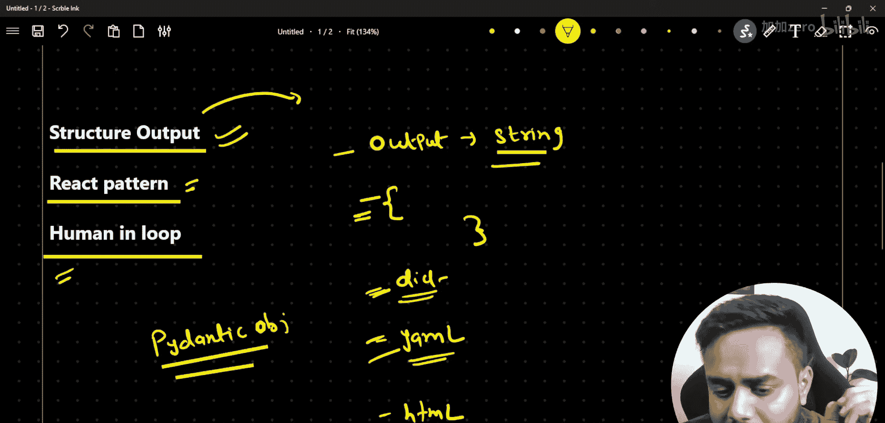
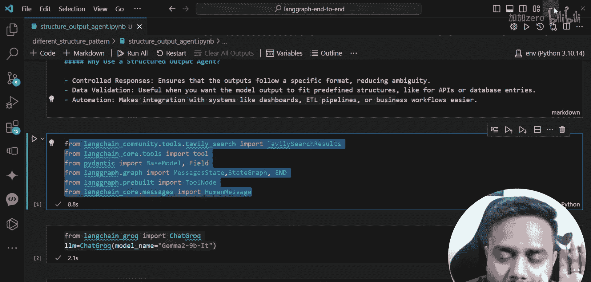
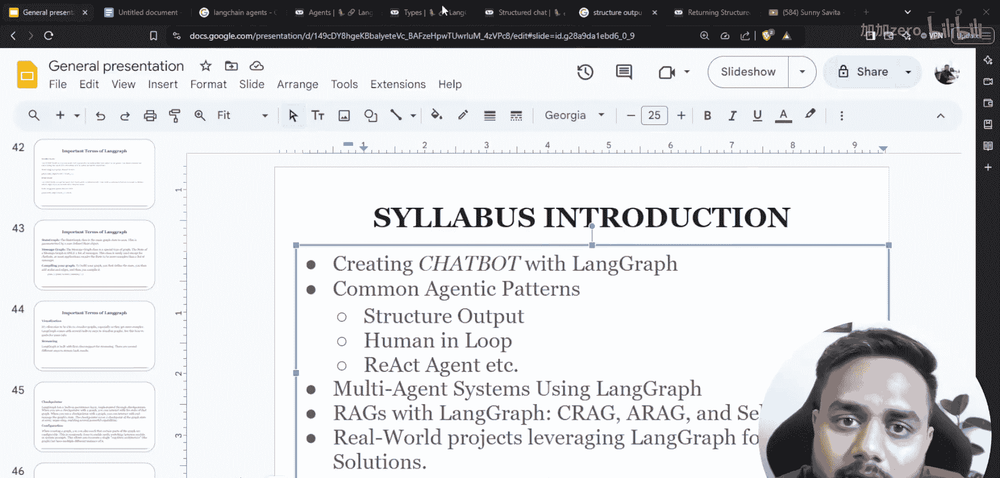
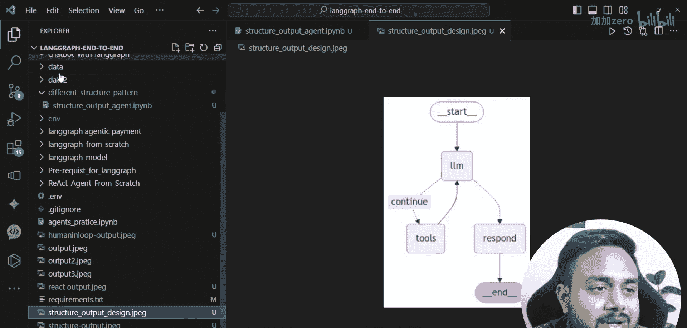
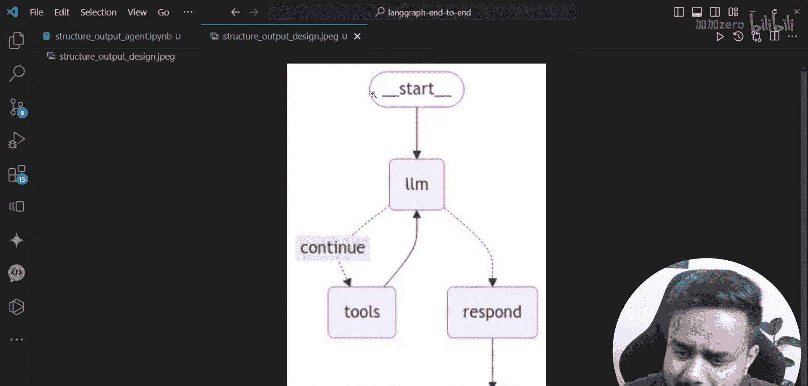

# Sunny Savita【中英⚡生成式AI：从初学者到专家｜Generative AI In-Depth Roadmap from Beginner to E】 p68 P68 LangGraph：10 Structured Output with LangGraph Agents #llm #genai #aiagents # [BV1Uht8zDENA_p68]

Hey hi everyone。 welcomelcome to myro channel。 My name is Sunri Savita and I'm back with another exciting and important video。

 So guys I started with design to a landgra course and I already uploaded nine videos related to this course this is the 10th video and from this video onwards we are going to start with a different different agent pattern Yes guys So what is a different different agent pattern I will let you know each and everything from a scratch and before that let me show you the complete syllabus let me show you the syllabus still which point we have already cover and what all thing is remaining So guys here is a first slide which I already completed if you will go and check with the playlist section there you will find out all the videos related to this particular topic and let me show you the second one so I already completed this slide as well and in the previous video I shown you how you can create a chatboard using the land graph and inside。

That particular video I explained you all these particular concept and before that as well I like uploaded the video related to the La graph introduction D okay and the concept of the built in classes of the La graph and the different different other concept like graph state notes ages visualization each and everything Now guys this is the last slide where basically I already discuss about the chatbo and now guys we are going to start a different different agent pattern like structure output human loop react agent and all and then I will come to the rag rag with La graph different different rag will try to implement like corrective rag agent rag and self rag and then we'll try to create some multiageenttic system and couple of project as well So this is a whole sort of agenda I hope this is clear to all of you if you are following to me from a starting。

Then I hope so this each and every point is clear Now guys we are going to start with this different different and like this common agent pattern and each and everything I will try to explain you from scratch So let me show you my YouTube channel if you haven't check so far please go and check and if you will go inside this playlist section I created a different different playlist like la la graph rag advanced rag multimod rag from scratch and the genetic V okay now if someone want to follow from scratch so what you can do you can follow this particular playlist and let's say someone want to understand the rag so that person can follow this playlist someone wants to understand about the la channel la graph you can follow this particular playlist apart from this one you will find out my other code as well so this courses I took on the different different other platform so if you want to check out this one you can go and check now guys so let me explain you the different different agent pattern and then we start with a practical implementation guys。

So here guys we are going to discuss this three important pattern。

 The first one is the structure output pattern。 The second is the react pattern and the third one is a human in loop。

 So first I will start with this structure output and I hope so you have seen the title of the video as well then I will come to the react pattern which we have already learned but again I will show you this pattern using the la graph and then I will come to this human in loop at how you can keep the human intervention how you can keep the human intervention in between the execution So this three pattern is a very important pattern and in like in your application in your implementation if you are going to create any sort of application implementation using the la graph easily you can adopt it So first one is guys is structure output and the name itself is explaining what it is trying to say so whatever output we are going to generate that particular output we can keep in a particular structure right So let's say whenever we are going to generate output so that that output generally we get inside the string。

Right is string but guys apart from the string， can we get a output in a different different other format。

 different different other format means can I get output into the JN format。

 can I get output into the dictionary format okay dictionary basically it's again similar to the JN it's a python specific object and can we get output in a Yal format or let's say if I want to get an advanced format like HTMLml you knowml right or maybe if I want to get in a latex format right so can I get output in a different different format is it possible Yes it is possible so what we can do we can define our pic object okay we can define our pic object and using this particular object pic object I can get I can achieve this particular structure Okay so I can generate output into the JN format dictionary Yal hml latex any of them right so guys in this particular video I will show you how you can get output in a particular key and value format Okay that further you can like convert into them。

Into the Json into the date or into the yal it is up to you according to the requirement now why we do it what is the requirement of it so let me explain you that part as well so this particular thing I kept inside the notebook and let me show you and that basically will get a better understanding guys here inside this notebook I am going to implement this is structure output agent and please try to read it what I written over here is structure output agent in Lang refers to。

An agent that produce response in a specific format such as Jason dictionary or in a different different other type Okay now what is a requirement of it So the requirement is very very simple So let's say if I want to get a controlled response means I don't want to get a response into the single stream I can give you better example so let's say if Im if I want to know about the Indian Prime minister Okay so like who is an Indian Prime minister from where he belongs and from like。

Wwhichch country he belongs Okay what is a capital of that country So everything I will get in a string format that is fine that is well in good but guys let's say if I want to get this output in a particular key and value pair means name name of the prime Minister Ra Modi and where he is living currently in New Delhi okay to which country he belong to India what is a capital of India again New Delhi Okay so I can get this particular output in a is structure format and that I can achieve using this structure output agent and for that will have to define the pi intake object。

Geting my point now again like why it is required so first is control response I can control the response second is data validation let's say if I want to send this particular data to any API means I return the backend code using this land graph and now I want to send this particular data to any API and a later on。

Means later on I have to show you over the UI or maybe I have to keep it inside the database。

 whatever like whatever I have to do， I can achieve it I can achieve using this structure output agent or if I want certain automation certain pipeline a certain like a dashboard ETL pipeline or which it is workflow and all after reciding my data to any of them like any of the basically a dashboard right like power via dashboard or tableau dashboard or maybe graph dashboard so I can easily automate that particular process I can easily pass the data to that particular dashboard to that specific I hope the thing is clear now once I will perform the practical you will get a remaining 50% thing so let's start with the practical guys and let me explain you each and everything here。

So here guys what I did I imported a couple of couple of statements。

 couple of module and here I am loading my LLM so this LLM which I' am loading from the G and which model I am reading I' am reading this Gema2 which is a open source model from the Google Okay now guys before starting with the practical see as you know we are going to implement this particular thing using the L graph but guys inside the L also like the developer the L community right they also have given you this particular facility let me show you with the older documentation of the Lang so guys once you will search over the Google itself here you will find out the laang documentation as well see。

This is Dub。So they they have already given you the way like how you can design the structure output and if you will read if you will read the reason of it so they are giving you the same reason this notebook covers how to have an agent written a structure output by default most of the output most the agent give the string output string me the single output now if I want to get output in a particular format like key and value format or any other format I can design that right So inside the older version of the length also they have given you that facility if you want to check out it you can do it I will give you this particular link inside inside the description but in our case we are going to implement this particular this particular output this agent using the language graph so first of all guys we require the model which I already written over here and I told you I'm using the Gma model now I required the tool as well so let me basically write the tool so we are going to use the tabt tabt basically。

W we use the tabt， the tab we use for scing the。For crawling the web okay so I can easily crawl the web using this tabt Now guys apart from this one we required a couple of more things so as we' go ahead I will let you know So first of all what I can do I can design my workflow Okay so this workflow is going to be like this let me show you the workflow and this is very very simple this is very very easy as well or what I can do I can show you the image first and then I will come to the workflow so here I kept the image guys structure output design yeah this one so this is the workflow guys and I hope so it is visible so let me zoom in see。

First I'm going to start。

