# Sunny Savita【中英⚡生成式AI：从初学者到专家｜Generative AI In-Depth Roadmap from Beginner to E】 p69 P69 LangGraph：11 Building Finance Bot with LangGraph's ReAct Agent #llm #genai # [BV1Uht8zDENA_p69]

He hi everyone。 welcomelcome to my Ro channel。 My name is Ters Savita and I'm back with another exciting and important video。

 guys， I started with this end to end Lagra course。

 and this is 11th video of this end to end course now before this video I uploaded 10 more important video related to this course if we haven't check so far。

 please go and check you will find out inside my section So open my group channel go inside the section there you will find out thelist of this La graph course now in this video we'll see how we can create a react agent using the La graph and many more concept I am going to discuss and even I will show you that how you can create a finance board using this react agent using this react with La graph and this video is going to be super important because I will be using a multiple tools over here and I will let you know that how this react workflow works in。

😊，Tms of this land graph So first of all， let me give you the complete overview of the syllabus that what thing we have discussed so far and let me show you those video and then I'll be starting with my topic now here guys you can see so this is the complete syllabus there a first slide it's a basic slide I already upload all the videos related to this particular points now like so I'm about to discuss this react agent which is a part of this common agent pattern now before that guys if you want to understand this react agent and for concept of the La graph and if you want to understand the multiagent and the rag with the La graph which I'm going to upload soon so please complete these particular slide I already created a video I will show you the video in some time so here I discuss about the graph structure I discuss about the land graph I discuss about a different different concept of the land graph and even I discuss the different inbu classes or how you can create a land graph and all from a scratch。

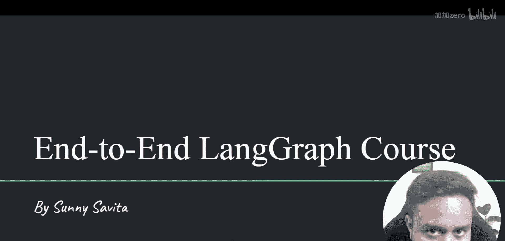

So each and everything I discuss in this particular slide and this particular syllabus if you don't know about it you can go and check out with my playlist okay now we are into this point react agent okay and it's agent pattern what is the agent pattern and what's the meaning of agent and all I already explain you in my previous video so if you want to understand those things you can go and check out now where you will find out all those video so please search my channel so once you will search Sunnya Vita and then go inside this playlist section。

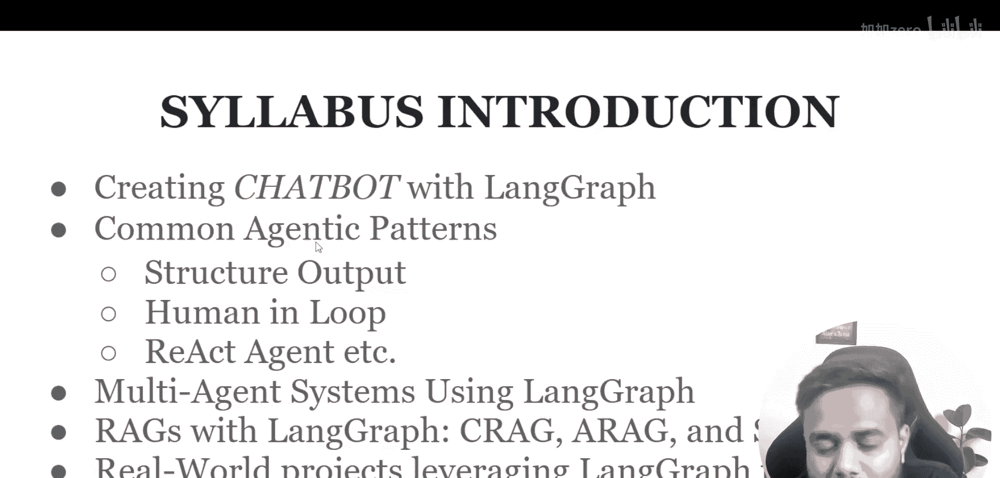

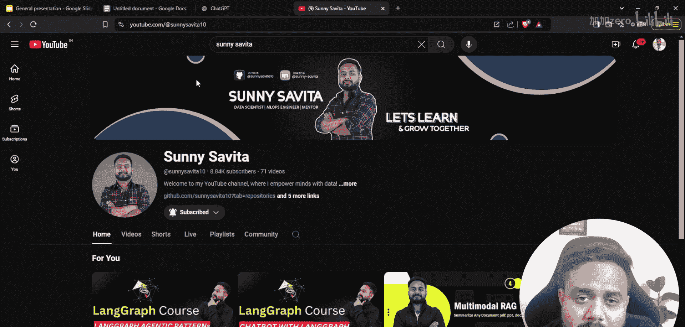

Here you will find out this La graph mastery playlist okay or else you can go inside this video section there also you will find out the video in the sequence itself。

 So if you haven't learned so far guys， you can go and check you can start your Lagra journey you can start your Gene journey not even the La graph I uploaded many more videos related to the Gene the rag all and in future I will be coming with many more videos related to Gene so if you haven't subscribed so far please do subscribe and please support the channel and guys if you want to connect with me1 to one so here I given you the option here inside the description of my channel So yeah take regarding whatever issue want to connect I will be available you just need to click on this link and you will get every information it great Now let's come back to the topic so first of all let me explain you about this react and whatever thing Ive discuss so far with respect to the。

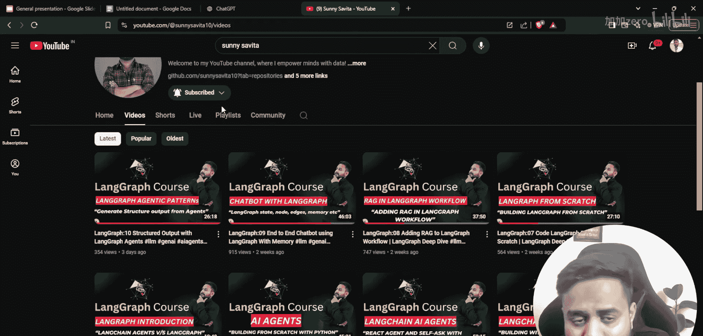

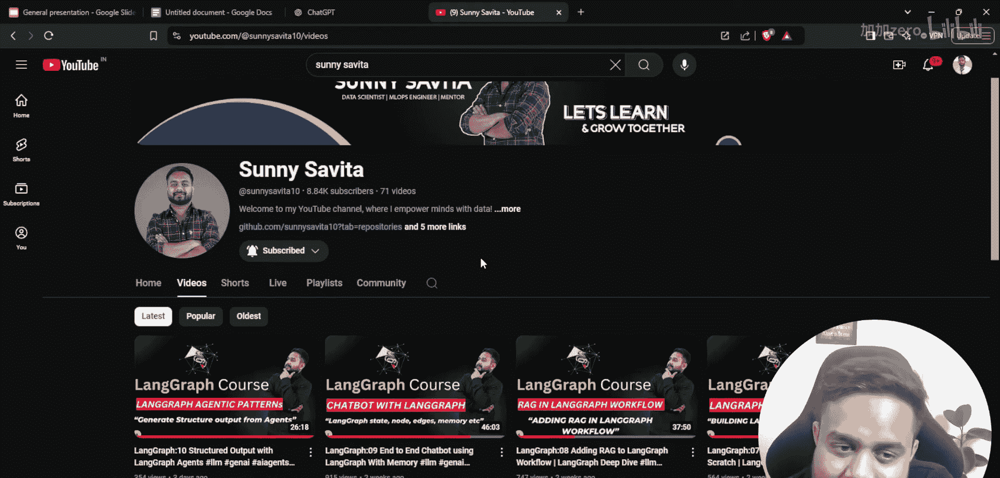

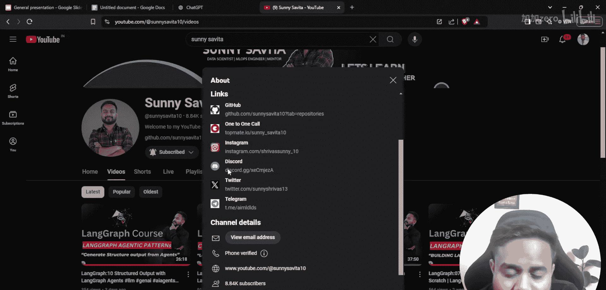

And then basically I will come to this react with La graph。

 So if you remember my previous session there I already discuss about the react。

 Okay I shown you how you can create a react agent using the L and even I shown you how you can create a react agent using using a python from a scratch so both a topic both a concept I discuss already and I hope so you are already aware about this react agent if you are following to my playlist if not you can go and check with my previous video so this is a complete code and code and all guys so you will find out this particular code on my Github so please go and check with any video let's say like if you are going to if you are going with this particular video so what you can do you can open the description and inside the description guys here I given you Github link now I mention all the code all the stuff inside my Github so please go and check please try to download all the material from here I uploaded everything over here prerequisite for the La graph So all the agent to send all。

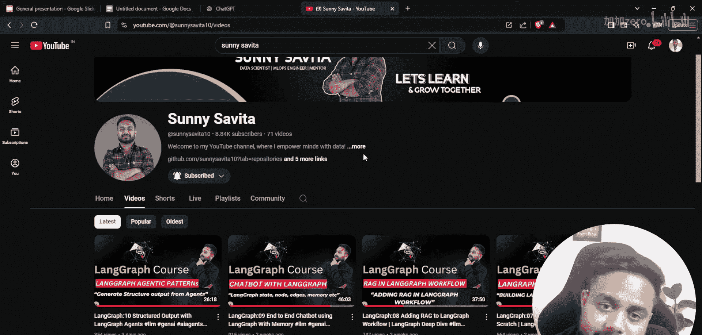

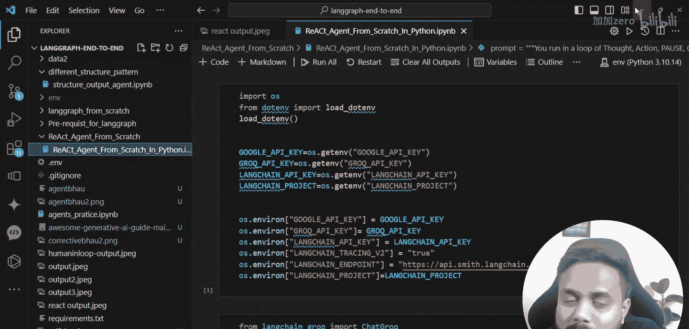

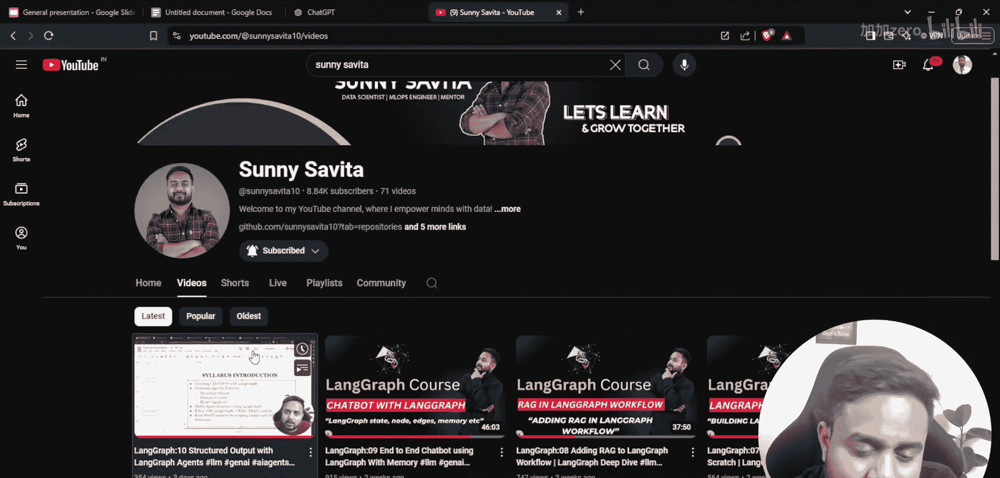

Okay inside this tools and agent you will find out the code of the react agent as well along with the link and here inside this particular folder you will find out the code of the react agent from scratch and Python right？

So you can go and check out every material is there。 every material is over the Gith。

 I hope so this thing is clear now coming to the next point so guys you are now you are comfortable with the material you are comfortable with the topic so let's start with this react okay react with land graph so here I will have to create one file I already created one file okay is structure output agent which I explain you in my previous video if you don't know about it you can go and check out it is like very much important if you want to connect your application your agent based application to your main stream application Okay now here I'm going to create one more file now my file name is going to be react。

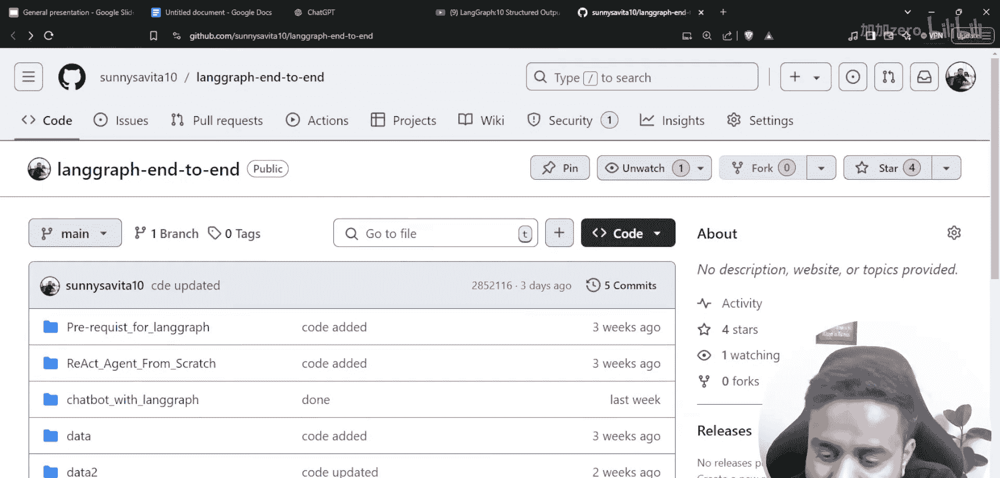

标准。With。Lang graph okay react agent with La graph dot IP and B So here guys， this is my file。

 Now what I will do first I will select the environment Okay。

 which is already there Now what I will do Ill be like importing and will be checking everything is working fine or not Yes。

 so everything is working fine and I hope so this is all clear to you if you don't know about the system set up and all you can check out with my previous videos means my like initial videos there I already explained the system set up and all everything Okay。

 even I created a dedicated video on my YouTube channel you can watch those video as well。

Now coming to the next point so first of all let me explain you about the react okay let me give you some sort of idea and then we's start with implementation step by step one by1 I will show you each and everything but guys I would suggest you highly I will recommend you these two videos or inside my playlist itself so just go and check with my playlist just second let me show you see here here here where it is。

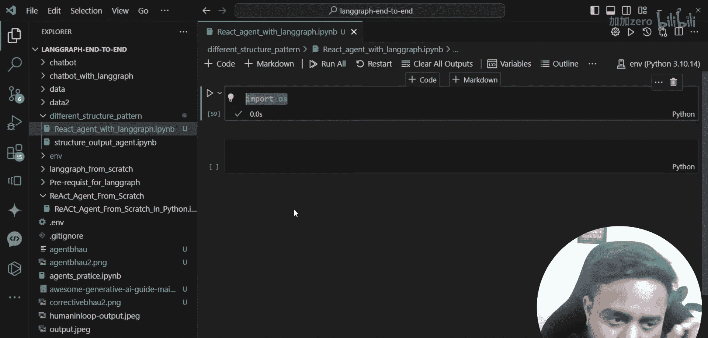

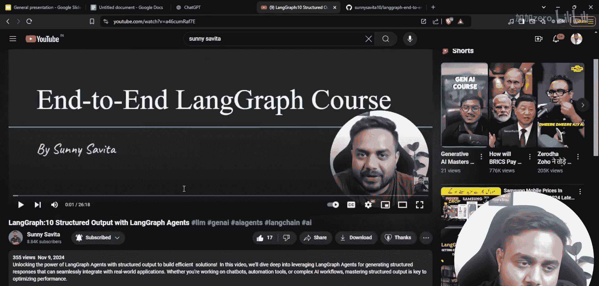

OfLanggra from scratch Lnggra yeah AI agents and this L and AI agents video number fifth and fourth fourth and fifth right this two video is pretty much mandatory to all of you if。

You want to deep dive into the agents and then rest of the video related to the La graph itself No so guys here I returned a couple of points on my blackboard and now one by one step by step I am going to explain you about this react。

guys， whenever we talk about the react， so how react works see。

 lets say we have an input we are passing the input this input is nothing its a message。

Message or whatever like input we are passing， okay。

 any like message any input along with a promptng and here let's say we are getting our output。Okay。

So we have output over here。😔，Got it Now in between input and output we will be having certain step。

 the first step is called the thought。 Okay， so what it will do it will think about the question。

 I will show you the example， Don't worry。First， let's try to understand the process。Okay。Part。

So it will think about this input and this input will go to the thought， then what will happen。

 it will take a action based on the thought， whatever it is thinking。

So now I will be having action one more step。And I already shown you this along with a prompt and all you can go and check with my previous video the video which I suggested then what will happen so after the action what it will do it will take observation okay。

So here is my。Ober。Viion。And see this thing actually this all the thing entire thing it will be working inside the loop Okay。

 and then finally I will be getting the output， but see Im saying now it will be working inside the loop。

 so it will take our observation， then if it is not getting a final output but it will do again it will go to the。

Where it will go to the thought again it will think about it then all that step will be followed and this this particular thing it will be working inside the loop okay so see input。

Partt action observation， and then if it is not going to satisfy the condition is not going to satisfy then again it will think then again action then again。

Observ okay now this action generally we use the tools over here whenever we talk about the actions。

 so we talk we use the tools understanding I hope you are getting my point you are understanding this entire flow Okay now let me show you the example because without example I would I I think so this is not a fruitful。

So let's say here I am asking the question my question is very straightforward what is the benefit of the cardiac exercise so first it is thinking。

So this is a thoughtful statement from the LLM then here it is taking action so ism going to find out the detail from the Wikipedia and here my this at this time Wikipedia is working as a tool this one okay it is taking a complete detail of this particular thought okay this quo then here is a observation right So observation basically it is a intermediateitted。

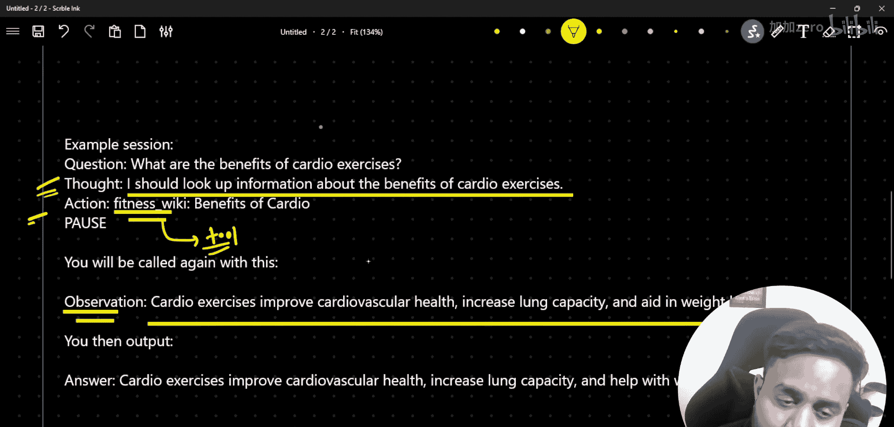