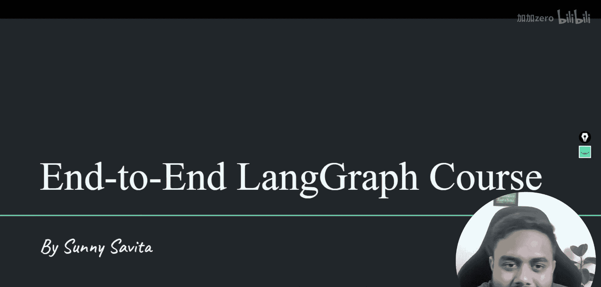
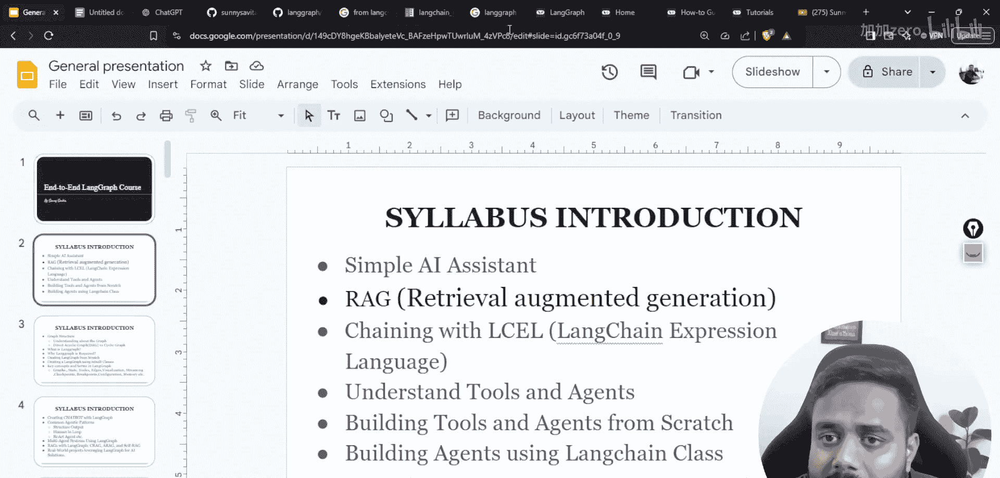
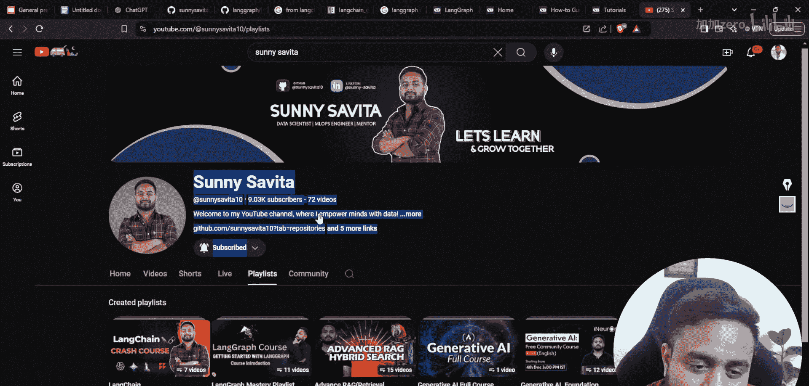
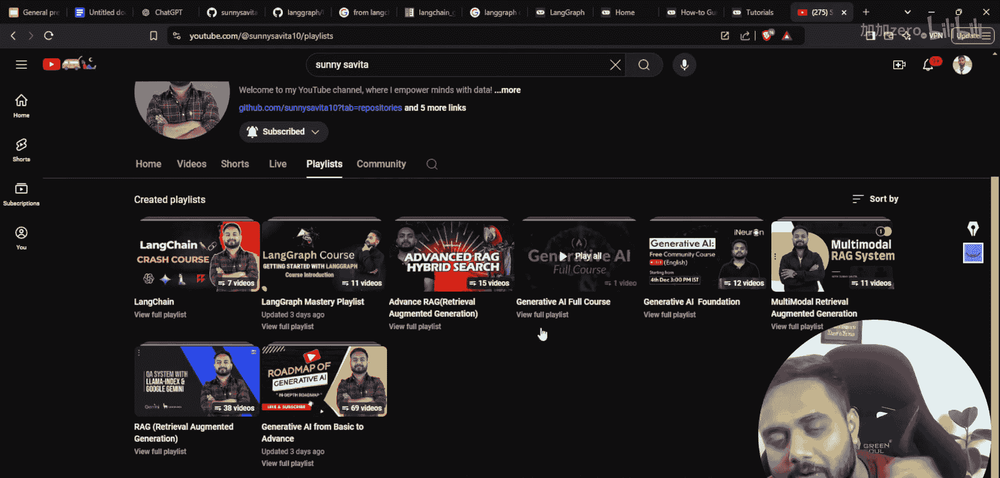
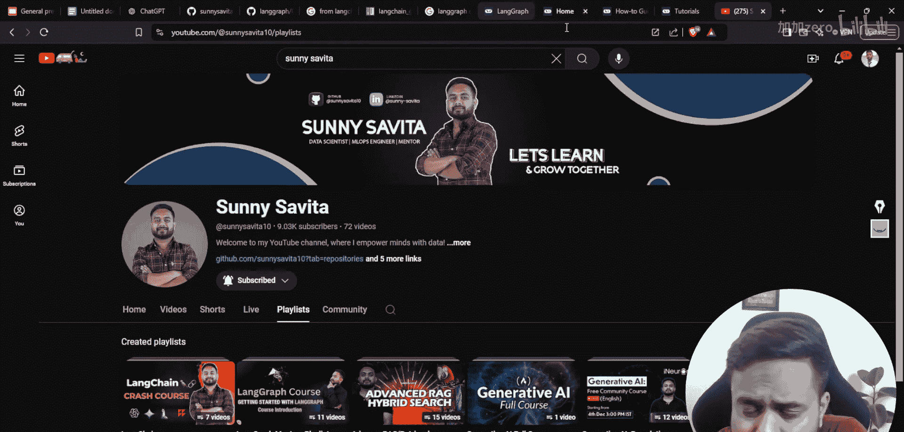
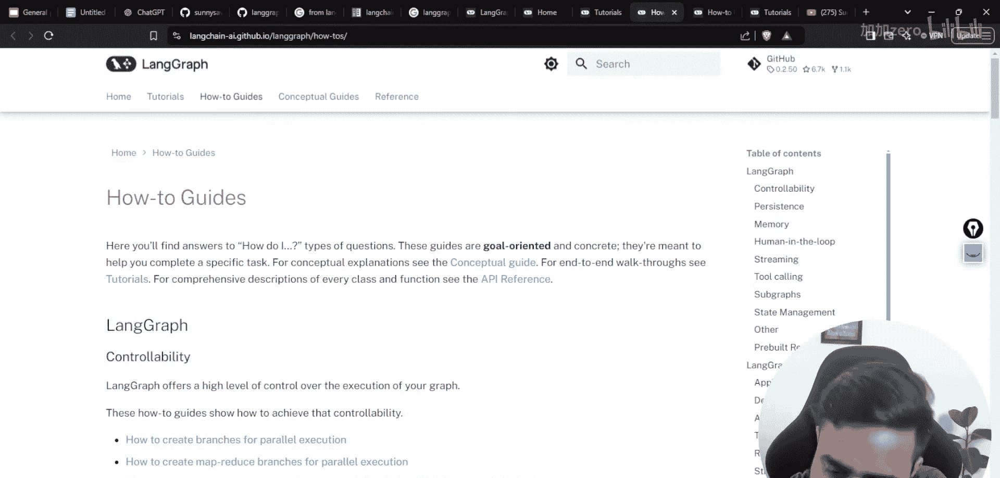
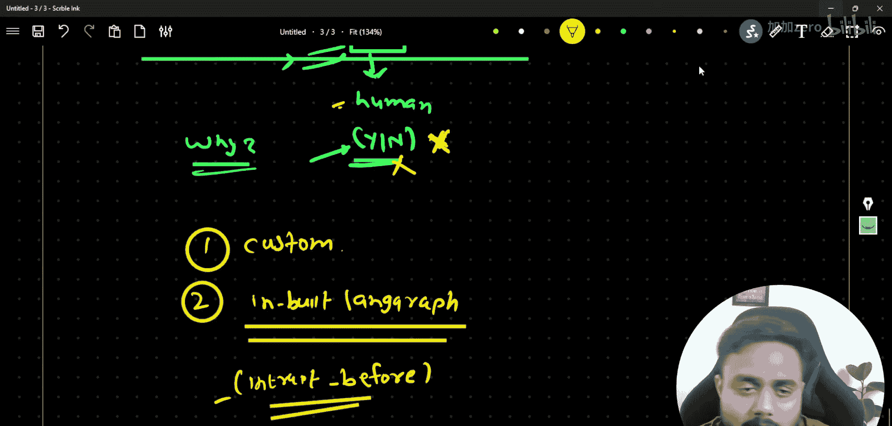
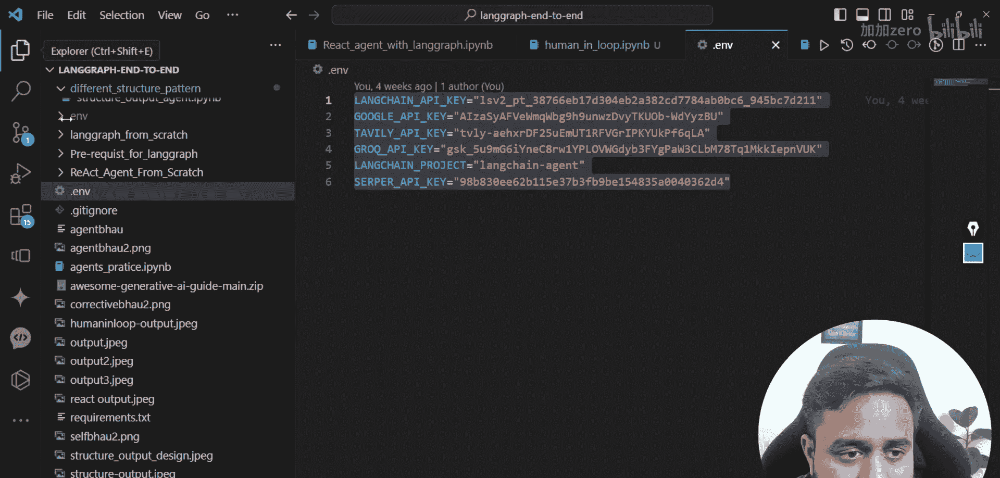

# Sunny Savita【中英⚡生成式AI：从初学者到专家｜Generative AI In-Depth Roadmap from Beginner to E】 p70 P70 LangGraph：12 LangGraph Agent with Human-In-The-Loop, Checkpoints & Breakpoin [BV1Uht8zDENA_p70]

y hellello everyone。 Welcome to my loop channel。 My name is Sunni Savita。

 and I'm back with another exciting and important video。 guys， as you know。

 I started with this end to end La graph course。 and this is 12th video of this end to end course。

 I already uploaded 11 video and inside those video I cover up almost each and everything which is required to understand this la graph。

 Now inside this particular video will try to discuss one more agent pattern。

 one more very important concept related to the lagra that is human in loop。

 willll try to understand the concept of the checkpointing and breakpointing which is directly related to this human in loop。

 And even I will explain you this term like what is the meaning of human ill loop。 Okay， so yeah。

 this is going to be very important concept。 and that's why I kept it inside my sus。

 And after completing this particular topic will move to the rag。 So we'll try。😊。

To create I will try to implement the different different kind of rag like corrective rack self rack agenttic rack adaptive rag and then we'll try to create a lots of projects using the multi agenttic system so I hope you are pretty much excited so first of all let me show you the syllabus so here is a syllabus guys I already completed this first slide and you can go and check with mytu channel and those video will be available inside the pre section inside the first slide I cover up the basics of the la chain and the agent and all now inside the second slide I can the basics of the la graph and even this video is already uploaded if you don't know if if you haven't check please go and check then this is the third slide so I'm going to i'm about to complete this common agent pattern so I already discuss this two pattern structure output and the react agent。

And now we are going to start with this human in loop then after completing this one well try to will try to like understand the rack which I already told you and then multiagetic system and the lots of project I hope this each and everything is skill here Now first of all let me show you my loop channel so here is my do channel guys you can go and check inside the P section youll find out please I think related to each and everything whatever is required to quick start your journey inside the Geneative AI and yes you can start your gene A journey with my do channel and many more thing I'll be uploading inside the future So if you haven't subscribe my channel so far please do it guys or like after watching the video Okay so do one thing first watch the video if you think this video is worth。

I'm adding some value inside your learning inside your life then subscribe the channel otherwise no issue guys because we should not force anyone to do something and this is my rule as well guess yeah it's up to you if you like in the content you can subscribe the channel because yesterday itself I seeing this statistics so。

Around 39% people have subscribed the channel and guys just think 69% people they are just watching the video on a regular basis and they are not even subscribing the channel so yeah it is up to you if you likening the content you can subscribe the channel now coming back to that topic。

And one more thing I would like to tell you so whenever you go you will go through with a language graph of documentation guide so there are so many things you will be able to find out now let me show you first of all so guys this three link is very much important first is this tutorial than how to guide and this conceptual guide。

So almost all the topic basically I took from the documentation itself。

 whatever thing is required to create a successful language graph application I took all the concept from the documentation and you can say my course is a crux of this particular documentation okay now guys here if you will go inside the tutorial you will find out some like other concept also see I am covering this all the use cases Im covering all this rag multiagetic system at all but lets say something basically which I left okay you were saying okay sir you haven't explained this plan and execute no issue I already explain you the react agent。

This react agent， this plan and execution actually is a part of the react agent only you can go and check the you can go and check the like architecture of it then reasoning without observation again its a part of the react agent so guys if you understood the crux easily you can grab this particular concept。

Getting my point so the moral of that story is very simple if you have if you have learned my course if youve gone through with my course easily you can understand any sort of a concept from here well let me go through with the other concept as well so here if you will go and check with this how to guide okay now here is one more concept that is how to create a branch for parallel execution。

This is also very simple if you know how to create a graph。

 if you know if you understand the crux of the graph easily you can grab it。That persistent memory。

 I explain you now。 Now， let's say any advance part is coming inside the memory。

 which I haven't covered。 nobodys。According to the you I given you the quick start I given you the like the way how to do it now you can add on the advanced con top of it according to your requirement。

Getting my point so guys so the moral of the story is very simple if you are going through with my course easily you can do anything from this particular documentation or easily you can build into an application using the lag understood lets start with a topic now so here is the blackboard so first of all let me explain you the concept of this human in loop and then basically will come through the implementation part。

So whenever we talking about this human。勇门。嗯。录。Okay。

 so the name itself is explaining human loop means whatever execution is there。Whatever。Execution。

Is there now inside this particular execution， I will keep the human intervention in between。

Human intervention in between。Okay， I can give you like a very good example as well。

 So let's say here is my node。 So let's say this is my first node。Here is my second note。

Here is my third node。Okay， and here isn't I。Or the note。So guys， let's say。

 at this particular stage。I am interrupting the process。And at this particular stage。

 I am going to take a input from the human why。So I can give you a very good scenario， let's say。

Here I am like inside this particular workflow I added two tools， one tool is a simple tool。

W is free。But lets say the second tool， okay， the complicated tool or the second tool。

Which is paid tool。Okay paid tool for this particular tool we required the money to guys here if we required money。

So what we can do we can we can take a we can take yes or no from the human lets say human means the user is saying yes proceed。

 I don't care about the money， I will proceed over here at this particular stage and I will complete the entire execution with respect to this tool I am saying okay complicated one now let's say human or this a user is saying no I don't want to proceed with this complicated process。

I don't want to like go through with this complicated process or this paid process。

 I will stop the intervention over here， sorry I will stop the execution over here and my execution will be stopped。

Understood guys yes or no。 So human e loop means we are keeping the human intervention in between。

 So how we can we are going to do it。 So there is two way the first way like I will be showing you the custom logic。

 which I have created by myself。And the second is the inbuilt La graph logic。7。Inbu。Langgrave。Logic。

Now inside this in La graph logic， I am going to use one parameter that is interrupt before。Okay。

 interrupt before。I hope so this each and everything is clear and now once I will implement it you will get to know all like very clearly so let's start let's start with a practical here I am going to do the practical inside my inside where inside my。

VS code itself， I already created a file and yes now lets try to write a chord。

So here I imported all the necessary statement and guys this module basically I'll be using throughout this implementation and here I am going to use this Zma model which is from the Google end and it it' is completely free and you can find it out over the Goc API and for reading the model I am using the free Goc API its a open source model so let me execute and let me check whether this thing is working or not so yes I am able to import the statement then here is my LLM then here is my like I am invoking the LLM and yes I am able to get a content from here right。

So guys if you are worrying that how I am loading this particular model without the API key so I already explain you that part if you will go and check with my initial video of this course itself so you will find out that how I define the API keys and all and I already import。

